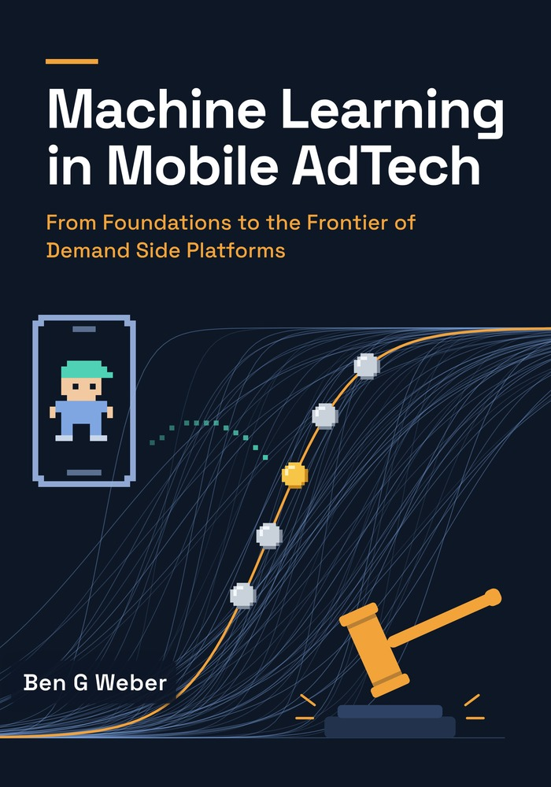
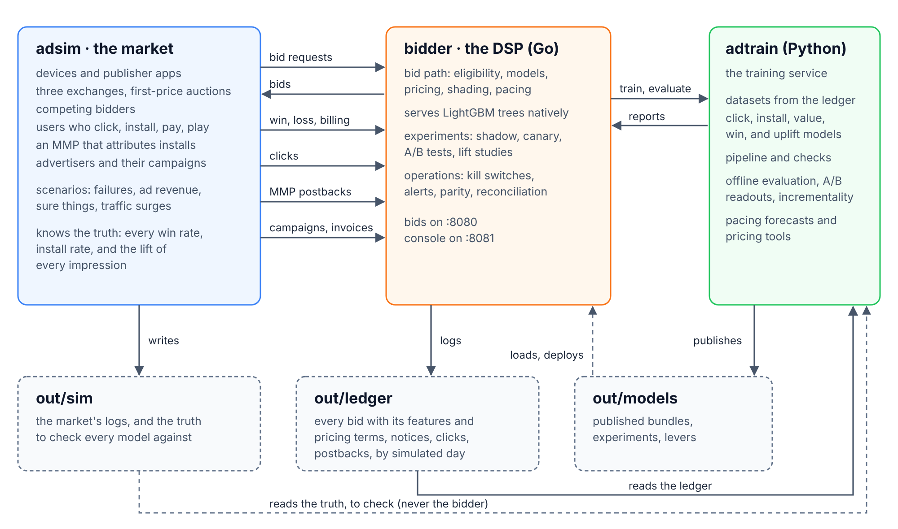
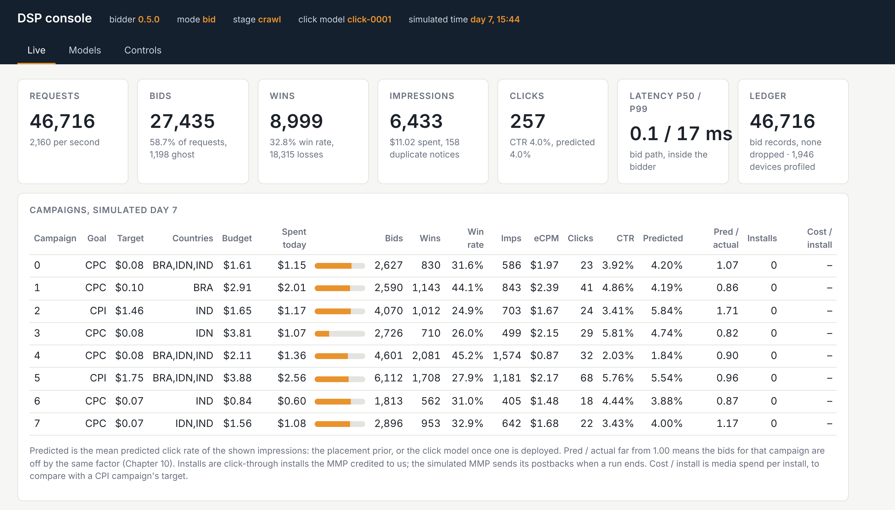
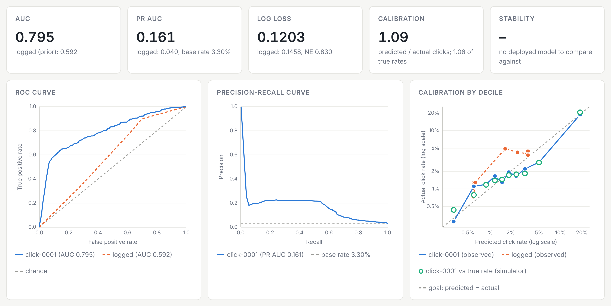
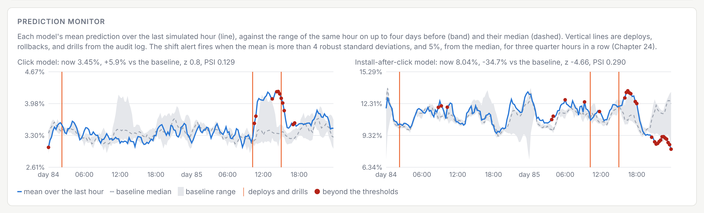

# Machine Learning in Mobile AdTech

<p align="center">
  
</p>

Source for the book *Machine Learning in Mobile AdTech* and its companion
code: a simulated mobile ad market, a Go bidder that trades in it, and the
Python pipelines that train, validate, and publish its models.

**Read it:** [free online edition](https://bgweber.github.io/AdtechBook/) ·
[free EPUB](https://github.com/bgweber/AdtechBook/releases/latest) ·
paperback coming soon

The EPUB's equations need a reader with math (MathML) support, such as Apple
Books, Thorium Reader, or Calibre. Kindle doesn't support it and shows the
equations garbled, so on Kindle, read the chapters with equations online.

> **Run the simulator:** start a simulated ad market, a Go bidder, and its console with one command,
> then follow the book chapter by chapter. The **[walkthrough](WALKTHROUGH.md)** has the commands for
> the exercises in Parts II and III and screenshots of what you'll see. The commands are for Linux and
> macOS; on Windows, use WSL 2 or the [PowerShell versions](WALKTHROUGH-windows.md).
>
> ```bash
> docker compose up --build    # then open http://localhost:8081
> ```

## A simulated market to work in

The heart of this repo is a simulated mobile ad market. You run a real bidder against it, train models on what the bidder logged, and check every model against the truth, which only a simulator knows. The market includes:

- **Users and their devices**, each with a country, a phone model, how much they play, tastes for game genres, and the apps already installed. They click, install, keep playing, buy, and earn ad revenue.
- **Publisher apps**: the supply, with their ad placements, ad density, price floors, and popularity.
- **Three ad exchanges** with their own quirks, running first-price auctions, sending win, loss, and billing notices, reporting the minimum bid to win, and sending invoices.
- **Competing bidders**, who set the price to beat in each auction, with a shared component, which is what makes the winner's curse.
- **A measurement partner (MMP)** that attributes installs by last touch, with click and view windows, and sends postbacks with delays, losses, and duplicates.
- **Other ad networks** that touch the same devices, so some installs our ads drove are credited elsewhere.
- **Organic installs**, which happen with no ad at all, including people who play so many games that they would have found the app without our ad.
- **Advertisers** with campaigns, budgets, targets, and creatives, some of whom share their full install data.
- **Fraud**: bot devices and fraudulent publisher apps.
- **Traffic patterns**: daily cycles by time zone, and scenarios for failures, bad labels, hypercasual ad revenue, and traffic surges.
- **The ground truth**: the true probability behind every click, install, and win, and the lift of every impression, so every model, forecast, and A/B test can be checked against what really happened.

<p align="center">
  
  <br><em>The simulated market, the bidder, and the training service, with the events between them and the files each one writes and reads.</em>
</p>

Everything the market does shows up on the bidder's console, as it would in a real DSP:

<p align="center">
  
  <br><em>The bidder's live console: requests, bids, wins, and spend for every campaign in the simulated market (Chapter 5).</em>
</p>

<p align="center">
  
  <br><em>Evaluating a click model: ROC and precision-recall curves, and calibration checked against the simulator's true rates (Chapter 9).</em>
</p>

<p align="center">
  
  <br><em>Monitoring models in production: hourly mean predictions against their baselines, with deploys and alerts marked (Chapter 24).</em>
</p>

## The companion code

The book comes with a simulated mobile ad market, **adsim**, and the code
that bids into it and learns from it. The simulator knows the truth: next to
the logs a DSP would see, it writes the true click, install, and lift
probabilities behind every impression, so you can check a model against
what really happened, not just against noisy outcomes.

What exists today and what's planned:

| Component | Status |
|---|---|
| `code/sim/`: adsim 0.3, the simulated market | **Works.** Crawl, walk, and run markets; OpenRTB requests with exchange quirks; first-price auctions with a winner's curse; clicks, installs, organic installs, MMP attribution, delayed postbacks, purchases, and non-attributed data; holdouts; truth tables. Runs offline with a Python policy, or live against a real bidder: OpenRTB over HTTP in simulated time, `tmax` enforced, notice URLs called, postbacks delivered, and failure scenarios for the incident chapters. See [`code/sim/README.md`](code/sim/README.md) |
| `code/dsp/`: bidder 0.14, the Go reference DSP | **Parts II and III complete: the crawl and walk stages.** Parsing and normalization of each exchange's quirks, device profiles, eligibility and selection, the bid ledger with FeatureVectors, notices, holdouts, kill switches, a fallback ladder, alerts, and reconciliation. Then LightGBM click, install, and win models served natively in Go with parity checks before every deploy, bid shading, pricing for CPC, CPI, ROAS, and CPA goals, pacing, shadow mode, canaries and A/B tests, incrementality measurement, per-stage latency and a load generator, a prediction monitor with incident drills and playbooks, and a live console. See [`code/dsp/README.md`](code/dsp/README.md) |
| `code/training/`: adtrain 0.8, training, validation, publishing | **Parts II and III complete.** Datasets from the bidder's ledger with automated checks, an FTRL click model with hashed tokens and crosses, LightGBM conversion and win models, out-of-time validation and readouts, publishing with golden examples, lift and pacing analysis, label quarantine, train/serve parity jobs, and ONNX export for the serving comparison. See [`code/training/README.md`](code/training/README.md) |
| `compose.yaml`: Docker Compose | **Works.** The bidder, the training service, and the simulator, plus a `loadtest` profile for the load generator. Infrastructure services are planned |

Parts II and III run end to end: the **[walkthrough](WALKTHROUGH.md)** has
every command. Part IV is in progress. Each chapter's "Try it on the
simulator" box says whether its exercise runs on adsim 0.3 today or what it
still needs.

Quick start, no Docker needed:

```bash
pip install -e code/sim[test]
python -m adsim --preset crawl --scale laptop --days 1 --seed 7 --out out/crawl
pytest code/sim
```

See [`code/sim/README.md`](code/sim/README.md) for the tables it writes and
how the market works.

Watch the Go bidder trade in the simulated market, with Docker:

```bash
docker compose up --build
```

Then open the console at <http://localhost:8081>. The simulator plays two
days and stops. Open the **Models** tab and click **Train**: the training
service builds click examples from the bidder's logs, trains a click
model, validates it, and the bidder deploys it if it passes its checks.
Then play more days with the model pricing the bids:

```bash
docker compose run --rm sim
```

Each run continues the market where the bidder's ledger left off, so the
model sees new days, never a replay. To start over, stop everything and
delete the `out` folder.

This needs a current
Docker with Compose v2, the `docker compose` command (Docker Desktop
includes it). If you get `unknown flag: --build` or `'compose' is not a
docker command`, your Docker is too old: update Docker Desktop. Without
Docker, see [`code/dsp/README.md`](code/dsp/README.md).

## Toward a full simulator

adsim 0.3 already runs a live market for a real bidder: it sends OpenRTB
bid requests over HTTP in simulated time, enforces each exchange's
timeout so a slow bidder loses auctions, calls the win, loss, and billing
notice URLs, delivers MMP postbacks, and injects failures for the incident
chapters (a campaign target entered 100 times too high, lost billing
notices, and bad attribution labels). The bidder
also has the listen-only mode the "watch before you bid" chapter uses.
Still planned, roughly in this order:

**Devices that change during the run (adsim 0.4)**

- Installs change what a device plays, tastes drift, sessions have a
  rhythm, and ads cause fatigue. This is what gives sequence models and
  transformers real signal to learn, and the truth tables record how much
  lift that signal is worth.

**A market that fights back (adsim 0.5)**

- Competing bidders that learn and adapt their shading.
- Market shifts: seasonality, holiday CPM spikes, a big buyer entering or
  leaving, traffic surges.
- More fault injection for incident labs: exchange outages, postback
  delays, duplicate floods, schema changes, clock skew.

**The rest of the mobile ecosystem (adsim 0.6)**

- iOS and ATT: devices without an IFA, SKAdNetwork-style postbacks with
  coarse values and delays, contextual-only signals.
- Creative content features, for creative selection models.
- Click injection and click spamming fraud.

**Throughout**

- A scoreboard: fixed seeds and markets, with policies scored on ROAS,
  incremental installs, and pacing error against the simulator's truth.
  Write a `decide()` function and see whether you can beat the baseline.
- Speed, so the `medium` and `large` scales run in reasonable time.

## Docker

The simulator, the bidder, and the training service already run with
Docker Compose (`compose.yaml`), and the load generator runs with
`--profile loadtest`. As the book grows, more services will join them,
grouped into Compose profiles so you start only what a chapter needs.
Planned profiles:

| Profile | Services |
|---|---|
| `core` | The simulator, the Go bidder |
| `ml` | Training and validation pipelines, experiment tracking, a model registry |
| `streaming` | An event stream and online feature store, for real-time learning |
| `gpu` | Deep model training and serving on an NVIDIA GPU |

The simulator alone keeps working without Docker (the quick start
above), and so will rendering the book.

### GPU training

Part IV trains deep models: multi-task networks, embeddings, and
transformers over device histories. The training code uses PyTorch, fits in
4 GB of GPU memory, and falls back to CPU at smaller scales. The `gpu`
profile needs an NVIDIA GPU and the NVIDIA Container Toolkit, on Linux or on
Windows with WSL 2. Docker on macOS can't use the GPU, so Macs run the CPU
fallback.

## Contributing

The book and the code are open source, and contributions are welcome. Good
places to start are the planned exercises and simulator features above: each
one says what it needs. Open an issue to discuss a change before a large
pull request. See [CONTRIBUTING.md](CONTRIBUTING.md).

## License

- **Text and figures:** [CC BY-NC-SA 4.0](LICENSE). You can share and adapt
  them for non-commercial purposes, with credit, under the same license. The
  cover and the author photo are not covered by this license.
- **Code:** [MIT](LICENSE-CODE). This covers `code/`, `scripts/`, `filters/`,
  the build configuration, and the code samples in the book, so you can use
  them in your own projects, including commercial ones.

## Repository layout

```
_quarto.yml                 Book config: chapters, HTML/PDF/EPUB formats
index.qmd, preface.qmd      Welcome page and preface
parts/, chapters/           Part pages and one .qmd file per chapter
appendices/                 Glossary, OpenRTB fields, templates, reading, the simulated world
code/sim/                   Python: adsim, the simulated market
code/dsp/                   Go: the reference bidder and its console
code/training/              Python: training, validation, publishing (adtrain)
compose.yaml                Docker Compose: the bidder, the trainer, and the simulator
images/                     Figures, the ebook cover (cover.jpg, added to the EPUB by
                            scripts/polish_epub.py), and the README cover (cover-front.jpg)
styles/preamble.tex         Print styling: headers, code boxes, copyright page
styles/epub.css             Ebook styling
scripts/polish_epub.py      Makes the EPUB a native ebook (runs after each render)
_freeze/                    Saved code output (committed; see below)
requirements.txt            Python packages CI needs to render
LICENSE, LICENSE-CODE       CC BY-NC-SA 4.0 for text and figures; MIT for code
CONTRIBUTING.md             How to contribute, and how contributions are licensed
.github/workflows/          Book build/publish and code test workflows
```

## Tests

The `Tests` workflow runs on every push and pull request: `pytest code` for
the Python code, and `go vet` and `go test ./...` in `code/dsp/`. To run
them locally:

```bash
pip install -e code/sim[test] -e code/training[test]
pytest code
cd code/dsp && go test ./...
```

The Go tests include a parity test against a model the Python code
trained (`code/dsp/internal/model/testdata`, made with
`python -m adtrain.fixture`), so training and serving can't drift apart
without a test failing.

## Setup

1. Install [Quarto](https://quarto.org/docs/get-started/).
2. Install Python 3.12 and the packages: `pip install -r requirements.txt`.
3. For the PDF, install a TeX distribution: `quarto install tinytex`.

## Local preview and builds

Live preview of the web edition (reloads on save):

```bash
quarto preview
```

Build every edition into `_book/`:

```bash
quarto render
```

Build one edition:

```bash
quarto render --to pdf
```

## Code execution and GPU chapters

Code cells run when a chapter renders. `execute: freeze: auto` saves the
results in `_freeze/`, and CI reuses them instead of running the code again.
CI has no GPU, so for any chapter with GPU code:

1. Render it locally on a machine with an NVIDIA GPU:
   `quarto render chapters/NN-name.qmd`
2. Commit the updated `_freeze/` folder along with the chapter.

## Publishing

One set of [Quarto](https://quarto.org) files builds three editions:

| Edition | Output | When it builds |
|---|---|---|
| Free web edition | HTML on GitHub Pages | Every push to `main` |
| Paperback | KDP 7" x 10" black-and-white interior PDF | Version tags (`v*`) or a manual run |
| Free ebook | Reflowable EPUB 3, a free download from each GitHub release | Version tags (`v*`) or a manual run |

**Web edition.** Enable GitHub Pages once: *Settings > Pages > Source:
GitHub Actions*. After that, every push to `main` deploys the site.

**Paperback and free ebook.** Tag a release:

```bash
git tag v1.0.0
```

```bash
git push origin v1.0.0
```

The workflow attaches the PDF and EPUB to the GitHub release for that tag.
Upload the PDF as the KDP paperback interior. The EPUB is not sold on
KDP: it stays on the GitHub release as a free download, which the web
edition links to. Kindle shows its equations garbled (no MathML support),
so the README and the home page point Kindle readers to the web edition.
The EPUB's cover is added by `scripts/polish_epub.py`, not Quarto's
`epub-cover-image`, whose SVG cover page made Kindle Previewer's conversion
fail. You can also run the workflow manually from the
*Actions* tab and download the files from the run's artifacts.

## Releases

- `main` is the online book. It changes whenever a chapter or the code changes.
- A git tag (`v1.0.0`, `v1.1.0`, ...) marks each print edition and its free EPUB.
  Readers of a printed copy can check out that tag to get the text and code
  that match their book.
- Each tag's release notes record the simulator version it was built and
  tested with (for example, `adsim 0.1`), and which "Try it on the
  simulator" exercises are runnable at that tag.
- Print comes first. Lock the PDF with a KDP proof copy before building the
  EPUB: during print work, build only the PDF and web editions
  (`quarto render --to pdf`, `quarto preview`). Then build the EPUB once
  (`quarto render --to epub`), open it in Kindle Previewer, and check tables,
  equations, figures, and long code lines. Kindle Previewer's conversion is
  CPU-heavy for this book, so don't rebuild the EPUB for every change.

## Before the print release

- Once the paperback is live on Amazon, add its product page link back in
  four places: the "Read it" line at the top of this README, the "Read it
  free" box in `index.qmd`, and the sidebar and footer in
  `_quarto.yml`. Until then they say the paperback is coming soon.
