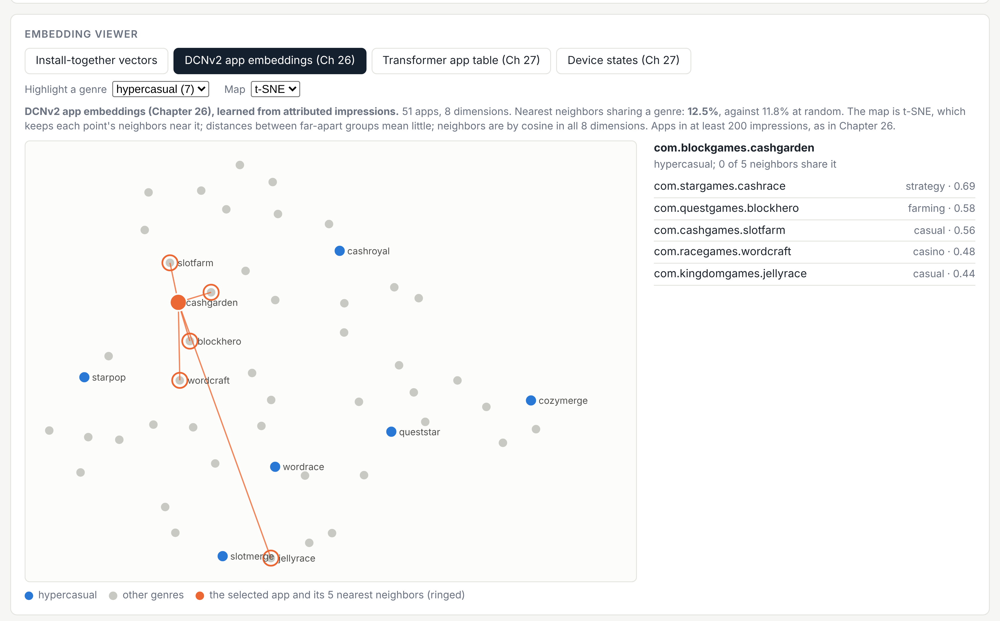

# Machine Learning in Mobile AdTech

<p align="center">
  
</p>

Source for the book *Machine Learning in Mobile AdTech* and its companion
code: a simulated mobile ad market, a Go bidder that trades in it, and the
Python pipelines that train, validate, and publish its models.

**Read it:** [free online edition](https://bgweber.github.io/AdtechBook/) ·
[free EPUB](https://github.com/bgweber/AdtechBook/releases/latest) ·
[paperback on Amazon](https://www.amazon.com/dp/B0HSX91M9W)

The EPUB's equations need a reader with math (MathML) support, such as Apple
Books, Thorium Reader, or Calibre. Kindle doesn't support it and shows the
equations garbled, so on Kindle, read the chapters with equations online.

**Run the simulator:** start a simulated ad market, a Go bidder, and its console with one command,
then follow the book chapter by chapter. The **[walkthrough](WALKTHROUGH.md)** has the commands for
the exercises in Parts II to IV and screenshots of what you'll see. The commands are for Linux and
macOS; on Windows, use WSL 2 or the [PowerShell versions](WALKTHROUGH-windows.md).

```bash
docker compose up --build    # then open http://localhost:8081
```

**We encourage you to work through the examples with an AI coding agent,** such as Claude Code,
Codex, or Cursor, open in this repo. It can give you each chapter's commands for your machine,
check your output against the book, and help when a step fails. [AGENTS.md](AGENTS.md) tells
it how; the walkthrough stays the reference for people.

## A simulated market to work in

The heart of this repo is a simulated mobile ad market. You run a real bidder against it, train models on what the bidder logged, and check every model against the truth, which only a simulator knows. The market includes:

- **Users and their devices**, each with a country, a phone model, how much they play, tastes for game genres, and the apps already installed. They click, install, keep playing, buy, and earn ad revenue.
- **Publisher apps**: the supply, with their ad placements, ad density, price floors, and popularity.
- **Three ad exchanges** with their own quirks, running first-price auctions, sending win, loss, and billing notices, reporting the minimum bid to win, and sending invoices.
- **Competing bidders**, who set the price to beat in each auction, with a shared component, which is what makes the winner's curse.
- **A measurement partner (MMP)** that attributes installs by last touch, with click and view windows, and sends postbacks with delays, losses, and duplicates.
- **Other ad networks** that touch the same devices, so some installs our ads drove are credited elsewhere.
- **Organic installs**, which happen with no ad at all, including people who play so many games that they would have found the app without our ad.
- **Advertisers** with campaigns, budgets, targets, and creatives, some of whom share their full install data.
- **Fraud**: bot devices and fraudulent publisher apps.
- **Traffic patterns**: daily cycles by time zone, and scenarios for failures, bad labels, hypercasual ad revenue, traffic surges, and a market shift.
- **The ground truth**: the true probability behind every click, install, and win, and the lift of every impression, so every model, forecast, and A/B test can be checked against what really happened.

<p align="center">
  
  <br><em>The simulated market, the bidder, and the training service, with the events between them and the files each one writes and reads.</em>
</p>

Everything the market does shows up on the bidder's console, as it would in a real DSP:

<p align="center">
  
  <br><em>The bidder's live console: requests, bids, wins, and spend for every campaign in the simulated market (Chapter 5).</em>
</p>

<p align="center">
  
  <br><em>Evaluating a click model: ROC and precision-recall curves, and calibration checked against the simulator's true rates (Chapter 9).</em>
</p>

<p align="center">
  
  <br><em>Monitoring models in production: hourly mean predictions against their baselines, with deploys and alerts marked (Chapter 24).</em>
</p>

<p align="center">
  
  <br><em>The embedding viewer: the deep model's app embeddings, with one genre highlighted and an app's nearest neighbors ringed. On this small market, they haven't learned genres (Chapter 26).</em>
</p>

## The companion code

The book comes with a simulated mobile ad market, **adsim**, and the code
that bids into it and learns from it. The simulator knows the truth: next to
the logs a DSP would see, it writes the true click, install, and lift
probabilities behind every impression, so you can check a model against
what really happened, not just against noisy outcomes.

| Component | What it is |
|---|---|
| `code/sim/`: adsim 0.9, the simulated market | Crawl, walk, and run markets; OpenRTB requests with exchange quirks; first-price auctions with a winner's curse; clicks, installs, organic installs, MMP attribution, delayed postbacks, purchases, ad revenue, and non-attributed data; holdouts; truth tables. Runs offline with a Python policy, or live against a real bidder: OpenRTB over HTTP in simulated time, `tmax` enforced, notice URLs called, postbacks delivered. Scenarios for failures, bad labels, Ad ROAS, uplift, traffic surges, and a market shift, and true rates for every creative. See [`code/sim/README.md`](code/sim/README.md) |
| `code/dsp/`: bidder 0.23, the Go reference DSP | Parsing and normalization of each exchange's quirks, device profiles, eligibility and selection, the bid ledger with FeatureVectors, notices, holdouts, kill switches, a fallback ladder, alerts, and reconciliation. LightGBM click, install, and win models served natively in Go with parity checks before every deploy; bid shading; pricing for CPC, CPI, ROAS, Ad ROAS, and CPA goals with win curves, uplift, and one pricing equation; pacing; shadow mode, canaries, and A/B tests; incrementality; a prediction monitor with drills and playbooks; a DCNv2 served in pure Go; and a live console with a Deep models tab. See [`code/dsp/README.md`](code/dsp/README.md) |
| `code/training/`: adtrain 0.20, training, validation, publishing | Datasets from the bidder's ledger with automated checks, an FTRL click model, LightGBM conversion, value, win, and uplift models, out-of-time validation and readouts, publishing with golden examples, lift and pacing analysis, label quarantine, and train/serve parity. For Part IV: trees against a DCNv2, pretraining a transformer, exporting for Go serving, retraining through a market shift, learned campaign selection, and personalized creative selection, all on a laptop's CPU. See [`code/training/README.md`](code/training/README.md) |
| `code/onnxbench/` | Chapter 17's comparison of ONNX Runtime from Go with the bidder's own tree evaluator. Not part of `docker compose` |
| `compose.yaml`: Docker Compose | The bidder, the training service, and the simulator, plus a `loadtest` profile for the load generator |

Every exercise in Parts II, III, and IV runs, through Chapter 36: the
**[walkthrough](WALKTHROUGH.md)** has every command, and
[AGENTS.md](AGENTS.md) helps an AI coding agent guide you through them. Each
chapter's "Try it on the simulator" box ends with the versions it was tested
with.

Quick start, no Docker needed:

```bash
pip install -e code/sim[test]
python -m adsim --preset crawl --scale laptop --days 1 --seed 7 --out out/crawl
pytest code/sim
```

See [`code/sim/README.md`](code/sim/README.md) for the tables it writes and
how the market works.

Watch the Go bidder trade in the simulated market, with Docker:

```bash
docker compose up --build
```

Then open the console at <http://localhost:8081>. The simulator plays two
days and stops. Open the **Models** tab and click **Train**: the training
service builds click examples from the bidder's logs, trains a click
model, validates it, and the bidder deploys it if it passes its checks.
Then play more days with the model pricing the bids:

```bash
docker compose run --rm sim
```

Each run continues the market where the bidder's ledger left off, so the
model sees new days, never a replay. To start over, stop everything and
delete the `out` folder.

This needs a current
Docker with Compose v2, the `docker compose` command (Docker Desktop
includes it). If you get `unknown flag: --build` or `'compose' is not a
docker command`, your Docker is too old: update Docker Desktop. Without
Docker, see [`code/dsp/README.md`](code/dsp/README.md).

## What the simulator leaves out

adsim runs a live market for a real bidder, with the scenarios each
chapter needs; Appendix E of the book documents its equations and
versions. It still leaves out:

- iOS and ATT: devices without an IFA, SKAdNetwork postbacks with coarse
  values and delays, and contextual-only signals.
- Click injection and click spamming fraud, beyond the 10-second rejection
  rule.
- Devices that change during a run: installs don't change which apps a
  device plays, and its fatigue only builds within a day.
- Competing bidders that learn and adapt their shading.
- A scoreboard: fixed markets where policies are scored against the
  simulator's truth.
- Speed: the built-in policy loops in Python, so the `medium` and `large`
  scales are slow.

## Docker

The simulator, the bidder, and the training service run with Docker
Compose (`compose.yaml`), and the load generator runs with
`--profile loadtest`. The simulator alone also runs without Docker (the
quick start above), and so does rendering the book.

### Deep models on the CPU

Part IV's deep models (Chapters 25 to 29, 35, and 36) are PyTorch, built for a laptop's
CPU: the training image installs the CPU build, and each chapter's command
runs in a few minutes on the Part IV dataset. The code doesn't use a GPU.
To scale up, with bigger datasets, wider models, and longer histories,
install the CUDA build of PyTorch and move the models and their inputs to
the GPU: the book provides the code, not the compute.

## Contributing

The book is openly licensed and the code is open source, and contributions are welcome. Good
places to start are the simulator features it leaves out, listed above. Open an issue to discuss a change before a large
pull request. See [CONTRIBUTING.md](CONTRIBUTING.md).

## License

- **Text and figures:** [CC BY-NC-SA 4.0](LICENSE). You can share and adapt
  them for non-commercial purposes, with credit, under the same license. The
  cover and the author photo are not covered by this license.
- **Code:** [MIT](LICENSE-CODE). This covers `code/`, `scripts/`, `filters/`,
  the build configuration, and the code samples in the book, so you can use
  them in your own projects, including commercial ones.

## Repository layout

```
_quarto.yml                 Book config: chapters, HTML/PDF/EPUB formats
index.qmd, preface.qmd      Welcome page and preface
parts/, chapters/           Part pages and one .qmd file per chapter
appendices/                 Glossary, OpenRTB fields, templates, reading, the simulated world
code/sim/                   Python: adsim, the simulated market
code/dsp/                   Go: the reference bidder and its console
code/training/              Python: training, validation, publishing (adtrain)
code/onnxbench/             Go: Chapter 17's ONNX Runtime comparison
compose.yaml                Docker Compose: the bidder, the trainer, and the simulator
WALKTHROUGH.md              Every exercise's commands (WALKTHROUGH-windows.md for PowerShell)
AGENTS.md                   Guidance for AI coding agents working through the exercises
images/                     Figures, the ebook cover (cover.jpg, added to the EPUB by
                            scripts/polish_epub.py), and the README cover (cover-front.jpg)
styles/preamble.tex         Print styling: headers, code boxes, copyright page
styles/epub.css             Ebook styling
scripts/polish_epub.py      Makes the EPUB a native ebook (runs after each render)
_freeze/                    Saved code output (committed; see below)
requirements.txt            Python packages CI needs to render
LICENSE, LICENSE-CODE       CC BY-NC-SA 4.0 for text and figures; MIT for code
CONTRIBUTING.md             How to contribute, and how contributions are licensed
.github/workflows/          Book build/publish and code test workflows
```

## Tests

The `Tests` workflow runs on every push and pull request: `pytest code` for
the Python code, and `go vet` and `go test ./...` in `code/dsp/`. To run
them locally:

```bash
pip install -e code/sim[test] -e code/training[test]
pytest code
cd code/dsp && go test ./...
```

The Go tests include a parity test against a model the Python code
trained (`code/dsp/internal/model/testdata`, made with
`python -m adtrain.fixture`), so training and serving can't drift apart
without a test failing.

## Setup

1. Install [Quarto](https://quarto.org/docs/get-started/).
2. Install Python 3.12 and the packages: `pip install -r requirements.txt`.
3. For the PDF, install a TeX distribution: `quarto install tinytex`.

## Local preview and builds

Live preview of the web edition (reloads on save):

```bash
quarto preview
```

Build every edition into `_book/`:

```bash
quarto render
```

Build one edition:

```bash
quarto render --to pdf
```

## Code execution

The chapters have no code cells that run when the book renders: the
companion code runs on its own, with the commands in `WALKTHROUGH.md`.
`execute: freeze: auto` in `_quarto.yml` is there for any that are added
later; it saves their results in `_freeze/`, and CI reuses them.
