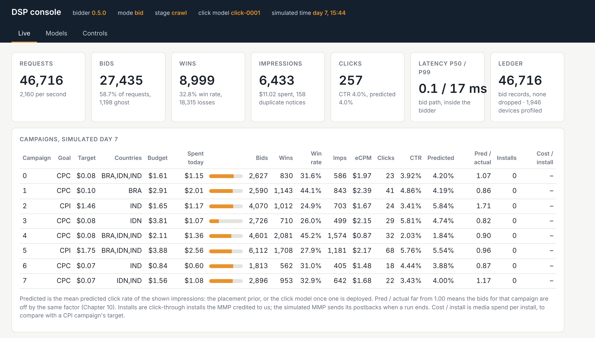
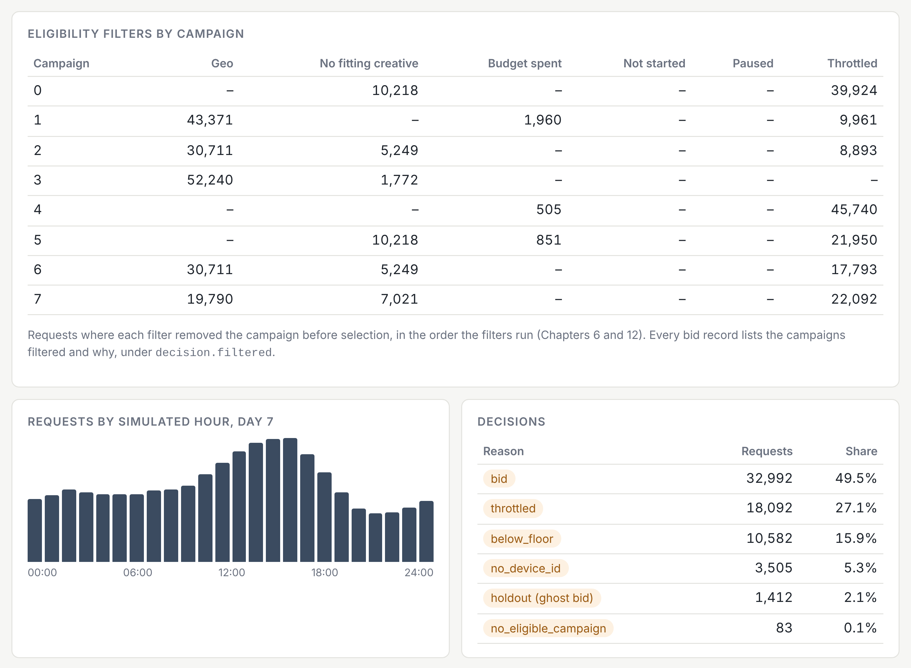
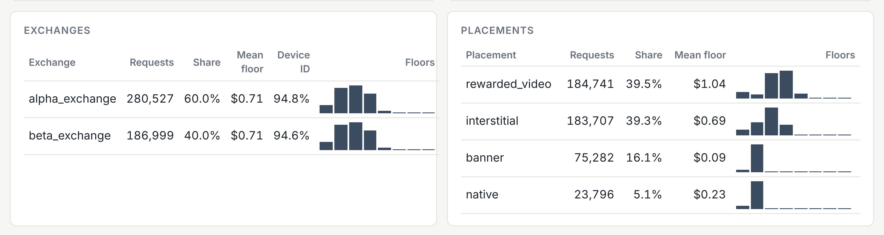
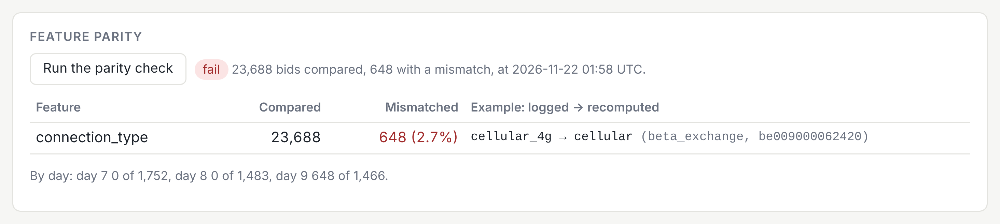
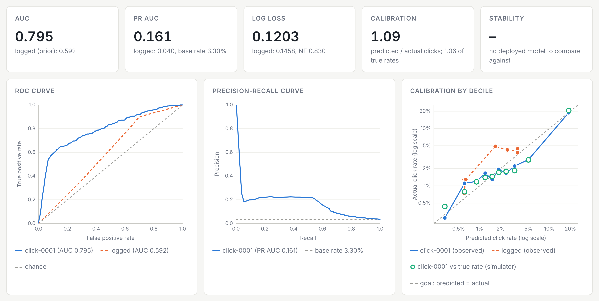
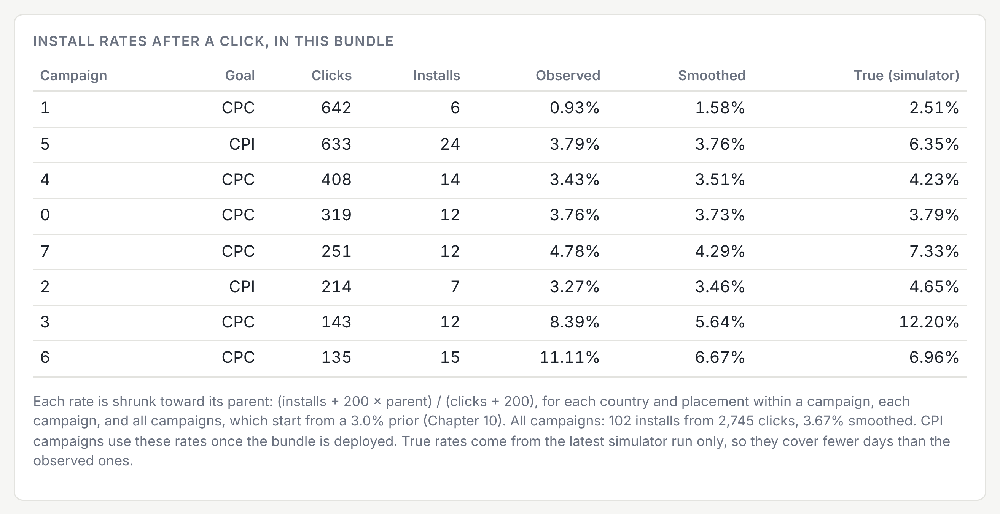
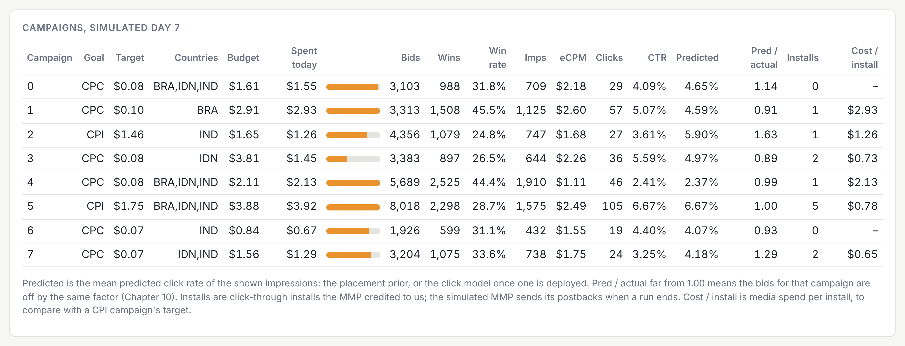
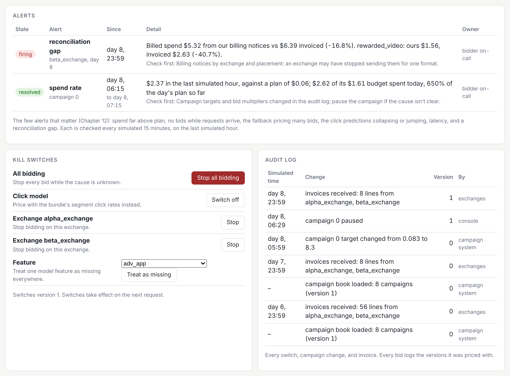
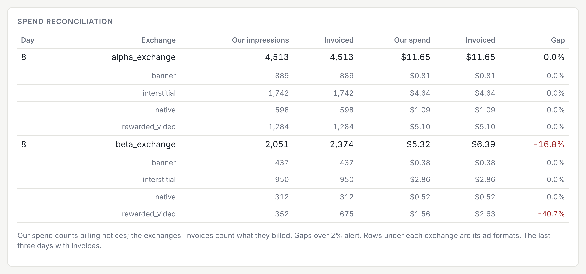

# Run the Simulator: A Chapter-by-Chapter Walkthrough

Part II of the book builds a working demand-side platform (DSP): a Go bidder that buys ads on a simulated mobile ad market, a training pipeline that learns a click model from the bidder's own logs, and a web console to watch it all. This page gives the commands for each chapter's "Try it on the simulator" box, and shows what you should see.

You need [Docker](https://docs.docker.com/get-docker/) with Compose v2 (`docker compose version` should work). Nothing else: the simulator, the bidder, and the training code all run in containers.

Your numbers won't match the screenshots exactly. The simulator is seeded, but how far your run has got, and what you've clicked on the console, changes what you see. The shapes and the stories should match.

## Before you start

**Setting options.** Runs are configured with environment variables. In bash or zsh, put them before the command:

```bash
ADSIM_DAYS=7 docker compose up --build
```

In PowerShell, set them first, and clear them when you're done:

```powershell
$env:ADSIM_DAYS=7; docker compose up --build
Remove-Item Env:ADSIM_DAYS
```

| Variable | Default | What it does |
|---|---|---|
| `ADSIM_DAYS` | `2` | Simulated days to play in each run |
| `ADSIM_SEED` | `7` | The simulator's random seed |
| `ADSIM_SCALE` | `tiny` | Traffic volume: `tiny` or `laptop` |
| `ADSIM_SCENARIO` | (none) | Break something on purpose: `wrong-target`, `lost-billing` (Chapter 12) |
| `BIDDER_MODE` | `bid` | `listen` to log requests without bidding (Chapter 7) |
| `BIDDER_BID_SHARE` | `1` | Share of requests to bid on (Chapter 7) |
| `BIDDER_SKEW` | (none) | Normalize one feature wrongly: `bundle` or `conn` (Chapter 8) |

**Where things land.** Everything goes in `./out`: the bidder's ledger in `out/ledger`, models in `out/models`, and the simulator's logs and ground truth in `out/sim`.

**Continuing and starting over.** Each run picks up the market where the last one stopped, so you can keep playing days with whatever model is deployed:

```bash
docker compose run --rm sim
```

To start over, stop everything and delete `./out`:

```bash
docker compose down
rm -rf out            # PowerShell: Remove-Item -Recurse -Force out
```

**Looking inside the logs.** While the containers are running, the training container has two commands for the ledger. `find` lists a few request IDs that match a filter, and `trace` follows one request from its bid to its training label:

```bash
docker compose exec trainer python -m adtrain find --ledger /out/ledger --clicked
docker compose exec trainer python -m adtrain trace <request_id> --ledger /out/ledger
```

`find` takes `--day`, `--goal cpc|cpi`, `--reason` (a no-bid reason, such as `below_floor`), `--explored`, `--clicked`, and `--limit`.

## Chapter 5: Starting from Scratch

Start the market, the bidder, the training service, and the console:

```bash
docker compose up --build
```

The simulator plays two days of auctions against the bidder and exits. The bidder and the training service keep running. Open the console at <http://localhost:8081>. The Live tab shows spend against budget for each campaign, wins, impressions, clicks, and the bidder's predicted click rate against the actual one.



Now trace one request from its bid to its click:

```bash
docker compose exec trainer python -m adtrain find --ledger /out/ledger --clicked --limit 3
docker compose exec trainer python -m adtrain trace <request_id> --ledger /out/ledger
```

You should see the decision, the FeatureVector, the win and billing notices, the click, and the training row it becomes:

```text
request al007000001284 on alpha_exchange, day 7, policy crawl-prior-v1
  decision: bid, campaign 4, creative 12, p_click 0.0060 from prior, bid $0.2789 CPM
  pricing: advertiser value $0.4980, media value $0.3984, explore x1.000
  FeatureVector: 9 strings, 10 numerics, 1 sets; ad {...}
  notice: win at 611202437, price 0.2789
  notice: billing at 611300123, price 0.2789
  click: cal007000001284 at 611311196
```

The simulator's ground truth, with the true click probability behind every impression, is in `out/sim/truth`.

## Chapter 6: Parsing Bid Requests and Eligibility

Use the same run. On the console's Live tab, scroll to the eligibility filters: for each campaign, how many requests each filter removed it from, and below that, what happened to every request.



A campaign that targets one country is removed by the geo filter from most requests, and a campaign with only video creatives can't fill banners. To see no-bids of one kind, list them and trace one:

```bash
docker compose exec trainer python -m adtrain find --ledger /out/ledger --reason no_device_id
docker compose exec trainer python -m adtrain find --ledger /out/ledger --reason below_floor
```

The simulator marks invalid traffic in `out/sim/truth/devices.parquet` (the `is_bot` column), for comparing its click rates with everyone else's.

## Chapter 7: Listening Before Bidding

Start over and run the bidder in listen-only mode. It runs the whole bid path and logs every request, but never bids:

```bash
docker compose down; rm -rf out
BIDDER_MODE=listen ADSIM_DAYS=7 docker compose up --build
```

The console's traffic tables show volume and floors by exchange and placement, with a histogram of floors for each row.



Then bid on 1% of requests, and check the first wins, impressions, and clicks on the Live tab:

```bash
docker compose down
BIDDER_BID_SHARE=0.01 docker compose up --build
```

## Chapter 8: Logging at Bid Time

Trace a request, as in Chapter 5, and look at each stream it touches. Then make the bidder log one feature wrongly, and watch the parity check catch it. Restart the bidder with a skew, play one more day, and run the check:

```bash
docker compose down
BIDDER_SKEW=conn ADSIM_DAYS=1 docker compose up --build
```

On the console's Models tab, run the feature parity check. It rebuilds the FeatureVector for the 5% of bids whose raw context was logged, with a second implementation in Python, and compares them field by field.



The same check runs from the command line:

```bash
docker compose exec trainer python -m adtrain parity --ledger /out/ledger
```

Restart without `BIDDER_SKEW` to put the bidder back.

## Chapter 9: A Click Model

Start over and play a simulated week, so there's enough data to train on:

```bash
docker compose down; rm -rf out
ADSIM_DAYS=7 docker compose up --build
```

On the console's Models tab, click **Train**. It trains on every day but the last and evaluates on the last, then shows the model's report: headline metrics against the predictions the bidder logged, ROC and precision-recall curves, and calibration by decile against observed clicks and the simulator's true click rates.



For the ablation, train once more without feature crosses and compare the two reports:

```bash
docker compose exec trainer python -m adtrain train --ledger /out/ledger --models /out/models --sim-out /out/sim --no-crosses
```

Look at the top decile of predictions in the calibration plot. Then check which devices those impressions came from against `out/sim/truth/devices.parquet`. Chapter 9 explains what you'll find.

## Chapter 10: Pricing a Click

Every bid record keeps the terms of its price. Find a bid for a CPI campaign, and one with an exploration multiplier, and trace them:

```bash
docker compose exec trainer python -m adtrain find --ledger /out/ledger --goal cpi
docker compose exec trainer python -m adtrain find --ledger /out/ledger --explored
docker compose exec trainer python -m adtrain trace <request_id> --ledger /out/ledger
```

The `pricing:` line shows the advertiser value, the media value after margin, the exploration multiplier, and, for CPI campaigns, the install rate after a click and where it came from.

After you train a model, the Models tab shows the install rates the bidder prices CPI campaigns with, next to the simulator's true rates.



Deploy the model (next chapter), play another day, and watch the CPI campaigns' cost per install on the Live tab.



## Chapter 11: Shipping the First Model

On the Models tab, each trained model shows its checks. A model that fails a check can only be deployed by forcing it.


Click **Deploy** next to the model. The bidder checks its predictions against the golden examples in the bundle, warms it up, and swaps it in. Play another day, train again, and deploy the second model. The list shows every model, which one is serving, and how the new one compares with the old.

```bash
docker compose run --rm sim
```


Bids by model version show the swap hour by hour:


To roll back, click **Deploy** next to the earlier model. The golden-example tests run with the Go and Python tests in CI. To run them yourself, you need Go and Python 3.12 installed. From the repo root:

```bash
(cd code/dsp && go test ./...)
(cd code/training && pip install -e ".[test]" && pytest)
```

## Chapter 12: Operating the First DSP

Play a day with two failures injected: a campaign's target entered a hundred times too high, and an exchange that stops sending billing notices for rewarded video at noon:

```bash
ADSIM_SCENARIO=wrong-target,lost-billing docker compose run --rm sim
```

Open the console's Controls tab. The spend alert fires within a simulated quarter hour of the bad target. Pause the campaign with its kill switch, and check how much it spent first.



Spend against plan shows how throttling spread each campaign's budget over the day, and how far the bad campaign overspent:


When the run ends, the simulated exchanges send their invoices. Reconciliation compares them with the bidder's own billed spend, and finds the missing rewarded video spend:



For the second part, publish a model that predicts the same click rate for everything, force-deploy it from the Models tab, play another day, and watch the prediction alert. Then switch the model off on the Controls tab, and watch the bidder fall back to segment rates:

```bash
docker compose exec trainer python -m adtrain train --ledger /out/ledger --models /out/models --constant 0.025
docker compose run --rm sim
```

The last exercise is yours to build: a filter that finds invalid traffic from the logs alone and removes it from training. The simulator's `is_bot` column lets you check your filter against the truth.

## Running without Docker

Each component also runs on its own. See [`code/sim/README.md`](code/sim/README.md), [`code/dsp/README.md`](code/dsp/README.md), and [`code/training/README.md`](code/training/README.md).
