# Run the Simulator: A Chapter-by-Chapter Walkthrough

Part II of the book builds a working demand-side platform (DSP): a Go bidder that buys ads on a simulated mobile ad market, a training pipeline that learns a click model from the bidder's own logs, and a web console to watch it all. Part III grows it into a competitive DSP on a bigger market: LightGBM conversion models, a pipeline and registry, experiments, bid shading, pricing for goals, pacing, incrementality, serving performance, and operations. Part IV, in progress, adds the state of the art, starting with value prediction, win curves, uplift, the unified pricing equation, and pacing with reinforcement learning. This page gives the commands for each chapter's "Try it on the simulator" box, and shows what you should see. The book's chapters tell the story of the same runs, with the reasoning behind each result.

You need [Docker](https://docs.docker.com/get-docker/) with Compose v2 (`docker compose version` should work). Nothing else: the simulator, the bidder, and the training code all run in containers.

The commands are for a Linux shell, bash, and run as written in the macOS Terminal (zsh) too. On Windows, run them in a WSL 2 terminal, the setup Docker Desktop recommends, or use the PowerShell versions in [WALKTHROUGH-windows.md](WALKTHROUGH-windows.md).

Working with an AI coding agent? [AGENTS.md](AGENTS.md) tells it how to guide you through these exercises, check your results, and get you unstuck.

Your numbers won't match the screenshots exactly. The simulator is seeded, but how far your run has got, and what you've clicked on the console, changes what you see. The shapes and the stories should match.

## Before you start

**Setting options.** Runs are configured with environment variables, put before the command. They apply to that command only:

```bash
ADSIM_DAYS=7 docker compose up --build
```

| Variable | Default | What it does |
|---|---|---|
| `ADSIM_DAYS` | `2` | Simulated days to play in each run |
| `ADSIM_SEED` | `7` | The simulator's random seed |
| `ADSIM_SCALE` | `tiny` | Traffic volume: `tiny`, or `laptop` (about ten times the traffic, for scaling up) |
| `ADSIM_PRESET` | `crawl` | The market: `crawl` (Part II) or `walk` (Part III) |
| `ADSIM_SCENARIO` | (none) | Break something on purpose: `wrong-target`, `lost-billing` (Chapter 12); `creative-test` (Chapter 21); `bad-labels` (Chapter 24); `ad-roas`, ad revenue and Ad ROAS campaigns (Chapter 30) |
| `BIDDER_MODE` | `bid` | `listen` to log requests without bidding (Chapter 7) |
| `BIDDER_BID_SHARE` | `1` | Share of requests to bid on (Chapter 7) |
| `BIDDER_SKEW` | (none) | Normalize one feature wrongly: `bundle` or `conn` (Chapter 8) |
| `BIDDER_STAGE` | `crawl` | The bidder's stage: `crawl` or `walk` (Part III) |
| `LOADGEN_LABEL`, `LOADGEN_RATES` | (none), `100,200,400,800,1600` | The load test's name and rates (Chapter 17) |

**Where things land.** Everything goes in `./out`: the bidder's ledger in `out/ledger`, models in `out/models`, and the simulator's logs and ground truth in `out/sim`.

**Continuing and starting over.** Each run picks up the market where the last one stopped, so you can keep playing days with whatever model is deployed:

```bash
docker compose run --rm sim
```

To start over, stop everything and delete `./out`:

```bash
docker compose down
rm -rf out
```

**Looking inside the logs.** While the containers are running, the training container has two commands for the ledger. `find` lists a few request IDs that match a filter, and `trace` follows one request from its bid to its training label:

```bash
docker compose exec trainer python -m adtrain find --ledger /out/ledger --clicked
docker compose exec trainer python -m adtrain trace <request_id> --ledger /out/ledger
```

`find` takes `--day`, `--goal cpc|cpi`, `--reason` (a no-bid reason, such as `below_floor`), `--explored`, `--clicked`, and `--limit`.

## Chapter 5: Starting from Scratch

Start the market, the bidder, the training service, and the console:

```bash
docker compose up --build
```

The simulator plays two days of auctions against the bidder and exits. The bidder and the training service keep running. Open the console at <http://localhost:8081>. The Live tab shows spend against budget for each campaign, wins, impressions, clicks, and the bidder's predicted click rate against the actual one.


Now trace one request from its bid to its click:

```bash
docker compose exec trainer python -m adtrain find --ledger /out/ledger --clicked --limit 3
docker compose exec trainer python -m adtrain trace <request_id> --ledger /out/ledger
```

You should see the decision, the FeatureVector, the win and billing notices, the click, and the training row it becomes:

```text
request al007000001284 on alpha_exchange, day 7, policy crawl-prior-v1
  decision: bid, campaign 4, creative 12, p_click 0.0060 from prior, bid $0.2789 CPM
  pricing: advertiser value $0.4980, media value $0.3984, explore x1.000
  FeatureVector: 9 strings, 10 numerics, 1 sets; ad {...}
  notice: win at 611202437, price 0.2789
  notice: billing at 611300123, price 0.2789
  click: cal007000001284 at 611311196
```

The simulator's ground truth, with the true click probability behind every impression, is in `out/sim/truth`.

## Chapter 6: Parsing Bid Requests and Eligibility

Use the same run. On the console's Live tab, scroll to the eligibility filters: for each campaign, how many requests each filter removed it from, and below that, what happened to every request.


A campaign that targets one country is removed by the geo filter from most requests, and a campaign with only video creatives can't fill banners. To see no-bids of one kind, list them and trace one:

```bash
docker compose exec trainer python -m adtrain find --ledger /out/ledger --reason no_device_id
docker compose exec trainer python -m adtrain find --ledger /out/ledger --reason below_floor
```

The simulator marks invalid traffic in `out/sim/truth/devices.parquet` (the `is_bot` column), for comparing its click rates with everyone else's.

## Chapter 7: Listening Before Bidding

Start over and run the bidder in listen-only mode. It runs the whole bid path and logs every request, but never bids:

```bash
docker compose down; rm -rf out
BIDDER_MODE=listen ADSIM_DAYS=7 docker compose up --build
```

The console's traffic tables show volume and floors by exchange and placement, with a histogram of floors for each row.


Then bid on 1% of requests, and check the first wins, impressions, and clicks on the Live tab:

```bash
docker compose down
BIDDER_BID_SHARE=0.01 docker compose up --build
```

## Chapter 8: Logging at Bid Time

Trace a request, as in Chapter 5, and look at each stream it touches. Then make the bidder log one feature wrongly, and watch the parity check catch it. Restart the bidder with a skew, play one more day, and run the check:

```bash
docker compose down
BIDDER_SKEW=conn ADSIM_DAYS=1 docker compose up --build
```

On the console's Models tab, run the feature parity check. It rebuilds the FeatureVector for the 5% of bids whose raw context was logged, with a second implementation in Python, and compares them field by field.


The same check runs from the command line:

```bash
docker compose exec trainer python -m adtrain parity --ledger /out/ledger
```

Restart without `BIDDER_SKEW` to put the bidder back.

## Chapter 9: A Click Model

Start over and play a simulated week, so there's enough data to train on:

```bash
docker compose down; rm -rf out
ADSIM_DAYS=7 docker compose up --build
```

On the console's Models tab, click **Train**. It trains on every day but the last and evaluates on the last, then shows the model's report: headline metrics against the predictions the bidder logged, ROC and precision-recall curves, and calibration by decile against observed clicks and the simulator's true click rates.


For the ablation, train once more without feature crosses and compare the two reports:

```bash
docker compose exec trainer python -m adtrain train --ledger /out/ledger --models /out/models --sim-out /out/sim --no-crosses
```

Look at the top decile of predictions in the calibration plot. Then check which devices those impressions came from against `out/sim/truth/devices.parquet`. Chapter 9 explains what you'll find.

## Chapter 10: Pricing a Click

Every bid record keeps the terms of its price. Find a bid for a CPI campaign, and one with an exploration multiplier, and trace them:

```bash
docker compose exec trainer python -m adtrain find --ledger /out/ledger --goal cpi
docker compose exec trainer python -m adtrain find --ledger /out/ledger --explored
docker compose exec trainer python -m adtrain trace <request_id> --ledger /out/ledger
```

The `pricing:` line shows the advertiser value, the media value after margin, the exploration multiplier, and, for CPI campaigns, the install rate after a click and where it came from.

After you train a model, the Models tab shows the install rates the bidder prices CPI campaigns with, next to the simulator's true rates.


Deploy the model (next chapter), play another day, and watch the CPI campaigns' cost per install on the Live tab.


## Chapter 11: Shipping the First Model

On the Models tab, each trained model shows its checks. A model that fails a check can only be deployed by forcing it.

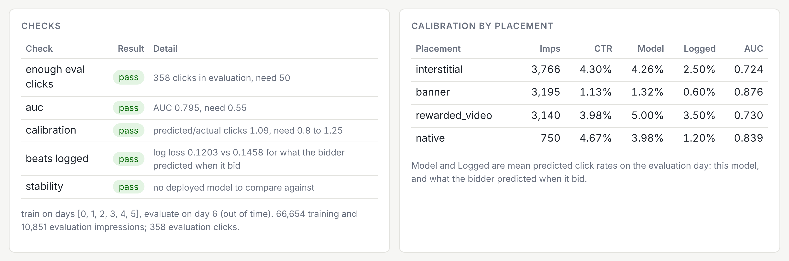

Click **Deploy** next to the model. The bidder checks its predictions against the golden examples in the bundle, warms it up, and swaps it in. Play another day, train again, and deploy the second model. The list shows every model, which one is serving, and how the new one compares with the old.

```bash
docker compose run --rm sim
```

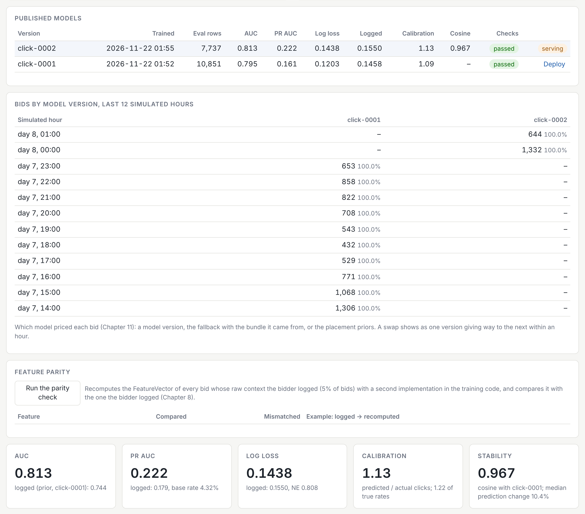

Bids by model version show the swap hour by hour:

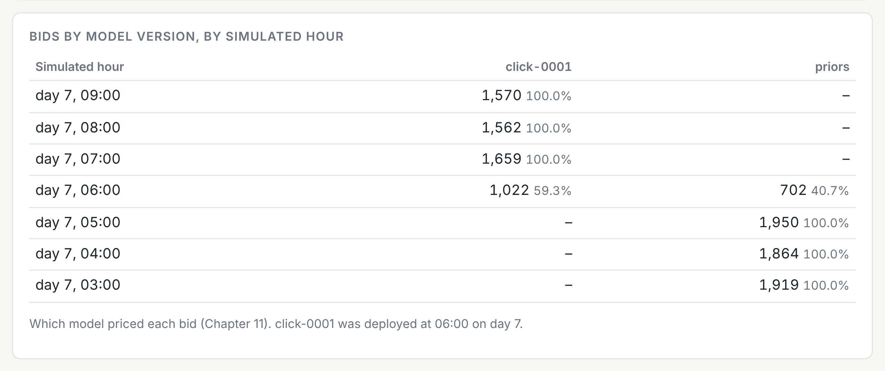

To roll back, click **Deploy** next to the earlier model. The golden-example tests run with the Go and Python tests in CI. To run them yourself, you need Go and Python 3.12 installed. From the repo root:

```bash
(cd code/dsp && go test ./...)
(cd code/training && pip install -e ".[test]" && pytest)
```

## Chapter 12: Operating the First DSP

Play a day with two failures injected: a campaign's target entered a hundred times too high, and an exchange that stops sending billing notices for rewarded video at noon:

```bash
ADSIM_SCENARIO=wrong-target,lost-billing docker compose run --rm sim
```

Open the console's Controls tab. The spend alert fires within a simulated quarter hour of the bad target. Pause the campaign with its kill switch, and check how much it spent first.


Spend against plan shows how throttling spread each campaign's budget over the day, and how far the bad campaign overspent:

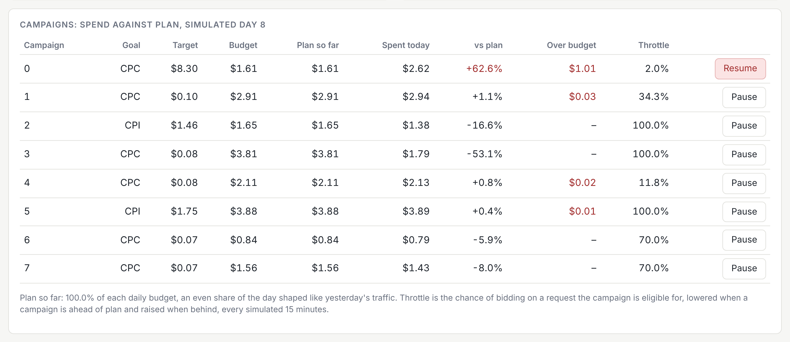

When the run ends, the simulated exchanges send their invoices. Reconciliation compares them with the bidder's own billed spend, and finds the missing rewarded video spend:


For the second part, publish a model that predicts the same click rate for everything, force-deploy it from the Models tab, play another day, and watch the prediction alert. Then switch the model off on the Controls tab, and watch the bidder fall back to segment rates:

```bash
docker compose exec trainer python -m adtrain train --ledger /out/ledger --models /out/models --constant 0.025
docker compose run --rm sim
```

The last exercise is yours to build: a filter that finds invalid traffic from the logs alone and removes it from training. The simulator's `is_bot` column lets you check your filter against the truth.

## Part III: A Competitive DSP

Part III runs the same DSP on a bigger market, the `walk` stage: tier-1 countries next to the low-CPM ones, a third exchange, and CPI, ROAS, and CPC campaigns. Start over for it, so its days don't mix with a Part II run:

```bash
docker compose down; rm -rf out
ADSIM_PRESET=walk BIDDER_STAGE=walk ADSIM_DAYS=7 docker compose up --build
```

Keep both variables set for every command in Part III, including `docker compose run --rm sim`.

## Chapter 13: From Clicks to Installs and Purchases

Install labels come from the advertiser's MMP, as postbacks, hours or days after the impression. The simulated MMP sends each one at the time it would really arrive; postbacks due after a run ends wait for the next run.

After the week has played, open the console's Labels tab and click **Read the labels**, or run:

```bash
docker compose exec trainer python -m adtrain labels --ledger /out/ledger --sim-out /out/sim
```

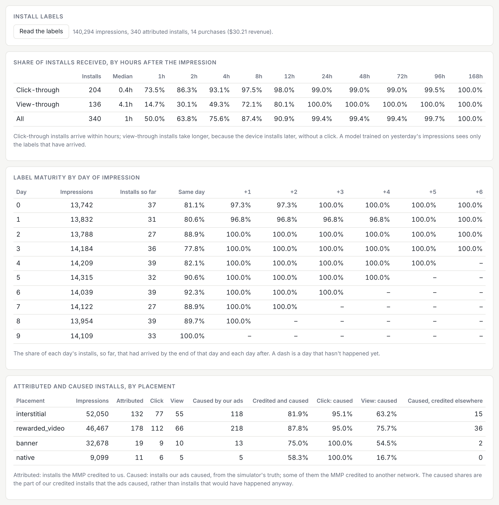

Three things to look at:

- **Delays.** Click-through installs mostly arrive within an hour or two of the impression. View-through installs take longer, because the device installs later, without clicking.
- **Maturity.** Each day's installs keep arriving after the day ends, so the most recent day's labels are never complete. A model trained up to yesterday learns from a share of yesterday's installs.
- **Attributed vs. caused.** The simulator knows which installs our ads caused. Compare that with what the MMP credited to us, by placement: a share of the credited installs, especially view-through ones, would have happened anyway, and some installs our ads caused were credited to another network.

## Chapter 14: Datasets for Conversion Models

Every postback that credits us an install also goes into the bidder's device profile, so from walk on the FeatureVector carries how many installs and purchases each device has made through our ads, as of the bid. The profiles are saved under `out/state` and survive a restart; without that, every device's history would drop to zero after `docker compose restart`, and the features served would no longer match the ones trained on.

Open the console's Conversions tab and click **Build a dataset**, then **Build a leaky dataset**, or run:

```bash
docker compose exec trainer python -m adtrain dataset --ledger /out/ledger --out /out/datasets
docker compose exec trainer python -m adtrain dataset --ledger /out/ledger --out /out/datasets --leak
```

Each dataset is one row per impression, with click, install, and revenue labels and a flag saying whether each label is final yet. The as-of dataset passes its checks. The leaky one counts every install a device ever made, including installs after the impression, and fails the check that compares its device history with what the bidder logged at the time.

## Chapter 15: LightGBM Conversion Models

Click **Train LightGBM** next to each dataset. The bundle trained on the leaky dataset scores far better offline: in our run, AUC 0.95 for installs after a click, against 0.77 for the as-of bundle.

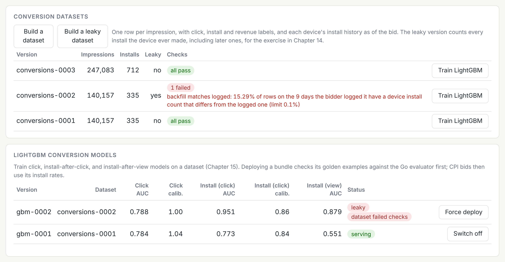

Click **Deploy** on the as-of bundle. The bidder first checks the bundle's 200 golden examples against its own Go evaluator, then serves it: bid records now show `conversion_model`, and CPI bids use the bundle's install rate after a click. Play a few days with `docker compose run --rm sim`.

Then the live half of the exercise: the leaky bundle needs **Force deploy**, because its dataset failed a check. Play a few days with it, switch back, and compare the periods. In our run (tiny scale, three days each, CPI campaigns; margin is the advertisers' CPI payouts minus our spend):

| Days | Serving | Spend | Installs | Margin |
|---|---|---|---|---|
| 7–9 | Priors | $33 | 41 | $135 |
| 10–12 | As-of bundle | $80 | 54 | $126 |
| 13–15 | Leaky bundle | $90 | 48 | $98 |

The leaky model only rates devices highly once they have installed, which at serving time means devices that already have the app; it spent more for fewer installs. The as-of model bought more installs than the priors but paid more for each: it overpredicts at the top, where the bidder spends most (see the calibration by predicted value in its report), and the bidder still bids its full estimate of the value, at first price. Bid shading comes in Chapter 20. Small numbers: rerun with `ADSIM_SCALE=laptop` for steadier ones.

## Chapter 16: Offline Evaluation

The Evaluate tab has three tools. They read the ledger, so they work on any run; the off-policy part needs bidder 0.7 or later, which logs the campaigns each choice was made from.

**Replay.** Pick a day, a bundle A (or "logged", for what the bidder did) and a bundle B, and click **Replay**, or:

```bash
docker compose exec trainer python -m adtrain replay --ledger /out/ledger --models /out/models --sim-out /out/sim --day 19 --a gbm-0006 --b gbm-0008
```

Replay rescores the day's priced bids with both bundles and reprices them the way the bidder does. Two checks come first: rescoring with the bundle that served that day reproduces the logged bids, and the simulator's highest other bid in each auction explains every logged win and loss. Then, by exchange and goal, the bids, the wins estimated from the win rates the logs show at each bid level, the true wins from the simulator, and spend.

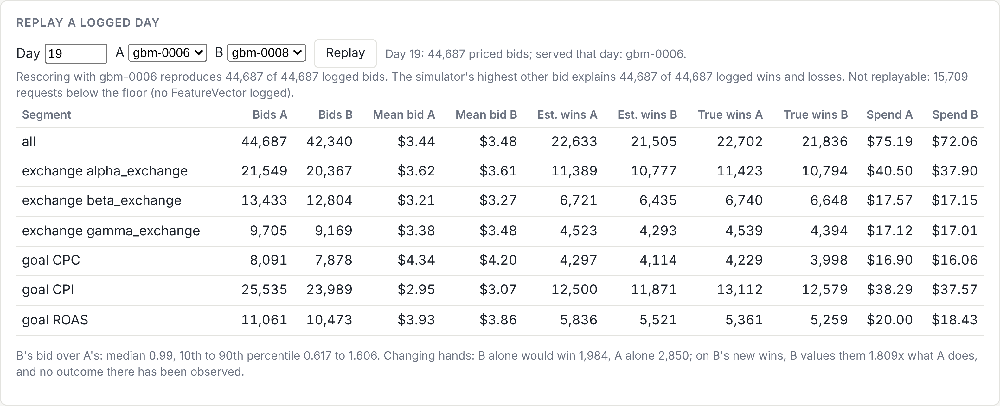

In our run, the estimated wins came within 2% of the true ones. The line under the table is the warning: about 2,000 impressions would change hands, and the challenger values the ones it would newly win at 1.8 times what the champion does. No outcome has been observed on them, and that's where a challenger's errors hide. Replay also can't see requests the champion priced below the floor, because the bidder doesn't log a FeatureVector for them.

**Off-policy evaluation.** The bidder picks a campaign at random, weighted by remaining budget, and logs the probability. Switch the selection policy under **Campaign selection**, play a few days on each, build a dataset (for the labels), and estimate one policy from another's logs:

```bash
docker compose exec trainer python -m adtrain ope --ledger /out/ledger --policy cpi-first
```


In our run, the estimate of CPI-first from the budget-weighted days was 0.00754 clicks per decision; running it gave 0.00750. From the uniform days it was 0.00731. Both 95% intervals contain the live value, and both are about ±6% wide: three days of logs can tell policies apart only when they differ by more than that.

**What each model bought.** **Compare serving periods** lists, for CPI campaigns, the spend, installs, and margin of each run of days with one conversion model serving: the table from Chapter 15, from the ledger.

```bash
docker compose exec trainer python -m adtrain periods --ledger /out/ledger --sim-out /out/sim
```

## Chapter 17: Serving Performance

Bidder 0.13 times every request by stage of the bid path: parsing, the device profile and features, eligibility, the conversion models, the win model's search for a bid (shading), the rest of pricing, the response, and logging. The **Serving** tab shows each stage's 50th and 99th percentiles over the latest 8,192 requests.

To see how the bidder holds up under more traffic than the simulator sends, play a day first (the load test needs the campaign book, which the simulator loads), then, with the bidder still up:

```bash
LOADGEN_LABEL=before docker compose run --rm loadgen
```

The load generator replays the requests in the raw log (the 5% sample from Chapter 8) at 100, 200, 400, 800, and 1,600 requests a second, ten-odd seconds each, and measures what an exchange would see: each answer's time, and how many came after the 100 ms deadline or couldn't be sent at all. The requests are dated the day after the log's last, so no budget is spent yet and every campaign is eligible, the busiest case for the internal auction. They carry an `X-Load-Test` header: the bidder runs the whole bid path and answers, but writes nothing to the ledger, the profiles, the budgets, or the alerts. The load is open loop: requests leave on schedule whether or not the earlier ones have answered, as an exchange's do. Set `LOADGEN_RATES=100,400,800` to choose the rates.


In our run, on two cores shared by the bidder and the load generator, shading was most of the time: the win model runs once per point of its grid, 18 points, for each campaign priced, and with every campaign eligible the auction priced about seven. The live column, the simulator's own requests, has a much longer tail in parsing and profiles than the load test: the simulator runs on the same machine and sends its requests in bursts, so the bidder waits for a core. The stages measure time on the request's clock, not CPU, and a stage that waits looks slow.

To see which functions use the CPU, profile the bidder while a load test runs:

```bash
go tool pprof -top http://localhost:8081/debug/pprof/profile?seconds=10
```

In our first profile, the tree walk was two thirds of the CPU, and the Thompson sampling over creatives (Chapter 21) a seventh: every request drew 200 times from each campaign's posteriors to estimate the chance it logs for offline evaluation. Within the tree walk, before the load test, a benchmark of the click model had found half the time in map lookups for categorical splits. Three changes made the same decisions faster:

- **Bitsets for categories.** LightGBM keeps a split's categories as a bitset; the bidder kept a map. The click model went from 17.1 to 10.2 µs per row, and the golden examples still match to 1e-16.
- **Cached creative chances.** A campaign's posteriors change only as day-old installs arrive, so the bidder keeps them, and each creative's chance from 4,000 draws, for 1,000 picks. Pricing's own time fell from 224 to 44 µs per request.
- **The win model's inputs once per request.** They don't depend on the campaign, so the bidder builds them once, and the grid's 18 bids go through the trees together, tree by tree.

The fourth trades accuracy for time. Under **Auction candidate cap**, set 3: the auction prices only the three campaigns with the best recent scores. During a load test, 5% of capped auctions are priced again in full, to measure what the cap gives up. Run the load test again with a new label:

```bash
LOADGEN_LABEL="cap 3" docker compose run --rm loadgen
```

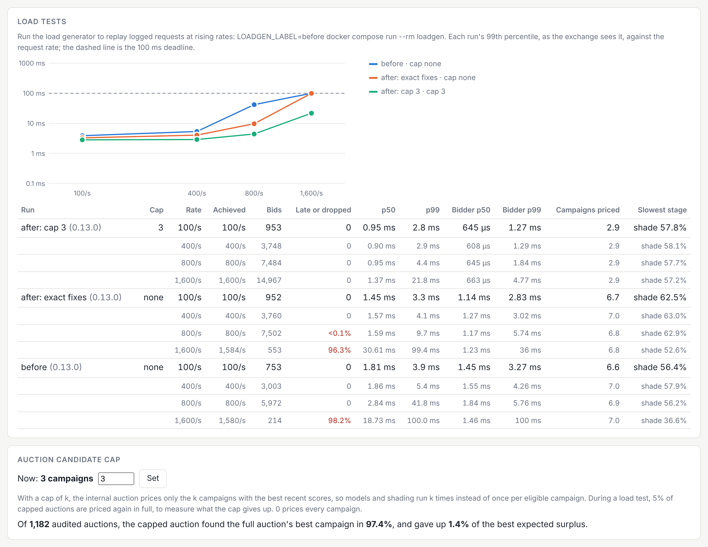

| Run | Bidder p50 at 100/s | p99 seen at 800/s | Late or dropped at 1,600/s |
|---|---|---|---|
| Before | 1.45 ms | 41.8 ms | 98% |
| Bitsets, cached chances, shared inputs | 1.14 ms | 9.7 ms | 96% |
| And a cap of 3 | 0.64 ms | 4.4 ms | 0% |

The exact fixes took a fifth off the median, but at 1,600 requests a second the bidder still fell behind: once requests arrive faster than two cores can price them, they queue, and almost every one misses the deadline, while the bidder's own stage timings barely move. That's the knee the chapter describes; past it, the exchange's view and the bidder's disagree. With a cap of 3, the capped auction found the full auction's best campaign 97% of the time, and gave up about 1.4% of the best expected surplus. A cap of 2 found it 89% of the time and gave up 4.7%; a cap of 4, 98.5% and 0.3%. Whether a point of surplus is worth half the CPU is a business question, and now it has numbers.

**ONNX.** The chapter compares the bidder's tree walker with ONNX Runtime on the same model. `python -m adtrain onnx --bundle ...` converts a bundle's click model and times ONNX Runtime from Python; `code/onnxbench` times it from Go, without cgo. In our run, ONNX Runtime took 20 µs a row from Go, 11.5 µs in batches of 64, against the tree walker's 10 µs a row. See `code/onnxbench/README.md`.

## Chapter 18: The Pipeline and the Registry

Chapters 14 and 15 ran each step by hand. The pipeline runs them in order and stops at the first one that fails. On the Conversions tab, click **Run the pipeline**, or:

```bash
docker compose exec trainer python -m adtrain pipeline --ledger /out/ledger --models /out/models --sim-out /out/sim
```

A run that passes publishes its bundle as the **challenger**. The bundle the bidder serves is the **champion**. Click **Promote** to serve the challenger; **Roll back** goes back to the version that served before. Both are deploys, so the bidder still checks the bundle's golden examples first, and the Deploys table records each one with the version it replaced.

Then break it twice on purpose:

- **Run it on a leaky dataset.** The pipeline stops at the dataset's checks, before training.
- **Run it with features missing.** Training succeeds, but every model predicts one number for every impression, and the model checks stop it: the predictions don't vary, the click AUC is 0.5, and it loses to the champion on the same rows.

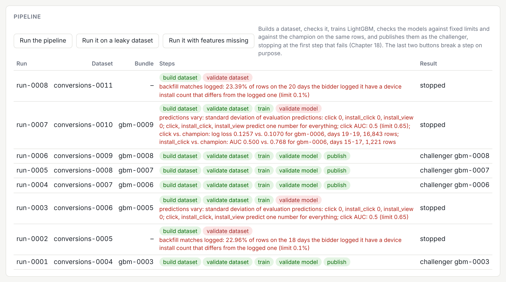

Each bundle's report records its lineage: the dataset version and a hash of its manifest, the code and library versions, and the training settings. Run the pipeline twice on the same ledger and the two bundles score identically against each other.

## Chapter 19: Shadow Mode, Canaries, and A/B Tests

The Experiments tab runs one experiment at a time, next to the champion. Pick a challenger bundle, then:

- **Shadow 10%.** The challenger scores a tenth of requests and logs its predictions next to the champion's, without bidding. The tab compares the two by placement and shows the challenger's latency. Play a day, stop it, and click **Check parity**: in our run, all 4,778 logged shadow scores matched the challenger's offline predictions to 1e-16.
- **Canary.** The challenger bids for 5% of devices, then 25%, then 50%, four simulated hours each, and is promoted if every stage passes. Every simulated quarter hour, guardrails compare its click and install predictions with the champion's on the same canary requests, by placement, along with the fallback share and the spend rate. Start one, play a day, and click **Break the challenger** once it reaches 25%: in our run, it rolled back 18 simulated minutes later. Our first version compared the two arms' mean predictions instead, on different devices, and rolled back a healthy canary on noise; comparing the same requests fixed that.
- **A/B test 50/50.** Devices are split between the arms by a salted hash, and each campaign's budget is split too, so neither arm can spend the other's money. Run it for a few days, stop it, play a few more days so the installs arrive, build a dataset, and click **Read out**:

```bash
docker compose exec trainer python -m adtrain abtest exp-0005 --ledger /out/ledger --sim-out /out/sim
```


We tested the leaky bundle from Chapter 14 against the champion for three days. Measured from installs, its cost per install was 2.26 times the champion's, with a 95% interval from 1.26 to 4.49, because each arm had only a few dozen installs. The simulator's true install rates, which carry no outcome noise, put the ratio at 1.46 (1.29 to 1.69): inside the measured interval, and far narrower.

## Chapter 20: Win Rate Models and Bid Shading

Until now, every bid has been 0.7 times the media value. On the Experiments tab, under **Win rate models and bid shading**, click **Train on the last 7 days**, once with **use minimum-bid-to-win reports** ticked and once without, or:

```bash
docker compose exec trainer python -m adtrain win --ledger /out/ledger --models /out/models --sim-out /out/sim
docker compose exec trainer python -m adtrain win --ledger /out/ledger --models /out/models --sim-out /out/sim --no-mtw
```

The label is the win notice, and the bid is an input with a monotone constraint. Two of the three exchanges report the minimum bid to win, exactly or rounded up; each report adds rows at bids above and below it. Both models are calibrated at the bids we made. Shading needs the win rate at bids we didn't make, and the simulator knows each auction's highest competing price, so it can check: at half the logged bid, the true win rate in our run was 27.1%; the model trained without the reports said 34.1%, and the one with them 28.1%.


Click **Shading A/B 50/50** on the model trained with the reports. The treatment arm bids the share of the media value with the most expected surplus; the control keeps 0.7. Run three days, stop it, and click **Read out**:

```bash
docker compose exec trainer python -m adtrain shadetest exp-0006 --ledger /out/ledger --models /out/models
```

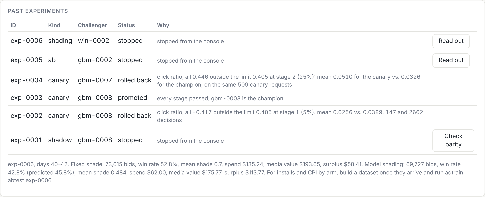

In our run, model shading bid 0.48 of the media value on average, won 42.8% of its bids instead of 52.8%, and spent $62 instead of $135, for 9% less media value: the surplus rose from $58 to $114. Three days later, with the installs in, `adtrain abtest exp-0006` put its cost per install on CPI campaigns at 0.62 times the fixed shade's (95% interval 0.37 to 0.98; 0.57 from the simulator's true install rates). It also spent less than its half of each budget, which Chapter 22's pacing turns into more volume.

## Chapter 21: Pricing for Goals

From bidder 0.10, a conversion bundle prices with installs from both paths, a click and a view, and ROAS campaigns use each app's D7 revenue per install from the bundle's training data, shrunk toward the overall average, instead of a fixed $1.00. Run the pipeline and promote its bundle to get one.

The new Pricing tab has three parts:

- **Campaign selection.** Click **Internal auction**: the bidder prices every eligible campaign and bids for the one with the most expected surplus, with 10% of requests picking at random so the logged selection probabilities stay useful offline. Trace a bid to see every term and every campaign's score:

```bash
docker compose exec trainer python -m adtrain find --ledger /out/ledger --goal cpi --limit 1
docker compose exec trainer python -m adtrain trace <request_id> --ledger /out/ledger
```

- **Calibration multipliers.** Click **Update from matured installs**. For each campaign, it compares the installs that arrived for impressions at least three days old with the installs the bidder predicted when it bought them. In our run the models predicted about a third more installs than arrived (overall kappa 0.74), the overconfidence on what the bidder wins that Chapter 15 showed, and the multipliers pull each campaign's value down to match.

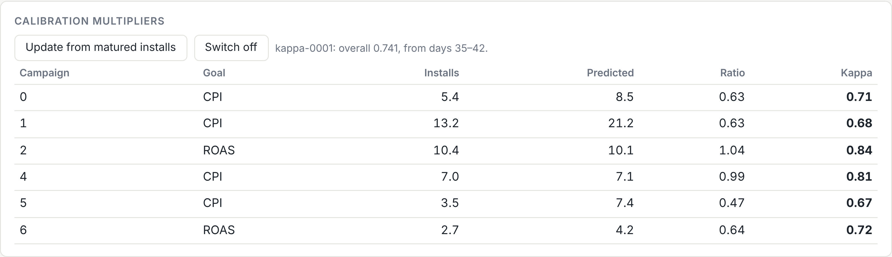

- **Creatives.** Click **Thompson sampling** and **Start over**, then play several days with one campaign's creative made much better:

```bash
ADSIM_SCENARIO=creative-test ADSIM_DAYS=1 docker compose run --rm sim
```

Keep the scenario on for every later run of the same market. Play a day at a time and watch campaign 1's shares: in our run, its strong creative went from a third of the draws to 78% in six days, at 3.5 installs per thousand impressions against 1.2 and 1.9 for the others.

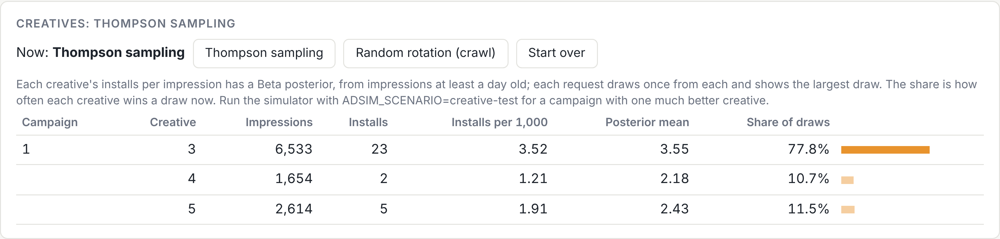

## Chapter 22: Basic Pacing

On the Pricing tab, under **Pacing**, click **Forecast tomorrow's starting multipliers** and then **PI controller**, and play a day. Every simulated quarter hour, the controller compares each campaign's spend so far with its plan and sets its multiplier, gamma, which scales the campaign's value before shading, between 0.3 and 2. The forecast replays the newest day's bids at different multipliers and starts each campaign where its forecast spend matches its budget. Click **Chart** on a campaign to see its day:

```bash
docker compose exec trainer python -m adtrain pace --ledger /out/ledger --models /out/models --sim-out /out/sim
```

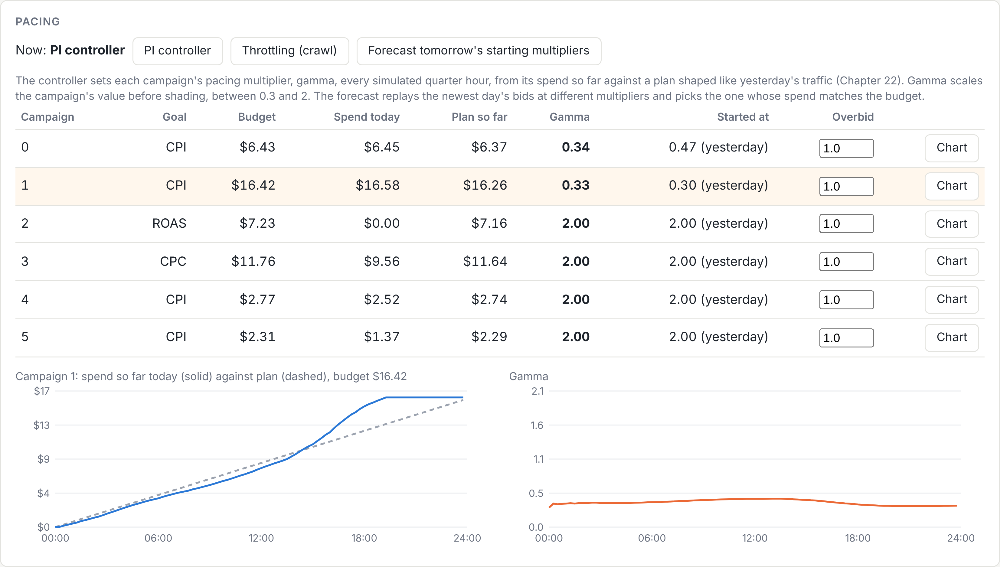

Three things to look for in the table:

- **Campaigns pinned at 2.** They can't spend their budget at any price the controller allows. In our run, those were the ROAS campaigns, whose D7 revenue per install is tiny in this market, and a few CPI and CPC campaigns with narrow targeting. The chapter says these need a person, not a higher bound.
- **Campaigns near 0.3.** They would overspend even at the lowest multiplier. Campaign 1 tracked its plan until mid-afternoon, then pulled ahead and spent its budget by 19:30, with gamma already near its floor. Its plan follows all of our traffic, not the traffic it's eligible for; a plan shaped like each campaign's own eligible requests is the reader exercise.
- **The forecast's starting point** against where the controller ended the day: when they differ a lot, the forecast's win curve is off.

**Overbids.** Type 2 into campaign 9's **Overbid** box, a manual multiplier on its value, logged apart from gamma. Play a day: the controller fights it, gamma falls to its floor, and the campaign runs ahead of plan, because the overbid has taken away the controller's room. Then lower it in steps, 1.5 and then 1, a day each. In our run, gamma stayed pinned at 0.3 at 1.5, and rose to about 0.5 once the overbid was gone, with the controller in charge again.

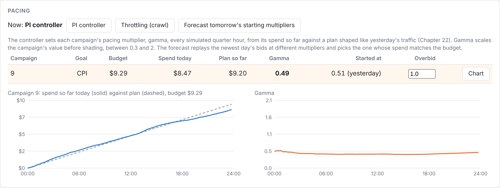

## Chapter 23: Measuring Incrementality

The holdout has been running since Part II: 5% of devices, by a salted hash of the device ID, get a ghost bid, which runs the whole bid path and logs the bid without sending it. On the Evaluate tab, click **Measure the last 28 days**, or:

```bash
docker compose exec trainer python -m adtrain lift --ledger /out/ledger --sim-out /out/sim
```

For each advertiser app, it compares the install rate of treated devices that got a bid with that of holdout devices that got a ghost bid, counting installs from any source: the ones the MMP credited to us, plus the ones the advertiser shares from its full install data. Only about half the walk advertisers share, so the rest can't be measured this way. The last column is the simulator's truth: the installs our ads caused on the same devices.

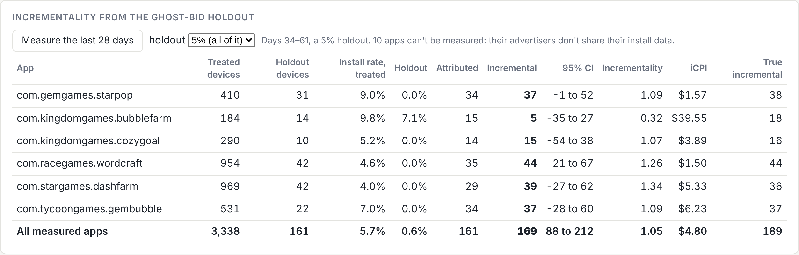

In our run, across the six apps that share, the holdout estimated 169 incremental installs (95% interval 88 to 212); our ads caused 189. Per app, the estimates were close to the truth, but each app's holdout had only 10 to 42 devices, so most intervals include zero: at the tiny scale, a per-advertiser estimate needs a much longer window, a larger holdout, or pooling, as the chapter says. In this simulated market the ads cause slightly more installs than the MMP credits to us, an incrementality a little above 1; organic installs are rare here, so few credited installs would have happened anyway.

Then pick a smaller **holdout** for one app:

```bash
docker compose exec trainer python -m adtrain lift --ledger /out/ledger --sim-out /out/sim --app com.racegames.wordcraft --holdout-share 0.01
```

For that app, the interval went from -21 to 67 incremental installs at 5%, to -95 to 89 at 2%, and -153 to 106 at 1%. Our first version used the usual normal approximation, which gives a holdout with no installs no uncertainty at all; the readout now uses the Agresti-Caffo interval, which adds one install and one non-install to each group.

## Chapter 24: Operating a Competitive DSP

Bidder 0.14 adds the Chapter 24 monitoring to the Controls tab: a **prediction monitor** that compares each model's mean prediction over the last hour with the same hour on the days before, a **daily parity check** that runs when the simulated day turns, **playbooks** linked from every alert, and **quarantine** for bad data. Here we run one incident drill end to end: a day of bad install labels.

**The incident.** Play a day with the `bad-labels` scenario, then two more days, so the bad day's install labels mature:

```bash
ADSIM_SCENARIO=bad-labels ADSIM_DAYS=1 docker compose run --rm sim
ADSIM_DAYS=2 docker compose run --rm sim
```

From 06:00 to 18:00 on the first day, the simulated MMP turns on probabilistic matching for view-throughs, and credits us with installs on devices that never installed. In our run, that was 249 false installs on day 74, against about 40 real ones a day.

**How it's found.** Run the pipeline from the Conversions tab, or build a dataset. The new **install label rate** check fails the build, and the pipeline stops before training:

```
FAIL  install label rate: day 74: 1.336% installs per impression, against a median of 0.190% over 10 days (limit 2 times)
```

The failed check links to its playbook. If we had trained on it anyway, the damage would already show in the model's report: evaluated on days that include the bad one, the install-after-view model's AUC fell to 0.49, and its calibration to 0.14, because the evaluation set's labels are wrong too.

**Following the playbook.** The playbook says to look for what marks the bad batch. On the Controls tab, under **Quarantine**, inspect day 74 by `match_type`:


Every false postback carried `match_type=probabilistic`, a value the MMP had never sent before. Then the four steps of the chapter:

1. **Quarantine.** Type `match_type=probabilistic` and a reason, and click **Quarantine the day**, or:

   ```bash
   docker compose exec trainer python -m adtrain quarantine add --datasets /out/datasets \
     --day 74 --where match_type=probabilistic --reason "probabilistic matching turned on by mistake"
   ```

2. **Rebuild.** Every dataset build reads the quarantine list. The rebuilt dataset skipped the 249 postbacks, and every check passed.
3. **Retrain.** Run the pipeline again. In our run, the install-after-view model evaluated on the rebuilt data had 48 installs to predict instead of 290, an AUC of 0.58, and a calibration of 0.82.
4. **Rebuild what carries it forward.** The bidder's device profiles counted the false installs, so `device_prior_installs` was wrong for every device that got one. Click **Recount device profiles**. In our run, 212 of 1,948 devices changed. Before the recount, every bid on those devices logged a count that included the false installs (100% of about 5,500 rows a day); on the day after it, none did.

**Watch the prediction monitor too.** The false installs feed a model feature, each device's install count, so the bad labels showed up in the click model's predictions before any dataset was built: in our run, the mean click prediction fell 12% the day after the bad day, and the shift alert fired at 01:30 with no deploy before it. The recount moves the predictions back, and the alert may fire again, because the baseline days now include the bad ones. That's a lesson the book takes up: incidents poison the baselines meant to catch the next one.

**Homework.** Two more drills are built, under **Incident drills** on the Controls tab:

- **A bad deploy.** Click **Deploy** with a factor of 1.1, and the serving bundle's click predictions are 10% too high, as a bad build's would be. Watch the prediction monitor, follow the alert to its playbook, and roll back. Then try 1.3. How large a shift can the monitor see within an hour at the tiny scale? In our data, an hour's mean click prediction moves 3 to 6% from one day to the next, and the alert needs four robust standard deviations.
- **A serving bug.** Click **Deploy** next to the serving bug, and the bidder starts logging finer cellular connection types than the training code computes. Play a day: when the day turns, the daily parity check finds it, and the parity alert links to its playbook.

Also built, without a drill: the pacing controller now starts each day at a gamma of at most 1 and steps up toward its starting value, so a campaign doesn't open the day at twice its value while its plan is still near zero.

## Part IV: A State-of-the-Art DSP

Part IV is in progress. Its exercises run on the smallest market, so each run takes a few minutes; every chapter leaves scaling up, more traffic and more days, to you. The code is complete and scales; the compute is yours.

**The Deep models tab.** Chapters 25 to 29 also run from the console. With the bidder and trainer up (`docker compose up -d bidder trainer`), open the **Deep models** tab: it shows which datasets are in `out/`, has a **Run** button for each chapter's command, and shows each chapter's latest report, whether it ran from the tab or from a terminal. Its **embedding viewer** maps the vectors the chapters learned, colored by genre: the install-together vectors, the DCNv2's app embeddings (Chapter 26), the transformer's app table and its device states (Chapter 27). Pick a genre to highlight, and click an app to see its nearest neighbors. Run Chapters 25 to 27 first, so there's something to map.

## The Part IV Dataset

Chapters 25 to 29 share one dataset: a frozen snapshot of a simulated market, so each chapter's models train in minutes on the same rows. Get it one of two ways.

**Download it** (fastest, and the book's numbers): from the [releases](https://github.com/bgweber/AdtechBook/releases), download `part4-dataset.zip` and unzip it into `out/`, so the files are in `out/snapshot/`.

**Or build it** (about twenty minutes): a fresh fourteen-day walk market with ad revenue, where every advertiser shares its install data, with the conversion models deployed after the first week.

```bash
docker compose down; rm -rf out
export ADSIM_PRESET=walk BIDDER_STAGE=walk ADSIM_SCENARIO=ad-roas,full-share
docker compose build
docker compose up -d bidder trainer
ADSIM_DAYS=7 docker compose run --rm sim
```

On the Conversions tab, build a dataset, train LightGBM, and deploy the bundle. Then play the second week and write the snapshot:

```bash
ADSIM_DAYS=7 docker compose run --rm sim
docker compose exec trainer python -m adtrain snapshot --ledger /out/ledger --sim-out /out/sim --out /out/snapshot
```

Ours had 211,540 impressions from 1,860 devices over fourteen days: nine days to train on, two to validate, two to test, and the newest, whose installs aren't final. A larger market or more days make a bigger dataset, for scaling up.

## Chapters 25 and 26: Where Trees Stop, and Deep Models with Embeddings

One command trains a small multi-task DCNv2 in PyTorch and LightGBM on the same rows, and compares them against the true rates (about half a minute, on the CPU):

```bash
docker compose run --rm --no-deps trainer deep --snapshot /out/snapshot
```

For Chapter 25, the output compares the two models overall and where trees should struggle, and their time per prediction. In ours, LightGBM was slightly ahead everywhere at this scale: an error against the true click rate of 0.55 against 0.58 overall, and 0.47 against 0.52 on rare advertiser apps. For Chapter 26, it has each head's AUC and calibration against the truth, the embedding rows training never touched and what zeroing them does, and whether the app embeddings group apps by genre: in ours, 12% of each app's nearest neighbors shared its genre, no better than random, against 57% for app vectors learned from which devices install apps together.

**Scaling up is yours.** Build a bigger dataset, and on a GPU, train wider and longer, and find where the deep model passes the trees.

## Chapter 27: Sequences and Transformers

One command pretrains a small transformer on the dataset's device histories, predicting each device's next install, and adds what it learned to the LightGBM install models (Design A), against the true rates (about three minutes, on the CPU):

```bash
docker compose run --rm --no-deps trainer pretrain --snapshot /out/snapshot
```

The output has the pretraining loss against popularity alone, next-install prediction against popularity over the last 7 days, the leakage check, each signal's correlation with the true install rate within each advertised app, and the error of each variant against the truth, by how many installs the device had. The app vectors, the daily device states, and the report go to `out/pretrain`. In ours, a pooled profile of each device's installs, from co-install vectors, cut the error against the true install-after-view rate from 0.87 to 0.81, while the transformer barely moved it (0.86 and 0.88): with about four installs per device, it learned which campaigns were running, not what each device wants.

**Scaling up is yours.** Give devices longer histories (the installs each device gets before the run are set in adsim's `history.py`), build a bigger dataset, and find where pretraining passes the pooled profile.

## Chapter 28: Serving Deep Models

Two commands: the trainer exports Chapter 26's DCNv2 to ONNX and to a bundle for the Go bidder, with golden vectors, and copies Chapter 27's app vectors and device states (run `pretrain` first for those); then the bidder's image checks the bundle in pure Go and benchmarks it (under a minute in all):

```bash
docker compose build
docker compose run --rm --no-deps trainer export --snapshot /out/snapshot --out /out/export --pretrain /out/pretrain
docker compose run --rm --no-deps --entrypoint deepcheck bidder -dir /out/export
```

The first reports the ONNX parity check against PyTorch (in ours, the largest logit difference was 3.8e-06). The second reports Go's parity with the golden vectors, the time per request with 1, 10, and 50 candidates, with and without the request's share of the first layers done once, the time for dot products, and a version rollover: device records from a version with no tables loaded are refused, and scored once both versions' tables are loaded. Times vary by machine; in ours, one candidate took 27 µs and fifty about 1.3 ms. Everything goes to `out/export`.

**Scaling up is yours.** Serve the network in the live bid path, and load-test it as in Chapter 17.

## Chapter 29: Retraining and Real-Time Learning

This chapter has a dataset of its own, the Part IV market with a shift: four more days with the `new-game` scenario, where at 12:00 UTC on the first, a new hypercasual hit takes over the genre's audience, and the genre's games get 40% of their installs from then on. It also records when each install's postback arrived.

**Download it:** from the releases, download `part4-shift.zip` and unzip it into `out/`, so the files are in `out/snapshot-shift/`.

**Or build it,** on the market you built for the Part IV dataset, with the bidder and trainer up and the variables still set (about eight minutes). The four days must run in one command:

```bash
ADSIM_SCENARIO=ad-roas,full-share,new-game ADSIM_DAYS=4 docker compose run --rm sim
docker compose exec trainer python -m adtrain snapshot --ledger /out/ledger --sim-out /out/sim --out /out/snapshot-shift
```

Then one command replays the shift: a model retrained daily, the same with an hourly calibration multiplier per advertised app, and models retrained every 6 hours with naive labels and with importance weights for the installs not reported yet, each trained only on the postbacks that had arrived by then (about two minutes):

```bash
docker compose build
docker compose run --rm --no-deps trainer retrain --snapshot /out/snapshot-shift
```

The output has each model's calibration against the true install rate, for the hypercasual games and the rest, from the day before the shift to the third day after it, and the calibration multiplier for the hypercasual apps. Hour by hour, they go to `out/retrain`. In ours, the daily model overpredicted hypercasual installs by 2.6 times until its next retrain, the multiplier fixed most of that a day sooner, the naive 6-hour model sat at two-thirds of the truth, and the weighted one was within 14% of it from 6 hours after the shift.

**Scaling up is yours.** Retrain every 2 hours, update a model online, and try other shifts.

## Chapter 30: Value Prediction

Bidder 0.15 prices **Ad ROAS** campaigns: hypercasual apps whose advertisers judge them on the ad revenue their new players earn in their first three days (D3), per dollar. The simulator adds ad revenue, and six Ad ROAS campaigns, with `--scenario ad-roas`. It changes the market, so start over, and keep the variables set for every command in this chapter. Nine simulated days take about five minutes:

```bash
docker compose down; rm -rf out
ADSIM_PRESET=walk BIDDER_STAGE=walk ADSIM_SCENARIO=ad-roas ADSIM_DAYS=9 docker compose up --build
```

When the header's clock reaches day 9, build a dataset on the Conversions tab, and click **Train LightGBM** on it. Next to the click and install models, the bundle now has a **value** model: D3 ad revenue per install, with a Tweedie loss. The **Value: true corr.** column is its correlation with the simulator's true value, against each app's average on the same installs. In our run: 0.73 against 0.11, and the fifth of installs it ranked highest held 53% of the true value. Its report (`report.json` in the bundle, under `models.value`) has the comparison by fifth of the prediction and by country, and a least-squares model on log revenue for comparison. Train it earlier, after six days, and it has too few installs with final D3 revenue to learn from.

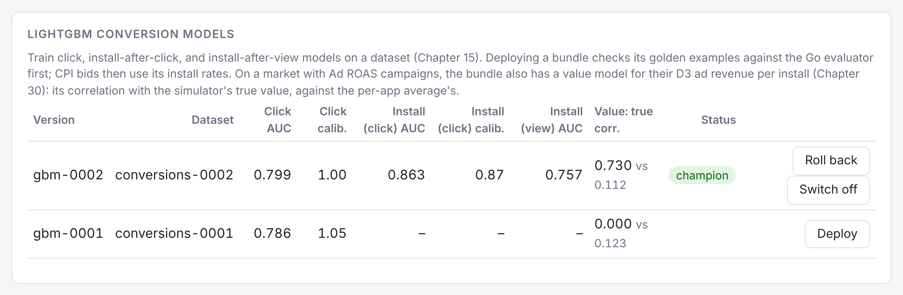

**Scaling up is yours.** Deploy the bundle; on the Experiments tab, choose it as the challenger and click **Value A/B 50/50**. The treatment arm prices Ad ROAS bids with the bundle's value model, the control with each app's average, and everything else is the same. Play three days, stop the test, play four more so its installs' D3 revenue is final, build a dataset, and click **Read out**:

```bash
ADSIM_PRESET=walk BIDDER_STAGE=walk ADSIM_SCENARIO=ad-roas ADSIM_DAYS=3 docker compose run --rm sim
docker compose exec trainer python -m adtrain abtest exp-0001 --goal AD_ROAS --ledger /out/ledger --sim-out /out/sim
```

On this small market, ours couldn't tell the arms apart: a ROAS ratio of 0.95 measured, with a 95% interval from 0.66 to 1.41. Then try the laptop scale (`ADSIM_SCALE=laptop`, about ten times the traffic and the time per day; build its datasets with `docker compose exec trainer python -m adtrain dataset --ledger /out/ledger --out /out/datasets --sample-rate 0.2` so they fit in memory). There, ours found 1.42 times the ROAS measured, and 1.36 times from the true values (1.18 to 1.58).

**The deep funnel is yours too.** ROAS campaigns for purchase revenue: two-part and Tweedie models on D7 purchase revenue, compared by calibration by decile and gain curves against the truth's `expected_d7_revenue`. Purchases are sparse, so plan on many more simulated days.

## Chapter 31: Win Rate Curves and the Winner's Curse

Bidder 0.16 shades with a **win curve**: trees that read the request alone and predict the price to beat, so one pass gives the win rate at every bid and the market price. With it comes a **winner's curse table**, which marks values down by how far the media value is above that market price. Continue Chapter 30's market, with the same variables set. On the Conversions tab, click **Deploy** on Chapter 30's bundle, so the install campaigns are priced with its models, and play five days:

```bash
ADSIM_PRESET=walk BIDDER_STAGE=walk ADSIM_SCENARIO=ad-roas ADSIM_DAYS=5 docker compose run --rm sim
```

On the Experiments tab, under **Win rate models and bid shading**, tick **with a win curve and a winner's curse table** and click **Train on the last 7 days** (a few minutes), or:

```bash
docker compose exec trainer python -m adtrain win --ledger /out/ledger --models /out/models --sim-out /out/sim --curve --curse
```

The new columns are the curve's AUC and the curse table, from wins below the market price to wins above three times it, after shrinking toward 1. In our run, the curve's AUC was 0.914 against the bid-input model's 0.911, and the table was 0.94, 0.82, 0.75, 0.81, 0.69 from 630 installs. The trainer's output also prints the table measured from the simulator's true install rates: in ours, 1.17 for narrow wins down to 1.02 above three times the market.

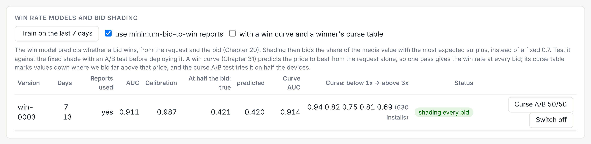

With Go installed, time the two ways of shading a bid on your bundle (in ours, 151 µs for the bid-input model's grid, 13 µs for the curve):

```bash
cd code/dsp && GBM_WIN_BUNDLE=../../out/models/win/win-0001 go test ./internal/gbm -run x -bench WinShadeFromEnv; cd ../..
```

Click **Deploy** on the new model, so both arms shade with the curve, then **Curse A/B 50/50**: the treatment marks values down by the table, the control doesn't, and each gets half of every campaign's budget. Play three days with the command below, click **Stop**, run it again so the installs are in, build a dataset on the Conversions tab, and click **Read out** on the test. The readout is for CPI campaigns; the second `abtest` gives the Ad ROAS ones (use the test's ID from the Experiments tab: `exp-0002` if you ran Chapter 30's value test):

```bash
ADSIM_PRESET=walk BIDDER_STAGE=walk ADSIM_SCENARIO=ad-roas ADSIM_DAYS=3 docker compose run --rm sim
docker compose exec trainer python -m adtrain abtest exp-0001 --ledger /out/ledger --sim-out /out/sim
docker compose exec trainer python -m adtrain abtest exp-0001 --goal AD_ROAS --ledger /out/ledger --sim-out /out/sim
```

In ours, the treatment spent 20% less on CPI campaigns for 40 installs against 44: a CPI 0.88 times the control's measured (95% interval 0.55 to 1.43), and 0.79 times from the true install rates (0.67 to 0.93). On the Ad ROAS campaigns, its ROAS was 1.27 times the control's measured, 1.12 times from the true values.

**Scaling up is yours.** On the laptop scale, see whether the measured table finds the slope by margin that the truth shows, and compare the table with a single markdown for every win.

## Chapter 32: Uplift Modeling

Bidder 0.17 runs **lift studies** and prices with an **incrementality tilt**. The simulator's `uplift` scenario adds sure things: heavy players install games on their own far more often, so many installs weren't caused by any ad, and every advertiser shares its install data. It changes the market, so start over. This time, build every image (the simulator's too: `up` alone would build only the bidder and trainer), and start the bidder and trainer first, so the study covers every day:

```bash
docker compose down; rm -rf out
export ADSIM_PRESET=walk BIDDER_STAGE=walk ADSIM_SCENARIO=ad-roas,uplift
docker compose build
docker compose up -d bidder trainer
```

On the Experiments tab, under **Uplift**, click **Start a lift study 50/50**: half the devices get our ads, the other half only ghost bids. Play nine days (about five minutes):

```bash
ADSIM_DAYS=9 docker compose run --rm sim
```

Click **Stop**. On the Conversions tab, build a dataset, train LightGBM on it, and deploy the bundle. Then, under **Uplift**, click **Train uplift models**, or:

```bash
docker compose exec trainer python -m adtrain uplift --ledger /out/ledger --models /out/models --sim-out /out/sim
```

The trainer's output has the Qini curves on held-out devices, the share of installs caused among the installs credited to us, and the comparison by fifth of how much the device plays. In our run, from 99,517 device-app-days, the share of all installs our ads caused fell from 0.75 for the lightest players to 0.20 for the heaviest (0.84 and 0.20 in the truth), but the T-learner's Qini coefficient was 0.03, no better than random targeting (0.05), and the attributed install model's was 0.20.

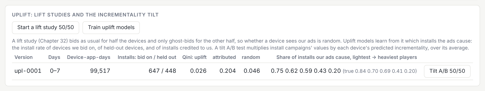

Click **Tilt A/B 50/50** on the bundle: the treatment multiplies install campaigns' values by each device's incrementality ratio over its average, and each arm gets half of every budget. Play three days, click **Stop**, play three more, build a dataset, and click **Read out** on the test, or:

```bash
ADSIM_DAYS=3 docker compose run --rm sim
docker compose exec trainer python -m adtrain abtest exp-0002 --goal INSTALL --ledger /out/ledger --sim-out /out/sim
```

In ours, the tilt lost: the treatment spent $311 against $290, and our ads caused 255 installs in its arm against 292, a cost per caused install 1.23 times the control's (95% interval 1.04 to 1.42). Of the installs credited to us, 85% were caused, so there was little for the tilt to correct, and its noise cost money. The chapter explains why.

**Scaling up is yours.** On the laptop scale, see how many randomized installs it takes for the uplift ranking to beat the attributed model, and try the tilt with a smaller alpha.

## Chapter 33: The Unified Pricing Equation

Bidder 0.18 adds the levers of the unified pricing equation, a bid ledger with every term, a bid explainer, and the consistency check. Continue Chapter 32's market, with the same variables set, and rebuild:

```bash
docker compose build
docker compose up -d bidder trainer
```

On the Pricing tab, under **Campaign levers**, give campaign 16 (a hypercasual Ad ROAS campaign) a second goal, CPI at $0.60 with weight 0.5, and a tilt alpha of 0.3 with uplift bundle `upl-0001`, and click **Save**. Play three days (about two minutes):

```bash
ADSIM_DAYS=3 docker compose run --rm sim
```

Under **Explain a bid**, enter campaign 16 and click the button: the newest day's last bid for it, term by term, from the ledger, with the media value the terms multiply to next to the one logged. Ours went from an Ad ROAS goal value of $17.57 and a CPI goal value of $9.00, to $13.29 weighted, $12.25 tilted, $9.80 after the margin, and a bid of $6.86. Under **Consistency check**, enter campaign 16 and click the button for its own budget and target; then try a budget of 88 at a ROAS of 0.5.

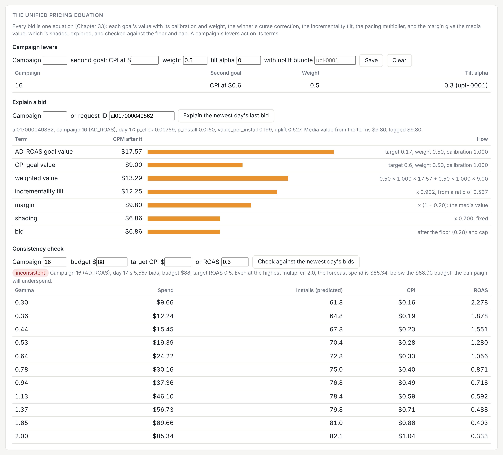

The check from the first of the three days also compares its forecast with the next day:

```bash
docker compose exec trainer python -m adtrain frontier --ledger /out/ledger --sim-out /out/sim --campaign 16 --day 15
docker compose exec trainer python -m adtrain frontier --ledger /out/ledger --sim-out /out/sim --campaign 16 --day 15 --budget 88 --target-roas 0.5
docker compose exec trainer python -m adtrain explain --ledger /out/ledger --campaign 16
```

In ours, its own settings were consistent, and twice the budget at a ROAS of 0.5 wasn't: spending $88 needed a multiplier of 1.65, at a forecast ROAS of 0.41. The next day, the campaign spent $44.21 of its $44.22 budget, but the check had forecast 99 installs at that spend, and 35 were credited: the install model runs high on the impressions we win (Chapter 31), and some installs our ads drove went to other networks.

**Scaling up is yours.** A week at the laptop scale against the frontier, an A/B test of unified against Part III pricing, and the margin controller.

## Chapter 34: Pacing with Reinforcement Learning

Adsim 0.6 adds the `traffic-surge` scenario: three times the requests from 13:00 to 16:00 UTC on the run's first day. Continue Chapter 33's market, with the same variables set, and rebuild every image:

```bash
docker compose build
docker compose up -d bidder trainer
```

On the Pricing tab, under **Pacing**, click **PI controller**. Play a normal day, then a day with a surge (about two minutes):

```bash
ADSIM_DAYS=1 docker compose run --rm sim
ADSIM_SCENARIO=ad-roas,uplift,traffic-surge ADSIM_DAYS=1 docker compose run --rm sim
```

Under **Pacing policies in a simulator from logged auctions**, enter campaign 21 (a hypercasual Ad ROAS campaign) and click the button (about half a minute), or:

```bash
docker compose exec trainer python -m adtrain rlpace --ledger /out/ledger --sim-out /out/sim --campaign 21
```

It builds a simulator from the campaign's logged bids on the normal day and the surge day, checks it by replaying the multipliers the bidder used, and compares the PI controller, MPC, and a Q-learning policy on the surge day. In ours, PI ran out of budget at 16:30 and won $76.32 of value; MPC cut its multiplier when the surge ate its budget, lasted until 19:45, and won $89.10, 17% more for the same spend; Q-learning won $74.48 and moved its multiplier about fourteen times as much.

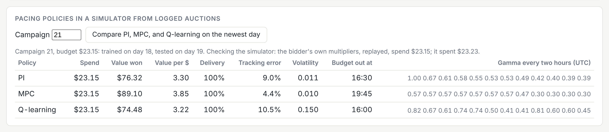

**Scaling up is yours.** A week of training days, a richer state or a small network for the learned policy, MPC in the bidder against PI in a budget-split A/B test, and a policy from the logged-auction simulator tested against the companion simulator itself.

## Running without Docker

Each component also runs on its own. See [`code/sim/README.md`](code/sim/README.md), [`code/dsp/README.md`](code/dsp/README.md), and [`code/training/README.md`](code/training/README.md).
