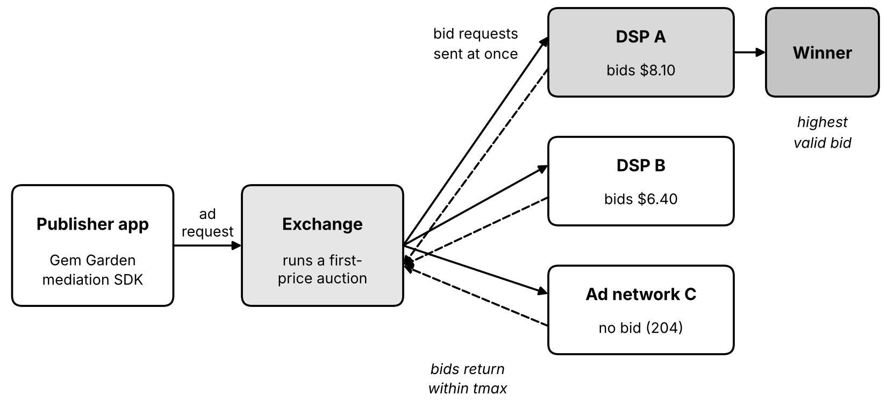
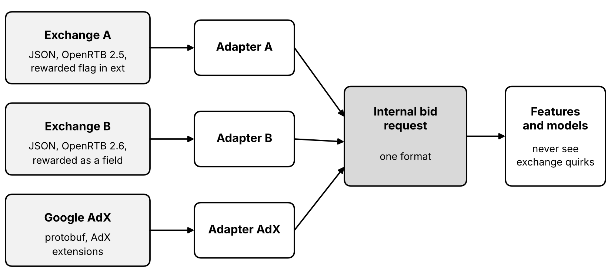

# The Auction Lifecycle {#sec-the-auction-lifecycle}

A DSP doesn't operate on its own. Every bid it makes depends on a chain of other companies: the game that owns the ad slot, the SDK that requests the ad, the mediation platform and exchange that run the auction, and later, the measurement company that decides whether the ad led to an install. Each of these partners gives the DSP a different slice of data, at a different time, in a different format. Before we can build models, we need to know where each piece of data comes from and what it actually means.

In @sec-introduction, we looked at the ecosystem from a high level. In this chapter and the next, we go a level deeper, and follow a single ad opportunity all the way from Gem Garden, our match-3 game, to a paying player of Cozy Farm Tycoon. This chapter covers the first half of that journey: the **auction lifecycle**, from an ad opportunity to a cleared impression. In this chapter, we'll introduce the funnel that ties all of a DSP's data together, walk through how a publisher's ad slot becomes an auction, discuss what it takes to integrate with an exchange, explain how a DSP wins an auction and why winning doesn't mean the ad is shown, and tour the bid request itself. The next chapter covers the second half, from impression to attributed install and purchase, through mobile measurement partners (MMPs).

## The Funnel and the Third Parties

The most useful mental model for a DSP's data is a funnel. Each step is a filter on the step before it, and each step is reported by a different partner:

1. **Opportunity:** a publisher's app has an ad slot to fill, and an exchange sends the DSP a bid request. Reported by the exchange.
2. **Bid:** the DSP decides to bid, and returns a price and an ad. Logged by the DSP.
3. **Win:** the exchange's auction picks the DSP's bid. Reported by the exchange, through a win notification.
4. **Impression:** the ad is actually shown to the user. Reported by the exchange, through a billing notification, and sometimes by the app's SDK.
5. **Click:** the user taps the ad. Reported by the DSP's own click tracking, and shared with the MMP.
6. **Install:** the user installs and opens the app. Reported by the advertiser's MMP, through an install postback.
7. **Purchase:** the user spends money in the app. Reported by the MMP, through in-app event postbacks.

@fig-ch2-funnel shows these steps, and which partner reports each one. The volumes fall off quickly. A large DSP may see millions of bid requests per second, bid on a fraction of them, win a fraction of those, and see installs on a tiny fraction of its impressions. Most of the modeling work in this book is about predicting the later steps of the funnel, which are rare and delayed, using what the DSP can see at the earlier steps, which are plentiful and immediate.

{#fig-ch2-funnel width="100%" fig-alt="Funnel of seven shrinking boxes: opportunity, bid, win, impression, click, install, purchase. Labels underneath show who reports each step, and brackets group the first four as the auction lifecycle and the last three as the measurement lifecycle."}

The language that ties the first half of the funnel together is the **OpenRTB** specification, maintained by the IAB Tech Lab.[^c2-ortb-spec] OpenRTB defines the bid request that an exchange sends, the bid response that a DSP returns, and the notification URLs that tell the DSP what happened next. Nearly every mobile exchange implements some version of it, usually 2.5 or 2.6, with its own extensions. If you're joining an ad tech team, the spec is worth reading end to end once. It's long, but it's the closest thing the industry has to a shared data dictionary.

[^c2-ortb-spec]: IAB Tech Lab, "OpenRTB 2.x specification," <https://github.com/InteractiveAdvertisingBureau/openrtb2.x>. Version 2.6 is the current release; many mobile exchanges still document their integrations against 2.5.

## A Publisher App That Wants to Make Money

Every auction starts with a publisher that wants to earn money from its users. Take Gem Garden, our free match-3 game. Most of its players will never make an in-app purchase, so the game earns revenue by showing ads: a rewarded video that a player watches for extra moves, an interstitial between levels, or a banner on the map screen. Each of these is an **ad slot** (also called a placement), and each time the game wants to fill one, there is an **ad opportunity**.

The game doesn't talk to advertisers directly. Instead, it embeds one or more ad SDKs. The most important one is usually a **mediation** SDK, such as AppLovin MAX, Unity LevelPlay, or Google AdMob, which decides which demand source gets to fill each slot. Mediation platforms connect to many demand sources at once: their own ad networks, other ad networks through adapter SDKs, and exchanges that forward the opportunity to DSPs.

From the publisher's point of view, the goal is simple: earn the most money per impression without hurting the player experience. The publisher cares about **eCPM**, the effective revenue per thousand impressions, and about **fill rate**, the share of ad opportunities that get filled. A DSP is one of many sources of demand competing to fill that slot.

@fig-ch2-publisher shows the pieces involved when Gem Garden fills an ad slot, and how the money flows back.

{#fig-ch2-publisher width="100%" fig-alt="Flow from Gem Garden through mediation and the exchange to the DSP, with Cozy Games as the advertiser. Below, money flows the other way per 1,000 impressions: the advertiser pays $10.00, the DSP keeps $2.00, the exchange keeps $1.20, and the publisher earns $6.80."}

## Following the Money

It's worth tracing how money moves from an advertiser to a publisher, because it explains why the price a DSP bids isn't the price a publisher receives.

Suppose Cozy Games is willing to pay its DSP for Cozy Farm Tycoon installs at a target cost per install (CPI). The DSP converts that goal into a bid for each impression, as we saw in @sec-introduction, and keeps a margin for itself. The exchange that runs the auction takes a fee as well, sometimes as a share of the clearing price and sometimes built into how it reports prices. If the inventory passed through an SSP or a reseller before reaching the exchange, each of those intermediaries may take a cut too. What's left is paid to the publisher.

Here's an illustrative example (the numbers are made up, but the structure is typical). An advertiser spends \$10 on a CPM basis through a DSP. The DSP keeps \$2 as its margin and bids \$8 CPM. The exchange clears the auction at \$8 CPM and keeps a 15% fee, so the publisher's mediation platform reports roughly \$6.80 CPM of revenue to the publisher. The same impression is worth \$10 to the advertiser, \$8 to the exchange, and \$6.80 to the publisher.

This matters for ML in two ways. First, the prices in your logs depend on where in the chain they were recorded: the bid price, the clearing price, and the price billed to the advertiser can all differ. Mixing them up is a common source of bugs in training data. Second, every intermediary adds a bit of distance between the DSP and the impression. The more hops an impression takes, the less the DSP can trust what the request says about it, which we come back to in the section on supply quality.

## From Ad Slot to Auction

Once the game decides to show an ad, its mediation SDK has to decide which demand source gets the slot. As we discussed in @sec-introduction, mobile mediation has moved from waterfalls, where networks were called one at a time in order of their historical price, to **in-app bidding**, where demand sources bid on the same impression at the same time in a unified auction.

For a DSP, in-app bidding is what makes impression-level pricing possible. The mediation platform runs an auction, often with an exchange of its own, and sends a bid request to each connected bidder. Each bidder decides whether to bid and how much, and the highest valid bid wins. @fig-ch2-auction shows this fan-out for a single ad opportunity.

{#fig-ch2-auction width="100%" fig-alt="Diagram of one auction: the publisher app sends an ad request to the exchange, which sends bid requests to DSP A, DSP B and ad network C at once. DSP A bids $8.10 and wins, DSP B bids $6.40, and network C returns no bid."}

The same impression can reach a DSP through several paths. A DSP might receive a bid request directly from the exchange run by the mediation platform, and also from a separate SSP or exchange that the publisher has connected as a bidder inside that mediation auction. In the second case, the SSP runs its own auction first, and its winner then competes in the mediation platform's auction. A DSP that's connected to both may effectively bid against itself, and will see what looks like two different opportunities for the same ad slot. Deduplicating these paths, and learning which path tends to win at what price, becomes important once a DSP has more than a handful of supply integrations.

## Who Bids

On the other side of the auction are the buyers. For a mobile user acquisition (UA) campaign, they fall into a few groups:

- **DSPs:** independent platforms such as Moloco or Liftoff that buy impressions across many exchanges on behalf of advertisers. This book is written from the point of view of a DSP.
- **Ad networks:** platforms that buy through their own SDKs and also bid on exchanges. Many mobile ad networks now operate much like DSPs on the buy side.
- **Self-attributing networks (SANs):** the large walled gardens, such as Meta and Google, which run their own ad platforms and report their own attribution to MMPs, rather than letting the MMP match their clicks. They mostly buy inside their own properties, although some also bid on third-party inventory.
- **Vertically integrated players:** companies that run mediation, an exchange, and a DSP or ad network under one roof. AppLovin, which runs the MAX mediation platform and its own demand, and Unity, which runs LevelPlay and its own exchange, are examples. These companies can see both sides of the auction, which gives their demand businesses a data advantage that independent DSPs don't have.

All of these buyers are chasing the same devices. A player who spends money in several farming games is a valuable impression for Cozy Farm Tycoon, and every DSP and network that has learned the same signals bids for it. The price of that impression rises, and the winner is often buying a player who was likely to install a farming game soon anyway. This is the congestion we described in @sec-introduction. Winning these auctions moves credit between platforms more than it creates new players, and it's one reason a DSP that can find players other platforms overlook, or change the minds of players who weren't going to install, has a real edge.

For an independent DSP, the practical consequence is that you're often bidding inside an auction run by a company that also competes with you. That's not necessarily unfair, but it means you should treat each exchange's rules, fees, and reporting as part of the environment your models operate in.

## Onboarding onto an Exchange

Before a DSP sees its first bid request, it has to integrate with each exchange it wants to buy from. This is mostly engineering and business work, not ML work, but it shapes the data that every model in this book trains on. At a high level, onboarding onto an exchange looks like this:

1. **Agreement and seat:** the DSP signs a commercial agreement with the exchange and gets a bidder account, often called a seat. The agreement covers payment terms, fees, and policies on data use.
2. **Endpoints and traffic:** the DSP provides bidder endpoints, usually one per region, close to the exchange's data centers to keep latency low. The exchange sets limits on queries per second (QPS), and often starts with a small share of traffic.
3. **Spec review:** the DSP's engineers read the exchange's OpenRTB documentation, which describes which version of the spec it follows, which fields it sends, which fields it requires in the response, and which extensions it adds. Exchanges often require fields that the spec leaves optional.
4. **Questionnaire and testing:** many exchanges ask for a pre-integration questionnaire, then provide tools for sending test bid requests and validating responses before live traffic starts.
5. **Creatives:** the exchange checks that the DSP's ads render correctly and follow its policies. Some exchanges review creatives before they can serve.
6. **Discrepancy checks and ramp-up:** once live, the DSP compares its own counts of wins, impressions, and spend against the exchange's reporting. When the numbers line up within an agreed tolerance, traffic ramps up.

Unity's exchange documentation is a good example of what an exchange integration guide looks like. It describes a first-price auction based on the OpenRTB spec, requires bidders to support billing notifications, and lists a pre-integration questionnaire, creative asset validation, discrepancy monitoring, and a partner portal for testing bids among its onboarding steps.[^c2-unity-start] Reading one or two of these guides is the fastest way to see how much an exchange's version of OpenRTB can differ from the spec.

In my experience, the last step is the one that takes the longest. Discrepancies between a DSP's logs and an exchange's reports are normal, because the two sides count events at different points and drop them for different reasons. But a discrepancy that's larger than expected is often the first sign of a bug in how the DSP handles that exchange's traffic, and it's worth chasing down before scaling up.

[^c2-unity-start]: Unity, "Getting started with Unity Exchange" and "Integration guidelines," Unity Grow documentation, <https://docs.unity.com/en-us/grow/programmatic/unity-exchange/get-started>.

## Winning an Auction

Most mobile exchanges now run **first-price auctions**: the winning bidder pays what it bid. This replaced second-price auctions, where the winner paid just above the second-highest bid. In a second-price auction, the best strategy is to bid what an impression is worth to you. In a first-price auction, bidding your true value means overpaying whenever you would have won with a lower bid, so DSPs try to bid just enough to win. This is called **bid shading**, and we cover it in the win rate and bid shading chapter.

A few other mechanics shape every auction:

- **Bid floors:** the publisher or exchange sets a minimum price (`bidfloor` in the request). Bids below the floor are rejected.
- **The response deadline:** the request's `tmax` field tells the DSP how many milliseconds it has to respond, including network time. A bid that arrives late is ignored, so a slow bidder loses auctions it would otherwise win. Exchanges commonly allow a few hundred milliseconds, and a DSP's own processing budget is usually much smaller.
- **No-bid responses:** a DSP that doesn't want an impression returns an empty response, typically HTTP 204, and can include a reason code.
- **The bid response:** a bid includes the price, the ad markup (`adm`) that tells the SDK how to render the ad, identifiers for the campaign and creative, and a set of notification URLs.

The notification URLs are how the DSP learns what happened after it bid. OpenRTB defines three: a **win notice** (`nurl`), called when the bid wins the auction; a **loss notice** (`lurl`), called when the bid is known to have lost, often with a reason code and sometimes the minimum price needed to win; and a **billing notice** (`burl`), called when a winning bid becomes billable under the exchange's policy. Exchanges use the price macros in these URLs, such as `${AUCTION_PRICE}`, to tell the DSP what it paid. These notifications are training data: they're the labels for win rate models, and the raw material for every spend and pacing calculation.

## Winning Is Not Showing

One of the first surprises for engineers new to mobile ad tech is that winning an auction doesn't mean an ad is shown. In mobile apps, ads are usually fetched before they're needed.

Consider a rewarded video in Gem Garden. If the game waited until the player tapped "watch an ad for 5 extra moves" to start the auction, the player would wait for the auction, then for a video to download, which is a bad experience. Instead, the mediation SDK **pre-fetches** an ad: it runs the auction ahead of time, downloads the winning creative, and caches it on the device. The ad is shown later, if and when the player reaches a point in the game where an ad is shown. Unity's exchange documentation describes exactly this: the winning ad is pre-cached on the device and only rendered when the user views the ad, at which point the DSP is notified of the impression.[^c2-unity-start]

This creates a gap between winning and showing, as @fig-ch2-win-vs-show shows. Between the auction and the moment an ad could be shown, many things can happen. The player might quit the game. The cached ad might expire before it's used. The mediation platform might run another auction for the same slot, and show a different ad. Each of these leaves the DSP with a won auction that never becomes an impression.

{#fig-ch2-win-vs-show width="100%" fig-alt="Timeline of an ad from pre-fetch to auction, win notice and caching on the device. It then branches: if the player reaches an ad break the ad is shown and billed; if the player quits or the ad expires, it was won but never shown."}

Header bidding and in-app bidding make this gap larger. In-app bidding was designed in part to bring the idea of header bidding from the web to apps: run an auction across many buyers before the ad server decides what to show. When an SSP runs its own auction and then submits the winner into a mediation auction, the DSP's "win" in the SSP's auction may still lose the mediation auction one level up. Depending on the exchange, the DSP may see a win notice for a bid that never had a chance to be shown.

We'll use the term **clear rate** for the share of won auctions that become billable impressions. Clear rates vary a lot by exchange, ad format, and integration, and they can be well below 100%. This is why most exchanges ask DSPs to count impressions and spend from the billing notice rather than the win notice. For example, AppLovin's DSP documentation requires bidders to use `burl` for impression and spend tracking, and only investigates discrepancies when it's used.[^c2-applovin-burl] ironSource's documentation is explicit that its win notice isn't necessarily indicative of a delivered, viewed, or billable ad.[^c2-ironsource]

For modeling, the distinction matters a lot. A model that learns from wins instead of impressions will think that it's showing ads that were never seen. Click and install rates computed per win will look lower than they really are, and they'll vary with the clear rate of each exchange rather than with the quality of the ad. In the data chapters, we'll be careful to build labels from impressions, not wins.

[^c2-applovin-burl]: AppLovin, "Bid responses," AppLovin ORTB specification for demand-side platforms, MAX demand partner documentation.
[^c2-ironsource]: Unity, "ironSource Exchange OpenRTB 2.5 specs," Unity Grow documentation.

## OpenRTB, Field by Field

Here's a simplified bid request for a rewarded video in Gem Garden, in OpenRTB 2.5 style JSON. If you're not an engineer, feel free to skim the code and read the list of fields that follows it. Real requests are larger and include many exchange-specific fields, but the core structure looks like this:

```json
{
  "id": "8f2c1e4a-auction-id",
  "tmax": 250,
  "at": 1,
  "imp": [{
    "id": "1",
    "rwdd": 1,
    "instl": 1,
    "bidfloor": 2.50,
    "bidfloorcur": "USD",
    "video": {
      "mimes": ["video/mp4"],
      "w": 1080, "h": 1920,
      "protocols": [2, 3, 7]
    }
  }],
  "app": {
    "bundle": "com.example.gemgarden",
    "publisher": { "id": "pub-123" },
    "cat": ["IAB9-30"]
  },
  "device": {
    "ifa": "38400000-8cf0-11bd-b23e-10b96e40000d",
    "os": "android",
    "osv": "15",
    "make": "samsung",
    "model": "SM-S918B",
    "connectiontype": 2,
    "geo": { "country": "USA" },
    "lmt": 0
  },
  "user": { "ext": { "consent": "..." } },
  "regs": { "coppa": 0, "ext": { "gdpr": 0 } },
  "source": { "ext": { "schain": { "complete": 1, "nodes": [] } } }
}
```

The fields that matter most for ML fall into a few groups:

- **The auction:** `id` identifies the auction, and is the key that joins the request to later notifications. `tmax` is the time limit, `at` is the auction type (1 is first price), and `bidfloor` is the minimum price.
- **The placement:** the `imp` object describes the ad slot. Here, `rwdd` marks it as rewarded (a field added in OpenRTB 2.6; older exchanges send this in an extension), `instl` marks it as full screen, and the `video` object describes which video formats and sizes are allowed.
- **The app:** `bundle` is the app's store ID, which is one of the most predictive features a DSP has. The same user behaves very differently in a casual puzzle game and in a casino app.
- **The device:** `ifa` is the device's advertising ID (GAID on Android, IDFA on iOS), which links the request to the DSP's device profile. `os`, `make`, `model`, and `connectiontype` are useful features on their own. `lmt` signals that the user has limited ad tracking.
- **Geography:** `geo.country` drives both pricing and eligibility, since campaigns usually target specific countries.
- **Regulation and supply chain:** the `regs`, `user.ext.consent`, and `schain` fields carry privacy and supply chain signals, which we discuss below and in the next chapter.

The response is smaller. A bid sets a `price`, the ad markup in `adm`, a creative ID (`crid`), the advertiser's domain or bundle (`adomain`, `bundle`), and the `nurl`, `lurl`, and `burl` notification URLs. We'll parse requests like this one in Go in the Parsing Bid Requests chapter.

## Every Exchange Is a Little Different

In theory, a DSP that implements OpenRTB can bid on any exchange. In practice, every exchange has its own version of the spec. The differences fall into a few categories:

- **Encoding:** most exchanges send JSON, but some support or prefer Protocol Buffers (protobuf), a compact binary format. Google's Authorized Buyers platform, often still called AdX, supports OpenRTB in both protobuf and JSON, and recommends protobuf for efficiency.[^c2-adx] The two formats carry the same data with small differences. For example, Google notes that 64-bit integer fields are represented as strings in its JSON format.[^c2-adx-migration]
- **Spec version:** some exchanges follow OpenRTB 2.5 and others 2.6. Fields that are first-class in 2.6, such as the rewarded flag, may show up in an `ext` object on a 2.5 exchange.
- **Extensions:** every OpenRTB object has an `ext` field for exchange-specific data, and exchanges use it heavily. Common examples include flags for rewarded or playable inventory, iOS attribution data, and feedback on past bids. Google defines its extensions in a separate protobuf file, `openrtb-adx.proto`, alongside the standard `openrtb.proto`.[^c2-adx]
- **Required fields and enumerations:** an exchange may require response fields that the spec marks optional, accept only some creative formats, or define its own loss reason codes beyond the spec's list.

The approach I recommend is to treat each exchange as an adapter. Each adapter decodes that exchange's requests, whatever their format and extensions, and maps them into a single internal bid request that the rest of the DSP uses. Everything downstream, including feature generation and models, only sees the internal format. That keeps exchange-specific logic in one place, and means a new exchange doesn't require changes to your models.

Efficiency matters too, because parsing is on the hot path for every request. A few principles go a long way: decode only the fields you use, avoid general-purpose parsing that relies on reflection, reuse buffers and objects across requests, and reject requests you can't bid on as early as possible. We'll implement these ideas in Go in the Parsing Bid Requests chapter.

@fig-ch2-adapters shows the idea.

{#fig-ch2-adapters width="100%" fig-alt="Three exchanges, each with its own format and OpenRTB version, feed separate adapters that convert their requests into one internal bid request format used by the features and models."}

[^c2-adx]: Google, "Real-time Bidding," Authorized Buyers developer documentation, <https://developers.google.com/authorized-buyers/rtb/>.
[^c2-adx-migration]: Google, "OpenRTB migration guide," Authorized Buyers developer documentation. The guide also notes that Google's older RTB protocol has been sunset in favor of OpenRTB.

## Supply Quality and Fraud

Because inventory passes through so many hands, a DSP can't take a bid request at face value. A request that claims to come from a popular game might come from a reseller that isn't authorized to sell it, or from fraudulent traffic generated by bots or emulators. The IAB Tech Lab has published three standards to help buyers verify where inventory comes from:

- **app-ads.txt:** a text file that an app developer publishes on its website, listing every ad system and account authorized to sell ads in its apps. It was released in 2019 as the app version of ads.txt for the web.[^c2-app-ads-txt] A DSP can check that the seller in a request is listed in the app's file.
- **sellers.json:** a file that each SSP or exchange publishes, identifying the sellers it represents.
- **The SupplyChain object (`schain`):** a field in the bid request that lists every intermediary the request passed through. sellers.json and the SupplyChain object were finalized together in 2019.[^c2-sellers-json]

Fraud in mobile advertising takes many forms, including fake devices, apps that load ads that are never visible, and the click spam and click-shaping that we look at in @sec-measurement-and-mmps. For this book, the important point is that bad supply poisons training data. Impressions that no human saw won't lead to installs, and fraudulent clicks may steal credit for installs that would have happened anyway. Both distort the labels that models learn from. Filtering suspicious supply is partly a business decision and partly an ML problem, and we'll come back to it in the data chapters.

[^c2-app-ads-txt]: PPC Land, "app-ads.txt," glossary entry.
[^c2-sellers-json]: PPC Land, "sellers.json," glossary entry. The IAB Tech Lab released sellers.json and the SupplyChain object for public comment in April 2019 and finalized both in July 2019.

## Conclusion

In this chapter, we followed an ad opportunity from a publisher's game to a cleared impression. We introduced the funnel that ties together a DSP's data, traced the money from advertiser to publisher, and walked through how a mediation SDK turns an ad slot into an auction. We discussed what it takes to onboard onto an exchange, how first-price auctions and notifications work, and why winning an auction doesn't mean an ad is shown. We also toured the bid request, and saw why every exchange needs its own adapter.

The key takeaway is that, through its exchange integrations, a DSP can follow every auction opportunity, every bid that wins, and every win that becomes a cleared impression. That's half of the funnel. In the next chapter, we'll follow the other half: how an impression becomes an attributed install and a paying user, and how that data flows back to the DSP through mobile measurement partners.
