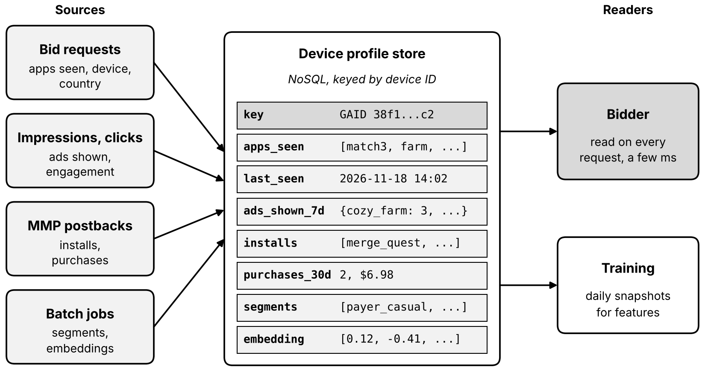

# Inside a Demand Side Platform {#sec-inside-a-demand-side-platform}

In the last two chapters, we treated the DSP as a black box. Bid requests went in, bids came out, and notifications and postbacks flowed back. In this chapter, we open the box. We'll look at what a DSP is as a business, the systems it's made of, how an advertiser sets up a campaign, and what happens inside the bidder in the few milliseconds between receiving a bid request and sending a response. Along the way, we'll define the pricing and campaign terms that the rest of the book relies on, and we'll map each step of the bid path to the models that drive it.

This is still a tutorial chapter. We'll talk about what goes into a campaign, but we won't define the Go structs for it yet, and we'll point back to @sec-the-auction-lifecycle and @sec-measurement-and-mmps rather than re-explaining notifications and postbacks. The goal is a mental model of the whole system that's detailed enough to see where ML fits, and where it doesn't.

## What a DSP Is

A **demand side platform** is the buy-side system that bids on ad inventory for advertisers. Its customers are the advertisers themselves, such as game studios and app developers, and the agencies that buy media on their behalf. In mobile UA, most customers are studios with in-house UA teams, which manage spend across a portfolio of channels: Meta, Google, the ad networks with their own SDKs, and a handful of DSPs. A DSP is one line in that portfolio, and it keeps its budget only as long as it delivers installs and revenue at a cost the studio is happy with.

A DSP makes money through its **margin**, the difference between what the advertiser pays and what the DSP pays for media. We introduced the margin in @sec-introduction as a term in the bid formula. Here's where it comes from in practice. There are two broad ways to bill an advertiser:

- **CPI billing** (or CPA billing, for deeper events). The advertiser pays a fixed price for each attributed install. The DSP buys impressions at whatever price it chooses, and keeps the difference between the install revenue and its media cost. The DSP takes on all of the performance risk. If its models overestimate install rates, it loses money, and if they underestimate them, it underspends.
- **CPM billing with a margin.** The advertiser pays for the media the DSP buys, plus a margin, which can be a fixed percentage of spend or vary from impression to impression. The advertiser takes on more of the performance risk, and judges the DSP on whether the resulting CPI or ROAS meets its goals.

Performance advertising on mobile started out largely on CPI billing. Ad networks sold installs, not impressions, and the network's job was to figure out which impressions would produce them. CPI billing is simple for the advertiser, but it hides the media cost, and a DSP that's good at prediction can earn a large spread without the advertiser knowing what it paid. As UA teams became more sophisticated and moved toward ROAS goals, they pushed for transparency, and the industry shifted toward CPM billing with a disclosed margin. Many DSPs still offer both. For example, Moloco describes working with UA advertisers on a dynamic CPM (dCPM) or CPI basis.[^c3-moloco-pricing] A **dynamic margin** sits between the two: the advertiser sets a CPI or ROAS target, the DSP bills on a CPM basis, and the margin on each impression varies as long as the campaign as a whole hits its target.

The billing model changes what a model error costs. Under CPI billing, an overconfident install model costs the DSP money directly, on its own books, the same day. Under CPM billing, the same error shows up as a worse CPI for the advertiser, which costs the DSP over weeks, through lower budgets and lost customers. Either way, errors cost money, which is why calibration comes up again and again in this book. Throughout the book, we bill on a CPM basis with a margin, and the pricing equations include it.

### Managed vs. Self-Serve

DSPs also differ in who operates the campaigns. On a **managed** platform, the DSP's own account managers set up and run campaigns for the advertiser, based on a brief: the app, the countries, the goal, and the budget. On a **self-serve** platform, the advertiser logs into a UI or calls an API and does all of this themselves.

Most mobile DSPs started as managed services, and many still are. Managed service lets a small customer base get a lot of attention, and it lets the DSP's team catch bad settings before they go live. Self-serve scales to many more advertisers, but everything the account managers used to catch has to be caught by software instead: unreachable targets, broken tracking links, creatives that won't render, and budgets that a model can't spend well. AppLovin is the largest recent example of this shift. It launched a self-serve Axon Ads Manager on a referral-only basis in October 2025, and opened it to all advertisers globally in June 2026.[^c3-axon-selfserve] Moloco also offers a self-serve interface to its DSP.[^c3-moloco-selfserve]

If I were launching a new DSP in 2026, I'd start managed, but build as if it were self-serve. In practice, that means:

- **Build the campaign API before the UI.** Account managers can work from internal tools and scripts at first, and a clean API is what eventually backs both a self-serve UI and integrations with the advertiser's own tools.
- **Validate settings in software from day one.** Every check an account manager does by hand, such as testing a tracking link or checking that a ROAS target is reachable, should become a validation rule. These rules are also what keep bad settings from poisoning training data.
- **Keep the ML universal.** A managed team is tempted to tune each campaign by hand, with per-campaign multipliers and overrides. That doesn't scale, and it hides problems with the models. We return to universal models in Part II.

The ML system doesn't change much between the two. What changes is how robust it has to be to unusual campaign settings, and how much a human is there to notice when something goes wrong.

### Leading With Incremental Value

Whether it's managed or self-serve, a new DSP needs a reason for advertisers to try it. In a market where everyone reports attributed CPI and ROAS, the strongest reason is proof that the DSP causes installs that wouldn't have happened otherwise, as we argued in @sec-introduction. If I were launching a DSP today, I'd make this the core of the product:

- **Hold out from day one.** Keep a small, random control group of devices for every advertiser, using ghost bids, so that every campaign produces an incrementality measurement as a matter of course.
- **Report incremental results next to attributed ones.** Show incremental CPI and incremental ROAS alongside the MMP's numbers, so advertisers can see what their budget actually bought.
- **Price on lift where you can.** Once the holdouts have produced enough data, use it to train models that estimate the lift from each impression, and bid on that.

This costs something. A holdout means some impressions that would have won aren't shown, and incremental numbers are always worse than attributed ones, because they leave out the credit a DSP collects for installs it didn't cause. But advertisers who run their own holdout tests will find that out anyway. Being the platform that tells them first builds the kind of trust that turns a test budget into a large one.

### DSPs and Ad Servers

In this book, we treat the DSP as a mostly standalone system that bids on exchanges and gets its outcomes from MMPs. That's the cleanest way to learn it, and it's how most independent DSPs are built. But as we saw in @sec-the-auction-lifecycle, many companies in mobile ad tech are vertically integrated, with an SDK, a mediation platform or exchange, and a DSP under one roof.

In those companies, the DSP often grows out of an ad network's **ad server**, the system that picks an ad for a placement in an app where the company's own SDK is installed. This changes the plumbing. On one team I worked on, the DSP was built alongside an ad server that had been designed for the supply side. Much of its data infrastructure came from serving ads through our own SDK, where we saw impressions and clicks directly from the device, rather than from MMP postbacks. When we built out the DSP, we reused those pipelines where we could, and added the MMP-focused pieces later. It worked, but some of the assumptions baked into the supply side pipelines, such as which events were reliable and when they arrived, didn't hold for exchange traffic.

If you join a company like this, expect two sources of truth for the same funnel, one from the SDK and one from MMPs, and expect them to disagree. The concepts in this book still apply. You'll just need to know which pipeline each label comes from.

## The Systems Inside a DSP

A DSP is a handful of systems that pass data in a loop. @fig-ch03-systems shows the main ones and how data flows between them.

{#fig-ch03-systems width="100%"}

- **The bidder** receives bid requests from exchanges, decides whether to bid and how much, and returns a bid response. It's the only system on the critical path of the auction, so it has to be fast and it can never go down. Everything that the ML team builds for real-time decisions ends up running inside it, or next to it.
- **Campaign management** is where advertisers, or the DSP's own account managers, set up apps, campaigns, budgets, and creatives, through a UI and an API. The bidder loads a snapshot of every active campaign, and refreshes it every few seconds to a few minutes.
- **Tracking servers** receive the win, billing, and impression notifications from exchanges, and handle clicks, as we saw in @sec-the-auction-lifecycle and @sec-measurement-and-mmps. They have to be highly available, because a notification that's dropped is an impression the DSP can't bill or learn from.
- **Postback ingestion** receives install and in-app event postbacks from MMPs and maps them into a standard format, as we saw in @sec-measurement-and-mmps.
- **Data pipelines** join bids, wins, impressions, clicks, and postbacks into a single view of the funnel. They produce the reports, the device profile updates, and the training datasets. Whether these pipelines run in batches or as streams is one of the bigger design decisions in a DSP, and it shapes how fresh both the profiles and the models can be.
- **Device profiles** store what the DSP knows about each device, in a NoSQL store that the bidder reads on every request. We'll look at them in more detail below.
- **ML training and model serving** turn training data into models, package them into **model bundles** (a model plus everything needed to serve it, such as the feature encoders and calibration tables), and publish them to the bidder.
- **Reporting** shows advertisers how their campaigns are doing, and shows the DSP's own teams how the business is doing.

The bidder also writes one record for every bid it makes, with the request ID, the features the models saw, the predictions, the model versions, and the price. We call this the **bid ledger**, and we'll lean on it heavily in Part III, because it's the most reliable way to get the features that a model saw at bid time into its training data.

The device profile store deserves a special call-out. It's not glamorous, but it powers much of what makes a DSP's models good. Most of the strongest features in mobile UA, such as which apps a device has used and whether it has paid in other games, come from the profile, not the bid request. The profile store is also where some of the most interesting ML engineering in a DSP happens, because it's where precomputed signals, such as pretrained device embeddings, can be stored and served without running a large model on the critical path.

### Real Time and Batch

Data moves through these systems at two speeds. Some of it has to be **real time**. The bidder can't wait to learn that a campaign has spent its budget, or that a device has already seen an ad three times today, so budgets, frequency caps, and some profile updates are handled by streaming pipelines that update within seconds. The rest can be **batch**: reports, training datasets, and most model features are computed every hour or every day, which is cheaper, simpler, and easier to fix when something goes wrong.

Deciding what needs to be real time is one of the bigger product and engineering decisions in a DSP. Fresher data usually helps the models, because a device that installed a game an hour ago is a different prospect than it was yesterday. But every real-time pipeline is more expensive to run and harder to debug than its batch equivalent. Most DSPs start with batch for nearly everything except budgets and caps, and move pieces to real time once they can measure what the freshness is worth. We come back to this tradeoff when we build training pipelines in Part II.

## Trading Locations and Data Centers

A bid response has to reach the exchange within its deadline, and network time counts against it. A round trip between the US East Coast and Europe takes around 80 ms, which on its own would use up much of a typical deadline. So exchanges send bid requests from a few regional data centers, called **trading locations**, and expect bidders to run nearby.

Google's Authorized Buyers lists four trading locations: Northern Virginia, the San Francisco Bay Area, Amsterdam, and Singapore.[^c3-google-peer] AppLovin's exchange sends requests from four regions too, but its Asia-Pacific region is served from Hong Kong and Tokyo, its US East region from New York and Washington, its US West region from San Francisco and San Jose, and its European region from Amsterdam, and it accepts one bidder endpoint per region.[^c3-applovin-regions] Unity's exchange routes all of its global traffic through a single US East data center in Virginia.[^c3-unity-faq] So the answer to "Singapore or Hong Kong?" depends on the exchange, and the regions that matter for a DSP are the ones its biggest exchanges use.

A new DSP should start with a single region, in Northern Virginia. Almost every exchange has a presence there, and US traffic is where most UA budgets go. As the DSP grows, it adds US West, Europe (usually Amsterdam), and Asia-Pacific, so that it can bid on traffic in those regions within the deadline.

Running in more than one region is where things get hard, because the bidder's state no longer lives in one place:

- **Budgets** are shared across regions. A campaign with \$5,000 a day to spend can't let each region spend \$5,000. Regions need to share spend counters, or split budgets ahead of time and rebalance them, and both approaches let a campaign overspend for a short time when traffic shifts.
- **Frequency caps** have the same problem. A device that travels, or whose requests are routed to different regions by different exchanges, can see more ads than its cap allows.
- **Device profiles** need to be available in every region where the device might show up. Replicating every profile everywhere is expensive, and not replicating them means a device seen in Amsterdam has no history when it shows up in Virginia.
- **Models and campaigns** need to reach every region, in sync. A model bundle that's live in one region and stale in another makes A/B tests and monitoring confusing.
- **Logs** need to flow back to wherever training happens, and moving data between clouds or regions has a real cost.
- **Privacy rules** may require some data to stay in the region it came from.

None of these are ML problems on their own, but all of them shape ML systems. For example, pacing models in @sec-pacing-and-budget-control have to work with spend counters that are a few seconds stale, and the features in @sec-feature-logging-and-feature-stores have to be consistent across regions. We won't go deep into multi-region infrastructure in this book, but it's worth knowing that the simple single-region picture eventually stops being true.

## How a Campaign Is Set Up

Let's set up a campaign. Advertisers organize their spend in a hierarchy: an **advertiser** has one or more **apps**, each app has one or more **campaigns**, and each campaign has a set of **creatives**. Many DSPs add **ad groups** between campaigns and creatives, to split a campaign's budget or targeting further. We won't cover ad groups in this book, because they don't change the ML.

Our running example is Cozy Farm Tycoon, the farming game we introduced in @sec-introduction. Cozy Games wants to grow it on Android in the US. Its UA manager sets up a campaign with the settings shown in @fig-ch03-campaign-setup.

{#fig-ch03-campaign-setup width="100%"}

Here's what the advertiser provides, and why each setting matters:

- **The store ID.** The app's ID in the app store, `com.cozygames.farmtycoon` on Google Play. It identifies the app being advertised, and it's how the DSP avoids showing the ad to people who already have the app.
- **MMP tracking links.** The click and impression URLs from the advertiser's MMP, which the DSP calls when a user clicks or sees an ad, as we saw in @sec-measurement-and-mmps. A broken tracking link means installs that never get attributed, and a campaign that looks like it's failing when it isn't. Testing these links before launch is one of the first validation rules a DSP should automate.
- **Countries and targeting.** Where the campaign runs, and any other restrictions: OS versions, device types, connection types, and supply that the advertiser wants to avoid, such as apps for children. Targeting is a hard filter. It decides which requests a campaign is eligible for, not how much it bids.
- **Budgets.** How much the campaign can spend, usually per day, sometimes with a total. The DSP spreads the budget across the day with pacing, which we cover in @sec-pacing-and-budget-control.
- **The goal and its target value.** What the advertiser is buying, such as installs at a target CPI of \$5, or revenue at a target D7 ROAS of 40%. This is where the models come in. The goal tells the DSP what to predict, and the target tells it how much a predicted outcome is worth. We'll go through the goals in the next section.
- **Bid caps.** The most the campaign will pay for an impression, as a CPM. A bid cap protects the advertiser from a model that's wildly overconfident, and it's a useful guardrail even when the models are good.
- **Frequency caps.** How often the same device can see the campaign's ads, such as three impressions per device per day. Users who've seen an ad five times and haven't installed rarely install on the sixth, and frequency caps keep the DSP from wasting money on them.
- **Creatives.** The ads themselves: videos, playables, and end cards, which we cover below.

Most of these settings are rules. Targeting and caps are filters, the budget is a constraint, and the store ID and tracking links are plumbing. The goal and target are different. They're the only settings that turn into a price, and every price depends on model predictions. The core models here are **conversion models**, which predict the chance of a click, an install, or a deeper event, and **value models**, which predict how much revenue an install will produce. Other models help along the way. **Win rate models** predict the chance that a bid wins, and are the basis for bid shading in @sec-win-rate-and-bid-shading. Ranking models narrow down which campaigns to consider, and creative models choose what to show. We'll map all of these to the bid path at the end of this chapter.

## Goals and What They Require the DSP to Predict

The goal type decides which predictions the DSP needs. @tbl-c03-goals lists the common goals in mobile UA, and what the DSP has to predict for each one.

| Goal | What the advertiser buys | What the DSP predicts |
|------|--------------------------|-----------------------|
| CPI | Installs at a target cost per install | Click rate and install rate |
| CPA | A post-install event, such as a tutorial completion or a first purchase, at a target cost | Install rate and the chance of the event after install |
| D7 ROAS | In-app purchase revenue in the first 7 days, at a target return on ad spend | Install rate and predicted 7-day revenue per install |
| D1 retention | Installs that come back the next day | Install rate and the chance of a day-1 return |
| Ad ROAS | Ad revenue in the first days after install, common for hypercasual games | Install rate and predicted ad revenue per install |
| Incremental CPI | Installs that wouldn't have happened without the ad, at a target cost | Install rate with the ad and without it, and the difference between them (the lift) |

: Common goal types in mobile UA, and the predictions each one requires. Every goal needs an install rate model. Deeper goals add a model for what happens after the install. {#tbl-c03-goals}

Two patterns stand out. First, every goal needs a good install rate prediction, which is why conversion models get so much attention in this book. Second, the deeper the goal, the longer the DSP waits to learn whether it was right. An install postback arrives within hours, a D1 retention event a day later, and a D7 revenue total a week later. Longer delays make training and monitoring harder, as we'll see in @sec-value-prediction.

We saw how predictions become a bid for CPI and ROAS goals in @sec-introduction. The other goals follow the same pattern: multiply the predicted outcome per impression by what the advertiser will pay for it, take out the margin, and express the result per thousand impressions. We work through all of them in @sec-from-predictions-to-bids. For now, here's the vocabulary that the rest of the book uses for pricing.

- **Advertiser value ($A$).** What an impression is worth to the advertiser per thousand impressions, given the predictions and the goal. For a CPI goal, it's the predicted installs per thousand impressions times the target CPI.
- **Calibration multiplier ($\kappa$).** A correction for models that are systematically too high or too low, measured as realized outcomes divided by predicted outcomes on recent wins.
- **Pacing multiplier ($\gamma$).** A factor that scales values up or down so that a campaign spends its budget evenly over the day.
- **Media value ($v_m$).** What the impression is worth to the DSP after calibration, pacing, the margin, and any fees the DSP pays on top of the media cost. It's the most the DSP should pay.
- **Floor.** The minimum price the exchange will accept, sent in the bid request.
- **Win rate ($W(b)$).** The chance that a bid of $b$ wins the auction.
- **Shaded bid.** The price the DSP actually bids, usually below the media value, chosen to trade some chance of winning for a lower price. We cover shading in @sec-win-rate-and-bid-shading.
- **Surplus.** The media value minus the price paid. In a first-price auction, the surplus is what's left for the DSP after paying for a win, so the bid that maximizes expected surplus balances the win rate against the price.
- **Clear rate.** The share of wins that become billable impressions, from @sec-the-auction-lifecycle.
- **Internal auction.** The comparison between the DSP's own candidate campaigns for a request, which picks the one campaign that bids. It's internal because the exchange never sees the losing campaigns.
- **Lift.** The extra chance of an install that an impression causes: the install rate with the ad minus the install rate without it. Pricing on lift, rather than on the attributed install rate, is how a DSP bids on incremental value. We build this up in @sec-incrementality-and-uplift.

## Creatives

A **creative** is the ad itself. @sec-introduction introduced the main formats. Here's how a DSP thinks about them:

- **Video** is the workhorse of mobile UA. Most video ads are 15 to 30 seconds long, shown as interstitials or as rewarded videos.
- **Playables** are small interactive HTML ads that let the user try the game. They're expensive to build, and they tend to bring in users who keep playing.
- **End cards** are the static or lightly animated screens shown after a video, with an install button. Many campaigns pair the same video with several end cards.
- **Interstitial and rewarded** describe the placement more than the creative. The same video can run as an interstitial, which the user didn't ask for, or as a rewarded video, which they chose to watch. Users respond very differently to the two, so the placement type is one of the most important features in any conversion model.

Video ads are usually described with **VAST** (Video Ad Serving Template), an XML standard from the IAB Tech Lab that tells the player which media files to play, which tracking URLs to call at each stage, and what to show at the end.[^c3-vast] The DSP returns the VAST, or HTML for a playable, in the ad markup of the bid response. As we said in @sec-introduction, we won't cover how to build ad markup in this book.

Not every exchange supports every format. Some support playables, and others only video and static images. Some accept VAST with a playable end card, and others don't. The bid request says which formats a placement allows, so a creative that the exchange can't render isn't eligible. On top of that, most exchanges review creatives before they can serve. For example, Unity's onboarding includes validation of creative assets.[^c3-unity-start] A creative that fails review on one exchange might still be live on others, which means the set of eligible creatives for a campaign can differ by exchange.

The modeling side of creatives, such as using creative IDs as features and choosing between creatives, is a topic for Part II and @sec-creative-selection.

## The Bid Path

Now let's follow a single bid request through the bidder. A player in Gem Garden, the match-3 game we have followed since @sec-introduction, finishes a level. The mediation SDK starts an auction for a rewarded video, and an exchange sends our DSP a bid request with a deadline of 200 ms. Here's what the bidder does with it.

1. **Parse and validate the request.** Each exchange sends its own variant of OpenRTB, so the bidder maps the request into one internal format, as we discussed in @sec-the-auction-lifecycle. Requests that are malformed, or that are missing fields the bidder needs, such as the app or the device's OS, are dropped here with a no-bid.
2. **Look up the device profile.** If the request has a device ID, the bidder fetches the device's profile from the profile store. If the lookup times out, the bidder carries on without it, rather than missing the deadline.
3. **Check eligibility.** The bidder filters the full set of active campaigns down to the ones that can bid on this request. This step is all rules: the campaign's targeting (country, OS, device type), its remaining budget, its frequency cap for this device, whether the placement allows any of its creative formats, policy rules, and blocklists of apps or publishers. It also drops campaigns for apps the device already has installed.
4. **Select candidate campaigns.** When many campaigns are eligible, scoring all of them with the full models can be too slow. A cheaper ranking step picks the most promising candidates to score in full. With a few dozen campaigns, this step can be skipped. With thousands, it's essential, and it's the subject of @sec-campaign-selection.
5. **Select a creative.** For each candidate campaign, the bidder picks the creative to show, among those that this exchange and placement can render.
6. **Predict.** For each campaign and creative pair, the models predict what the campaign's goal needs: click and install rates, and deeper events or revenue for deeper goals. This is usually the most expensive step.
7. **Price.** The predictions and the campaign's target become an advertiser value, then a media value after calibration, margin, and fees, and then a shaded bid, which is clipped to the floor and the campaign's bid cap.
8. **Pace.** The pacing multiplier for each campaign scales its bid up or down to keep its spend on track, and campaigns that are ahead of their budget may skip the request.
9. **Pick a winner.** The internal auction compares the remaining bids, and the campaign with the highest expected surplus becomes the one bid the DSP sends.
10. **Send the response.** The bidder builds the bid response, with the price, the ad markup, and the notification URLs, sends it to the exchange, and writes the bid ledger record.

@fig-ch03-bid-path shows the steps, with illustrative timings and the number of items each step considers. The shape is what matters. Eligibility cuts a large set of campaigns down to a smaller one with cheap rules, candidate selection narrows it further, and the expensive models only run on what's left.

{#fig-ch03-bid-path width="100%"}

The response isn't the end of the story. If the bid wins, the exchange sends a win notification, and if the ad is shown, a billing notification, as we saw in @sec-the-auction-lifecycle. If the player taps the ad and installs Cozy Farm Tycoon, the MMP sends an install postback, and later postbacks for purchases, as we saw in @sec-measurement-and-mmps. Each of these is joined back to the bid ledger record by the auction ID or the click ID, and that join is what turns this bid into a training example.

## Latency Budgets

Every bid request carries a deadline, the `tmax` field. For example, Unity's exchange gives bidders up to 200 ms to respond, and for in-app bidding auctions the mediation platform sets the deadline, with 50 ms taken out for Unity's own processing.[^c3-unity-start] The deadline includes the network time in both directions, so the time left for the bidder itself is much smaller than `tmax`.

A DSP sets its own **internal budget** for processing a request, which is usually much tighter than the exchange's deadline. A budget of 10 to 50 ms is common, and less is better. There are a few reasons to leave so much room:

- **Network time varies.** The round trip to the exchange is usually fast within a region, but it has a long tail, and a response that's late is a lost auction.
- **The tail matters more than the average.** At a million requests per second, the slowest 1% is ten thousand requests every second. The bidder has to meet its budget at the 99th percentile, not just on average.
- **Cost scales with time.** A bidder that takes twice as long per request needs roughly twice the servers. At the scale of a DSP, latency is a cost line, not just a quality metric.

As @fig-ch03-bid-path shows, the time inside the bidder is usually dominated by the profile lookup and the model predictions. The profile lookup is a network call, so its cost is mostly waiting. Prediction is computation, and its cost grows with the number of candidates and the size of the models. That's why serving is such a large part of this book. A model that's 1% better offline but takes three times as long to run may not be worth it, unless it can run on fewer candidates or be moved off the critical path.

Each step also needs a plan for when it's too slow or fails. If the profile lookup times out, bid without the profile. If a model fails to load, fall back to the previous version or a simpler model. If everything goes wrong, return no bid rather than a bad one. These **fallbacks** are cheap to design up front and expensive to add after an incident, and we cover them in @sec-fallbacks-playbooks-and-on-call.

## Device Profiles

@fig-ch03-device-profile shows what a device profile looks like inside a DSP, where its data comes from, and who reads it.

{#fig-ch03-device-profile width="100%"}

The hard constraint is speed. The profile store has to answer a lookup in a few milliseconds, at the full request rate of the bidder, for billions of devices. That rules out most relational databases, and DSPs typically use key-value or wide-column NoSQL stores, with the device ID as the key. Because the lookup is a network call on the critical path, the bidder gives it a strict timeout and bids without the profile if it doesn't answer in time.

Updates come from two kinds of pipeline, matching the two speeds we saw earlier. Streaming updates keep the fast-changing parts fresh within seconds or minutes:

- **Apps seen**, from the bid requests the DSP receives. This is the DSP's view of what the user plays, and one of the strongest signals for predicting what they'll install next.
- **Ads shown and engagement**, which power frequency caps and features like "how many times has this device seen this campaign this week."
- **Installs and purchases**, from MMP postbacks for the apps the DSP has advertised. A device that has paid in other games is far more likely to pay in the next one.

Batch updates, recomputed every few hours or every day, write back slower-moving values:

- **Segments and embeddings**, such as a predicted spender tier or a learned embedding of the device's app history.

Profiles matter a lot for ML, for two reasons. First, they're where most of the strong features come from, so their freshness and coverage put a ceiling on model quality, which is why the gap between Android and iOS coverage matters so much. Second, the profile is a natural place to store precomputed model outputs. A large sequence model can't run on every request in a few milliseconds, but it can run offline over each device's history and write an embedding to the profile, which a small model in the bidder then uses as a feature. That pattern, heavy models offline and light models online, comes up again and again in the rest of the book.

## Where ML Fits

Every bid comes down to three decisions:

- **What to show.** Which campaign and which creative, among the eligible ones.
- **Whether to bid.** Whether this impression is worth anything to any of our advertisers, given what we know about the device and the placement.
- **How much to bid.** The price, given the value, the competition, and the budget.

Each step of the bid path supports one of these decisions, and the steps that aren't rules are driven by models. @fig-ch03-ml-map maps the steps to the models behind them.

{#fig-ch03-ml-map width="100%"}

- **Conversion models** predict clicks, installs, and deeper events. They're the core of the bidder.
- **Value models** predict revenue and retention for ROAS and retention goals.
- **Win rate models** predict the chance of winning at a given price, and drive bid shading and spend forecasts.
- **Ranking models** narrow down the candidates when there are too many campaigns to score in full.
- **Creative models** choose what to show for a campaign.
- **Pacing controllers** keep each campaign on budget, using forecasts from the win rate model.
- **Pretrained device signals**, such as embeddings stored in the profile, feed into the other models.
- **Uplift models** estimate how much an impression changes the chance of an install, rather than the chance itself, using data from ghost bid holdouts.

A new DSP doesn't need all of these on day one. A single conversion model, a fixed shading factor per exchange, a simple pacing rule, and every eligible campaign scored in full will get a DSP bidding. We start with conversion models in Part II, and the rest of the book adds the others one at a time, in roughly the order that they start to matter.

## A Bid by the Numbers

Let's put the pieces of Part I together, with one bid. A player in Gem Garden finishes a level, and the exchange sends our DSP a request for a rewarded video. The Cozy Farm Tycoon campaign from @fig-ch03-campaign-setup is eligible, with its D7 ROAS goal of 40%. @tbl-c03-bid-numbers follows the bid from predictions to price. The numbers are illustrative, but the steps are the ones every bid goes through.

| Step | Value | What it means |
|------|-------|---------------|
| Predicted click rate | 2% | 2 of every 100 players who see the ad tap it |
| Predicted install rate after click | 5% | 1 in 20 of those players installs |
| Predicted installs per 1,000 impressions (IPM) | 1.0 | $0.02 \times 0.05 \times 1{,}000$ |
| Predicted D7 revenue per install | \$2.00 | What a new player spends in their first week |
| Value of an install | \$5.00 | \$2.00 of revenue at a 40% ROAS target |
| Advertiser value ($A$) | \$5.00 CPM | 1 install per 1,000 impressions, worth \$5.00 each |
| Calibration multiplier ($\kappa$) | 0.90 | The model has been running 10% high, so scale down |
| Pacing multiplier ($\gamma$) | 1.05 | The campaign is behind on spend today, so bid a bit more |
| Margin | 20% | The DSP's share, fixed here; a dynamic margin would vary it per impression |
| Media value ($v_m$) | \$3.78 CPM | $5.00 \times 0.90 \times 1.05 \times 0.80$, the most the DSP should pay |
| Floor | \$1.50 CPM | The exchange's minimum price |
| Shaded bid | \$2.84 CPM | 75% of the media value, chosen with the win rate model |
| Surplus if the bid wins | \$0.94 CPM | The media value minus the price paid |

: One bid by the numbers, for the Cozy Farm Tycoon campaign. Every value above the floor depends on a model prediction or on the campaign's settings. {#tbl-c03-bid-numbers tbl-colwidths="[40,17,43]"}

Suppose the DSP wins 100,000 impressions like this one over the day, and the exchange clears all of them. In a first-price auction, the DSP pays what it bid, so its media cost is \$284. Under CPM billing with a 20% margin, Cozy Games is billed \$355, and the DSP keeps \$71. The model expected 100 installs, but because it runs 10% high, about 90 come in, each spending \$2.00 in the first week as predicted. That's \$180 of revenue on \$355 of spend, a D7 ROAS of about 51%, comfortably above the 40% target, at a CPI of about \$3.94.

Four things are worth noticing. First, the campaign beat its target because of calibration and shading: the calibration multiplier corrected the model's overconfidence, and shading kept the price below the media value. Without $\kappa$, the DSP would have paid for 100 installs and received 90. Second, beating the target isn't free money. It's a signal that the DSP could bid higher and win more of the impressions it's losing, which is what the advertiser really wants, since a campaign that hits its ROAS target at a larger scale is worth more to them than one that beats it on a small budget. Balancing those two is the job of the pacing and shading models. Third, the 51% is an attributed number. Suppose the DSP's ghost bid holdout shows that a third of those 90 installs would have happened anyway. Only 60 installs were incremental, so the incremental CPI is about \$5.92, and the incremental D7 ROAS is \$120 on \$355, about 34%, below the advertiser's target. A campaign that looked like a success on the MMP's report missed its goal once you account for the installs it didn't cause. That's the gap a DSP built around incremental value would close, by bidding on the lift for each impression instead of the attributed install rate.

Fourth, nothing here was known for certain at bid time. The click rate, the install rate, the revenue, the calibration, and the win rate were all predictions, and the realized ROAS only became known a week later, through MMP postbacks. Every model in this book is about getting one of those numbers right.

## Conclusion

In this chapter, we looked inside the DSP. We saw how a DSP makes money through its margin, how billing has moved from CPI to CPM with a disclosed margin, and why a new DSP should start managed but build for self-serve. We walked through the systems that make up a DSP, and why running in more than one trading location makes all of them harder. We set up a campaign for Cozy Farm Tycoon, mapped each goal type to the predictions it needs, and defined the pricing vocabulary the rest of the book uses. We followed a bid request through the ten steps of the bid path, with a latency budget measured in milliseconds, and mapped each step to the models behind it. We worked one bid for Cozy Farm Tycoon through from predictions to price to realized ROAS, and saw how the same campaign can look like a success on attributed numbers and miss its goal on incremental ones. And we made the case that a new DSP should lead with incremental value, using ghost bid holdouts from day one.

That completes our tour of how mobile ad tech works. In Part II, we'll get hands-on. We'll start with the data and labels that come out of the funnel, and build the first model a DSP needs: a conversion model that predicts installs from features that are available at bid time.

[^c3-moloco-pricing]: Moloco, "How to pick a mobile DSP," <https://www.moloco.com/blog/how-to-pick-a-mobile-dsp>. Moloco describes UA pricing on a dCPM or CPI basis, re-engagement on a CPC basis, and dCPM pricing in its self-serve product.
[^c3-axon-selfserve]: PPC Land, "AppLovin's \$1.84B Q1 beats guidance as Axon platform opens to all in June," May 2026, <https://ppc.land/applovins-1-84b-q1-beats-guidance-as-axon-platform-opens-to-all-in-june/>.
[^c3-moloco-selfserve]: Moloco, "Self-serve DSP," <https://www.moloco.com/products/self-serve-dsp>.
[^c3-google-peer]: Google, "Latency Restrictions and Peering," Authorized Buyers real-time bidding documentation, <https://developers.google.com/authorized-buyers/rtb/peer-guide>. Google notes that requests can come from anywhere in a cluster, not only the trading location itself, and that bidders need to be reachable from every trading location to receive all impressions.
[^c3-applovin-regions]: AppLovin, "AppLovin ORTB specification: Introduction," MAX demand partner documentation, <https://support.axon.ai/en/max/demand-partners/demand-side-platforms/applovin-ortb-specification/introduction>.
[^c3-unity-faq]: Unity, "Frequently asked questions," Unity Exchange documentation, <https://docs.unity.com/en-us/grow/programmatic/unity-exchange/faq>.
[^c3-vast]: IAB Tech Lab, "Video Ad Serving Template (VAST)," <https://iabtechlab.com/standards/vast/>.
[^c3-unity-start]: Unity, "Getting started with Unity Exchange," Unity Grow documentation, <https://docs.unity.com/en-us/grow/programmatic/unity-exchange/get-started>.
