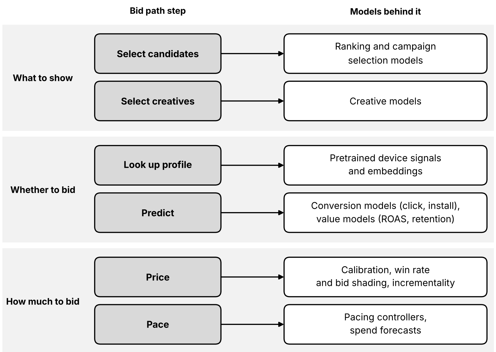

# Inside a Demand Side Platform {#sec-inside-a-demand-side-platform}

In the last two chapters, we treated the DSP as a black box. Bid requests went in, bids came out, and notifications and postbacks flowed back. In this chapter, we open the box. We'll look at what a DSP is as a business, the systems it's made of, how an advertiser sets up a campaign, how predictions become a price, and what happens inside the bidder in the few milliseconds between a bid request and a response. Along the way, we'll define the pricing terms the rest of the book relies on, and map each step of the bid path to the models that drive it. We'll talk about what goes into a campaign, but we won't write any code yet. The goal is a mental model of the whole system that's detailed enough to see where ML fits, and where it doesn't.

## What a DSP Is

A **demand side platform** is the buy-side system that bids on ad inventory for advertisers. Its customers are the advertisers themselves, such as game studios and app developers, and the agencies that buy on their behalf. In mobile UA, most customers are studios with in-house UA teams, which spread spend across Meta, Google, ad networks, and a handful of DSPs. A DSP is one line in that portfolio, and it keeps its budget only as long as it delivers installs and revenue at a cost the studio is happy with.

A DSP makes money through its **margin**, the difference between what the advertiser pays and what the DSP pays for media. There are two broad ways to bill an advertiser:

- **CPI billing** (or CPA billing, for deeper events). The advertiser pays a fixed price for each attributed install, and the DSP keeps the difference between that and its media cost. The DSP takes on all of the performance risk.
- **CPM billing with a margin.** The advertiser pays for the media the DSP buys, plus a margin, which can be fixed or vary from impression to impression. The advertiser takes on more of the risk, and judges the DSP on whether the resulting CPI or ROAS meets its goals.

Performance advertising on mobile started out largely on CPI billing. Ad networks sold installs, not impressions. CPI billing is simple for the advertiser, but it hides the media cost, and a DSP that's good at prediction can earn a large spread without the advertiser knowing what it paid. As UA teams moved toward ROAS goals, they pushed for transparency, and the industry shifted toward CPM billing with a disclosed margin, although many DSPs still offer both. For example, Moloco describes working with UA advertisers on a dynamic CPM (dCPM) or CPI basis.[^c3-moloco-pricing] A **dynamic margin** sits between the two: the advertiser sets a target, the DSP bills on a CPM basis, and the margin varies per impression as long as the campaign hits its target.

The billing model changes what a model error costs. Under CPI billing, an overconfident install model costs the DSP money directly, the same day. Under CPM billing, the same error shows up as a worse CPI for the advertiser, which costs the DSP over weeks, through lower budgets and lost customers. Throughout the book, we bill on a CPM basis with a margin.

### The Business Model

As an illustrative example, a DSP whose advertisers spend \$100 million a year on media through it, at an average margin of 25%, has about \$25 million of revenue. Its costs fall into three groups. **Infrastructure** comes first, because the bidder has to answer every bid request, including the large majority it doesn't bid on, so the cost of processing a million requests is one of the most important numbers in the business. Then **people**, and **working capital**, since a DSP typically pays exchanges before its advertisers pay it.

For an ML team, the infrastructure cost is a design constraint: it's why the bid path filters cheaply before it predicts, and why a model that's slightly better but much slower can lose money. Scale also feeds the models. More spend means more wins, more wins mean more installs to learn from, and better models bring more spend. This flywheel is why the market has consolidated, and why a new DSP needs an edge that doesn't depend on being big.

### Managed vs. Self-Serve

DSPs also differ in who operates the campaigns. On a **managed** platform, the DSP's own account managers set up and run campaigns based on the advertiser's brief. On a **self-serve** platform, the advertiser does this through a UI or an API. Most mobile DSPs started as managed services. Self-serve scales to many more advertisers, but everything the account managers used to catch, such as broken tracking links, unreachable targets, and creatives that won't render, has to be caught by software instead. AppLovin is the largest recent example of the shift: it launched a self-serve Axon Ads Manager on a referral-only basis in October 2025, and opened it to all advertisers in June 2026.[^c3-axon-selfserve] Moloco also offers a self-serve interface to its DSP.[^c3-moloco-selfserve]

### Launching a DSP Today

If I were launching a DSP today, I'd make proving incremental value the core of the product, as we argued in @sec-introduction, and I'd start managed while building as if it were self-serve:

- **Hold out from day one.** Keep a small, random control group of devices for every advertiser, using the ghost bids we saw in @sec-measurement-and-mmps, so that every campaign produces an incrementality measurement as a matter of course.
- **Report incremental results next to attributed ones.** Show incremental CPI and ROAS alongside the MMP's numbers, so advertisers can see what their budget actually bought.
- **Build the campaign API before the UI, and validate settings in software.** Every check an account manager does by hand should become a rule, which also keeps bad settings from poisoning training data.
- **Keep the ML universal.** Per-campaign multipliers and manual overrides, such as the overbids we'll see below, don't scale, and they hide problems with the models.

Holdouts cost something: some impressions that would have won aren't shown, and incremental numbers always look worse than attributed ones. But advertisers who run their own holdout tests will find that out anyway, and being the platform that tells them first builds the trust that turns a test budget into a large one.

### DSPs and Ad Servers

We treat the DSP as a standalone system that bids on exchanges and learns from MMPs. But many companies are vertically integrated, and their DSP often grows out of an ad network's **ad server**, which picks ads for apps where the company's own SDK is installed. On one team I worked on, the DSP reused data pipelines built for serving ads through our own SDK, where impressions and clicks came straight from the device, and some of their assumptions about which events were reliable didn't hold for exchange traffic. If you join a company like this, expect two sources of truth for the same funnel, one from the SDK and one from MMPs, and expect them to disagree.

## The Systems Inside a DSP

A DSP is a handful of systems that pass data in a loop. @fig-ch03-systems shows the main ones.

{#fig-ch03-systems width="100%"}

- **The bidder** receives bid requests, decides whether to bid and how much, and returns a response. It's the only system on the critical path of the auction, so it has to be fast and it can never go down. Everything the ML team builds for real-time decisions runs inside it, or next to it.
- **Campaign management** is where campaigns, budgets, and creatives are set up, through a UI and an API. The bidder loads a snapshot of every active campaign and refreshes it every few seconds to minutes.
- **Tracking servers** receive the win and billing notifications from exchanges, and handle clicks. A dropped notification is an impression the DSP can't bill or learn from.
- **Postback ingestion** receives install and in-app event postbacks from MMPs and maps them into a standard format.
- **Data pipelines** join bids, wins, impressions, clicks, and postbacks into a single view of the funnel, and produce reports, profile updates, and training data.
- **Device profiles** store what the DSP knows about each device, in a fast store the bidder reads on every request.
- **ML training and model serving** turn training data into **model bundles** (a model plus everything needed to serve it, such as feature encoders and calibration tables) and publish them to the bidder.
- **Reporting** shows advertisers, and the DSP's own teams, how campaigns are doing.

The bidder also writes one record for every bid, with the request ID, the features the models saw, the predictions, the model versions, and the price. We call this the **bid ledger**. It's the most reliable way to get the features a model saw at bid time into its training data, and we'll lean on it heavily later in the book.

### Real Time and Batch

Data moves through these systems at two speeds. Budgets, frequency caps, and some profile updates have to be **real time**, because the bidder can't wait to learn that a campaign has spent its budget. Reports, training datasets, and most features can be **batch**, computed every hour or day, which is cheaper, simpler, and easier to fix. Fresher data usually helps the models, because a device that installed a game an hour ago is a different prospect than it was yesterday, but every real-time pipeline costs more and is harder to debug. Most DSPs start with batch for nearly everything except budgets and caps, and move pieces to real time once they can measure what freshness is worth.

## Trading Locations and Data Centers

A bid response has to reach the exchange within its deadline, and network time counts against it. A round trip between the US East Coast and Europe takes around 80 ms, so exchanges send bid requests from a few regional data centers, called **trading locations**, and expect bidders to run nearby. Google's Authorized Buyers lists Northern Virginia, the San Francisco Bay Area, Amsterdam, and Singapore.[^c3-google-peer] AppLovin's exchange uses four regions, with Asia-Pacific served from Hong Kong and Tokyo.[^c3-applovin-regions] Unity's exchange routes all of its traffic through a single US East data center in Virginia.[^c3-unity-faq]

A new DSP should start in one region, Northern Virginia, where almost every exchange has a presence and most UA budgets are spent, and add US West, Europe, and Asia-Pacific as it grows. Running in more than one region is where things get hard, because the bidder's state no longer lives in one place. Budgets and frequency caps have to be shared across regions, device profiles have to be available wherever a device shows up, model bundles have to reach every region in sync, logs have to flow back to wherever training happens, and some privacy rules require data to stay where it came from. None of these are ML problems on their own, but they shape ML systems. For example, pacing has to work with spend counters that are a few seconds stale.

## How Advertisers Buy

Before a campaign exists, an advertiser has to decide to try the DSP, and the UA team's process sets the conditions a DSP's models have to perform under. Adding a new DSP usually looks like this:

1. **Integration.** The DSP has to be an integrated partner in the advertiser's MMP, so that installs can be attributed to it and postbacks can flow back.
2. **A test budget.** The team starts with a small daily budget against a goal it already measures on other channels, such as a D7 ROAS target, for a few weeks, because D7 results can only be read a week after each install.
3. **Evaluation.** The team compares the DSP with its other channels on the same MMP metrics, and sophisticated teams also run holdout tests.
4. **Scale or cut.** If the DSP hits its targets, the budget grows in steps. If it misses, it's cut, and it's hard to get a second test.

Each step is a requirement for the ML system. A short test with a new advertiser is a cold start problem, which models that learn across all advertisers solve. Holding results as the budget grows means buying deeper into the ranked list of impressions, where calibration keeps bids honest. Steady day-to-day delivery is the job of pacing. And results that have to survive an advertiser's own holdout test are why incrementality matters.

## How a Campaign Is Set Up

Advertisers organize their spend in a hierarchy: an **advertiser** has one or more **apps**, each app has one or more **campaigns**, and each campaign has a set of **creatives**. Many DSPs add **ad groups** between campaigns and creatives, but they don't change the ML, so we won't cover them. Our running example is Cozy Farm Tycoon. Cozy Games' UA manager sets up a campaign with the settings shown in @fig-ch03-campaign-setup.

{#fig-ch03-campaign-setup width="100%"}

- **The store ID**, `com.cozygames.farmtycoon`, identifies the app being advertised, and lets the DSP avoid showing the ad to people who already have it.
- **MMP tracking links** are the URLs the DSP calls when a user clicks or sees an ad. A broken link means installs that never get attributed, so testing links before launch is one of the first rules a DSP should automate.
- **Countries and targeting** decide which requests a campaign is eligible for: OS versions, device types, and supply the advertiser wants to avoid, such as apps for children. Targeting is a filter, not a price.
- **Budgets** set how much the campaign can spend, usually per day, spread across the day by pacing.
- **The goal and its target**, such as installs at a \$5 CPI or a D7 ROAS of 40%. This is where the models come in: the goal tells the DSP what to predict, and the target tells it what a predicted outcome is worth.
- **Bid caps** set the most the campaign will pay for an impression, a guardrail against an overconfident model.
- **Frequency caps** limit how often the same device sees the campaign, because a player who has seen an ad five times without installing rarely installs on the sixth.
- **Creatives** are the ads themselves, which we cover below.

Most of these settings are rules: filters, constraints, and plumbing. The goal and target are the only settings that turn into a price, and every price depends on model predictions.

### Manual Levers and Overbids

Campaign management usually also has levers that aren't in the advertiser's brief. The most common is an **overbid**: a multiplier that an account manager applies to raise a campaign's bids above what its goal and the models say an impression is worth, usually to hit a spend target, such as a new campaign that's ramping up slowly or a committed monthly budget.

Some manual control is necessary, because a DSP has to be able to deliver the spend it promised. But forcing the DSP to override its own goals and pricing to get there is usually a bad idea. An overbid pays more than the models think an impression is worth, so it hurts the advertiser's results. It also distorts the data the models learn from, since wins bought at inflated prices teach the win rate and calibration models the wrong lessons, and it hides model problems behind a layer of manual adjustments. It's also hard to unwind: removing an overbid drops spend, so the lever tends to stay on, and more get added over time. In my experience, legacy systems accumulate too many of these levers, and it becomes a system that's hard to get out of. The pacing multiplier, which we'll see shortly, is the automated and bounded version of the same idea, and it's where spend control belongs.

## Goals and What They Require the DSP to Predict

The goal type decides which predictions the DSP needs. @tbl-c03-goals lists the common goals in mobile UA.

| Goal | What the advertiser buys | What the DSP predicts |
|------|--------------------------|-----------------------|
| CPI | Installs at a target cost per install | Click rate and install rate |
| CPA | A post-install event, such as a first purchase, at a target cost | Install rate and the chance of the event after install |
| D7 ROAS | In-app purchase revenue in the first 7 days, at a target return on ad spend | Install rate and predicted 7-day revenue per install |
| D1 retention | Installs that come back the next day | Install rate and the chance of a day-1 return |
| Ad ROAS | Ad revenue in the first days after install, common for hypercasual games | Install rate and predicted ad revenue per install |
| Incremental CPI | Installs that wouldn't have happened without the ad, at a target cost | Install rate with the ad and without it, and the difference (the lift) |

: Common goal types in mobile UA, and the predictions each one requires. Every goal needs an install rate model. Deeper goals add a model for what happens after the install. {#tbl-c03-goals tbl-colwidths="[20,42,38]"}

Every goal needs a good install rate prediction, which is why conversion models get so much attention in this book. And the deeper the goal, the longer the DSP waits to learn whether it was right: an install postback arrives within hours, a D1 retention event a day later, and a D7 revenue total a week later.

### From Predictions to a Price

Here's how predictions become a bid for a campaign with a CPI goal. The DSP predicts the probability that the user clicks on the ad, $p_{\text{click}}$, and the probability that the user installs after clicking, $p_{\text{install} \mid \text{click}}$.[^c3-view-through] The value of the impression is the chance of an install times what the advertiser will pay for it, minus the margin, expressed as a CPM:

$$
\text{CPM} = \text{target CPI} \times p_{\text{click}} \times p_{\text{install} \mid \text{click}} \times 1000 \times (1 - \text{margin})
$$

With a target CPI of \$5, a predicted click rate of 2%, a predicted install rate after click of 5%, and a 20% margin, the expected installs per thousand impressions (IPM) is $0.02 \times 0.05 \times 1000 = 1$, and the bid is \$4.00. For a ROAS goal, the DSP also predicts the revenue an installed user will generate in the first seven days, and divides it by the target ROAS to get the value of an install:

$$
\text{CPM} = p_{\text{click}} \times p_{\text{install} \mid \text{click}} \times \frac{\text{predicted D7 revenue}}{\text{target D7 ROAS}} \times 1000 \times (1 - \text{margin})
$$

With a predicted D7 revenue of \$2.00 and a target D7 ROAS of 40%, an install is worth \$5, and the bid is again \$4.00. The other goals follow the same pattern: multiply the predicted outcome per impression by what the advertiser will pay for it, take out the margin, and express the result per thousand impressions.

Real bidders adjust this value before they bid. Here's the vocabulary the rest of the book uses:

- **Advertiser value ($A$).** What an impression is worth to the advertiser per thousand impressions, given the predictions and the goal. For a CPI goal, it's the predicted IPM times the target CPI.
- **Calibration multiplier ($\kappa$).** A correction for models that run systematically high or low, measured as realized outcomes divided by predicted outcomes on recent wins.
- **Pacing multiplier ($\gamma$).** A factor that scales values up or down so that a campaign spends its budget evenly over the day.
- **Media value ($v_m$).** What the impression is worth to the DSP after calibration, pacing, the margin, and any fees. It's the most the DSP should pay.
- **Floor.** The minimum price the exchange will accept, sent in the bid request.
- **Win rate ($W(b)$).** The chance that a bid of $b$ wins the auction.
- **Shaded bid.** The price the DSP actually bids, usually below the media value, trading some chance of winning for a lower price. We cover shading in @sec-win-rate-and-bid-shading.
- **Surplus.** The media value minus the price paid. The bid that maximizes expected surplus balances the win rate against the price.
- **Clear rate.** The share of wins that become billable impressions.
- **Internal auction.** The comparison between the DSP's own candidate campaigns for a request, which picks the one campaign that bids.
- **Lift.** The extra chance of an install that an impression causes: the install rate with the ad minus the rate without it. Pricing on lift is how a DSP bids on incremental value, which we build up in @sec-uplift-modeling.

[^c3-view-through]: Splitting the prediction into a click and an install after the click keeps the example simple. Some installs come from users who saw an ad without tapping it, called view-through installs, so production models often predict installs per impression directly, or combine a click path and a view-through path.

## Creatives

A **creative** is the ad itself. **Video** is the workhorse of mobile UA, usually 15 to 30 seconds long, shown as an interstitial or a rewarded video. **Playables** are small interactive HTML ads that are expensive to build and tend to bring in players who keep playing. **End cards** are the screens shown after a video, with an install button. Interstitial and rewarded describe the placement more than the creative, and users respond so differently to the two that the placement type is one of the most important features in any conversion model.

Video ads are usually described with **VAST** (Video Ad Serving Template), an XML standard from the IAB Tech Lab that tells the player which media files to play and which tracking URLs to call.[^c3-vast] Not every exchange supports every format, and the bid request says which formats a placement allows. Most exchanges also review creatives before they can serve; for example, Unity's onboarding includes validation of creative assets.[^c3-unity-start] So the set of eligible creatives for a campaign can differ from one exchange to the next.

## The Bid Path

Now let's follow a single bid request through the bidder. A player in Gem Garden finishes a level, the mediation SDK starts an auction for a rewarded video, and an exchange sends our DSP a bid request with a deadline of 200 ms.

1. **Parse and validate the request.** Each exchange sends its own variant of OpenRTB, so the bidder maps the request into one internal format. Requests that are malformed or missing fields the bidder needs are dropped with a no-bid.
2. **Look up the device profile.** If the request has a device ID, the bidder fetches its profile. If the lookup times out, the bidder carries on without it.
3. **Check eligibility.** The bidder filters all active campaigns down to the ones that can bid on this request, using rules: targeting, remaining budget, frequency caps, allowed creative formats, policy, and blocklists. It also drops campaigns for apps the device already has.
4. **Select candidate campaigns.** When many campaigns are eligible, a cheaper ranking step picks the most promising ones to score in full. With a few dozen campaigns, this can be skipped. With thousands, it's essential.
5. **Select a creative.** For each candidate, the bidder picks a creative that this exchange and placement can render.
6. **Predict.** For each campaign and creative pair, the models predict what the campaign's goal needs. This is usually the most expensive step.
7. **Price.** The predictions and the target become an advertiser value, then a media value after calibration, margin, and fees, and then a shaded bid, clipped to the floor and the bid cap.
8. **Pace.** The pacing multiplier scales each bid to keep spend on track, and campaigns ahead of their budget may skip the request.
9. **Pick a winner.** The internal auction compares the remaining bids, and the campaign with the highest expected surplus becomes the one bid the DSP sends.
10. **Send the response.** The bidder sends the bid response, with the price, the ad markup, and the notification URLs, and writes the bid ledger record.

@fig-ch03-bid-path shows the steps, with illustrative timings and the number of items each step considers. The shape is what matters: cheap rules cut a large set of campaigns down to a smaller one, and the expensive models only run on what's left.

{#fig-ch03-bid-path width="100%"}

The response isn't the end of the story. If the bid wins and the ad is shown, the exchange sends win and billing notifications. If the player installs Cozy Farm Tycoon, the MMP sends an install postback, and later postbacks for purchases. Each is joined back to the bid ledger record by the auction ID or the click ID, and that join is what turns this bid into a training example.

## Latency Budgets

Every bid request carries a deadline, the `tmax` field. For example, Unity's exchange gives bidders up to 200 ms to respond, and for in-app bidding auctions the mediation platform sets the deadline, with 50 ms taken out for Unity's own processing.[^c3-unity-start] The deadline includes network time in both directions, so a DSP sets its own, much tighter **internal budget** for processing a request, often in the tens of milliseconds. It leaves that room because network time has a long tail, because the bidder has to meet its budget for the slowest 1% of requests and not just on average, and because a bidder that takes twice as long per request needs roughly twice the servers.

As @fig-ch03-bid-path shows, the time inside the bidder is usually dominated by the profile lookup and the model predictions. A model that's slightly better offline but takes three times as long to run may not be worth it, unless it can run on fewer candidates or be moved off the critical path. Each step also needs a fallback for when it's too slow or fails: bid without the profile, fall back to the previous model, or return no bid rather than a bad one.

## Device Profiles

@fig-ch03-device-profile shows what a device profile looks like inside a DSP, where its data comes from, and who reads it.

{#fig-ch03-device-profile width="100%"}

The hard constraint is speed. The profile store has to answer a lookup in a few milliseconds, at the full request rate of the bidder, for billions of devices, so DSPs typically use key-value or wide-column NoSQL stores with the device ID as the key. Streaming updates keep the fast-changing parts fresh: the apps a device has been seen in, the ads it has been shown, and its installs and purchases from MMP postbacks. Batch jobs write back slower-moving values, such as a predicted spender tier or a learned embedding of the device's app history.

Profiles matter a lot for ML. They're where most of the strong features come from, so their freshness and coverage put a ceiling on model quality, which is why the gap between Android and iOS coverage matters so much. And they're a natural place to store precomputed model outputs. A large sequence model can't run on every request in a few milliseconds, but it can run offline over each device's history and write an embedding to the profile, which a small model in the bidder then uses as a feature. That pattern, heavy models offline and light models online, comes up again and again in this book.

## Where ML Fits

Every bid comes down to three decisions: **what to show**, **whether to bid**, and **how much to bid**. Each step of the bid path supports one of them, and the steps that aren't rules are driven by models. @fig-ch03-ml-map maps the steps to the models behind them.

{#fig-ch03-ml-map width="100%"}

- **Conversion models** predict clicks, installs, and deeper events. They're the core of the bidder.
- **Value models** predict revenue and retention for ROAS and retention goals.
- **Win rate models** predict the chance of winning at a given price, and drive bid shading and spend forecasts.
- **Ranking models** narrow down the candidates when there are too many campaigns to score in full.
- **Creative models** choose what to show for a campaign.
- **Pacing controllers** keep each campaign on budget.
- **Pretrained device signals**, such as embeddings stored in the profile, feed into the other models.
- **Uplift models** estimate how much an impression changes the chance of an install, using data from holdouts.

A new DSP doesn't need all of these on day one. A single conversion model, a fixed shading factor per exchange, a simple pacing rule, and every eligible campaign scored in full will get a DSP bidding. The rest of the book adds the others, in roughly the order that they start to matter.

## A Bid by the Numbers

Let's put the pieces of Part I together, with one bid. A player in Gem Garden finishes a level, and the exchange sends our DSP a request for a rewarded video. The Cozy Farm Tycoon campaign is eligible, with its D7 ROAS goal of 40%. @tbl-c03-bid-numbers follows the bid from predictions to price. The numbers are illustrative, but the steps are the ones every bid goes through.

| Step | Value | What it means |
|------|-------|---------------|
| Predicted click rate | 2% | 2 of every 100 players who see the ad tap it |
| Predicted install rate after click | 5% | 1 in 20 of those players installs |
| Predicted installs per 1,000 impressions (IPM) | 1.0 | $0.02 \times 0.05 \times 1{,}000$ |
| Predicted D7 revenue per install | \$2.00 | What a new player spends in their first week |
| Value of an install | \$5.00 | \$2.00 of revenue at a 40% ROAS target |
| Advertiser value ($A$) | \$5.00 CPM | 1 install per 1,000 impressions, worth \$5.00 each |
| Calibration multiplier ($\kappa$) | 0.90 | The model has been running 10% high, so scale down |
| Pacing multiplier ($\gamma$) | 1.05 | The campaign is behind on spend today, so bid a bit more |
| Margin | 20% | The DSP's share, fixed here; a dynamic margin would vary it per impression |
| Media value ($v_m$) | \$3.78 CPM | $5.00 \times 0.90 \times 1.05 \times 0.80$, the most the DSP should pay |
| Floor | \$1.50 CPM | The exchange's minimum price |
| Shaded bid | \$2.84 CPM | 75% of the media value, chosen with the win rate model |
| Surplus if the bid wins | \$0.94 CPM | The media value minus the price paid |

: One bid by the numbers, for the Cozy Farm Tycoon campaign. Every value above the floor depends on a model prediction or on the campaign's settings. {#tbl-c03-bid-numbers tbl-colwidths="[40,17,43]"}

Suppose the DSP wins 100,000 impressions like this one over the day, and the exchange clears all of them. In a first-price auction, the DSP pays what it bid, so its media cost is \$284. Under CPM billing with a 20% margin, Cozy Games is billed \$355, and the DSP keeps \$71. The model expected 100 installs, but because it runs 10% high, about 90 come in, each spending \$2.00 in the first week. That's \$180 of revenue on \$355 of spend, a D7 ROAS of about 51%, above the 40% target, at a CPI of about \$3.94.

Three things are worth noticing. First, calibration and shading did real work: without $\kappa$, the DSP would have paid for 100 installs and received 90, and without shading it would have paid the full media value. Beating the target also isn't free money. It's a sign the DSP could bid higher and win more of the impressions it's losing, and balancing that against the target is the job of the pacing and shading models.

Second, the 51% is an attributed number. Suppose the DSP's ghost bid holdout shows that a third of those 90 installs would have happened anyway. Only 60 were incremental, so the incremental CPI is about \$5.92, and the incremental D7 ROAS is \$120 on \$355, about 34%, below the target. A campaign that looked like a success on the MMP's report missed its goal once you account for the installs it didn't cause.

Third, nothing here was known for certain at bid time. The click rate, the install rate, the revenue, the calibration, and the win rate were all predictions, and the realized ROAS only became known a week later, through MMP postbacks. Every model in this book is about getting one of those numbers right. From Part II on, you can trace a bid like this one step by step in the companion bid simulator, and compare each prediction with the true value.

## Conclusion

In this chapter, we looked inside the DSP: how it makes money, what it costs to run, how advertisers test and scale it, and why a new DSP should lead with incremental value. We walked through the systems that make up a DSP and the regions it runs in, set up a campaign for Cozy Farm Tycoon, and saw how predictions become a price. We followed a bid request through the bid path, mapped each step to the models behind it, and worked one bid through from predictions to a realized ROAS, attributed and incremental.

That completes our tour of how mobile ad tech works. From here on, we start building, beginning with the simplest models that can get a DSP bidding, and improving them one at a time.

[^c3-moloco-pricing]: Moloco, "How to pick a mobile DSP," <https://www.moloco.com/blog/how-to-pick-a-mobile-dsp>. Moloco describes UA pricing on a dCPM or CPI basis, re-engagement on a CPC basis, and dCPM pricing in its self-serve product.
[^c3-axon-selfserve]: PPC Land, "AppLovin's \$1.84B Q1 beats guidance as Axon platform opens to all in June," May 2026, <https://ppc.land/applovins-1-84b-q1-beats-guidance-as-axon-platform-opens-to-all-in-june/>.
[^c3-moloco-selfserve]: Moloco, "Self-serve DSP," <https://www.moloco.com/products/self-serve-dsp>.
[^c3-google-peer]: Google, "Latency Restrictions and Peering," Authorized Buyers real-time bidding documentation, <https://developers.google.com/authorized-buyers/rtb/peer-guide>. Google notes that requests can come from anywhere in a cluster, not only the trading location itself, and that bidders need to be reachable from every trading location to receive all impressions.
[^c3-applovin-regions]: AppLovin, "AppLovin ORTB specification: Introduction," MAX demand partner documentation, <https://support.axon.ai/en/max/demand-partners/demand-side-platforms/applovin-ortb-specification/introduction>. Its other regions are US East (New York and Washington), US West (San Francisco and San Jose), and Europe (Amsterdam), with one bidder endpoint per region.
[^c3-unity-faq]: Unity, "Frequently asked questions," Unity Exchange documentation, <https://docs.unity.com/en-us/grow/programmatic/unity-exchange/faq>.
[^c3-vast]: IAB Tech Lab, "Video Ad Serving Template (VAST)," <https://iabtechlab.com/standards/vast/>.
[^c3-unity-start]: Unity, "Getting started with Unity Exchange," Unity Grow documentation, <https://docs.unity.com/en-us/grow/programmatic/unity-exchange/get-started>.
