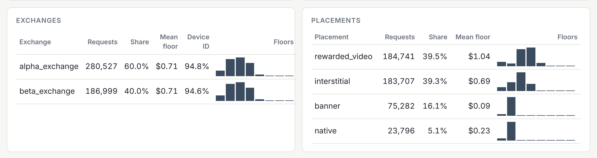
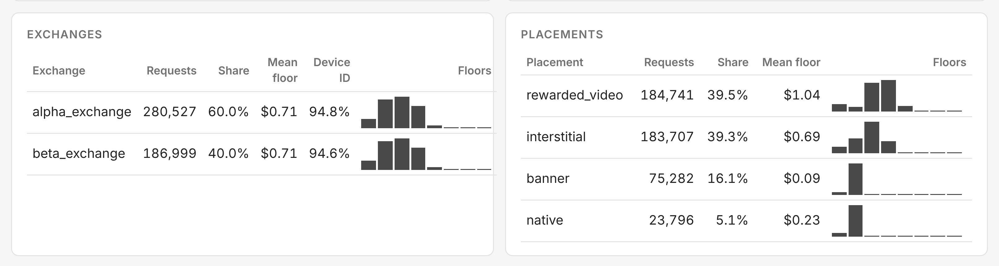

# Listening Before Bidding {#sec-listening-before-bidding}

Once a bidder is connected to an exchange, it starts receiving bid requests, whether or not it's ready to bid on them. That's an opportunity. Every request is a free sample of the market: which apps are sending traffic, which devices, which countries, at what floors, and at what times of day. It's also a free test of the bidder: whether it parses every exchange's requests correctly, whether it responds in time under real load, and whether the logs it writes are complete. None of this requires winning an auction, so none of it costs money.

A DSP that starts bidding on its first day finds its bugs with real budgets. A parsing bug that drops the device model for one exchange, a profile lookup that times out under load, or a unit error in the bid price will all show up eventually, and it's much cheaper when they show up while nothing is being bought.

In this chapter, we will run the bidder in listen-only mode: it processes every request through the full bid path, logs what it would have done, and sends a no-bid response. We'll use the listening period to validate parsing and latency on live traffic, learn the market's volumes and floors, and start building device profiles from the bid stream. We then turn on bidding for a small random share of requests, and connect listening to shadow mode, which we use to launch models later in the book.

## Why Listen First

Listening is the cheapest phase in the life of a DSP. A bug found while listening costs an engineer's time. The same bug found while bidding costs that time plus whatever the bidder bought while it was broken, and it can also cost the trust of an advertiser or an exchange.

What listening can tell us is everything that happens before the auction:

- **Whether the bidder works:** parse failures, missing fields, timeouts, and errors, by exchange.
- **What the market looks like:** request volumes, apps, devices, countries, formats, and floors, by hour of day.
- **What each campaign could reach:** how many requests pass its targeting and eligibility filters.
- **Who the devices are:** the start of a device profile for every device we see.

What listening can't tell us is anything after the auction. There are no wins, so no clearing prices, no impressions, and no clicks. We can't learn click rates or win rates by listening, and we shouldn't try to infer them from floors alone. Floors tell us the least a publisher will accept, not what other bidders are willing to pay.

Listening also can't go on forever. An exchange sends traffic to a bidder because it expects bids, and some exchanges reduce the traffic they send to bidders that rarely respond with one. Agree on a listening period with each exchange during onboarding, and plan for it to be a few weeks rather than a few months.

## Validating Parsing and Latency on Live Traffic

Test endpoints and sample requests catch the obvious problems. Live traffic catches the rest, because real requests are more varied than any sample, and real load is different from a load test. During the listening period, we watch three things.

**Field coverage and parse failures by exchange.** For each field the models will use, track the share of requests where it's present, missing, or rewritten by normalization, broken down by exchange. Compare exchanges with each other. If one exchange sends a device model on 98% of requests and another on 40%, either the second exchange really sends less, or the bidder is failing to read a field it sends under a different name. Both are worth knowing before the models depend on that field.

**End-to-end latency against `tmax`.** The exchange's time limit includes the network round trip, so the bidder's own budget is smaller than `tmax`. Measure latency from the moment a request arrives to the moment the response is sent, and track the 99th percentile (p99), not the median. A bid that arrives late is a lost bid, and at high request rates, the slowest 1% of requests is a lot of requests. Latency under real load is usually worse than in a load test, because real requests are larger, profile reads hit a colder cache, and traffic arrives in bursts.

**Timeouts and no-bid reasons.** Every request gets a response, and every no-bid has a reason: no eligible campaign, filtered by supply quality, malformed request, or, during listening, listen-only mode. Count them by reason and exchange. When we turn on bidding, the share of requests that end in each reason is our first view of where the volume goes.

## Learning the Market

While listening, the bidder logs every request, which gives us a picture of the market before we bid in it. A few views are worth building early:

- **Volume by geo, exchange, format, and hour.** Request volumes follow daily cycles in each country's local time, and they vary a lot by format. Rewarded video, interstitials, and banners have different volumes, different floors, and different click rates.
- **Floor distributions.** For each geo and format, the distribution of floors shows the minimum prices publishers accept. Floors are a lower bound on clearing prices, so a segment where most floors are above what a campaign could pay is one it won't win in.
- **Supply concentration.** A small share of publisher apps usually sends a large share of requests. Knowing the top apps by volume, and how they differ from the long tail, helps with blocklists, features, and expectations.
- **Eligible requests per campaign.** Running each campaign's targeting and filters over the logged requests estimates how many requests it could bid on in a day. A campaign whose targeting reaches almost nothing is better fixed now than after an advertiser asks why it isn't spending.

The reference DSP's console builds the first of these views from the bid ledger, as in @fig-c7-traffic. On the simulator, rewarded video and interstitials make up almost 80% of requests and carry most of the value: their mean floors are around ten times those of banners. The two exchanges look alike on floors and device IDs, which is itself worth confirming before treating them the same.

::: {.content-visible when-format="html"}
{#fig-c7-traffic width="100%" fig-alt="Screenshot of two console tables. Exchanges: alpha_exchange sent 280,527 requests, 60% of the total, and beta_exchange 186,999, 40%. Both have a mean floor of $0.71 and a device ID on about 95% of requests, with similar floor histograms. Placements: rewarded_video 184,741 requests with a mean floor of $1.04, interstitial 183,707 at $0.69, banner 75,282 at $0.09, and native 23,796 at $0.23. Banner and native floors sit in the lowest histogram bins."}
:::

::: {.content-visible unless-format="html"}
{#fig-c7-traffic width="100%" fig-alt="Screenshot of two console tables. Exchanges: alpha_exchange sent 280,527 requests, 60% of the total, and beta_exchange 186,999, 40%. Both have a mean floor of $0.71 and a device ID on about 95% of requests, with similar floor histograms. Placements: rewarded_video 184,741 requests with a mean floor of $1.04, interstitial 183,707 at $0.69, banner 75,282 at $0.09, and native 23,796 at $0.23. Banner and native floors sit in the lowest histogram bins."}
:::

These views also produce the first numbers for planning. If a campaign is eligible for a few million requests a day, has floors around a certain price, and we expect to win a small share of the requests we bid on, we can estimate how much it could spend, before spending anything. The estimate will be rough, because we don't know win rates yet, but it's much better than no estimate at all.

## Building Device Profiles from the Bid Stream

The bid stream is also the first source of data for device profiles. Every request tells us that a device was active in a publisher app at a certain time, with a certain device model, OS version, and connection type. Over days and weeks, that adds up to a useful history:

- **Apps the device is seen in,** with counts and the most recent time. A device seen in several puzzle games is more likely to be interested in Cozy Farm Tycoon than one seen only in a sports app.
- **Frequency and recency:** how often the device sends requests, and how recently. Highly active devices behave differently from occasional ones.
- **Device and OS attributes,** such as model, OS version, and the countries the device is seen in.

As we saw in @sec-parsing-bid-requests-and-eligibility, seeing a device in requests from an app also tells us the app is installed, which the eligibility filters use to skip devices that already have the advertised app.

Bid stream data comes with obligations. Exchanges set terms for how the data they send can be used and how long it can be kept, and those terms vary. Consent signals in the request, and regulations such as GDPR, limit what can be stored for some users. Decide retention periods for profile data and for raw bid logs during the listening period, with these terms in mind, rather than after a year of data has piled up. We cover data governance in the pipelines in @sec-building-training-datasets.

## Bidding on a Small Share

When the bidder has run cleanly for long enough, with stable field coverage, latency comfortably inside the budget, and no unexplained errors, we turn on bidding, but only for a small share of requests. The bidder picks requests at random, for example 1%, and bids on those at low prices, for one or two campaigns whose advertisers have agreed to be first.

Choosing requests at random, rather than the ones that look best, matters even here. It means the first wins, impressions, and clicks are a fair sample of the traffic the bidder is eligible for, which makes them useful data, not just a smoke test.

The first bids bring a series of firsts, and each is a check:

- **The first win notices.** Do they arrive, can they be joined to the bid log by auction ID, and do the prices in them match what we bid?
- **The first impressions.** As we saw in @sec-the-auction-lifecycle, a win isn't an impression. Does the impression tracking fire, and what share of wins become impressions?
- **The first clicks.** Do clicks reach our tracking endpoint and pass through to the advertiser's tracking link with the right click ID?
- **The first reconciliation.** Does our count of spend, from billing notices, match what the exchange reports? It usually won't at first, and @sec-operating-the-first-dsp covers why.

From here, the share of bidding requests goes up in steps, much like the QPS cap in @sec-starting-from-scratch, with a check of the same numbers at each step.

## From Listening to Shadow Mode

Listening is the first version of an idea we use throughout the book: compute everything, send nothing. In listen-only mode, the whole bidder runs in the background. Later, the same mechanism runs one component in the background. In shadow mode, a new model scores live requests alongside the current one, and we log both predictions but bid with the current one. That lets us compare a new model's predictions, latency, and errors with the champion's on real traffic before it affects a single bid. We use shadow mode to launch models in @sec-shadow-mode-canaries-and-ab-tests.

The same idea also gives us ghost bids. For a random holdout group of devices, the bidder computes a bid as usual, logs it, and doesn't send it. Comparing the outcomes of those devices with the ones we did bid on measures how many installs the DSP actually causes, as we saw in @sec-measurement-and-mmps. We add the holdout flag in the next chapter, and measure incrementality with it in @sec-measuring-incrementality.

## First-Time Pitfalls

- **Storing the full bid stream gets expensive fast.** A bidder at even a modest QPS sees billions of requests a month. Decide on sampling and retention for listening logs before turning on traffic. Keep every request in aggregate counts, but store full requests only for a sample.
- **Requests with no device ID are common on some supply.** Don't let them collapse into one profile keyed by an empty string, or into one hash bucket. Route them explicitly, as in @sec-parsing-bid-requests-and-eligibility.
- **Listen-only responses still count as responses.** Make sure listen-only mode returns proper no-bid responses within the time limit, since an exchange judges the bidder's latency and error rates during listening as well.

::: {.callout-tip title="Try it on the simulator"}
Run the crawl bidder in listen-only mode for a simulated week. Build the volume and floor views by geo and exchange, and estimate the eligible requests for each campaign. Then turn on bidding for 1% of requests, and check the first win notices, impressions, and clicks against the bid log.

*Status: runs with the companion bidder (dsp 0.5): start it with `-mode listen`, then with `-mode bid -bid-share 0.01`. The console shows volume and floors by exchange, placement, and country, and wins, impressions, and spend by campaign. The bidder receives clicks through the click tracker in each bid's ad markup and logs them next to its notices.*

<!-- Tracker: private/implementation-tracker.md -->
:::

## Conclusion

In this chapter, we used the bid stream before spending money on it. Listening validates the bidder on live traffic, with field coverage, p99 latency, and no-bid reasons tracked by exchange. It also maps the market, with volumes, floors, and eligible requests per campaign, and it starts the device profiles that later models depend on. We then turned on bidding for a small random share of requests, and checked the first wins, impressions, clicks, and spend. Listening is the first instance of a pattern we use again for models: run everything in the background, compare, and only then let it affect bids.

Now that the bidder is producing wins and clicks, the logs it writes become training data. In the next chapter, we make those logs the single source of truth for training, by logging features at bid time.
