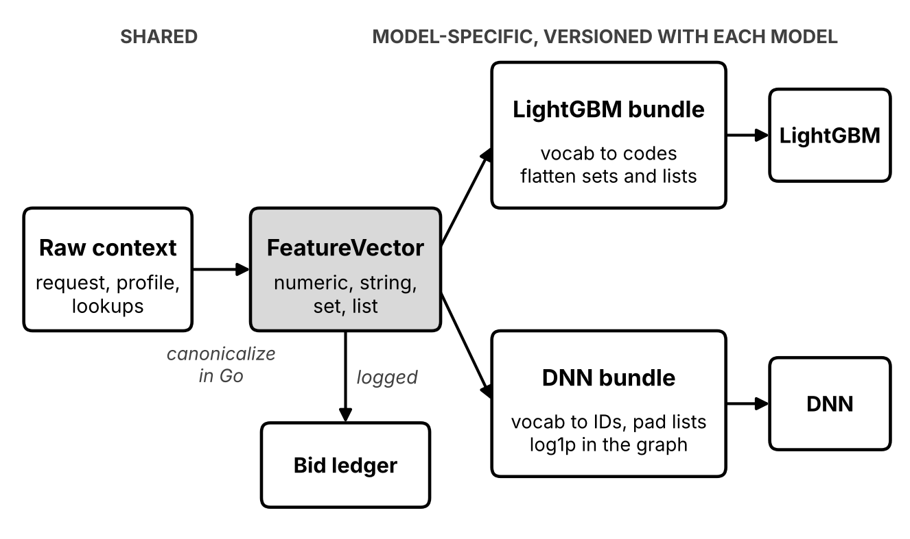

# Logging at Bid Time {#sec-logging-at-bid-time}

A model is only as good as the match between the features it was trained on and the features it sees at bid time. When the two drift apart, a model that looked excellent offline loses money online, and the cause is often hard to find, because nothing is obviously broken. This mismatch is called **training-serving skew**, and in a DSP it has more sources than in most ML systems. Features are computed from a device profile that changes every few seconds, in a Go bidder with a latency budget of a few milliseconds, while the training pipeline runs hours or days later in Python, on data that has kept changing since the bid.

I learned this the hard way. When I worked on migrating a DSP's click and install models from logistic regression to deep learning, a large share of the incidents we ran into were feature parity issues: places where the training pipeline and the serving pipeline computed the same feature in slightly different ways.[^c8-incidents] None of them crashed anything. They just made the models a bit worse in production than they were offline, and each one took time to track down.

That's why the crawl DSP logs features before it has a model worth keeping. In this chapter, we will look at where skew and leakage come from, compare the main ways to get features into training data, and make the case for one of them: logging features at bid time in a single, model-agnostic record that we call the **FeatureVector**. We then lay out the logs the bidder and its trackers write, how events get from the bidder into storage, the minimal postback endpoint the first CPI campaign needs, why labels come from impressions rather than wins, and the propensities and holdout flag we log from the first bid. Adding features after the fact by replay comes in @sec-building-training-datasets, and versioned embeddings and feature stores come in @sec-serving-deep-models.

[^c8-incidents]: Ben Weber, "Machine Learning Incidents in AdTech," *Towards Data Science*, January 29, 2025, <https://medium.com/data-science/machine-learning-incidents-in-adtech-e3f48d858054>

## Training-Serving Skew and Leakage

**Skew** is any difference between the value a feature had at bid time and the value used to train the model. **Leakage** is a special case, where the training value contains information that was not available at bid time, usually information about the outcome itself. @tbl-c9b-skew lists the most common sources of both in a DSP.

| Source | How it happens |
|---|---|
| Two implementations | The same feature is computed in Python for training and in Go for serving, and the two drift apart |
| Hash functions | Python's built-in hash is randomized per process, and Go and Python libraries differ in seeds and algorithms |
| Missing values | Empty strings, nulls, zeros, and "unknown" are handled differently in each pipeline |
| String normalization | Case, whitespace, Unicode, and app bundle ID formats |
| Time | Time zones, day-of-week bucketing, and clock skew between bidder hosts |
| Versions | A model trained with one vocabulary or embedding version and served with another |
| Precision | float32 vs. float64, and values that pass through JSON |
| Profile freshness | Training on a device profile read after the bid, which includes events that happened later |

: Common sources of training-serving skew and leakage. {#tbl-c9b-skew}

Every row in this table has bitten a team I've worked with. A few examples from the migration I mentioned:

- **Divide by zero.** We had ratio features, such as a device's historical click rate (clicks divided by impressions). The training pipeline encoded a divide by zero as -1, and the serving pipeline encoded it as 0. Our parity checker caught it, but only after the model was live.
- **String parsing.** Our vocabulary mapped `com.dreamgames.royalmatch` to an index, but in one pipeline the bundle arrived with a locale suffix appended, as `com.dreamgames.royalmatch` followed by `$hl=en_US`, which mapped to the out-of-vocab (OOV) index. The fix that worked long term was cleaning app bundles once, at data ingestion, instead of in each pipeline.
- **Time-relative features.** We tried a `weeks_ago` feature, computed in training as the number of weeks between the impression and the training date. At serving time, it was always 0. The feature ranked highly offline, and the model without it won the A/B test.

The last row of the table, profile freshness, is the most dangerous, because it produces leakage rather than just noise. Suppose the training pipeline reads each device's profile from the NoSQL store at training time. That profile now includes the apps the device installed after the bid, including the advertised app, installed because of the impression we are trying to learn from. A feature like "has installed apps in this genre" becomes almost perfectly predictive offline and useless at bid time. Subtler versions include install counts, engagement aggregates, and recency features that absorb events after the bid. The model looks better offline than any honest model could, and then underperforms online.

## Three Ways to Get Features into Training Data

There are three common patterns, shown in @fig-c9b-three-ways, and most DSPs use some mix of them.

{#fig-c9b-three-ways width="100%" fig-alt="Three rows comparing ways to get features into training data. Logging raw inputs means computing features twice, with skew risk. Recomputing at training time reads future data, with leakage risk. Logging the bidder's feature vector at bid time gives training exactly what the bidder used."}

**Log raw inputs and compute features twice.** The bidder logs the bid request and the device profile it fetched, often as JSON. The Go bidder computes features for serving, and a Python pipeline computes the same features from the logged inputs for training. This is point-in-time correct, because the profile was captured at bid time, and it makes backfilling new features easy. Its weakness is that every feature exists twice, and the two implementations drift. Most of the incidents above came from this setup.

**Recompute from stores at training time.** The training pipeline joins bids to the current device profile, app metadata, and aggregate tables. This is the easiest to build and the most dangerous, because every lookup returns today's value rather than the value at bid time. It's only safe with point-in-time (as-of) joins, which we cover in @sec-building-training-datasets.

**Log features at bid time.** The bidder logs the exact feature values it computed, keyed by request ID, and training joins labels to those logged values. Training sees exactly what serving saw, so skew from two implementations and leakage from late lookups both disappear. The cost is that a new feature has no history until it has been logged for a while, which we address with replay in @sec-building-training-datasets.

| | Log raw, compute twice | Recompute at training time | Log features at bid time |
|---|---|---|---|
| Skew from two implementations | High | High | None |
| Leakage risk | Low | High without as-of joins | None |
| Backfilling new features | Easy | Easy | Needs a replay or a wait |
| Log volume | Large (full profiles) | Small | Medium |
| Who can add features | Anyone in Python, but Go must match | Anyone | Engineers who change the bidder |

: Comparing the three approaches. {#tbl-c9b-approaches}

This book recommends logging features at bid time as the default, with raw inputs logged alongside them for a sample of traffic, so that new features can be backfilled. I've argued for this structure before, in the context of how to organize an ML team: when the team that trains the models also owns the code that computes features at bid time, feature parity issues become structurally much harder to introduce.[^c8-pods] The tradeoff is that adding a feature means changing the Go bidder first. That is a higher bar than working entirely in Python, but in my experience it's the right bar.

The log that holds these records is the **bid ledger** from @sec-inside-a-demand-side-platform: one row per bid, keyed by the auction's request ID, with the FeatureVector, the model predictions, the model, lookup, and configuration versions, and every term of the price. The bid ledger shows up again in the training, monitoring, and on-call chapters, because it's the ground truth for what the bidder knew and did.

[^c8-pods]: Ben Weber, "Structuring an ML Org for a DSP: Pods not Silos for Effective Model Delivery," *Data Science Collective*, May 19, 2026, <https://medium.com/data-science-collective/structuring-an-ml-org-for-a-dsp-9fae5a01c671>

## One FeatureVector for Every Model

A DSP usually runs several models on the same request, such as a LightGBM model and a DNN conversion model, and they need their inputs in different forms. Rather than logging each model's tensors, the bidder logs one FeatureVector, a model-agnostic record of clean feature values before any model-specific transform. Each model then turns the FeatureVector into its own inputs.

### Four Value Types

| Type | Examples | Notes |
|---|---|---|
| Numeric | Seconds since last install, sessions in the last 7 days, bid floor, device age in days | Natural units, no log or scaling |
| String | Country, OS version, publisher app, exchange, device model | Normalized, not yet mapped to IDs |
| String set | Installed app categories, apps seen in the last 30 days | Deduplicated, unordered |
| String list | Recent app sequence, recent event types | Most recent first, capped at a generous length such as 200, with per-item ages |

: The four value types in the FeatureVector. {#tbl-c9b-types}

Strings stay strings in the FeatureVector. Mapping them to integer IDs depends on a model's vocabulary, which belongs to the model, so it happens after logging. This is also what would have prevented one of the incidents in my post: we had reused one vocabulary across a click model and an install model, and the install model, trained on a smaller dataset, ended up with embedding entries that never received a training update. When vocabularies belong to models rather than to the log, that kind of sharing doesn't happen by accident.

### Canonicalization Rules

The FeatureVector is produced by a canonicalization layer in the bidder. These are fixed rules that define what a feature means, shared by every model:

- **Natural units:** prices in dollars and durations in seconds.
- **Normalized strings:** lowercase and trimmed, with consistent app bundle ID and country formats.
- **Explicit missing values:** missing values are recorded with presence fields, never as a silent zero or empty string.
- **Clipping:** impossible values, such as negative counts, are clipped.
- **Relative time:** time is expressed relative to the request timestamp, such as the age of each event in a list, so that models never need the wall clock. This is the rule that would have prevented the `weeks_ago` incident.
- **Ordering:** sets are deduplicated, and lists are ordered most recent first, with a fixed maximum length.

A minimal contract, in the protocol buffer style we use for specs in @sec-where-trees-stop, looks like this:

```protobuf
message FeatureVector {
  int32 schema_version = 1;
  // Natural units; an absent key means missing.
  map<string, double> numeric = 2;
  map<string, string> strings = 3;      // normalized
  map<string, StringSet> sets = 4;      // deduplicated
  map<string, StringList> lists = 5;    // recent first, capped
  // Lookup versions, e.g. app_glove -> v2026-03.
  map<string, string> lookup_versions = 6;
}

message StringSet {
  repeated string values = 1;
}

message StringList {
  repeated string values = 1;
  repeated int64 age_seconds = 2;
}
```

The schema only grows. New fields are added, and old fields are never repurposed, so a model built for schema version 5 can run on any bidder producing version 5 or later.

One design choice is worth calling out: data from the advertiser's MMP and from SDKs should keep its own vocabulary rather than being merged into bid request fields. The two sources describe the same devices differently. For example, MMP data might use two-letter country codes where bid requests use three-letter codes, or list device models by marketing name where bid requests use hardware identifiers. If you merge them before logging, every one of these mismatches becomes a feature parity issue.[^c8-intent] Canonicalize each source on its own terms, and let the models decide how to combine them.

[^c8-intent]: Ben Weber, "Pretrained Deep Learning Intent Signals for Mobile DSPs," *Medium*, October 3, 2026.

### Model-Specific Transforms

Everything after the FeatureVector belongs to a model, and is versioned with it. In crawl, there's only one model, logistic regression on hashed one-hot features, which turns every value into tokens, as we'll see in @sec-a-click-model. The point of the FeatureVector is that later models can read the same record without changing what the bidder logs. @tbl-c9b-transforms shows how a LightGBM model, from Part III, and a DNN, from Part IV, treat the same four types.

| Feature type | LightGBM | DNN |
|---|---|---|
| Numeric | None needed. Trees ignore monotone transforms, and missing values are handled natively | `log1p`, clipping, and standardization, with statistics fitted on the training split |
| String | Vocabulary to integer codes, with native categorical splits and an "other" code | Vocabulary to IDs, then an embedding; hashing for very high-cardinality fields |
| String set | Flattened to fixed columns, such as counts or multi-hot over the top values | IDs, then an embedding bag with mean or sum pooling |
| String list | Hand-built aggregates, such as counts in time windows | Padded ID tensors with a mask and per-item ages, truncated to the model's length |

: Model-specific transforms for each value type. {#tbl-c9b-transforms}

One rule decides where each transform runs. Anything learned from data is model metadata, and anything that is a fixed formula can live in the model graph. Vocabularies, means and standard deviations, bucket boundaries, and top-value lists are fitted once on the training split and shipped as metadata files with the model. String-to-ID lookups run in a shared Go preprocessing library that reads the model's vocabulary, because Go inference runtimes handle string operations in the graph unevenly. Numeric math for the DNN, such as `log1p` and standardization, runs in the graph, so that training and serving execute the same operations. Flattening sets and lists for LightGBM is a per-model specification executed by the same Go library, both in the bidder and in the batch job that builds training data.

Padding is a good example of why this matters. In one incident, we couldn't send empty arrays to our serving endpoint when batching was turned on, so the serving code padded empty app lists with `[0]`. But index 0 was a real app, so the model was told that devices had installed an app they never had, and only in serving, not in training. The eventual fix was to reserve index 0 as a padding value with no meaning in every vocabulary, and to apply the same padding in both pipelines. With a shared Go preprocessing library, that rule lives in one place.

Each model ships as a **bundle**: the model file, its preprocessing specification, vocabularies, fitted statistics, the versions of any lookup tables it depends on, and the FeatureVector schema version it expects. A set of **golden vectors** per model version, FeatureVectors with the exact tensors the model should receive, is checked in both the Go library and the Python training path on every build. We cover publishing bundles in @sec-pipelines-validation-and-publishing, and @fig-c9b-one-vector shows how the pieces fit together.

{#fig-c9b-one-vector width="100%" fig-alt="Raw context is canonicalized in Go into one FeatureVector, which is logged to the bid ledger and fed to two model-specific bundles: a LightGBM bundle and a DNN bundle, each with its own preprocessing."}

## Bid, Win, Impression, and Click Logs

The FeatureVector is one part of what the bidder and its trackers log. A DSP writes a small number of event logs, each keyed so that they join to each other:

- **The bid log** (the bid ledger): one record per request the bidder processed, with the request ID, the exchange, the outcome (bid, no-bid with a reason, or ghost bid), and, for bids, the chosen campaign and creative, the candidate set and selection probability, the FeatureVector, the model version and prediction, the configuration version, and every term of the price.
- **The notification log:** one record per win, loss, or billing notice from the exchange, keyed by the request ID and impression ID, with the clearing price where the exchange reports it and any loss reason or minimum bid to win.
- **The impression log:** one record per impression our tracking saw rendered, keyed by impression ID, with video quartiles or other engagement events where the format has them.
- **The click log:** one record per click, keyed by a click ID that the DSP generates and passes through to the MMP, along with the impression ID it came from.

Two rules apply to all of them. First, **log no-bids and losses, not just wins.** A model that only sees wins learns about the impressions we already buy, and a win rate model needs the bids we lost as much as the ones we won. No-bids can be sampled, as we'll see below, but they can't be skipped. Second, **give every event its own ID**, separate from the keys it joins on. Exchanges retry notifications, trackers fire twice, and a log stream can deliver a message more than once, so deduplication needs an ID that identifies the event itself.

## Collecting Events: Tracking Endpoints and Log Transport

Some of these events are seen by the bidder directly, and some aren't. The bid log is written by the bidder as it responds. Notifications arrive at notification URLs the bidder put in its response (`nurl`, `burl`, and `lurl`), which the DSP hosts. Impressions and clicks are reported by the ad itself. The ad markup includes impression tracking URLs that fire when the ad renders, and the click URL points to a DSP tracking endpoint first. That endpoint logs the click with a new click ID, then redirects the device to the advertiser's MMP tracking link, with the click ID attached, as we saw in @sec-measurement-and-mmps. That's how a later install postback can be joined back to our click and impression.

The bidder and trackers shouldn't write directly to the warehouse. They write events to a log stream, such as Pub/Sub on Google Cloud or Kafka on-prem, and separate jobs move the events into storage. This keeps the bid path fast, since publishing a message is cheap, and it lets the storage side fall behind and catch up without affecting bidding. For a small crawl DSP, writing batches of compressed files to object storage every minute works too, as long as the files are partitioned by time and every event has its ID.

The keys that join the logs are worth writing down early, because everything later depends on them:

| Key | Created by | Joins |
|---|---|---|
| Request ID | The exchange (auction `id`) | Bid log to notifications |
| Impression ID | The DSP, in the ad markup | Bid log to impressions and clicks |
| Click ID | The DSP's click tracker | Clicks to MMP postbacks |
| Device ID | The device (advertising ID) | Bids to profiles and to non-attributed postbacks |

: The keys that join a DSP's logs. {#tbl-c8-keys}

## Receiving Install Postbacks (Minimal Version)

The crawl DSP optimizes for clicks, but its first CPI campaign, in @sec-pricing-a-click, needs install rates for each segment. That needs a way to receive install postbacks from the advertiser's MMP. The minimal version is an HTTPS endpoint that accepts the MMP's install postback, validates that it came from the MMP, and logs it with the click ID or impression ID it carries, the install time, and the postback's own ID. It's joined to the click log later, in batch.

That's all crawl needs. Attribution windows, view-through installs, non-attributed postbacks, purchase events, and the many ways postbacks are duplicated, delayed, or lost are covered in full in @sec-from-clicks-to-installs-and-purchases. One thing is worth doing now, though: log the postback exactly as the MMP sent it, in the MMP's own field names and formats, and translate it in the batch join. As with MMP data in the FeatureVector, keeping the source's vocabulary avoids mismatches that are hard to find later.

## Labels from Impressions, Not Wins

In @sec-the-auction-lifecycle, we saw that winning an auction isn't the same as showing an ad. Many wins never become impressions, because the ad was pre-fetched and never used, and the share that do, the clear rate, varies a lot by exchange, format, and publisher. This has a direct effect on how click labels should be built.

Suppose we built click examples from wins: each win is an example, and the label is whether a click followed. For a publisher app with a 50% clear rate, half of the examples are wins whose ad was never shown, so they can't have a click, and the measured click rate is half the true rate per impression. For an app with a 95% clear rate, the measured rate is close to the true one. A model trained on wins would learn that the first app has a lower click rate, when what it actually has is a lower clear rate. Worse, the error would land in exactly the place where it hurts: the DSP is billed per impression, so a price based on clicks per win would be wrong by the clear rate.

The fix is to build click examples from impressions. Join each impression in the impression log to its bid ledger record, for the features, and to the click log, for the label. Model the clear rate separately where it matters, which we'll do for pricing in @sec-pricing-for-goals and for the win model in @sec-win-rate-and-bid-shading.

## Propensities and Holdout Flags

Two more things go into the bid ledger from the first bid, even though nothing in crawl uses them yet.

**Propensities.** In @sec-parsing-bid-requests-and-eligibility, the bidder logged the probability of the campaign and creative it picked. In @sec-pricing-a-click, it will also log a random bid multiplier applied to a small share of bids. Both are records of deliberate randomness, and both are what make later models and evaluations possible: the selection probabilities enable offline policy evaluation, and the randomized bids let us learn how the win rate changes with the bid.

**A holdout flag.** From the first day, a small random share of devices, for example 5%, is held out. For these devices, the bidder runs the full bid path, computes a bid, and logs it with a holdout flag, but doesn't send it. These are the ghost bids from @sec-measurement-and-mmps. Assignment uses a hash of the device ID with a salt reserved for the holdout, so the same device is always in or out of it, and the holdout is independent of any experiment that hashes devices with a different salt.

The holdout costs something: the DSP gives up the impressions it would have won on those devices. But it's much easier to set up at the start than later, when every advertiser is used to the DSP's current volume. And without it, the DSP can only report attributed installs, which, as we saw in Part I, include installs that would have happened anyway. We'll measure incrementality with the holdout in @sec-measuring-incrementality.

## What to Log and How Much

| Record | Logged for | Why |
|---|---|---|
| FeatureVector | Every bid, including ghost bids, and a sample of no-bids | Labels exist only for impressions; the win rate model needs every bid |
| FeatureVector for losing candidates | A sample of internal auction losers | Training candidate selection and ranking models |
| Raw context (request and profile snapshot) | A sample of bids, such as 1% to 5% | Backfills and parity checks |
| Model inputs (tensors) | A small sample per model | Parity checks against the model bundle |
| Sampling weights | Every sampled record | Exact correction for downsampling during training and calibration |

: What the bid ledger records, and for which traffic. {#tbl-c9b-what-to-log}

The second row refers to the **internal auction** from @sec-inside-a-demand-side-platform, where the DSP compares its own candidate campaigns for a request and picks one to bid with. In crawl, the choice is weighted random, but logging a sample of the candidates that weren't picked costs little and is what later selection models train on.

Volume decides most of these choices. A bidder that sees a few thousand requests per second and bids on a small share of them can afford to log everything. At hundreds of thousands of requests per second, it can't, and the usual approach is to keep every bid and every win, and sample the rest:

- **Keep all bids and wins.** These are the rows the models train on, and the rows that need to reconcile with spend.
- **Sample no-bids,** for example 1%, and record the sampling rate with each row, so training and monitoring can weight them back up.
- **Count everything.** Aggregate counts of requests by exchange, geo, format, and no-bid reason are cheap to keep in full, and they're what dashboards read.

For storage, logs land in a columnar format, such as Parquet, partitioned by date and hour, which is what both Spark and warehouses read efficiently. The FeatureVector is stored as its protocol buffer, or as nested columns, rather than flattened, so that adding a feature doesn't change the table's schema.

Retention is a decision to make now, not later. Bid logs are large, and they include device-level data that exchange terms and privacy regulations limit. Decide how long full records are kept, how long sampled and aggregated data is kept, and how deletion requests reach every copy. Retention also bounds what the team can do later: the replay backfills in @sec-building-training-datasets only reach back as far as the logs do.

## First-Time Pitfalls

- **Notifications arrive more than once.** Exchanges retry win and billing notices when the first attempt times out, and trackers can fire twice. Deduplicate on the event ID, or spend and win counts are inflated, and so is every model trained on them.
- **Sampling changes what training sees.** If no-bids are sampled at 1% and bids are kept in full, a training set built from both is heavily skewed toward bids. Record the sampling rate on every row and correct for it.
- **Clocks disagree.** Bidder hosts, trackers, and the MMP all have their own clocks, and a few seconds of skew is enough to break joins and time-ordered features. Use one time source where possible, and log both the time an event happened and the time it was received.

::: {.callout-tip title="Try it on the simulator"}
Follow one request from its FeatureVector in the bid ledger, through its win and billing notices, its impression, and its click, to the training row that joins them. Then change how the bidder normalizes one feature, without changing the training code, and watch the parity check flag the mismatch between logged and recomputed values.

*Status: planned. This exercise needs the companion Go bidder's FeatureVector logging and the parity job, which isn't built yet.*

<!-- Tracker: private/implementation-tracker.md -->
:::

## Conclusion

In this chapter, we made the logs the single source of truth for training. Skew and leakage come from computing features twice, or looking them up after the fact, so the bidder logs one model-agnostic FeatureVector at bid time, with explicit missing values, normalized strings, and relative times, and every model applies its own transforms to that record. Around it, we set up the event logs and the keys that join them, a tracking and transport path from the bidder to storage, a minimal postback endpoint, labels built from impressions rather than wins, and two records of deliberate randomness, propensities and a holdout flag, that later chapters depend on.

With logs that match what the bidder saw, we can train a model on them. Next, we build the first one: a logistic regression click model on hashed features.
