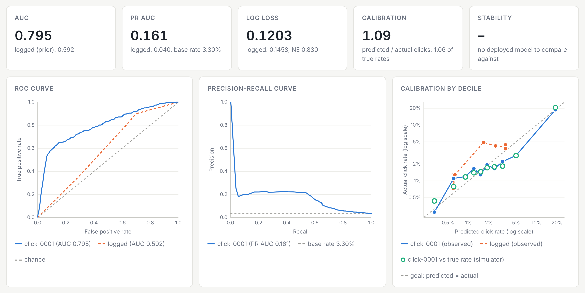
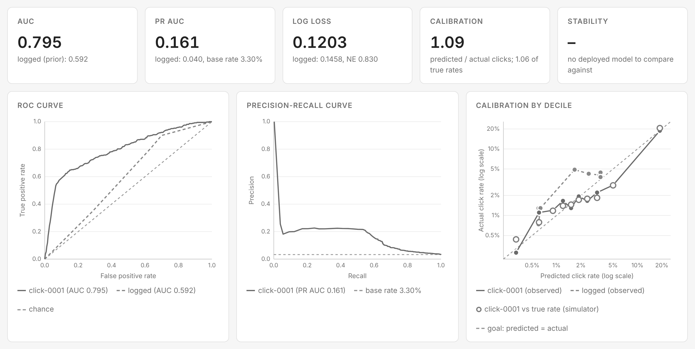

# A Click Model {#sec-a-click-model}

Logistic regression has been the workhorse of click prediction in ad tech for more than a decade. Facebook described combining it with boosted trees for ad click prediction in 2014,[^c9-facebook] Google described training it online at very large scale a year earlier,[^c9-mcmahan] and DSPs pushed it pretty far before moving to deep learning. I've worked with logistic regression click models that had more than 50 million parameters.[^c9-click] It's not the state of the art anymore, but it's still a good first model for a new DSP: it trains fast on a single machine, it's cheap to serve in Go, its predictions are probabilities that are easy to calibrate, and every weight can be inspected.

In this chapter, we will train the crawl DSP's click model. We build labeled click examples from the logs of @sec-logging-at-bid-time, choose the first features, and encode them as hashed one-hot tokens with hand-built crosses. We train with FTRL, an online learning algorithm built for sparse, high-dimensional data, correct predictions for negative downsampling, and evaluate the model with log loss, AUC, and calibration, using out-of-time evaluation broken down by segment. We close with what this model can't do, which motivates the models in Parts III and IV.

## From Logs to Labeled Click Examples

A click example is one impression, with the features the bidder logged when it bid, and a label of 1 if the impression was clicked and 0 if not. As we saw in @sec-logging-at-bid-time, examples start from impressions, not wins, so that the label isn't diluted by wins whose ad was never shown. Building them is a join of three logs:

1. **Impressions** from the impression log, deduplicated on the event ID.
2. **Features** from the bid ledger, joined on the request ID: the FeatureVector, plus the campaign and creative that were chosen.
3. **Clicks** from the click log, joined on the impression ID, keeping the first click per impression.

One more decision is needed: when is an example final? A click usually follows an impression within seconds, since it happens while the ad is on screen, but a few arrive later, from end cards, delayed redirects, or a tracker that was slow to fire. We pick a **click window**, such as one hour after the impression, and count only clicks inside it. An impression becomes a training example once its window has closed. The window should be chosen from data: plot the distribution of time from impression to click in the logs, and pick a window that captures nearly all of it. A window that's too short turns late clicks into negatives, and one that's too long delays training for almost no extra labels.

Before training, remove the rows we don't want the model to learn from. Impressions from publisher apps on the invalid traffic blocklist come out, as do ghost bids, which by definition have no impressions, and any impressions from test campaigns. We cover cleaning invalid traffic from training data in more detail in @sec-operating-the-first-dsp.

## Features for the First Model

The first model's features come from three sources: the bid request, the device profile, and the campaign and creative being considered. All of them are computed in the Go bidder at bid time and logged in the FeatureVector, so training uses exactly what the bidder saw. Early on, the gains usually come from getting a handful of strong features right rather than from having many features, so it's worth understanding what each one captures, how it's encoded, and how it can go wrong.

The tables in this section list the features worth building for a production click model. The reference DSP's first model uses the subset the simulator can supply: nine strings from the request (exchange, publisher app, placement type, country, OS, OS major version, make, model, and connection type), eight from the campaign and creative (campaign, advertised app, goal, creative, and the creative's format, length, orientation, and style), eight bucketed numerics from the request and profile (floor, hour, whether the device is known, its request count, the time since we first and last saw it, our impressions today, and the time since our last impression), the set of apps the device was seen in, and five crosses.

### Features from the Request

The request describes where the ad would be shown, and the placement explains more of the variation in click rates than anything else. The same player who skips past a banner might happily tap the end card of a rewarded video they chose to watch.

| Feature | Type | What it captures | Watch out for |
|---|---|---|---|
| Publisher app (`app.bundle`) | String | The app's audience and how ads fit into it | High cardinality; new apps have no history |
| Publisher or developer | String | Apps from one developer share audiences and ad setups | Missing on some exchanges |
| App store category | String | Genre, such as puzzle, casual, or casino | Exchange categories are noisy; prefer your own app metadata |
| Placement ID (`imp.tagid`) | String | One ad slot within an app, such as the level-end interstitial | Very high cardinality; IDs change when apps update |
| Placement type | String | Rewarded video, interstitial, banner, or native | Derived per exchange from fields and extensions |
| Format details | String, numeric | Size, orientation, video duration limits, skippable | Many combinations; bucket them |
| Exchange and seller | String | Integration differences and supply path | Collinear with publisher; keep both |
| Bid floor | Numeric | The publisher's own estimate of the slot's value | Varies by exchange policy; bucket it |
| Country and region | String | Market, language, and device mix | Normalize codes at ingest |
| OS version, make, model | String | Device price tier and age | Thousands of models; normalize aliases |
| Device type and screen size | String, numeric | Phone or tablet; how big the ad is | Often derivable from the model |
| Connection type and carrier | String | Wi-Fi vs. cellular, which affects video completion | Unknown values are common |
| Local hour and day of week | String | Daily and weekly cycles in attention | Use the device's local time, not UTC |

: Request features for the first click model. {#tbl-c9-request-features tbl-colwidths="[24,12,34,30]"}

Two of these deserve a note. The **publisher app** is the most predictive single feature in most click models, and it's also the hardest for a linear model, because there are many apps and most have little traffic. The hashed one-hots below give every app its own weight, and L1 regularization keeps rare apps near zero until they've earned a weight. The **bid floor** may seem like a pricing input rather than a click feature, but publishers set higher floors on placements that perform better, so it carries real information about the slot. It's available at bid time, so it's safe to use.

### Features from the Device Profile

The profile describes the device's recent activity. In crawl, it's built mostly from the bid stream, as in @sec-listening-before-bidding, and from our own impressions and clicks.

| Feature | Type | What it captures | Watch out for |
|---|---|---|---|
| Apps seen in the last 30 days | String set | Interests and the kind of games the player plays | Large sets; cap the length |
| Genres of apps seen | String set or counts | A compact version of the same signal | Depends on app metadata coverage |
| Requests seen today and this week | Numeric | How active the device is | Varies with our QPS caps, not just the user |
| Days since first seen | Numeric | How long we've known the device | New devices and reset IDs look alike |
| Our impressions today and this week | Numeric | Ad fatigue | Count shown impressions, not wins |
| Impressions of this campaign today | Numeric | Fatigue with this specific ad | Also used for frequency caps |
| Our clicks in the last 30 days | Numeric | A habit of clicking ads | Includes invalid clicks unless cleaned |
| Time since our last impression and click | Numeric | Recency | Missing for new devices; log as missing |
| Profile status | String | Found, not found, or timed out | Must be logged, not inferred later |

: Profile features for the first click model. {#tbl-c9-profile-features tbl-colwidths="[30,16,28,26]"}

Counts are bucketed into tokens, such as `imps_today_3to5`, so the linear model can learn that the click rate rises and then falls with activity. Ratios, such as the device's historical click rate, are tempting but risky. They're noisy for devices with few impressions, and a zero denominator has to be handled the same way in Go and Python. Giving the model the counts as separate bucketed features is safer, and lets it learn the ratio's effect itself.

### Features from the Campaign and Creative

The bidder scores the chosen campaign and creative, so their features describe the ad itself.

| Feature | Type | What it captures | Watch out for |
|---|---|---|---|
| Campaign ID | String | Everything specific to this campaign | New campaigns start with no weight |
| Advertised app and its genre | String | How appealing the game is, and to whom | Genre lets new campaigns borrow from similar ones |
| Creative ID | String | Everything specific to one ad | Many creatives with little traffic each |
| Creative format and length | String | Video, playable, or static; short or long | Must match what the placement allows |
| Orientation and end card type | String | Fit with the placement; the call to action | Missing for some formats |

: Campaign and creative features for the first click model. {#tbl-c9-campaign-features tbl-colwidths="[24,12,34,30]"}

Campaign and creative IDs memorize, and genre and format generalize. Including both lets the model use an ID's own history when it has one, and fall back on what similar campaigns and creatives have done when it doesn't. Most of the value of these features comes from crosses with the request and profile features, which we add below.

### Features to Leave Out

Some features look predictive and should stay out of the model:

- **Anything not known at bid time.** Whether the impression was shown, its clearing price, and anything from the device's later activity are all outcomes or partial outcomes. A feature computed after the bid is leakage, as we saw in @sec-logging-at-bid-time.
- **Absolute time.** The date, or the number of days between an event and training, means something different at serving time than in training. Express time relative to the request, as the FeatureVector's canonicalization rules require.
- **The device ID itself, and IP addresses.** As features, they memorize individual devices rather than learning anything general, and they're personal data with limits on how they can be used.
- **Our own decisions.** The selection probability, the bid, and the random multiplier depend on the logging policy, not on the user. A model that uses them learns about our past bidding rather than about clicks.
- **Self-reported user fields.** Fields such as year of birth and gender are rarely present in mobile bid requests, are often unreliable when they are, and depend on consent.

### Choosing What to Add

There's no shortage of possible features, so each one should earn its place. A simple process works well in crawl:

1. **Check coverage first.** Look at how often the feature is present, by exchange, in the logs. A feature present on 30% of requests from one exchange and 95% from another will mostly teach the model which exchange the request came from.
2. **Add it to the bidder and log it,** or backfill it by replay, as in @sec-building-training-datasets.
3. **Train with and without it** on the same days, and compare log loss and calibration out of time, overall and by segment.
4. **Weigh the gain against the cost.** Every feature adds latency, memory, logging volume, and a new way for training and serving to disagree. A feature that improves log loss by a tiny amount is often not worth carrying.

## Hashed One-Hots and Feature Crosses

Logistic regression needs numeric inputs, and most of these features are strings. The approach I've used is to turn every feature into one or more **tokens**, strings of the form `name_value`, and give the model one binary input per token. For a rewarded video in Gem Garden on a Samsung phone in India, the tokens might look like this:

```
publisher_app_com.example.gemgarden
placement_rewarded_video
country_ind
model_sm-a155f
campaign_cozyfarm_cpc_in
```

Each type of value in the FeatureVector maps to tokens in its own way:

- **Strings** become one token each, as above. A missing value gets its own token, such as `model_null`, so the model learns what missing means.
- **String sets** become many tokens, one per member, such as one token for each publisher app the device was seen in recently. These are **many-hot** features.
- **Numerics** are bucketed first, and each bucket becomes a token, such as `our_imps_today_b3` for the fourth bucket, three or four of our impressions today. Buckets let a linear model learn a nonlinear effect, for example that the click rate falls as a device sees more of our ads in a day.

A linear model can't learn interactions on its own. It can learn that rewarded video gets more clicks than banners, and that Cozy Farm Tycoon's ads get more clicks than average, but not that Cozy Farm Tycoon's ads do especially well in rewarded video. So we add **crosses**: tokens that combine two features, such as `placement_rewarded_video*campaign_cozyfarm_cpc_in`. The most useful crosses pair the campaign or advertised app with features of the supply and device:

- Placement type × campaign.
- Publisher app × campaign.
- Country × campaign.
- Placement type × creative format.
- Device model × publisher app.

Crosses are where the token count explodes. There are many publisher apps, many device models, and many campaigns, so their pairs number in the millions or more. Rather than keeping a dictionary from token to index, which would have to be built, versioned, and shared between training and serving, we use the **hashing trick**: hash each token to an integer and take it modulo a fixed number of buckets, such as $2^{24}$.[^c9-hashing] The model has one weight per bucket. Two tokens can collide into one bucket, which adds a little noise, but with enough buckets, collisions among the tokens that matter are rare, and the model needs no vocabulary at all.

This is the tokenizer from the reference DSP's training code, `adtrain`, lightly trimmed. The bidder has a Go twin of it, and the model artifact carries the lists it reads, so the two can't drift apart:

```python
def tokens(self, fv: dict, ad: dict) -> list[str]:
    strings = fv.get("strings") or {}
    numeric = fv.get("numeric") or {}
    sets = fv.get("sets") or {}

    def val(k):
        v = ad.get(k) or strings.get(k)
        return v if v else None

    toks = []
    for k in self.strings:
        v = val(k)
        toks.append(f"{k}_{v if v is not None else 'null'}")
    for k in sorted(self.numeric_buckets):
        if k not in numeric:
            toks.append(f"{k}_missing")
            continue
        i = bisect.bisect_right(self.numeric_buckets[k], numeric[k])
        toks.append(f"{k}_b{i}")
    for k in sorted(self.sets):
        for m in sorted(sets.get(k) or [])[: self.sets[k]]:
            toks.append(f"{k}_{m}")
    for a, b in self.crosses:
        va, vb = val(a), val(b)
        if va is not None and vb is not None:
            toks.append(f"{a}_{va}*{b}_{vb}")
    return toks

def bucket(self, tok: str) -> int:
    return mmh3.hash(tok, self.seed, signed=False) % self.num_buckets
```

The hash function has to be stable and identical in Python and Go. Python's built-in `hash()` is randomized per process for strings, so it can't be used, and two libraries that both call themselves MurmurHash can still differ in seed and output type. Pick one algorithm and one seed, and check that both languages produce the same indexes for a fixed set of tokens. That check becomes part of the golden-file test in @sec-shipping-the-first-model.

Choosing the number of buckets is a tradeoff between collisions and memory. Each bucket is one weight, so $2^{24}$ buckets is about 16 million weights, or 64 MB as 32-bit floats, which is fine in a Go bidder's memory. With L1 regularization, which we turn to next, most weights end up at exactly zero, and the model can be stored sparsely.

## Training with FTRL

We train with **FTRL-Proximal** (Follow The Regularized Leader), the algorithm Google described for large-scale online click prediction.[^c9-mcmahan] It's built for exactly this setting: billions of examples, millions of sparse binary inputs, and only a few dozen of them active in each example.

FTRL is an **online** algorithm. It passes over the examples one at a time and updates only the weights of the tokens present in each example. For each bucket $i$, it keeps two numbers, $z_i$ and $n_i$, and computes the weight from them when it's needed:

$$w_i = \begin{cases} 0 & \text{if } |z_i| \le \lambda_1 \\ -{\displaystyle\frac{z_i - \operatorname{sgn}(z_i)\,\lambda_1}{(\beta + \sqrt{n_i})/\alpha + \lambda_2}} & \text{otherwise} \end{cases}$$

For an example with prediction $p = \sigma(\sum_i w_i x_i)$ and label $y$, the gradient for each active bucket is $g_i = p - y$, and the update is:

$$\sigma_i = \frac{\sqrt{n_i + g_i^2} - \sqrt{n_i}}{\alpha}, \qquad z_i \leftarrow z_i + g_i - \sigma_i w_i, \qquad n_i \leftarrow n_i + g_i^2$$

Three properties make it a good fit:

- **Per-coordinate learning rates.** The effective learning rate for bucket $i$ shrinks as $n_i$ grows, so common tokens, such as a large publisher app, settle quickly, while rare tokens keep learning. This matters a lot when token frequencies span many orders of magnitude.
- **Sparsity from L1.** The $\lambda_1$ term sets weights exactly to zero unless a token has accumulated enough evidence. Most hashed crosses never do, so the trained model is mostly zeros and stores and serves sparsely.
- **One pass, small memory.** FTRL needs only two numbers per bucket and one pass over the data, so it can train on billions of rows on a single machine, reading examples as a stream.

FTRL is also the first step in a thread that runs through the book. Because it updates example by example, the same model can keep learning as new impressions arrive, rather than waiting for a daily retrain. The crawl DSP retrains daily from scratch, which is simpler to reason about, but online updates come back in @sec-retraining-and-real-time-learning.

A practical warning: general-purpose libraries don't always handle this kind of model well. When I trained logistic regression models with tens of millions of parameters in Spark's MLlib, training ran into problems because the implementation densified the feature vectors in its training loop. A library that works on the sparse vectors directly, with model averaging across workers, avoided the bottleneck. FTRL is short enough to implement yourself, which is what the reference DSP does, and it's worth checking that whatever you use never builds a dense vector of all the buckets.

The reference trainer is about 90 lines of Python, and the core of it is the two formulas above. The bias is a bucket of its own, keyed `BIAS`, with no L1 penalty, so it's never zeroed out:

```python
def weight(self, i: int) -> float:
    z = self.z.get(i, 0.0)
    l1 = 0.0 if i == BIAS else self.l1
    if abs(z) <= l1:
        return 0.0
    n = self.n.get(i, 0.0)
    return -(z - math.copysign(l1, z)) / (
        (self.beta + math.sqrt(n)) / self.alpha + self.l2)

def update(self, buckets: list[int], y: int) -> float:
    keys = [BIAS, *buckets]
    w = {i: self.weight(i) for i in keys}
    s = max(min(sum(w.values()), 35.0), -35.0)
    p = 1.0 / (1.0 + math.exp(-s))
    g = p - y  # the gradient for every active bucket, as x_i = 1
    for i in keys:
        n = self.n.get(i, 0.0)
        sigma = (math.sqrt(n + g * g) - math.sqrt(n)) / self.alpha
        self.z[i] = self.z.get(i, 0.0) + g - sigma * w[i]
        self.n[i] = n + g * g
    return p
```

It uses $\alpha = 0.1$, $\beta = 1$, and $\lambda_1 = \lambda_2 = 1$, and stores $z$ and $n$ only for the buckets it has seen, so memory grows with the data rather than with the $2^{24}$ buckets.

Building the reference trainer also turned up a trap in using an online algorithm for a daily retrain. The first version passed over the training days in time order, as an online learner would, and its models came out badly miscalibrated: on one run, they predicted only 64% of the clicks in their own training data. Yet the predictions FTRL made along the way, each one before seeing its example, were well calibrated hour by hour. The model wasn't wrong. It was tracking the data as it went, and its final weights fit the last hours of the last day, after most budgets had run out and the "today" counters were about to reset, better than they fit the day as a whole. That's the right behavior for a model that keeps learning online, and the wrong one for a model that's trained once and then serves a whole day. The reference trainer now does three things: it starts the bias at the log-odds of the training click rate rather than at zero, it shuffles the training days with a fixed seed, and after its one pass, it refits the bias so the model's predictions on the training data sum to the number of clicks. On the run that came in at 64%, the same data then gave about 90%, which matched a real difference in click rates between the training days and the evaluation day.

## Negative Downsampling and Correcting Probabilities

Click rates are low, typically a few percent or less, so almost all examples are negatives. Most of them teach the model very little that the others don't, and they dominate training time. A common fix is **negative downsampling**: keep every click, and keep each non-click with probability $w$, such as 0.1.

Downsampling changes the base rate the model sees, so its predictions are too high. If the model predicts $p$ on downsampled data, the corrected probability is:[^c9-facebook]

$$q = \frac{p}{p + (1 - p)/w}$$

For example, with $w = 0.1$, a prediction of 10% on downsampled data corresponds to about 1.1% on the original data. The correction has to be applied wherever the model's output is used, which in the crawl DSP means in the Go bidder, before pricing. We store $w$ in the model's metadata, so the bidder applies the right correction for each model version, and a model trained with a different rate can't be served with the wrong correction by accident.

The reference trainer supports downsampling, but keeps every non-click by default: at the simulator's scale, a day's training data fits easily in memory, and there's no reason to throw any of it away. Record the sampling rate on every training row, too. The same correction applies when evaluating calibration offline, and the no-bid sampling from @sec-logging-at-bid-time is a second rate that has to be tracked separately.

## The Model Artifact

The trained model is just a table of weights, one for each hashed bucket that L1 didn't zero out, plus a bias. That table, and the rules for turning a request into buckets, is everything the bidder needs. @tbl-c9-weights shows part of it for one request: the banner in Gem Garden that we followed through the logs in @sec-logging-at-bid-time, scored by the reference DSP's first model, `click-0001`, trained on six simulated days.

| Token | Bucket | Weight |
|---|---:|---:|
| (bias) | | −3.00 |
| `placement_banner` | 3,143,049 | −0.20 |
| `publisher_app_com.example.gemgarden` | 7,000,618 | −0.20 |
| `apps_seen_com.example.gemgarden` | 8,858,060 | −0.44 |
| `country_bra` | 2,913,600 | +0.20 |
| `make_realme` | 3,442,833 | +0.25 |
| `model_rmx3834` | 2,929,526 | +0.26 |
| `hour_of_day_b0` | 507,560 | +0.20 |
| `our_imps_today_b5` | 4,810,759 | +0.33 |
| `seconds_since_our_last_imp_b1` | 6,637,563 | +0.14 |
| `placement_banner*creative_format_static` | 7,960,659 | −0.20 |
| `placement_banner*campaign_4` | 3,046,908 | −0.18 |
| `publisher_app_com.example.gemgarden*campaign_4` | 6,819,808 | −0.21 |
| `country_bra*campaign_4` | 12,342,626 | +0.19 |
| `model_rmx3834*publisher_app_com.example.gemgarden` | 11,305,803 | +0.55 |
| 17 other tokens | | +0.12 |

: Learned weights for the tokens in one request, scored by the reference DSP's first click model, with $2^{24}$ buckets. {#tbl-c9-weights tbl-colwidths="[66,18,16]"}

Most of the weights are easy to read. Banners get fewer clicks than the average placement, and this campaign does especially poorly in banners and in Gem Garden, beyond what its overall rate and the placement's rate would predict. Brazil is a good country for it. But the largest weights point somewhere else: a device that has already seen ten or more of our ads today, a Realme RMX3834, and above all the cross of that device model with this publisher app.

Scoring the request means adding the weights: the bias plus the 31 token weights is $-2.20$, and the sigmoid of $-2.20$ is 10.0%. This model was trained on every non-click, so no downsampling correction applies, and 10.0% is the number the pricing step in @sec-pricing-a-click would use. That's nine times the average banner click rate on the simulator, and it's what the model learned from its data. The simulator knows why. This device is a bot, one of the simulated devices that send requests at five times the normal rate and click a quarter of the ads they're shown, and every request we've seen from it came from Gem Garden. The request we followed in @sec-logging-at-bid-time was one of its clicks. The model has no feature that says "bot," so it found the next best thing: a device model in a publisher app, with an unusual number of impressions.

It's not just this device. On the evaluation day, about 83% of the impressions in the model's top decile of predictions came from bots, against 9% of impressions overall, and bots produced 58% of the day's clicks. As we warned in @sec-parsing-bid-requests-and-eligibility, a click model trained on invalid clicks learns to find more of them, and by every metric in the next section, it looks like a good model while doing it.

The **model artifact** is what the training job publishes and the bidder loads. For this model, it has two parts. A small metadata file describes how to build the tokens and how to read the weights:

```json
{
  "model": "click-ftrl",
  "version": "click-0001",
  "feature_schema_version": 1,
  "spec": {
    "strings": ["exchange", "publisher_app", "placement", "...",
                "creative_orientation", "creative_style"],
    "numeric_buckets": {"bidfloor": [0.25, 0.5, 1, 2, 4, 8],
                        "our_imps_today": [1, 2, 3, 5, 10],
                        "...": []},
    "sets": {"apps_seen": 30},
    "crosses": [["placement", "campaign"],
                ["publisher_app", "campaign"],
                ["country", "campaign"],
                ["placement", "creative_format"],
                ["model", "publisher_app"]],
    "num_buckets": 16777216,
    "hash": {"fn": "murmur3_32", "seed": 0}
  },
  "bias": -3.0008,
  "downsample_rate": 1.0,
  "ftrl": {"alpha": 0.1, "beta": 1.0, "l1": 1.0, "l2": 1.0},
  "trained_at": "2026-11-22T01:52:16+00:00",
  "nonzero_weights": 517
}
```

A binary file holds the nonzero weights as sorted pairs of a 4-byte bucket and a 4-byte weight. Trained on six small simulated days, the first model has only 517 nonzero weights, so the file is 4 KB. A production model trained on billions of rows might have a few million, which is still only tens of megabytes for the bidder to hold in memory. Serving is the same steps we just did by hand, in the reference bidder's Go:

```go
func (m *Model) Predict(fv *features.FeatureVector,
    ad map[string]string) float64 {
    z := m.Bias
    for _, b := range m.Spec.Buckets(m.Spec.Tokens(fv, ad)) {
        z += float64(m.Weights[b])
    }
    p := 1 / (1 + math.Exp(-z))
    if w := m.DownsampleRate; w > 0 && w < 1 {
        p = p / (p + (1-p)/w)
    }
    return p
}
```

Everything that changes the prediction is in the artifact: the hash function and seed, the number of buckets, the list of crosses, the numeric bucket boundaries, and the downsampling rate. If the bidder computed any of them from its own configuration, a change on one side would silently break the model on the other, as in the incidents in @sec-logging-at-bid-time. The same rule holds for every model in this book, and the artifacts get richer as the models do.

The weights are also the model's first readout. Sorting the tokens by weight, for each campaign, shows which publishers, placements, and countries the model likes and dislikes, and these readouts are the first thing to surface in the DSP's admin tool next to the model's metrics. When an account manager asks why a campaign stopped buying a publisher, the answer is usually in this table. The reference DSP's console lists the largest positive and negative weights for each model, with each token's count in the training data. For `click-0001`, the top of that list was `our_imps_today >= 10`, followed by a handful of publisher apps and the Realme device model, which is the bot story from @tbl-c9-weights told a second way.

## Metrics

We evaluate the click model with three kinds of metric, because each answers a different question:

- **Log loss** measures how good the predicted probabilities are, example by example. Lower is better. It's the quantity the model is trained to minimize, and it's sensitive to both ranking and calibration. To compare across datasets with different click rates, normalize it by the log loss of a model that always predicts the average click rate, which gives the **normalized entropy** that Facebook's paper reports.[^c9-facebook]
- **AUC** measures ranking: the probability that a randomly chosen click gets a higher prediction than a randomly chosen non-click. It ignores calibration entirely. A model can have a good AUC and predict click rates that are all twice too high.
- **Calibration** measures whether predicted rates match observed rates. The simplest check is the ratio of the sum of predictions to the number of clicks, overall and by segment. A calibration plot shows where the model is off. Sort the examples by their prediction, split them into ten equal groups, or deciles, and plot the mean predicted click rate and the observed click rate in each group, as in @fig-c9-calibration.

{#fig-c9-calibration width="100%" fig-alt="Line chart on a log scale of click rate by decile of the prediction, from 1 to 10. Observed, predicted, and true rates all rise from under 0.5% in decile 1 to about 2% in decile 6. In deciles 7 to 9, the predicted rate is higher than both the observed and true rates, reaching 5% in decile 9 where observed and true are about 2.9%. In decile 10, all three are close to 19 to 21%. The model's AUC is 0.79."}


The lines should overlap. When the predicted line is above the actual line, the model overpredicts and the DSP overbids in those impressions. The top deciles matter most, because that's where the bidder bids highest and wins most often. On the simulator, the first model is too high in deciles 7 to 9, by as much as 75% in decile 9, and well calibrated in decile 10, which, as we saw above, is mostly bots. The simulator also gives a third line that production can't: the true click rate, which we come back to below.

For bidding, calibration matters more than ranking. The price of an impression is proportional to the predicted click rate, as we'll see in @sec-pricing-a-click, so a model that overpredicts by 20% overbids by 20% on every impression, even if it ranks impressions perfectly. AUC still matters, because a model that can't tell good impressions from bad ones pays the same for both, but a well-calibrated model with a modest AUC makes money, and a poorly calibrated model with a great AUC loses it.

The reference DSP's console shows these metrics for every model it trains, next to the same metrics for the predictions the bidder logged when it bought the evaluation day's impressions, as in @fig-c9-curves. Before the first model, those logged predictions come from the per-placement priors of @sec-pricing-a-click, so the comparison answers the first question anyone asks about a model: is it better than what we're doing now?

::: {.content-visible when-format="html"}
{#fig-c9-curves width="100%" fig-alt="Screenshot of the console's model report. Five tiles: AUC 0.795 against 0.592 for the logged priors; PR AUC 0.161 against 0.040, with a base rate of 3.30%; log loss 0.1203 against 0.1458, normalized entropy 0.830; calibration 1.09, and 1.06 of true rates; stability not applicable, because no model is deployed. Below, an ROC curve for the model well above the logged curve and the diagonal, a precision-recall curve far above the base rate at low recall, and a calibration plot on log scales where the model's points lie near the diagonal and the logged priors' points lie above it."}
:::

::: {.content-visible unless-format="html"}
{#fig-c9-curves width="100%" fig-alt="Screenshot of the console's model report. Five tiles: AUC 0.795 against 0.592 for the logged priors; PR AUC 0.161 against 0.040, with a base rate of 3.30%; log loss 0.1203 against 0.1458, normalized entropy 0.830; calibration 1.09, and 1.06 of true rates; stability not applicable, because no model is deployed. Below, an ROC curve for the model well above the logged curve and the diagonal, a precision-recall curve far above the base rate at low recall, and a calibration plot on log scales where the model's points lie near the diagonal and the logged priors' points lie above it."}
:::

## Out-of-Time Evaluation

Click data changes over time. New apps appear, campaigns start and stop, and devices update. A model is always trained on the past and used in the future, so we evaluate it the same way: train on earlier days, and evaluate on a later day the model has never seen. For example, train on days 1 to 7, and evaluate on day 8. A random split of the same days would put examples from the same hours, apps, and devices in both sets, and overstate how well the model generalizes.

Then break the results down. An overall log loss can hide a model that's well calibrated on the largest exchange and badly off on the second one. For each evaluation, report log loss, AUC, and calibration by exchange, country, placement type, and campaign, with the number of impressions in each segment, so small, noisy segments are easy to spot. Segments where the model is miscalibrated are the ones where pricing will be off, and they're often where a feature is broken or missing.

The simulator adds one more comparison that production can't. Because it knows the true click probability of every impression, we can compare predicted rates with true rates, not just with the noisy observed clicks. That separates model error from sampling noise in small segments.

@tbl-c9-segments shows the breakdown for the first model, trained on days 0 to 5 of a fixed-seed simulator run and evaluated on day 6, with 10,851 impressions and 358 clicks.

| Segment | Imps | CTR | Model | Logged | Log loss | AUC | Calib. |
|---|---:|---:|---:|---:|---:|---:|---:|
| alpha_exchange | 6,960 | 3.23% | 3.60% | 2.14% | 0.118 | 0.80 | 1.11 |
| beta_exchange | 3,891 | 3.42% | 3.57% | 2.14% | 0.125 | 0.79 | 1.05 |
| interstitial | 3,766 | 4.30% | 4.26% | 2.50% | 0.157 | 0.72 | 0.99 |
| banner | 3,195 | 1.13% | 1.32% | 0.60% | 0.044 | 0.88 | 1.17 |
| rewarded_video | 3,140 | 3.98% | 5.00% | 3.50% | 0.150 | 0.73 | 1.26 |
| native | 750 | 4.67% | 3.98% | 1.20% | 0.139 | 0.84 | 0.85 |
| All | 10,851 | 3.30% | 3.59% | 2.14% | 0.120 | 0.80 | 1.09 |

: Out-of-time results for the first click model by exchange and placement, on day 6 of a simulator run. Model and Logged are the mean predictions of the new model and of the priors the bidder used, and Calib. is the model's predicted over observed clicks. {#tbl-c9-segments tbl-colwidths="[24,10,10,10,10,12,10,14]"}

Overall, the model beats the priors on every metric: an AUC of 0.80 against 0.59, a log loss of 0.120 against 0.146, and a calibration of 1.09 where the priors predicted only 65% of the clicks. The breakdown shows where to look next. The model is 26% too high on rewarded video and 17% too high on banners, and 15% too low on native, which has the fewest impressions and the widest uncertainty. Against the simulator's true click rates, which separate model error from the luck of which impressions happened to be clicked, overall calibration is 1.06, so a little of the 9% overprediction is noise and most of it is the model. And the AUC of 0.88 on banners, the highest of any segment, is a reminder of the decile plot: on banners, where real click rates are low, the bots stand out most.

::: {.callout-tip title="Try it on the simulator"}
Build click examples from a simulated week, train the logistic regression model with FTRL on days 1 to 6, and evaluate it on day 7. Compare its calibration with the observed clicks and with the true click rates, by exchange and placement. Then remove the crosses and train again, and see which segments get worse.

*Status: runs with the companion bidder (dsp 0.5) and training code (adtrain 0.4). Play a week with `ADSIM_DAYS=7 docker compose up --build`, then click Train on the console's Models tab: it trains on every day but the last and evaluates on the last, with ROC and PR curves, calibration by decile against observed clicks and the true click rates, and tables by placement, exchange, and campaign. For the ablation, run `python -m adtrain train --no-crosses`; see `code/training/README.md`.*

<!-- Tracker: private/implementation-tracker.md -->
:::

<!-- TODO: optional reality check on a public mobile click dataset, such as Avazu, after checking its license for use in a sold print edition. -->

## What This Model Can't Do

The click model is a good start, and it has clear limits:

- **No sharing between related values.** Each token has its own weight. Two puzzle games that attract the same players are, to the model, as unrelated as a puzzle game and a casino app. A new publisher app starts at zero and has to earn its weight from its own clicks.
- **Crosses built by hand.** The model only learns the interactions we thought to add. An important interaction we didn't add, such as one between connection type and video creatives, is invisible to it.
- **No device memory.** The model sees a device's history only through the counters we computed in the bidder, such as impressions today. It can't learn which sequences of apps or events predict a click.
- **It predicts clicks, not caused clicks.** The model learns who is likely to click when shown an ad. That's what a CPC campaign pays for, so it's the right target here. But the same habit carries into install and value models, where it matters much more: a model that's good at predicting who will install isn't the same as a model of who will install *because of* the ad. We come back to this distinction every time a prediction turns into spend.

These limits set up the rest of the book. In @sec-gradient-boosted-conversion-models, LightGBM learns interactions and nonlinear effects without hand-built crosses. In Part IV, embeddings let related values share what they learn, and sequence models learn from device histories directly.

## Conclusion

In this chapter, we trained the crawl DSP's first model. We built click examples from impressions joined to the bid ledger and the click log, with a click window that decides when an example is final. We encoded the FeatureVector as hashed one-hot tokens with hand-built crosses, trained logistic regression with FTRL, and corrected its predictions for negative downsampling. We evaluated it out of time, by segment, with log loss, AUC, and, most importantly for bidding, calibration.

A calibrated click rate is not yet a bid. Next, we turn the click model's prediction into a price, first for a CPC campaign and then for a first CPI campaign, and add the randomized bids that later let us model the auction itself.

[^c9-facebook]: Xinran He, Junfeng Pan, Ou Jin, Tianbing Xu, Bo Liu, Tao Xu, Yanxin Shi, Antoine Atallah, Ralf Herbrich, Stuart Bowers, and Joaquin Quiñonero Candela, "Practical Lessons from Predicting Clicks on Ads at Facebook," ADKDD, 2014.

[^c9-mcmahan]: H. Brendan McMahan, Gary Holt, D. Sculley, Michael Young, Dietmar Ebner, Julian Grady, Lan Nie, Todd Phillips, Eugene Davydov, Daniel Golovin, Sharat Chikkerur, Dan Liu, Martin Wattenberg, Arnar Mar Hrafnkelsson, Tom Boulos, and Jeremy Kubica, "Ad Click Prediction: a View from the Trenches," KDD, 2013, <https://research.google/pubs/ad-click-prediction-a-view-from-the-trenches/>

[^c9-click]: Ben Weber, "Deep Learning for Click Prediction in Mobile AdTech," *Towards Data Science*, January 2025, <https://medium.com/data-science/deep-learning-for-click-prediction-in-mobile-adtech-9739fe3f52de>

[^c9-hashing]: Kilian Weinberger, Anirban Dasgupta, John Langford, Alex Smola, and Josh Attenberg, "Feature Hashing for Large Scale Multitask Learning," ICML, 2009.
