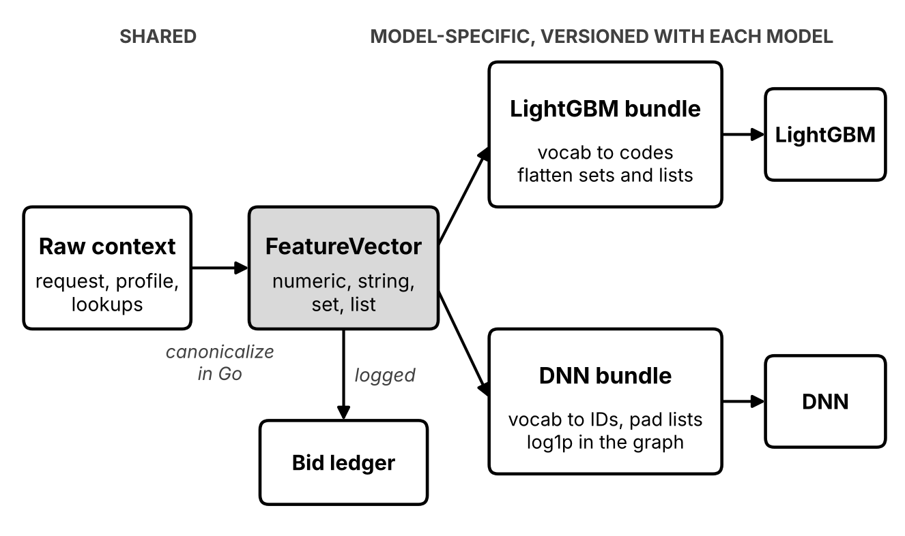
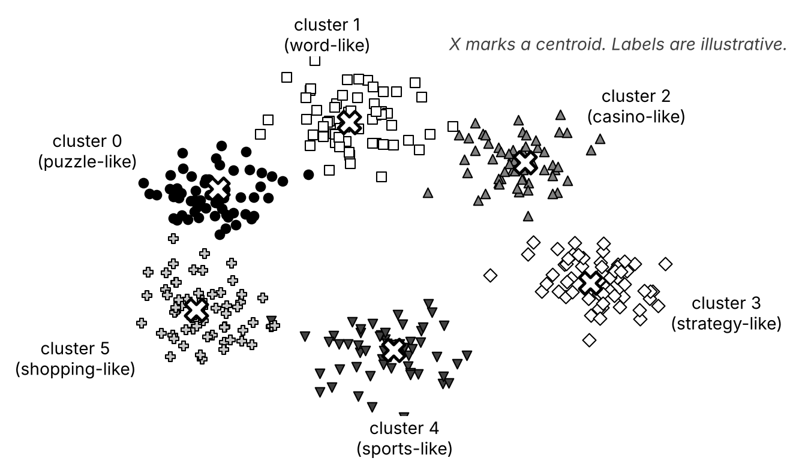
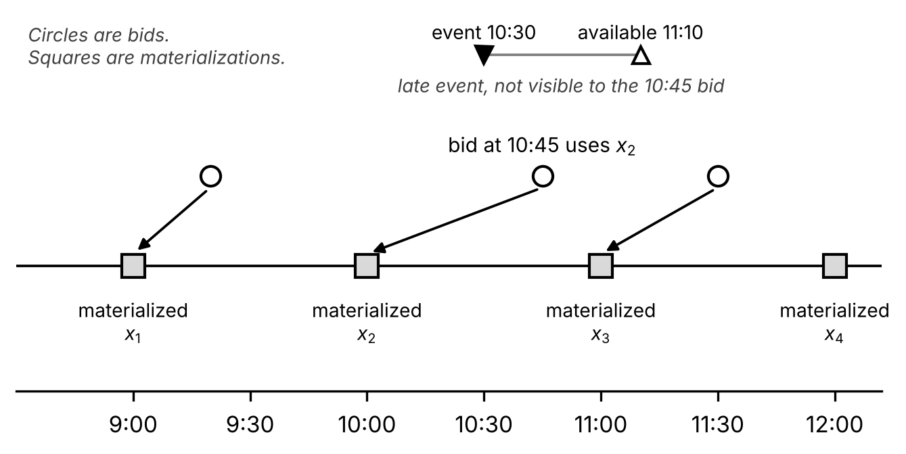

# Feature Logging and Feature Stores {#sec-feature-logging-and-feature-stores}

A model is only as good as the match between the features it was trained on and the features it sees at bid time. When the two drift apart, a model that looked excellent offline loses money online, and the cause is often hard to find, because nothing is obviously broken. This mismatch is called **training-serving skew**, and in a DSP it has more sources than in most ML systems. Features are computed from a device profile that changes every few seconds, in a Go bidder with a latency budget of a few milliseconds, while the training pipeline runs hours or days later in Python, on data that has kept changing since the bid.

I learned this the hard way. When I worked on migrating a DSP's click and install models from logistic regression to deep learning, a large share of the incidents we ran into were feature parity issues: places where the training pipeline and the serving pipeline computed the same feature in slightly different ways.[^c9b-incidents] None of them crashed anything. They just made the models a bit worse in production than they were offline, and each one took time to track down.

In this chapter, we will look at where skew and leakage come from, compare the main ways to get features into training data, and make the case for one of them: logging features at bid time in a single, model-agnostic record that we call the **FeatureVector**. We will cover how several models with different needs can share that record, how lookup features and embeddings are versioned, how clustering embeddings produces compact categorical features, and how to add new features without waiting weeks for logs to accumulate. We then cover when a feature store makes sense and how to build one without leakage, and close with how the right approach depends on the structure of the team.

[^c9b-incidents]: Ben Weber, "Machine Learning Incidents in AdTech," *Towards Data Science*, January 29, 2025, <https://medium.com/data-science/machine-learning-incidents-in-adtech-e3f48d858054>

## Training-Serving Skew and Leakage

**Skew** is any difference between the value a feature had at bid time and the value used to train the model. **Leakage** is a special case, where the training value contains information that was not available at bid time, usually information about the outcome itself. @tbl-c9b-skew lists the most common sources of both in a DSP.

| Source | How it happens |
|---|---|
| Two implementations | The same feature is computed in Python for training and in Go for serving, and the two drift apart |
| Hash functions | Python's built-in hash is randomized per process, and Go and Python libraries differ in seeds and algorithms |
| Missing values | Empty strings, nulls, zeros, and "unknown" are handled differently in each pipeline |
| String normalization | Case, whitespace, Unicode, and app bundle ID formats |
| Time | Time zones, day-of-week bucketing, and clock skew between bidder hosts |
| Versions | A model trained with one vocabulary or embedding version and served with another |
| Precision | float32 vs. float64, and values that pass through JSON |
| Profile freshness | Training on a device profile read after the bid, which includes events that happened later |

: Common sources of training-serving skew and leakage. {#tbl-c9b-skew}

Every row in this table has bitten a team I've worked with. A few examples from the migration I mentioned:

- **Divide by zero.** We had ratio features, such as a device's historical click rate (clicks divided by impressions). The training pipeline encoded a divide by zero as -1, and the serving pipeline encoded it as 0. Our parity checker caught it, but only after the model was live.
- **String parsing.** Our vocabulary mapped `com.dreamgames.royalmatch` to an index, but in one pipeline the bundle arrived as `com.dreamgames.royalmatch$hl=en_US`, which mapped to the out-of-vocab (OOV) index. The fix that worked long term was cleaning app bundles once, at data ingestion, instead of in each pipeline.
- **Time-relative features.** We tried a `weeks_ago` feature, computed in training as the number of weeks between the impression and the training date. At serving time, it was always 0. The feature ranked highly offline, and the model without it won the A/B test.

The last row of the table, profile freshness, is the most dangerous, because it produces leakage rather than just noise. Suppose the training pipeline reads each device's profile from the NoSQL store at training time. That profile now includes the apps the device installed after the bid, including the advertised app, installed because of the impression we are trying to learn from. A feature like "has installed apps in this genre" becomes almost perfectly predictive offline and useless at bid time. Subtler versions include install counts, engagement aggregates, and recency features that absorb events after the bid. The model looks better offline than any honest model could, and then underperforms online.

## Three Ways to Get Features into Training Data

There are three common patterns, shown in @fig-c9b-three-ways, and most DSPs use some mix of them.

{#fig-c9b-three-ways width="100%"}

**Log raw inputs and compute features twice.** The bidder logs the bid request and the device profile it fetched, often as JSON. The Go bidder computes features for serving, and a Python pipeline computes the same features from the logged inputs for training. This is point-in-time correct, because the profile was captured at bid time, and it makes backfilling new features easy. Its weakness is that every feature exists twice, and the two implementations drift. Most of the incidents above came from this setup.

**Recompute from stores at training time.** The training pipeline joins bids to the current device profile, app metadata, and aggregate tables. This is the easiest to build and the most dangerous, because every lookup returns today's value rather than the value at bid time. It's only safe with point-in-time joins, which we cover in the feature store section.

**Log features at bid time.** The bidder logs the exact feature values it computed, keyed by request ID, and training joins labels to those logged values. Training sees exactly what serving saw, so skew from two implementations and leakage from late lookups both disappear. The cost is that a new feature has no history until it has been logged for a while, which we address later in the chapter.

| | Log raw, compute twice | Recompute at training time | Log features at bid time |
|---|---|---|---|
| Skew from two implementations | High | High | None |
| Leakage risk | Low | High without as-of joins | None |
| Backfilling new features | Easy | Easy | Needs a replay or a wait |
| Log volume | Large (full profiles) | Small | Medium |
| Who can add features | Anyone in Python, but Go must match | Anyone | Engineers who change the bidder |

: Comparing the three approaches. {#tbl-c9b-approaches}

This book recommends logging features at bid time as the default, with raw inputs logged alongside them for a sample of traffic, so that new features can be backfilled. I've argued for this structure before, in the context of how to organize an ML team: when the team that trains the models also owns the code that computes features at bid time, feature parity issues become structurally much harder to introduce.[^c9b-pods] The tradeoff is that adding a feature means changing the Go bidder first. That is a higher bar than working entirely in Python, but in my experience it's the right bar.

We'll call the log that holds these records the **bid ledger**: one row per bid (or per won impression, if storage is tight), keyed by the auction's request ID, with the FeatureVector, the model predictions, the model and lookup versions, and the price. The bid ledger shows up again in the training, monitoring, and on-call chapters, because it's the ground truth for what the bidder knew and did.

[^c9b-pods]: Ben Weber, "Structuring an ML Org for a DSP: Pods not Silos for Effective Model Development," *Data Science Collective*, May 19, 2026, <https://medium.com/data-science-collective/structuring-an-ml-org-for-a-dsp-9fae5a01c671>

## One FeatureVector for Every Model

A DSP usually runs several models on the same request, such as a LightGBM model and a DNN conversion model, and they need their inputs in different forms. Rather than logging each model's tensors, the bidder logs one FeatureVector, a model-agnostic record of clean feature values before any model-specific transform. Each model then turns the FeatureVector into its own inputs.

### Four Value Types

| Type | Examples | Notes |
|---|---|---|
| Numeric | Seconds since last install, sessions in the last 7 days, bid floor, device age in days | Natural units, no log or scaling |
| String | Country, OS version, publisher app, exchange, device model | Normalized, not yet mapped to IDs |
| String set | Installed app categories, apps seen in the last 30 days | Deduplicated, unordered |
| String list | Recent app sequence, recent event types | Most recent first, capped at a generous length such as 200, with per-item ages |

: The four value types in the FeatureVector. {#tbl-c9b-types}

Strings stay strings in the FeatureVector. Mapping them to integer IDs depends on a model's vocabulary, which belongs to the model, so it happens after logging. This is also what would have prevented one of the incidents in my post: we had reused one vocabulary across a click model and an install model, and the install model, trained on a smaller dataset, ended up with embedding entries that never received a training update.[^c9b-incidents] When vocabularies belong to models rather than to the log, that kind of sharing doesn't happen by accident.

### Canonicalization Rules

The FeatureVector is produced by a canonicalization layer in the bidder. These are fixed rules that define what a feature means, shared by every model:

- **Natural units:** prices in dollars and durations in seconds.
- **Normalized strings:** lowercase and trimmed, with consistent app bundle ID and country formats.
- **Explicit missing values:** missing values are recorded with presence fields, never as a silent zero or empty string.
- **Clipping:** impossible values, such as negative counts, are clipped.
- **Relative time:** time is expressed relative to the request timestamp, such as the age of each event in a list, so that models never need the wall clock. This is the rule that would have prevented the `weeks_ago` incident.
- **Ordering:** sets are deduplicated, and lists are ordered most recent first, with a fixed maximum length.

A minimal contract, in the protocol buffer style we use for specs in @sec-technical-specs, looks like this:

```protobuf
message FeatureVector {
  int32 schema_version = 1;
  // Natural units; an absent key means missing.
  map<string, double> numeric = 2;
  map<string, string> strings = 3;      // normalized
  map<string, StringSet> sets = 4;      // deduplicated
  map<string, StringList> lists = 5;    // recent first, capped
  // Lookup versions, e.g. app_glove -> v2026-03.
  map<string, string> lookup_versions = 6;
}

message StringSet {
  repeated string values = 1;
}

message StringList {
  repeated string values = 1;
  repeated int64 age_seconds = 2;
}
```

The schema only grows. New fields are added, and old fields are never repurposed, so a model built for schema version 5 can run on any bidder producing version 5 or later.

One design choice is worth calling out: data from the advertiser's MMP and from SDKs should keep its own vocabulary rather than being merged into bid request fields. The two sources describe the same devices differently. For example, MMP data might use two-letter country codes where bid requests use three-letter codes, or list device models by marketing name where bid requests use hardware identifiers. If you merge them before logging, every one of these mismatches becomes a feature parity issue.[^c9b-intent] Canonicalize each source on its own terms, and let the models decide how to combine them.

[^c9b-intent]: Ben Weber, "Pretrained Deep Learning Intent Signals for Mobile DSPs," *Medium*, October 3, 2026.

### Model-Specific Transforms

Everything after the FeatureVector belongs to a model, and is versioned with it. @tbl-c9b-transforms shows how a LightGBM model and a DNN treat the same four types.

| Feature type | LightGBM | DNN |
|---|---|---|
| Numeric | None needed. Trees ignore monotone transforms, and missing values are handled natively | `log1p`, clipping, and standardization, with statistics fitted on the training split |
| String | Vocabulary to integer codes, with native categorical splits and an "other" code | Vocabulary to IDs, then an embedding; hashing for very high-cardinality fields |
| String set | Flattened to fixed columns, such as counts or multi-hot over the top values | IDs, then an embedding bag with mean or sum pooling |
| String list | Hand-built aggregates, such as counts in time windows | Padded ID tensors with a mask and per-item ages, truncated to the model's length |

: Model-specific transforms for each value type. {#tbl-c9b-transforms}

One rule decides where each transform runs. Anything learned from data is model metadata, and anything that is a fixed formula can live in the model graph. Vocabularies, means and standard deviations, bucket boundaries, and top-value lists are fitted once on the training split and shipped as metadata files with the model. String-to-ID lookups run in a shared Go preprocessing library that reads the model's vocabulary, because Go inference runtimes handle string operations in the graph unevenly. Numeric math for the DNN, such as `log1p` and standardization, runs in the graph, so that training and serving execute the same operations. Flattening sets and lists for LightGBM is a per-model specification executed by the same Go library, both in the bidder and in the batch job that builds training data.

Padding is a good example of why this matters. In one incident, we couldn't send empty arrays to our serving endpoint when batching was turned on, so the serving code padded empty app lists with `[0]`. But index 0 was a real app, so the model was told that devices had installed an app they never had, and only in serving, not in training. The eventual fix was to reserve index 0 as a padding value with no meaning in every vocabulary, and to apply the same padding in both pipelines.[^c9b-incidents] With a shared Go preprocessing library, that rule lives in one place.

Each model ships as a **bundle**: the model file, its preprocessing specification, vocabularies, fitted statistics, the versions of any lookup tables it depends on, and the FeatureVector schema version it expects. A set of **golden vectors** per model version, FeatureVectors with the exact tensors the model should receive, is checked in both the Go library and the Python training path on every build. We cover publishing bundles in @sec-model-validation-and-publishing, and @fig-c9b-one-vector shows how the pieces fit together.

{#fig-c9b-one-vector width="100%"}

## Lookup Features and Embeddings

Many useful features are lookups keyed by an entity: an app's category and release date, a publisher's historical click rate, or a pretrained embedding for the advertised app. Lookups are easy to get wrong, because the table behind them changes over time.

### Embeddings Are Versioned Artifacts

Consider GloVe embeddings for apps, trained on co-install data in February and retrained in March.[^c9b-glove] The March vectors are not a refined copy of the February vectors. Each training run produces an arbitrary rotation of the space, so the coordinates mean different things. A model trained on February vectors that receives March vectors at serving time sees inputs that look like noise. The version is part of the feature's definition, and `app_glove@v2026-02` and `app_glove@v2026-03` are different features.

The pattern that keeps this consistent has four parts:

1. **Immutable artifacts.** Each embedding table is published once and never overwritten. The vocabulary, the rule for apps missing from it, and a checksum belong to the version.
2. **Model manifests.** Each model's bundle lists the exact versions it depends on, such as `app_glove@v2026-02` for one model and `app_glove@v2026-03` for another.
3. **Multi-version serving.** The bidder loads every version that any live model needs, keyed by feature name and version. A model whose dependencies are not loaded doesn't go live, and a version is unloaded once no model references it.
4. **Versions in the log.** The FeatureVector records the lookup key, such as the app bundle ID, and the version used, not the full vector. Because the artifact can't change, the input can be rebuilt exactly. Full vectors are logged only for a sample, for parity checks.

Small tables, such as app embeddings, can also be stored inside the model as a frozen embedding layer. One million apps with 64 dimensions in float32 take about 256 MB, which is often acceptable, and it makes version mismatches impossible. Large shared tables, such as precomputed device embeddings, belong in a versioned store, with at most two versions live at a time during a migration.

Two details are easy to miss. Each version has its own vocabulary, so a new app may be missing from February and present in March, and the OOV rule must match between training and serving. And embeddings trained on co-installs through March carry a little future information when used to train on January impressions. That's usually acceptable, but for strict comparisons, train embeddings only on data from before the model's training window, and record that window with the artifact.

[^c9b-glove]: Jeffrey Pennington, Richard Socher, and Christopher D. Manning, "GloVe: Global Vectors for Word Representation," EMNLP, 2014.

### Cluster IDs from Embeddings

Embeddings work well in DNNs, but a 64-dimensional vector is awkward for tree models and hard for people to reason about. A useful compromise is to cluster the embeddings and use the cluster ID as a categorical feature. This is one of the most useful tricks I've used: on one DSP team, we trained GloVe embeddings on advertiser and publisher apps, grouped the apps with k-means at several values of k, and used the cluster IDs as categorical features in a logistic regression model. The embeddings were pretrained offline, and trivial to serve.[^c9b-intent]

Running k-means on the app embeddings assigns each app to its nearest centroid:

$$c(a) = \arg\min_k \lVert e_a - \mu_k \rVert^2$$

where $e_a$ is the embedding for app $a$, and $\mu_k$ are the centroids. With a few hundred clusters, the cluster ID becomes a compact categorical feature that LightGBM can split on directly, that groups similar apps for cold start, and that gives analysts readable segments for reporting, as in @fig-c9b-clusters. Two levels, such as 20 coarse and 200 fine clusters, work well together, and the distance to the centroid is a useful numeric companion that says how typical an app is for its cluster.

{#fig-c9b-clusters width="90%"}

Cluster IDs are derived from an embedding version, so they are versioned with it, and the mapping from app to cluster is published as a lookup table alongside the embedding. Cluster numbers are arbitrary in each run, which means cluster 17 in February has nothing to do with cluster 17 in March. If continuity matters, for example for reporting, match new centroids to old ones with a minimum-cost assignment on centroid distances, and renumber the new clusters to follow the old ones.

## Adding New Features

Logging features at bid time has one real cost. A new feature has no history until the bidder has logged it for long enough to train on, which for conversion models also means waiting for labels to mature. For a D7 ROAS model, that can be a month or more. There are four ways to shorten the wait.

**Dark launch the feature.** Ship the feature extraction to the bidder behind a flag, so that it's computed and logged but not used by any model. Logging starts as soon as the code is written, well before the model that uses it is ready, and the cost is only bidder CPU and log space.

**Backfill by replaying raw context.** If the bidder logs raw inputs (the request and the device profile it fetched) for a sample of traffic, a batch job can run the same Go feature code over that history to compute the new feature for past bids. Because the code is the same as the bidder's, there is no second implementation to drift. This is the main reason to keep a sample of raw context alongside the FeatureVector.

**Reconstruct as of the bid from an event log.** If the device profile is built from an append-only log of events, a historical profile can be rebuilt by replaying only the events that were available before each bid:

$$\text{include event } e \text{ for a bid at time } t \iff t_{available}(e) < t$$

The important detail is the availability time, when the event landed in the online store and the bidder could see it, rather than the event time on the device. As we saw in @sec-measurement-and-mmps, postbacks and SDK events often arrive minutes or hours late. A replay based on event time gives training fresher profiles than the bidder ever had, which is a quiet form of skew.

**Train with partial history.** When neither replay is possible, train on a mix of rows with and without the new feature, with explicit missing values for older rows. Tree models handle this natively, and DNNs can use a missing indicator. The model learns more slowly about the new feature, but it doesn't have to wait.

### Validating a Backfill

A backfill is only trustworthy if it reproduces what the bidder actually computed. Once live logging begins, there is a window where both values exist for the same bids, as shown in @fig-c9b-backfill. For each feature, measure the share of bids where the backfilled and logged values disagree:

$$\text{mismatch}_j = \frac{1}{N}\sum_{i=1}^{N} \mathbb{1}\left[\,\lvert x^{backfill}_{ij} - x^{logged}_{ij}\rvert > \epsilon_j\,\right]$$

where $x_{ij}$ is feature $j$ for bid $i$, and $\epsilon_j$ is a tolerance, zero for strings and sets. A mismatch rate below a threshold, such as 0.1%, means the backfill can be used for training. Higher rates usually come from availability times, event ordering, or list truncation, and are worth fixing before any model sees the data.

{#fig-c9b-backfill width="100%"}

### What to Log and How Much

| Record | Logged for | Why |
|---|---|---|
| FeatureVector | Every won impression, and every bid if storage allows | Labels exist only for wins; the win rate model needs every bid |
| FeatureVector for losing candidates | A sample of internal auction losers | Training candidate selection and ranking models |
| Raw context (request and profile snapshot) | A sample of bids, such as 1% to 5% | Backfills and parity checks |
| Model inputs (tensors) | A small sample per model | Parity checks against the model bundle |
| Sampling weights | Every sampled record | Exact correction for downsampling during training and calibration |

: What the bid ledger records, and for which traffic. {#tbl-c9b-what-to-log}

The second row refers to the **internal auction**, where the DSP compares its own candidate campaigns for a request and picks one to bid with. We'll define it properly in @sec-inside-a-demand-side-platform.

## When a Feature Store Makes Sense

A **feature store** provides one definition of each feature, computed by one pipeline and served to both training and serving. Most feature stores have four parts:

- **Registry:** feature definitions, owners, versions, and the entities they are keyed by.
- **Offline store:** historical feature values with timestamps, for building training data.
- **Online store:** current feature values with low-latency reads, for serving.
- **Materialization:** jobs that compute features and write them to both stores.

In a DSP, a feature store fits some features much better than others. Entity-level features, keyed by app, publisher, exchange, country, or campaign, are a natural fit. There are relatively few keys, the values change slowly, they are computed in batch or streaming jobs, and many models share them. Device-level features are a harder fit. There are billions of keys, they are written constantly, and they have to be read within a millisecond on the bid path. Most DSPs keep a custom device profile store, such as Bigtable, Aerospike, or Redis, for those, and log the values at bid time.

### Building One Without Leakage

The rule for a leakage-free feature store is that the offline store must return exactly what the online store would have returned at bid time, including its staleness. If the online store is refreshed every hour, a bid at 10:45 saw the value materialized at 10:00, and training must use that value, not one recomputed at 10:45:

$$x_{train}(t) = x(\tau^*), \qquad \tau^* = \max\{\,\tau_k : \tau_k \le t\,\}$$

where $\tau_k$ are the materialization times. This is called a point-in-time join, or an **as-of join**, and @fig-c9b-asof shows how it works.

{#fig-c9b-asof width="100%"}

A few design choices make this reliable:

- **Two timestamps on every value.** Store the event time the feature describes and the availability time it reached the online store, and join on availability time.
- **Append, never overwrite.** The offline store keeps every materialized value with its timestamp, so any past state can be reconstructed.
- **The same code writes both stores.** One materialization job writes the online and offline stores, so they can't drift.
- **Freshness monitoring.** Track the lag between event time and availability time per feature, because training should reflect the lag the bidder actually experienced.
- **Log what was served anyway.** Even with a feature store, have the bidder log the values it read and their timestamps. The log is the ground truth for parity checks against the offline store.

On Google Cloud, a simple version is an offline store in BigQuery with timestamped rows and an online store in Bigtable, written by the same Dataflow or batch job. Managed options include the Feature Store in Google's Gemini Enterprise Agent Platform, which replaced the Vertex AI brand in April 2026,[^c9b-agent-platform] and open source options include Feast.[^c9b-feast] Commercial platforms such as Tecton add streaming materialization and a registry.

[^c9b-agent-platform]: "Google Announces New Gemini Enterprise Agent Platform," *THE Journal*, May 4, 2026. Most of the former Vertex AI services, including Feature Store, Pipelines, and Model Registry, continue under the Agent Platform name.
[^c9b-feast]: Feast, an open source feature store, <https://feast.dev/>

## Choosing an Approach for Your Team

The best approach depends less on the technology than on who builds features and who owns the bidder.

**A small team that trains and serves.** When the same people train models and write the Go bidder, logging features at bid time is the simplest and safest choice. Adding a feature means adding it to the Go canonicalization layer, dark launching it, and backfilling from raw context with the same code. There is no extra infrastructure, skew is impossible by construction, and the team already understands the bid path. This is the setup this book uses for its reference DSP.

**A larger organization with more data scientists.** As the team grows, more people want to add features, and many of them work in SQL and Python rather than in the production Go codebase. Requiring a bidder change and a code review from the serving team for every feature becomes the bottleneck. This is when a feature store earns its cost. Data scientists define entity-level features declaratively, the platform materializes them to the online and offline stores, and the bidder reads them by name without code changes.

### An Extension Path

The two approaches don't have to compete. A DSP can keep logging at bid time and still let data scientists add features without touching Go, by giving the FeatureVector a section for registry-driven features:

1. Data scientists define a feature in the registry, with its entity key, its SQL or Python definition, and a refresh schedule.
2. The materialization job writes values to the online and offline stores.
3. The bidder reads the registry, fetches the listed features for each request by entity key, and places them in a generic section of the FeatureVector, keyed by feature name and version.
4. The bidder logs those values with the rest of the FeatureVector, so training still uses exactly what serving saw.

{#fig-c9b-team-path width="100%"}

This keeps the most important property of logging at bid time, that training data is exactly what the bidder used, while moving feature development to the people who build models. Device-level features that need bid-time aggregation stay in Go, owned by the serving team, and entity-level features move to the store. @fig-c9b-team-path and @tbl-c9b-teams summarize the progression.

| | Small full-stack team | Growing team with an extension path | Large organization |
|---|---|---|---|
| Who adds features | ML engineers, in Go | Data scientists for entity features; engineers for device features | Data scientists, through the platform |
| Source of training features | Logged FeatureVector | Logged FeatureVector, including registry features | Feature store as-of joins, checked against logs |
| New feature history | Dark launch and replay | Store backfill for entity features | Store backfill |
| Main risk | Bottleneck on the serving team | Registry and fetch latency on the bid path | Offline and online drift, staleness mismatches |

: How the approach changes as the team grows. {#tbl-c9b-teams}

One more lesson from the incidents: whichever structure you choose, have the people who train the models review changes to the code that computes features at bid time, and vice versa. When we started adding data scientists as reviewers on pull requests to the serving pipeline, parity issues started getting caught before they shipped instead of after.[^c9b-incidents]

## Conclusion

Training-serving skew and leakage are some of the most expensive bugs in a DSP, because they make models look better offline than they are online. In this chapter, we compared three ways to get features into training data and chose logging features at bid time as the default. A single, model-agnostic FeatureVector, with numerics, strings, string sets, and string lists, records what the bidder knew, and each model owns its transforms, vocabularies, and lookup versions in a bundle. Embeddings and the cluster IDs derived from them are versioned artifacts that models pin in a manifest. New features are dark launched and backfilled by replaying logged raw context through the same Go code, and each backfill is checked against live values before it's used. Feature stores fit entity-level features well, and they are leakage-free only when their offline store returns exactly what the online store would have returned at bid time.

The right mix depends on the team. A small team that owns both training and serving gets the most from logging at bid time. A larger organization benefits from a feature store, and the extension path keeps the guarantee of logged features while letting data scientists add features without changing the bidder. In the next chapter, we use the logged FeatureVector to build training datasets, joining it to labels as they arrive.
