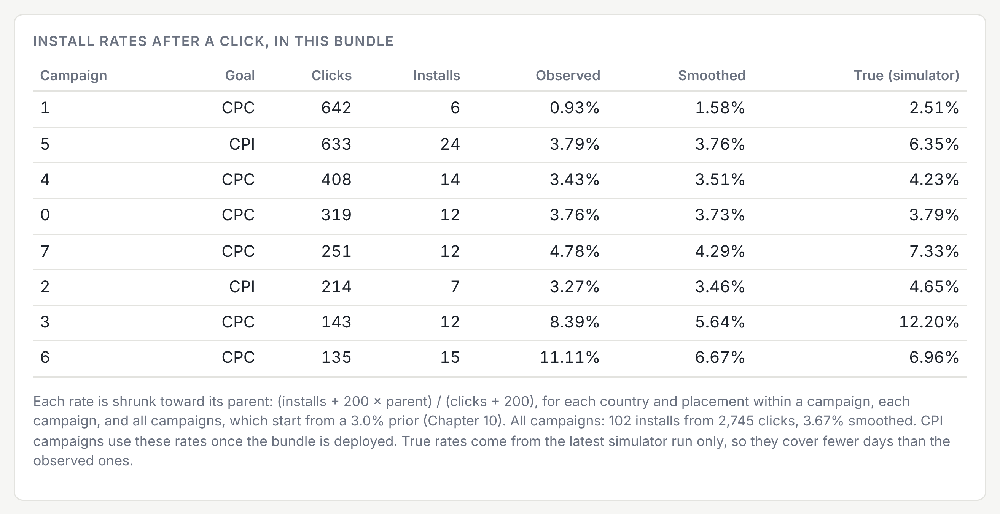
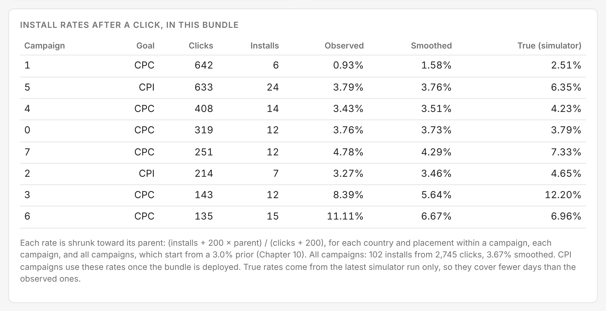
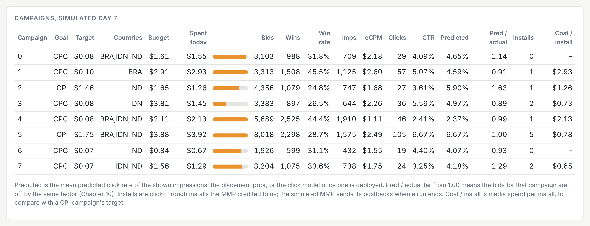
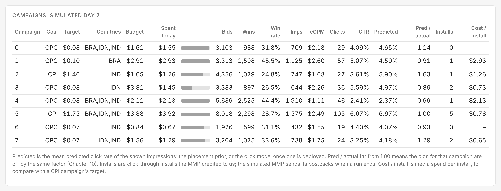

# Pricing a Click {#sec-pricing-a-click}

A click model on its own doesn't buy anything. The bidder has to turn its prediction into a price, in dollars per thousand impressions, that's high enough to win some auctions and low enough that the advertiser gets what they're paying for and the DSP keeps a margin. Pricing is where model errors become money. A click model that's 20% too high produces bids that are 20% too high, on every impression, for as long as nobody notices.

In @sec-inside-a-demand-side-platform, we defined the vocabulary for this step: the advertiser value $A$, the calibration multiplier $\kappa$, the pacing multiplier $\gamma$, the media value $v_m$, the floor, and the shaded bid. The crawl DSP uses all of them, most in their simplest form. In this chapter, we will price a CPC campaign from the click model, then price a first CPI campaign by combining the click model with install rates for each segment. We add the margin, fees, and floors, use a fixed shade with a small randomized multiplier on a share of bids, build the bid response, and log the win, loss, and billing notifications that come back.

## CPC Pricing

For a CPC goal, the advertiser says what a click is worth: the target CPC. If the click model predicts that an impression will be clicked with probability $p_{\text{click}}$, then the impression is worth $\text{target CPC} \times p_{\text{click}}$ to the advertiser, and a thousand such impressions are worth a thousand times that. This is the **advertiser value**:

$$A = \text{target CPC} \times p_{\text{click}} \times 1000$$

Bids in OpenRTB are prices per thousand impressions (CPM), so $A$ is already in the right units. From there, the bidder applies the rest of the pricing equation from @sec-inside-a-demand-side-platform:

$$v_m = A \times \kappa \times \gamma \times (1 - m) - f, \qquad b = s \times v_m$$

where $m$ is the margin, $f$ is any fixed fee per thousand impressions, and $s$ is the shade. In crawl, two of these terms are fixed at 1. The calibration multiplier $\kappa$ is 1 because we don't yet have a separate calibration layer. We rely on the click model's own calibration and check it daily, and $\kappa$ becomes a real, continuously updated term in @sec-pricing-for-goals. The pacing multiplier $\gamma$ is 1 because the crawl DSP spreads spend with throttling rather than by changing bids, as we'll see in @sec-operating-the-first-dsp.

This is the same form as the formula in my post on click prediction, `cpm = target_cpc * p_ctr` followed by `bid_price = cpm * bid_shade` with a shade below 1, with the margin and fees made explicit.[^c10-click]

Let's work through an example with Gem Garden traffic. Cozy Farm Tycoon runs a CPC campaign in India with a target CPC of \$0.08. A request arrives for a rewarded video in Gem Garden, and the click model predicts a click rate of 1.5%. The numbers are illustrative.

| Step | Value | Calculation |
|------|-------|-------------|
| Predicted click rate | 1.5% | From the click model, corrected for downsampling |
| Advertiser value ($A$) | \$1.20 CPM | $0.08 \times 0.015 \times 1000$ |
| Calibration and pacing ($\kappa$, $\gamma$) | 1.0, 1.0 | Fixed in crawl |
| Margin ($m$) | 20% | The DSP's share |
| Media value ($v_m$) | \$0.96 CPM | $1.20 \times 0.80$ |
| Shade ($s$) | 0.70 | Fixed in crawl |
| Bid | \$0.67 CPM | $0.70 \times 0.96$, if above the floor |

: Pricing one impression for a CPC campaign. {#tbl-c10-cpc}

If the DSP wins a thousand impressions like this one at \$0.67, it pays \$0.67 for the media and bills Cozy Games \$0.84, the media cost plus a 20% margin on the billed amount. If the model is calibrated, those impressions produce 15 clicks, so the advertiser pays about \$0.056 per click, well under the \$0.08 target. That gap is the shade at work. It's money the advertiser saves, and it's room the DSP could use to bid higher and win more, which is the tradeoff a win rate model optimizes in @sec-win-rate-and-bid-shading.

One detail about units: $p_{\text{click}}$ has to be a click rate per impression shown, which is why we trained on impressions in @sec-a-click-model. Most exchanges bill on the billing notice, which fires when the ad is shown, so a price per impression is what we pay. If an exchange bills on the win instead, the value per win is lower by the clear rate, and the bid has to be multiplied by it.

In the reference bidder, the advertiser value is one function, with a case for each goal. The CPI case uses the install rate from the next section:

```go
func (p *Crawl) Value(c *campaigns.Campaign,
    pClick, pInstall float64) float64 {
    switch c.Goal {
    case "CPC":
        return c.Target * pClick * 1000
    case "CPI":
        return c.Target * pClick * pInstall * 1000
    }
    return 0
}
```

The rest of the price is a few lines in the policy's `Decide` method. With $\kappa$, $\gamma$, and $f$ fixed, they reduce to the margin, the shade, the random multiplier we come to below, the floor, and a cap:

```go
d.AdvertiserValue = p.Value(c.Campaign, d.PClick, pInstall)
d.MediaValue = d.AdvertiserValue * (1 - p.Margin)
if rng.Float64() < p.ExploreShare {
    lo, hi := math.Log(p.ExploreLo), math.Log(p.ExploreHi)
    d.ExploreMult = math.Exp(lo + rng.Float64()*(hi-lo))
}
if d.MediaValue < floor {
    d.Action, d.Reason = "nobid", "below_floor"
    return d
}
bid := math.Min(d.MediaValue*p.Shade*d.ExploreMult, p.CapCPM)
if floor > 0 {
    bid = math.Max(bid, floor)
}
```

Every term is kept in the decision and logged with the bid. The banner request we followed in @sec-logging-at-bid-time was priced before any model was deployed, from the banner prior of 0.6%, for a CPC campaign with a target of \$0.083: $0.083 \times 0.006 \times 1000 \times 0.8 \times 0.7 = \$0.2789$ CPM, which is the bid in its ledger record.

## A First CPI Campaign Priced from Clicks

As we said in @sec-starting-from-scratch, advertisers buy installs, not clicks. The crawl DSP can run a first CPI campaign before it has an install model, by noting that, for installs that come from clicks, the value of a click is the value of an install times the chance that a click leads to one:

$$\text{value of a click} = \text{target CPI} \times p_{\text{install} \mid \text{click}}$$

With that, a CPI campaign is priced exactly like a CPC campaign, with the value of a click in place of the target CPC. The click model supplies $p_{\text{click}}$, and the install rate after a click comes from data, not from a model. Using the install postbacks from the minimal endpoint in @sec-logging-at-bid-time, we compute a click-to-install rate for each segment, such as each combination of campaign, country, and placement type.

Segment rates need smoothing, because most segments have few installs. A segment with 40 clicks and one install has an observed rate of 2.5%, and one with 40 clicks and no installs has 0%, but neither number means much. A simple fix is to shrink each segment's rate toward the rate of a larger parent segment, such as the campaign's overall rate:

$$\hat{r}_s = \frac{\text{installs}_s + k \times r_{\text{parent}}}{\text{clicks}_s + k}$$

where $k$ is the number of clicks' worth of weight the parent rate gets. With $k = 200$ and a parent rate of 3%, the segment with 40 clicks and one install gets a smoothed rate of $(1 + 6) / 240 \approx 2.9\%$, close to the parent, while a segment with 20,000 clicks is barely affected. Choose $k$ by checking which values best predict the next week's segment rates.

For example, suppose Cozy Farm Tycoon's CPI campaign in India has a target CPI of \$1.20, and the smoothed click-to-install rate for rewarded video in its segment is 3%. A click is worth $1.20 \times 0.03 = \$0.036$, and with the same 1.5% click rate as before, $A = 0.036 \times 0.015 \times 1000 = \$0.54$ CPM. The rest of the pricing is the same.

This is the realistic first campaign for a new DSP, because it buys what advertisers want, and it needs only a click model and a few weeks of postbacks. It also falls short in ways that set up Part III:

- **It ignores view-through installs.** Some installs follow an impression without a click. Pricing only on clicks undervalues placements, such as rewarded video, where many installs come without one.
- **Segment rates are coarse.** Every click in a segment gets the same install rate, whether it came from a device that installs games every week or one that never does.
- **Labels are slow and sparse.** Installs arrive hours to days after a click, so the rates lag, and small segments stay noisy even with smoothing.

We replace segment rates with install models in @sec-from-clicks-to-installs-and-purchases.

The reference DSP computes these rates with every model it trains, for each country and placement within a campaign, shrunk toward the campaign, which is shrunk toward all campaigns, which starts from a 3% prior, all with $k = 200$. They ship in the model bundle, so a CPI campaign's prices change only when a new bundle is deployed. @fig-c10-install-rates shows them for the first bundle, next to the simulator's true rates.

::: {.content-visible when-format="html"}
{#fig-c10-install-rates width="100%" fig-alt="Screenshot of a console table of eight campaigns with clicks, installs, observed, smoothed, and true install rates. Campaign 5, a CPI campaign, had 633 clicks and 24 installs: 3.79% observed, 3.76% smoothed, and 6.35% true. Campaign 6 had 135 clicks and 15 installs: 11.11% observed, shrunk to 6.67%, with 6.96% true. Across all campaigns, 102 installs from 2,745 clicks, 3.67% smoothed. In most rows the true rate is higher than the observed rate."}
:::

::: {.content-visible unless-format="html"}
{#fig-c10-install-rates width="100%" fig-alt="Screenshot of a console table of eight campaigns with clicks, installs, observed, smoothed, and true install rates. Campaign 5, a CPI campaign, had 633 clicks and 24 installs: 3.79% observed, 3.76% smoothed, and 6.35% true. Campaign 6 had 135 clicks and 15 installs: 11.11% observed, shrunk to 6.67%, with 6.96% true. Across all campaigns, 102 installs from 2,745 clicks, 3.67% smoothed. In most rows the true rate is higher than the observed rate."}
:::

Two things stand out. Smoothing does its job on small campaigns: campaign 6 had 15 installs from 135 clicks, an observed rate of 11%, and the smoothed 6.7% is much closer to its true 7.0%. But the observed rates are below the true rates for almost every campaign, and smoothing can't fix that, because it isn't noise. The true rate counts every install our clicks caused. The observed rate counts only the installs the MMP credited to us, and the simulated MMP, like a real one, uses last-touch attribution: when another ad network touched the device after our click, it gets the install, and some postbacks never arrive at all. For campaign 5, the gap is 3.8% against 6.3%. A CPI campaign priced on attributed installs values clicks at what the advertiser will pay us for, not at what they're worth, which is the right price for the DSP's business, and the gap is why we come back to incrementality in @sec-measuring-incrementality.

The first CPI campaigns did well on the simulator even so. Before the first bundle, the bidder priced them with the 3% prior for every click. @fig-c10-campaigns shows the next simulated day, when the bundle, with these rates, was deployed at 06:00: campaign 5 spent its whole budget, at \$0.78 per attributed install against a \$1.75 target, and campaign 2 came in at \$1.26 against \$1.46. With five installs and one, those costs are noisy, and they're the right numbers to watch as the counts grow.

::: {.content-visible when-format="html"}
{#fig-c10-campaigns width="100%" fig-alt="Screenshot of a console table of eight campaigns for simulated day 7. For each: goal, target, countries, budget, spend with a progress bar, bids, wins, win rate between 25% and 46%, impressions, eCPM, clicks, CTR, predicted CTR, the ratio of predicted to actual, installs, and cost per install. Campaign 5, CPI with a $1.75 target, spent $3.92 of $3.88, with 105 clicks, a predicted to actual ratio of 1.00, 5 installs, and $0.78 per install. Campaign 2, CPI with a $1.46 target, spent $1.26 of $1.65, with a ratio of 1.63 and $1.26 per install."}
:::

::: {.content-visible unless-format="html"}
{#fig-c10-campaigns width="100%" fig-alt="Screenshot of a console table of eight campaigns for simulated day 7. For each: goal, target, countries, budget, spend with a progress bar, bids, wins, win rate between 25% and 46%, impressions, eCPM, clicks, CTR, predicted CTR, the ratio of predicted to actual, installs, and cost per install. Campaign 5, CPI with a $1.75 target, spent $3.92 of $3.88, with 105 clicks, a predicted to actual ratio of 1.00, 5 installs, and $0.78 per install. Campaign 2, CPI with a $1.46 target, spent $1.26 of $1.65, with a ratio of 1.63 and $1.26 per install."}
:::


## Margin and Billing

The crawl DSP bills advertisers on CPM with a fixed margin, which @sec-inside-a-demand-side-platform described as one of the two common business models. The advertiser pays for the media the DSP buys, plus the margin, and judges the DSP on whether the resulting cost per click or per install meets its target. In the pricing equation, the margin is the $(1 - m)$ term: the DSP never values an impression at more than $(1 - m)$ of what it's worth to the advertiser, so whatever it pays, it can bill the advertiser for the media plus its margin and still meet the target if the predictions are right.

The fee term $f$ covers costs per impression that the DSP pays on top of the media, such as a data or measurement fee. It's subtracted after the margin, so the media value is what's left for the exchange. In crawl, $f$ is often zero, but keeping it in the equation from the start means adding a fee later is a configuration change, not a code change.

A fixed margin is simple and predictable. In @sec-pricing-for-goals, we look at billing per install and at a margin that varies per impression.

## Bid Floors

Every impression in a bid request has a floor, the minimum price the publisher will accept. The bidder compares the floor with the media value:

- **If the media value is below the floor, don't bid.** The impression isn't worth the least the publisher will accept, and the no-bid reason is logged as below floor.
- **If the shaded bid is below the floor but the media value isn't, bid the floor.** The impression is still worth more than the floor to us, so we bid the lowest price that can win.
- **Otherwise, bid the shaded price,** capped at an absolute maximum CPM for the campaign and for the DSP.

The cap matters more than it looks. It's the last line of defense against a bug elsewhere, such as a unit error or a model that predicts a click rate of 100%, turning into a bid that's a thousand times too high.

Floors are also a signal. A floor is set by the publisher, or by the exchange on its behalf, often based on what impressions in that placement have cleared at before. That makes the floor a rough lower bound on the clearing price. We log the floor on every request, whether or not we bid, and it becomes one of the most useful features of the win model in @sec-win-rate-and-bid-shading.

## A Fixed Shade with Randomized Multipliers

In a first-price auction, the winner pays what it bid, so bidding the full media value leaves no surplus. As we saw in @sec-the-auction-lifecycle, the bidder shades its bid: it bids less than the impression is worth, trading some chance of winning for a lower price. The right shade depends on the competition for each impression, which we can't model yet, because we don't have win data. So the crawl DSP uses a fixed shade, such as 0.7, for every bid.

A fixed shade is wrong almost everywhere. Where competition is thin, it overpays, and where competition is heavy, it loses impressions that were worth winning. Fixing that needs a win rate model, which predicts the chance of winning at each possible bid. And a win rate model can only learn how the win rate changes with the bid if the bid varies for reasons other than the value of the impression. If every bid is exactly 0.7 times the media value, a high bid always means a valuable impression, and the model can't tell whether the impression won because the bid was high or because the impression was easy to win.

So the crawl DSP adds deliberate randomness. On a small share of bids, for example 5%, the bidder multiplies the media value by a random factor before shading, drawn log-uniformly between about 0.6 and 1.5. The multiplied bid is still clipped to the floor and the cap, so it never goes outside the range the campaign allows. The multiplier is logged with the bid, along with whether the bid was in the explored share. In @sec-win-rate-and-bid-shading, this is the data the first win model trains on.

Exploration costs a little. Bids with a low multiplier lose some impressions they'd have won, and bids with a high multiplier pay more than they needed to. On 5% of bids, the cost is a small fraction of total surplus, and we can measure it from the logs. The data can't be collected any other way, and it's much cheaper to start collecting in crawl than to retrofit later.

## Building the Bid Response

When the bidder decides to bid, it builds an OpenRTB bid response. For each impression it bids on, the response includes:

- **`price`:** the bid, as a CPM in the currency the request asked for.
- **`adm`:** the ad markup, which includes the creative, the impression tracking URLs, and the click URL that goes through the DSP's click tracker.
- **`crid` and `cid`:** the creative and campaign IDs, which exchanges use for creative review and reporting.
- **`adomain` and `bundle`:** the advertiser's domain and app store ID, which publishers use for blocking.
- **`nurl`, `burl`, and `lurl`:** the win, billing, and loss notification URLs, with macros the exchange fills in.

When the bidder doesn't bid, it still responds, as we said in @sec-parsing-bid-requests-and-eligibility. An empty response, or an HTTP 204, tells the exchange there's no bid, and OpenRTB defines a no-bid reason field (`nbr`) with a small set of codes, such as invalid request or suspected non-human traffic. The DSP's own reasons are more detailed than these codes, so the bidder logs its internal reason in the bid ledger, such as no eligible campaign, below floor, holdout, or listen-only, and maps it to the closest OpenRTB code in the response.

## Win, Loss, and Billing Notifications

After the auction, the exchange calls the notification URLs from the response. Each tells us something different:

- **The win notice** (`nurl`) says the bid won. The exchange fills in the `${AUCTION_PRICE}` macro with the clearing price, which in a first-price auction is our own bid.
- **The billing notice** (`burl`) says the impression was billable, usually because the ad was shown. This is the notice that spend should be counted from, as we saw in @sec-the-auction-lifecycle, since many wins never become impressions.
- **The loss notice** (`lurl`) says the bid lost, with a reason code in `${AUCTION_LOSS}`. Exchanges that support OpenRTB 2.6 can also report the minimum bid to win, in `${AUCTION_MIN_TO_WIN}`, which is very valuable for the win model.

Not every exchange sends every notice. Some don't send loss notices, some don't report the minimum bid to win, and some encrypt the price. Record which exchange supports what, because the win model treats exchanges with and without loss data differently.

Each notice is logged with its own event ID, the request ID and impression ID it refers to, and the time it arrived, as we set up in @sec-logging-at-bid-time. Spend is counted from billing notices, deduplicated, and it's the number that the spend counters, dashboards, and reconciliation in @sec-operating-the-first-dsp all start from.

## First-Time Pitfalls

- **Unit errors.** OpenRTB prices are CPMs, but it's easy to mix up a price per impression and a price per thousand, dollars and cents, or dollars and micros, and exchanges can use different currencies. Test every conversion with known values, and keep the absolute bid cap as a backstop, so a unit error can't become a runaway bid.
- **Applying the downsampling correction twice, or not at all.** The click model's prediction needs the correction from @sec-a-click-model exactly once, in the bidder. A golden-file test with known inputs and prices catches both mistakes.
- **Forgetting the multiplier in analysis.** Bids in the explored share don't follow the pricing equation by design. Exclude them, or account for them, when checking that bids match the equation.

::: {.callout-tip title="Try it on the simulator"}
Trace the pricing ledger for one CPC bid and one CPI bid: the prediction, the advertiser value, the margin, the media value, the shade, the floor check, and the bid. Then find a bid in the explored share, and check that its multiplier was logged and that it was clipped to the floor and the cap.

*Status: runs with the companion bidder (dsp 0.5). Every bid record in the ledger has the decision's terms: the predicted click rate and the model version that made it, the advertiser value, the media value after margin, the exploration multiplier, the bid, and for no-bids, the reason, such as `below_floor`. For CPI campaigns, it also has the install rate after a click and where it came from: a segment, the campaign, all campaigns, or the 3% prior. The shade is the crawl policy's fixed 0.7. See `code/dsp/README.md` for reading the ledger.*

:::

## Conclusion

In this chapter, we turned the click model into prices. For a CPC campaign, the advertiser value is the target CPC times the predicted click rate, and the media value applies the margin and fees, with calibration and pacing fixed at 1 in crawl. For a first CPI campaign, we valued a click as the target CPI times a smoothed install rate for its segment, which buys what advertisers want before the DSP has an install model. We checked bids against floors and an absolute cap, used a fixed shade with randomized multipliers on a small share of bids to collect data for a win model, and logged the bid response and every notification that comes back.

The bidder now has everything it needs to bid: a parsed request, a campaign, a click model, and a price. In the next chapter, we get the model from a training script into the Go bidder safely, with versioned artifacts, hot-swapping, and tests that catch parity bugs before they reach a bid.

[^c10-click]: Ben Weber, "Deep Learning for Click Prediction in Mobile AdTech," *Towards Data Science*, January 2025, <https://medium.com/data-science/deep-learning-for-click-prediction-in-mobile-adtech-9739fe3f52de>
