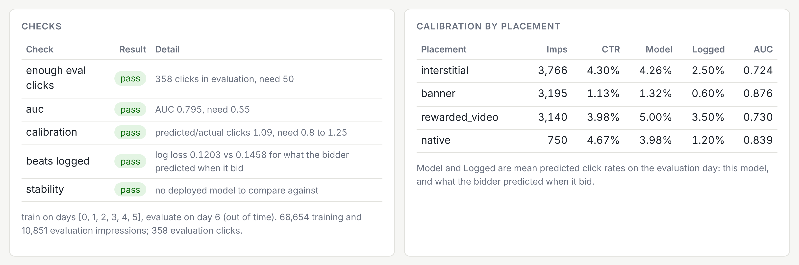
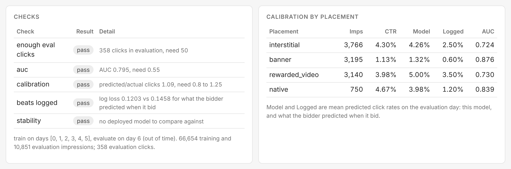
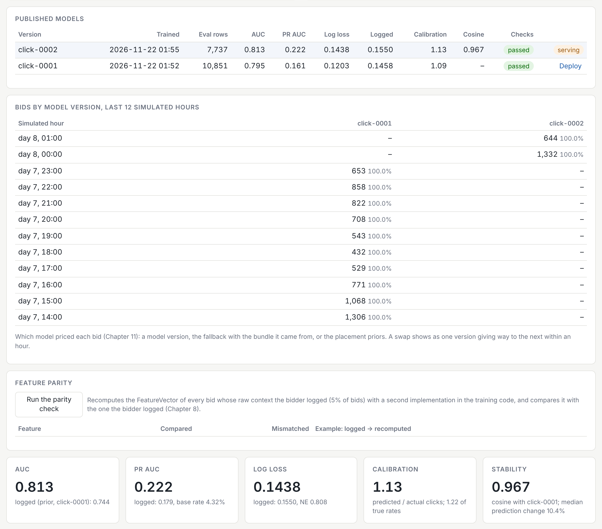
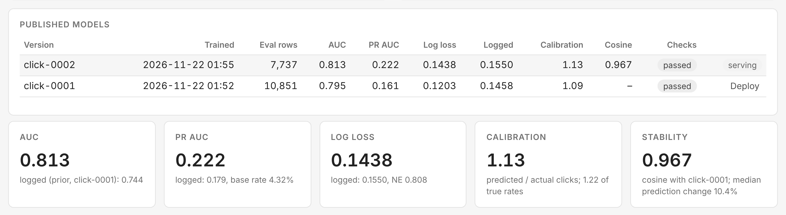
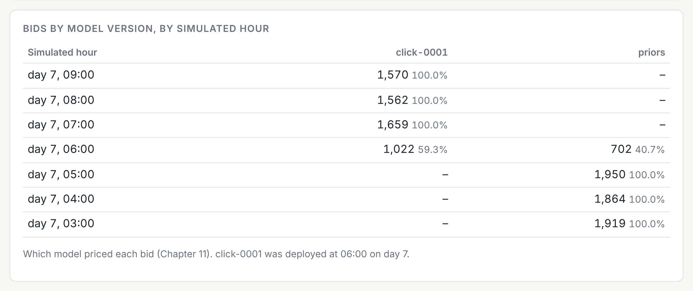
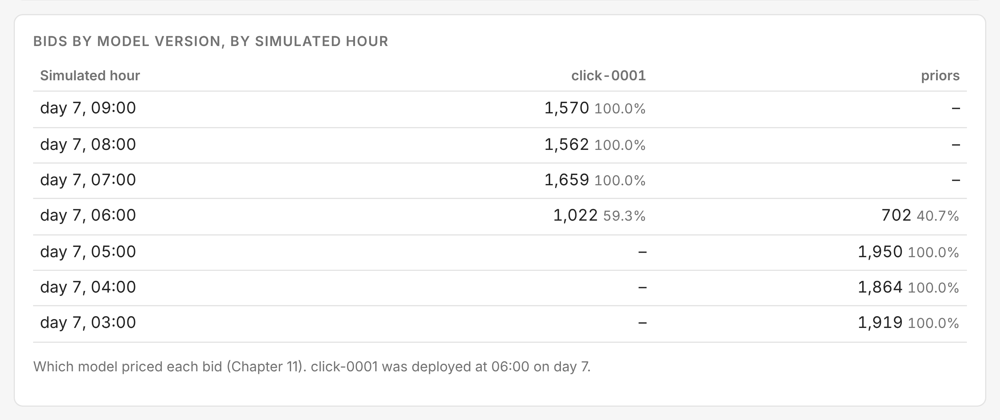

# Shipping the First Model {#sec-shipping-the-first-model}

A model that lives in a notebook doesn't bid. Getting it into the bidder means a training job that runs on its own every day, an artifact the bidder can load, a way to replace the running model without restarting, and a record of which model priced every bid. None of this is hard on its own, but each piece is easy to get slightly wrong, and the mistakes compound. A model trained with one hash seed and served with another, or loaded before it's warmed up, or swapped in at midnight with nobody watching, can cost more than the model will ever earn.

The goal for crawl is a path from training script to bidder that's simple, versioned from the start, and tested where it matters most: at the boundary between Python and Go, where the same features have to be computed the same way. In Part III, we replace most of these pieces with a pipeline, a model registry, and canary deploys. The habits we build here carry over.

In this chapter, we will train the click model end to end in a daily Python job, package it as a versioned artifact with a pointer to the current champion, and load, warm up, and hot-swap it in the Go bidder. We log the model version with every bid, set up a manual deploy checklist and deploy windows, walk through the complete crawl bid path in Go, and test the path with unit tests, a golden-file parity test, and a smoke test.

## Training a Baseline End to End in Python

The first training pipeline is one script that runs once a day, on a schedule, with no manual steps. It does four things:

1. **Build examples.** Join the previous days' impressions, bid ledger records, and clicks into click examples, as in @sec-a-click-model, skipping any impression whose click window hasn't closed and any row from invalid traffic.
2. **Train.** Train the logistic regression model with FTRL on the most recent days, for example the last 14, holding out the most recent full day for evaluation.
3. **Evaluate.** Compute log loss, AUC, and calibration on the held-out day, overall and by exchange and placement, and compare them with the current champion on the same day.
4. **Write an artifact.** If the model passes its checks, write it to a new versioned location in object storage.

A single machine is enough at crawl volumes. FTRL reads examples as a stream and keeps two numbers per bucket, so even billions of rows fit comfortably. When the data outgrows one machine, the example-building step moves to Spark first, since that's where most of the time goes, and training follows later if it needs to.

The reference DSP's version is `python -m adtrain train`, which the console's Train button also runs. It trains on every complete day in the ledger but the last, evaluates on the last, and publishes a bundle. On six simulated days, it takes well under a minute. One step from the list above is missing: the reference trainer doesn't remove invalid traffic yet, which is why the bots in @sec-a-click-model are still in its training data. Adding it is an exercise in @sec-operating-the-first-dsp.

Run the script with the same code, container, and dependency versions every day, and record them with each artifact. In crawl, a scheduler such as cron or a managed equivalent is enough. We move to a proper orchestrator in @sec-pipelines-validation-and-publishing, when there are several models and their jobs depend on each other.

## Packaging the Model Artifact

Each training run writes a **bundle**: everything the bidder needs to use the model, in one place.

- **Weights:** the nonzero weights, stored sparsely as bucket index and value.
- **Hash settings:** the hash algorithm, seed, and number of buckets.
- **Feature specification:** the list of features and crosses, the numeric bucket boundaries, and the FeatureVector schema version the model expects.
- **Corrections:** the negative downsampling rate, so the bidder can correct predictions as in @sec-a-click-model.
- **Metadata:** the training window, the code commit and container version that built it, the evaluation metrics, and a version ID.
- **Golden vectors:** a small set of FeatureVectors with the exact hashed indexes and predictions the model should produce, for the parity test later in this chapter.

The reference DSP's bundles are directories, such as `out/models/click/click-0001/`, with six files: `model.json` and `weights.bin` from @sec-a-click-model, `golden.jsonl` with the golden vectors, `report.json` with the evaluation and the checks, and two tables of segment rates, `install_rates.json` for CPI pricing and `click_rates.json` for the fallback in @sec-operating-the-first-dsp. The training window and metrics are in the report.

Start simple with versioning. Write each bundle to its own path in object storage, named by version, such as `models/click/2026-11-19-0600/`, and never overwrite a bundle once it's written. A separate small file, the **champion pointer**, names the version the bidder should use. Deploying a model means changing the pointer, and rolling back means changing it back. The old bundles are still there, so a rollback is as fast as a deploy. In the reference DSP, the pointer is a file named `DEPLOYED` next to the bundles, and every deploy is also appended to a log, so the history of what served when is never lost. In @sec-pipelines-validation-and-publishing, we replace the pointer file with a model registry, where the champion is an alias on a registered version, but the idea is the same.

The training job checks each new model before it writes a bundle, and refuses to publish one that fails. Simple checks catch a lot:

- **Metrics above a floor,** such as AUC above 0.55 and log loss below the base-rate model's.
- **A sane prediction distribution,** with the mean prediction close to the observed click rate and the spread of predictions not collapsed.
- **A comparison with the champion** on the same evaluation day, with a limit on how much worse the new model can be.
- **Stability against the previous model,** measured on the models themselves rather than on their metrics.

The reference trainer runs five checks, shown for the first model in @fig-c11-checks: at least 50 clicks in the evaluation day, so the metrics mean something; an AUC of at least 0.55; a calibration between 0.8 and 1.25; a lower log loss than the predictions the bidder logged when it bought the evaluation day's impressions, which is the comparison with the champion; and a stability check against the deployed model, which we come to next. A model that fails is still published, so it can be inspected, but the bidder won't deploy it unless a person forces the deploy.

::: {.content-visible when-format="html"}
{#fig-c11-checks width="100%" fig-alt="Screenshot of two console panels. Checks: enough eval clicks, pass, 358 clicks in evaluation, need 50; auc, pass, AUC 0.795, need 0.55; calibration, pass, predicted over actual clicks 1.09, need 0.8 to 1.25; beats logged, pass, log loss 0.1203 versus 0.1458 for what the bidder predicted when it bid; stability, pass, no deployed model to compare against. Trained on days 0 to 5 and evaluated on day 6, with 66,654 training and 10,851 evaluation impressions. Calibration by placement: interstitial, banner, rewarded video, and native, with the model's mean prediction much closer to the observed click rate than the logged priors' in every placement."}
:::

::: {.content-visible unless-format="html"}
{#fig-c11-checks width="100%" fig-alt="Screenshot of two console panels. Checks: enough eval clicks, pass, 358 clicks in evaluation, need 50; auc, pass, AUC 0.795, need 0.55; calibration, pass, predicted over actual clicks 1.09, need 0.8 to 1.25; beats logged, pass, log loss 0.1203 versus 0.1458 for what the bidder predicted when it bid; stability, pass, no deployed model to compare against. Trained on days 0 to 5 and evaluated on day 6, with 66,654 training and 10,851 evaluation impressions. Calibration by placement: interstitial, banner, rewarded video, and native, with the model's mean prediction much closer to the observed click rate than the logged priors' in every placement."}
:::

These checks matter more than they look. In one system I worked on, a daily retrain produced a model that predicted a 25% click rate for every request, with an AUC of 0.5, and it was deployed automatically. That kind of bad training run happened around 2% of the time, and the fix was a validation step with metric thresholds and a comparison against the prior model on the same data.[^c11-incidents]

The stability check catches failures that metrics miss. At Chartboost, we trained a large logistic regression click model every day, and compared each new model with the previous day's using the cosine similarity of their weight vectors. Consecutive days of training data overlap heavily, so two consecutive models should be nearly the same, with a similarity close to 1. When the similarity drifted below a threshold, the model refresh failed and the new model needed a person to review and deploy it by hand. A sudden drop usually means something changed in the pipeline rather than in the market: a feature that stopped arriving, a changed hash setting, a broken label join, or a day of bad traffic. Metrics can miss these, because a model trained by a broken pipeline is often evaluated on data built by the same broken pipeline.

A few details make the check work:

- **Compare over the union of nonzero weights.** FTRL produces sparse models, so treat a weight that's missing from one model as zero. Otherwise, a feature that disappears entirely doesn't lower the similarity.
- **Set the threshold from history.** Record the similarity for every run and fail when a new value falls well outside the usual range, such as below the lowest value of the past month. A fixed number like 0.95 is either too loose or too strict, depending on the model.
- **Break it down when it fails.** Similarity per feature group, such as the publisher, the campaign, and each cross, usually points straight at the feature that changed.
- **Skip it for intended changes.** A new feature specification or hash setting makes the weights incomparable. Those changes go through a manual deploy anyway.

The reference trainer compares each new model with the deployed one, over the union of nonzero weights, and fails below a cosine of 0.8, a placeholder until there's a month of history to set it from. With no deployed model, the check passes with nothing to compare. It also reports the median change in predictions on the evaluation day, which is easier to explain to an account manager than a cosine. The second model, trained one day after the first and on one more day of data, had a cosine of 0.967 with it, and a median prediction change of 10%, as in @fig-c11-models.

::: {.content-visible when-format="html"}
{#fig-c11-models width="100%" fig-alt="Screenshot of the console's published models table and metric tiles. click-0002, trained at 01:55, is serving: 7,737 evaluation rows, AUC 0.813, PR AUC 0.222, log loss 0.1438 against 0.1550 logged, calibration 1.13, cosine 0.967, checks passed. click-0001, trained at 01:52, has 10,851 evaluation rows, AUC 0.795, PR AUC 0.161, log loss 0.1203 against 0.1458 logged, calibration 1.09, checks passed, and a Deploy link. Tiles for click-0002: AUC 0.813 against 0.744 logged; PR AUC 0.222 against 0.179, base rate 4.32%; log loss 0.1438, normalized entropy 0.808; calibration 1.13, 1.22 of true rates; stability 0.967, cosine with click-0001, median prediction change 10.4%."}
:::

::: {.content-visible unless-format="html"}
{#fig-c11-models width="100%" fig-alt="Screenshot of the console's published models table and metric tiles. click-0002, trained at 01:55, is serving: 7,737 evaluation rows, AUC 0.813, PR AUC 0.222, log loss 0.1438 against 0.1550 logged, calibration 1.13, cosine 0.967, checks passed. click-0001, trained at 01:52, has 10,851 evaluation rows, AUC 0.795, PR AUC 0.161, log loss 0.1203 against 0.1458 logged, calibration 1.09, checks passed, and a Deploy link. Tiles for click-0002: AUC 0.813 against 0.744 logged; PR AUC 0.222 against 0.179, base rate 4.32%; log loss 0.1438, normalized entropy 0.808; calibration 1.13, 1.22 of true rates; stability 0.967, cosine with click-0001, median prediction change 10.4%."}
:::


We build fuller validation gates in @sec-pipelines-validation-and-publishing, including stability checks for tree and deep models, whose parameters can't be compared this way.

## Loading, Warming Up, and Hot-Swapping Models in Go

The bidder loads the model in-process, as a data structure in its own memory. For logistic regression, that's a map or a sorted array from bucket index to weight. Scoring an impression means hashing its tokens, looking up a few dozen weights, summing them, and applying the sigmoid, which takes microseconds.

In-process serving has a property that matters a lot for a model retrained every day: a new model can replace the old one in a single step. With a model served from a separate endpoint, a new version usually means a new endpoint or route, and for a while both versions have to be live while traffic moves over, with the feature encoding matched to whichever endpoint each request reaches. In-process, the bidder loads the new model, and then switches to it.[^c11-golang] The switch is the same pattern we used for campaign configuration in @sec-parsing-bid-requests-and-eligibility:

1. **Poll the champion pointer.** The bidder checks the pointer file every minute or so. When it names a new version, the bidder starts loading it in the background, while the current model keeps serving.
2. **Load and verify.** Read the bundle, check its schema version against the FeatureVector the bidder produces, and run its golden vectors through the Go code. If anything doesn't match, refuse the model, keep serving the current one, and alert.
3. **Warm up.** Score a set of sample requests with the new model before it takes traffic, so memory is allocated and caches are warm. A freshly loaded model is often slow for its first requests, and slow requests are lost bids.
4. **Swap.** Replace the model with a single atomic pointer swap. Requests that started with the old model finish with it, and new requests use the new one.

The reference bidder runs a single process, so it skips the polling. A deploy, from the console or its API, runs the other three steps directly and then moves the pointer. Here's the core of it, from the bidder's model registry, with error handling trimmed:

```go
type Registry struct {
    Dir string
    cur atomic.Pointer[Model]
    mu  sync.Mutex // serializes deploys
}

// One atomic load, so the bid path never waits on a deploy.
func (r *Registry) Current() *Model { return r.cur.Load() }

func (r *Registry) Deploy(version string, force bool) DeployResult {
    r.mu.Lock()
    defer r.mu.Unlock()
    dir := filepath.Join(r.root(), version)
    m, err := Load(dir)
    // ...
    n, worst, err := m.CheckGolden(dir)
    if err != nil || worst > ParityTolerance {
        // refused: parity can't be forced
    }
    if !report.Passed && !force {
        // refused: failed checks need a person to force the deploy
    }
    if us := m.warmup(dir); us > MaxPredictUS {
        // refused: too slow to serve
    }
    r.cur.Store(m) // in-flight requests keep their old pointer
    r.record(version, force)
    // ...
}
```

The parity check scores every golden vector in the bundle and requires the Go predictions to match the Python ones to within $10^{-9}$. It's the one check a person can't override: a model the bidder can't reproduce is never served. Warmup scores the golden vectors a few times and then times them, and refuses the model if one prediction takes more than 2 ms. The first model took 7 µs per prediction after warmup.

## Logging Model Versions

Every bid logs the version of the model that priced it, next to the configuration version from @sec-parsing-bid-requests-and-eligibility. It sounds like bookkeeping, and it's the first parity check a DSP has.

During a rollout, a fleet of bidders polls the pointer at slightly different times, so for a few minutes, some bidders serve the new model and some the old one. If one bidder fails to load the new model, it can keep serving the old one for hours. Without the version in the bid log, all of this is invisible. With it, a dashboard of bids by model version shows the rollout as it happens, and a version that should be gone and isn't is an alert. @fig-c11-versions shows the first deploy on the reference DSP, at 06:00 on the seventh simulated day. In that hour, 41% of bids were priced by the priors and 59% by the model, and from then on, all of them by the model.

::: {.content-visible when-format="html"}
{#fig-c11-versions width="100%" fig-alt="Screenshot of a console table with one row per simulated hour of day 7, from 03:00 to 09:00, and columns for click-0001 and the priors. From 03:00 to 05:00, all bids were priced by the priors, about 1,900 an hour. At 06:00, 1,022 bids, 59.3%, were priced by click-0001 and 702, 40.7%, by the priors. From 07:00, click-0001 priced all bids. A note reads: click-0001 was deployed at 06:00 on day 7."}
:::

::: {.content-visible unless-format="html"}
{#fig-c11-versions width="100%" fig-alt="Screenshot of a console table with one row per simulated hour of day 7, from 03:00 to 09:00, and columns for click-0001 and the priors. From 03:00 to 05:00, all bids were priced by the priors, about 1,900 an hour. At 06:00, 1,022 bids, 59.3%, were priced by click-0001 and 702, 40.7%, by the priors. From 07:00, click-0001 priced all bids. A note reads: click-0001 was deployed at 06:00 on day 7."}
:::


The version also connects the training side to the serving side. When the training job evaluates a model offline, it records the version. When monitoring looks at the model's live predictions and outcomes, it filters by the same version. Comparing the two is how we find out whether a model behaves in production the way it did offline, which is the question behind every parity check in @sec-operating-a-competitive-dsp.

## Manual Deploys and Deploy Windows

In crawl, a person decides when a new model goes live. The daily job publishes a bundle, and an engineer moves the champion pointer after checking a short list:

- **The training job passed its checks,** and the metrics are close to the previous model's.
- **The parity test passed** in Go for this bundle's golden vectors.
- **Nothing else is changing** at the same time, such as a bidder release or a large campaign launch, so that if something goes wrong, the cause is clear.
- **Someone will watch** the prediction and spend dashboards for the first hour after the swap.
- **The rollback is known:** the previous version is named, and moving the pointer back has been tested.

Model deploys should happen when the people who can respond are awake. Deploy during the working hours of the on-call engineer and the team, which can include weekends if the rotation covers them, and never late at night or just before the on-call engineer goes offline. Automated rollback reduces the risk of a bad deploy, but it doesn't remove the need for someone to follow up, and many problems only appear hours later as traffic patterns change.

The checklist also catches what the automated checks can't judge. On one simulator run, the second model failed its calibration check: it predicted 37% more clicks than it got on its evaluation day. Nothing was broken. The evaluation day had been bought by the first model, which bid most on the impressions it rated highest, including the ones it overrated, so the impressions it won were biased toward its own mistakes. This is the winner's curse, and any model evaluated on traffic that a model bought will see some of it. The check was right to stop the deploy, and the person reviewing it has to decide whether the new model is worse or just evaluated on biased data. We come back to the winner's curse in @sec-win-rate-curves-and-the-winners-curse.

A manual deploy every day gets tedious, and that's the point at which to automate it. In @sec-shadow-mode-canaries-and-ab-tests, deploys become canaries with automated checks and rollback. Until then, a manual step with a checklist is a reasonable price for knowing what changed and when.

## A Complete Bid Path in Go

We now have all the pieces of the crawl bidder. Here's the path a request takes, end to end:

1. **Receive** the request, start a deadline timer from `tmax` minus a network allowance, and assign the request to a holdout or not, by hashing the device ID.
2. **Parse and normalize** the request into the narrow struct from @sec-parsing-bid-requests-and-eligibility, rejecting malformed requests with a no-bid.
3. **Read the profile** with a strict timeout, treating a timeout as a missing profile.
4. **Filter** the campaigns in the current configuration snapshot, from cheapest to most expensive check.
5. **Select** a campaign and creative with weighted random selection, and record the candidate set and the selection probability.
6. **Compute the FeatureVector** from the request, profile, campaign, and creative.
7. **Predict** the click rate with the current model, correct it for downsampling, and record the model version.
8. **Price** the impression as in @sec-pricing-a-click: the advertiser value, the margin and fees, the shade, the random multiplier on the explored share, and the floor and cap checks.
9. **Respond** with a bid or a no-bid, unless the device is in the holdout, in which case the bid is logged as a ghost bid and a no-bid is sent.
10. **Log** the bid ledger record, with every input and output above, to the log stream.

The reference bidder's handler follows the same steps, in a slightly different order. Its profiles are in memory, so there's no timeout to manage, and the holdout is decided after pricing, so ghost bids are priced like real ones. Trimmed to the calls, it reads like the list:

```go
var req openrtb.BidRequest
body, err := io.ReadAll(io.LimitReader(r.Body, 1<<20))
if err == nil {
    err = json.Unmarshal(body, &req)
}
var n normalize.Request
if err == nil {
    n, err = normalize.Normalize(exchange, &req)
}
d := policy.Decision{Action: "nobid", CampaignID: -1, CreativeID: -1}
switch {
case err != nil:
    d.Reason = "bad_request"
case !n.ValidIFA:
    d.Reason = "no_device_id"
default:
    snap = b.Profiles.Observe(n.IFA, n.Bundle, ts, day)
    v := features.Build(&n, snap, ts)
    fv = &v
    elig, why := b.Book.EligibleWhy(n.Country, n.Placement, int(day))
    // kill switches and throttling
    cands, reason := b.filter(elig, why, sw, rng)
    if reason != "" {
        d.Reason, d.Filtered = reason, why
        break
    }
    predict := func(c *campaigns.Campaign,
        cr campaigns.Creative) (policy.Prediction, bool) {
        ad = features.Ad(c, cr)
        return b.predict(fv, ad, exchange, sw)
    }
    // select, predict, price, and decide the holdout
    d = b.Policy.Decide(cands, n.Placement, n.IFA, n.Floor,
        rng, predict)
    d.Filtered = why
}
if d.Action == "bid" {
    b.respond(w, &req, &d, ad)
} else {
    w.WriteHeader(http.StatusNoContent) // a no-bid, or a ghost bid
}
b.Bids.Log(day, BidRecord{RequestID: n.ID, LatencyUS: lat,
    Decision: d, Request: n, Features: fv, Ad: ad /* ... */})
```

The listen-only mode, kill switches, and sampling from earlier chapters are a few more cases in the same `switch`.

Each step records its own latency, so a trace shows where the time goes. In crawl, almost all of it is in parsing and the profile read. The model and pricing together take a tiny share, which won't be true once there are several models per request, as we'll see in @sec-serving-models-in-the-bid-path.

## Testing the First Model Path

Most ML bugs in a DSP don't crash anything. They produce a slightly different feature value in serving than in training, and the model quietly gets worse. Tests are the cheapest place to catch them, before a deploy rather than after. The crawl DSP needs four kinds.

**Unit tests for feature and hashing code, in both languages.** The feature code exists twice: in Go, in the bidder, which computes the FeatureVector and the hashed tokens, and in Python, in training, which computes the hashed tokens from the logged FeatureVector. Test both with the edge cases that cause incidents: empty fields, unknown values, Unicode in app bundles, very long strings, zero denominators in ratios, and missing profiles. In one incident on a team I worked on, a divide by zero was encoded as -1 in training and 0 in serving. A unit test with a zero denominator in both languages would have caught it.

**A golden-file test.** Take a fixed set of logged FeatureVectors, a few hundred covering the edge cases above, and run them through the Python training code and the Go serving code. The hashed indexes must match exactly, and the predictions must match to within floating point tolerance. The expected outputs are checked into the repository, and the test runs on every change. This is the single most valuable test in the crawl DSP. Many of the incidents I've written about were parity issues between training and serving pipelines, and each one would have shown up as a golden-file mismatch.

**A smoke test.** Start the bidder with the new model and a test configuration, send it a handful of realistic requests, and check that bids come back, that prices are within the expected range for each campaign, and that latency is within the budget. This catches problems that unit tests can't, such as a model file that loads but scores everything as zero.

**A minimal CI pipeline.** Run the unit tests, the golden-file test, and the smoke test on every change to feature code, model code, or bidder code, and block the merge if any fails. The tests are fast, so there's no reason to skip them.

## First-Time Pitfalls

- **Hot-swapping briefly holds two models in memory.** During the swap, the old model is still referenced by in-flight requests while the new one is loaded. Size the bidder's memory for two models, or the swap runs out of memory, usually during peak traffic.
- **A freshly loaded model is slow until warmed up.** Route traffic to a new model only after warmup, and watch p99 latency during and right after every swap.
- **A fleet mid-rollout runs two model versions at once.** That's normal for a few minutes. Log the version with every bid so the mix is visible, and alert if it lasts longer than a rollout should.

::: {.callout-tip title="Try it on the simulator"}
Train a new click model and publish it as a bundle. Move the champion pointer, and watch the bidders pick it up, warm it up, and swap, with bids by model version on the dashboard. Run the golden-file test after changing the hash seed in only the Python code, and watch it fail. Then publish a model that predicts a constant, and roll it back by moving the pointer.

*Status: runs with the companion bidder (dsp 0.5). Train and deploy from the console's Models tab. Each model is published with golden examples; the bidder refuses to deploy one whose predictions it can't reproduce, or one that failed its checks (including the cosine stability check) unless the deploy is forced, and rolls back by deploying an earlier version or going back to the priors. The bidder warms each model up before the swap, and the Models tab shows bids by model version for each simulated hour. The golden-file test runs in `go test` and `pytest`; for the constant model, use the Chapter 12 button on the Models tab.*

:::

## Conclusion

In this chapter, we built the path from a training script to the bidder. A daily Python job builds examples, trains, evaluates, and publishes a versioned bundle with its weights, hash settings, feature specification, corrections, and golden vectors. A champion pointer names the version to serve, and the Go bidder loads, verifies, warms up, and hot-swaps models with an atomic pointer swap, logging the model version with every bid. Deploys are manual, with a checklist and deploy windows, and the path is tested with unit tests in both languages, a golden-file parity test, and a smoke test in CI.

The crawl DSP can now bid with a trained model. Before it spends real money at scale, it needs the operations to keep that spending safe. In the next chapter, we add dashboards, alerts, spend caps, kill switches, and reconciliation with the exchanges.

[^c11-incidents]: Ben Weber, "Machine Learning Incidents in AdTech," *Towards Data Science*, January 29, 2025, <https://medium.com/data-science/machine-learning-incidents-in-adtech-e3f48d858054>

[^c11-golang]: Ben Weber, "Options for ML Serving with Golang," *Medium*, May 7, 2026, <https://medium.com/@bgweber/options-for-ml-serving-with-golang-3b1afa3a6182>
