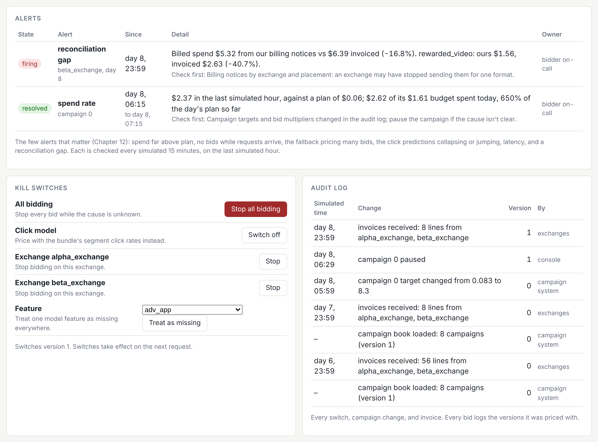
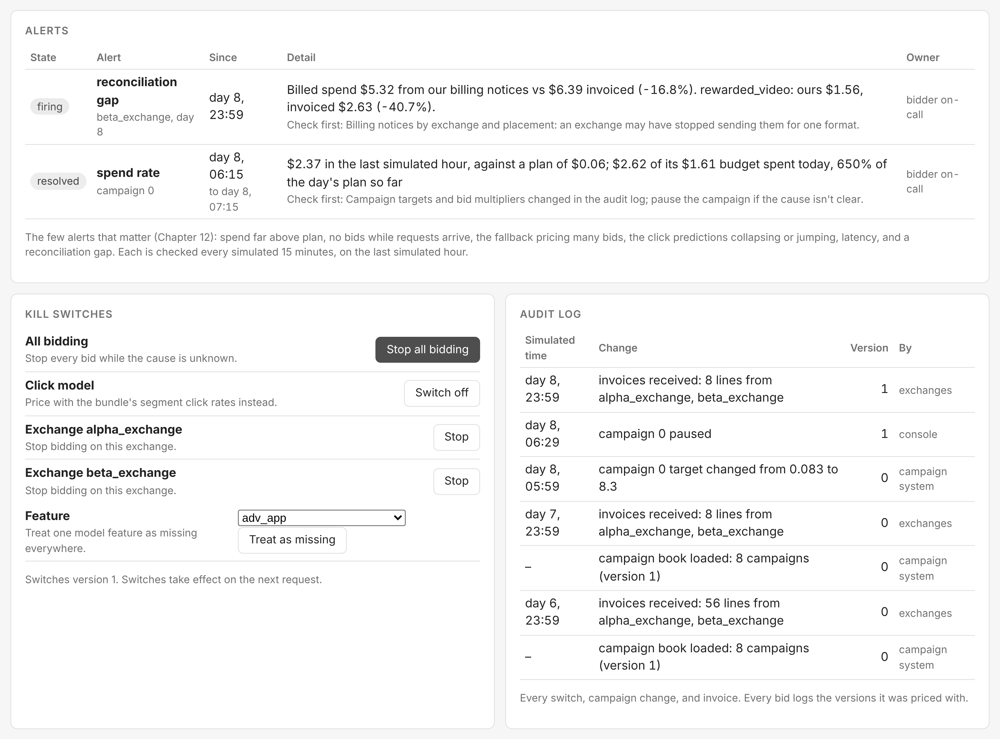
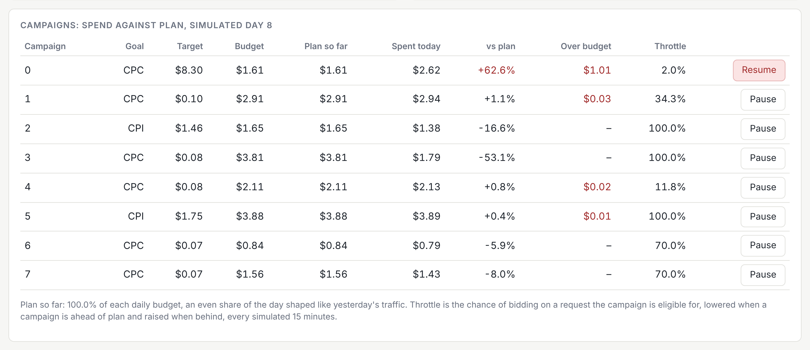
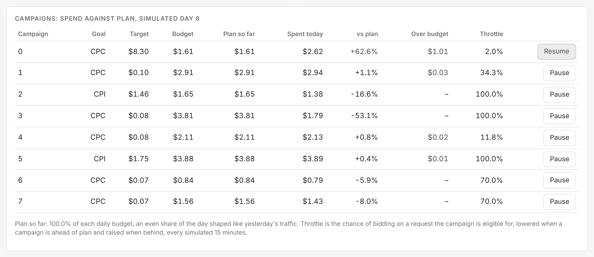
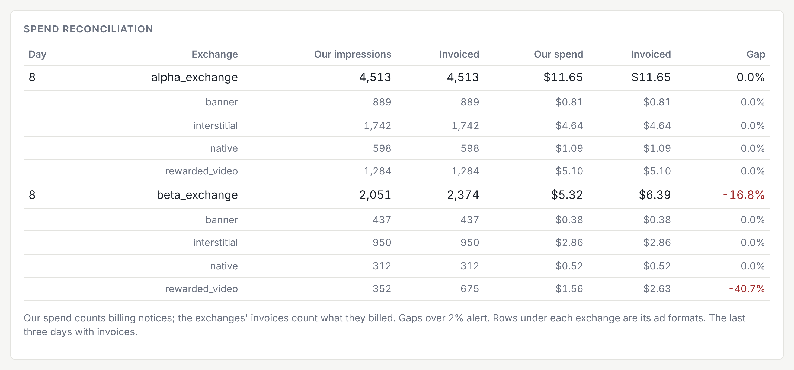
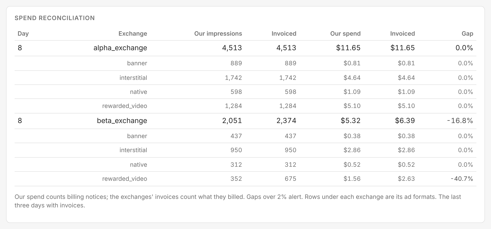

# Operating the First DSP {#sec-operating-the-first-dsp}

A DSP spends money continuously, by itself, at a rate set by software. That's what makes it useful, and it's also what makes it dangerous. A bug that would cause a slow page in another system can cause a DSP to spend a day's budget in an hour, or to stop bidding entirely while everyone's dashboards look normal. The models we've built so far have no idea whether they're doing that. Something else has to watch.

The crawl DSP doesn't need a large operations practice, but it does need the minimum before it spends real money: a way to see what it's spending, alerts for the few failures that matter most, limits that bound the damage of any mistake, a way to switch things off fast, and a check that the money we think we spent matches the money exchanges bill us for. These pieces are mostly not ML, but the ML team depends on them, and most of them become inputs to models later.

In this chapter, we will build spend dashboards and a few alerts, cap and spread spend with throttling, add kill switches and a fallback that prices with segment click rates when the model fails, and share budget and frequency state across the bidder fleet. We then reconcile spend with exchanges, deal with invalid traffic in practice, and treat configuration changes as deploys. We close with what breaks next, which sets up Part III.

## Spend Dashboards

The first dashboard answers one question: where is the money going? For the current day and the previous few, by hour, it shows:

- **Spend, wins, impressions, and clicks** by campaign, exchange, and country.
- **Win rate,** the share of bids that win, and **clear rate,** the share of wins that become impressions.
- **Average bid and average clearing price,** in CPM.
- **Spend against plan** for each campaign: how much it has spent so far today, compared with an even share of its daily budget.
- **Predicted vs. actual clicks** by campaign and exchange: the sum of the click model's predictions on shown impressions, next to the clicks that arrived.

The last panel is the ML team's. It's the simplest calibration check there is, and in crawl it's also a check on the whole pricing path, since the price is proportional to the prediction. If predicted clicks run 30% above actual clicks for one exchange, every bid on that exchange is about 30% too high.

Two other views from earlier chapters belong next to these. The no-bid reasons from @sec-parsing-bid-requests-and-eligibility show where volume goes before the auction, and bids by model and configuration version from @sec-shipping-the-first-model show what's running.

## A Few Alerts That Matter

It's tempting to alert on everything on the dashboards. Don't. Alerts that fire often and don't need action teach people to ignore alerts. In crawl, a handful cover the failures that cost the most:

- **Spend rate far above plan.** Spend in the last hour, for a campaign or overall, several times what the plan allows. This is the runaway bidding alert, and it's the one that matters most.
- **No bids.** The bid rate drops to near zero for an exchange or overall, while requests keep arriving. Something is filtering everything, or the bidder is failing.
- **Fallback use spikes.** The share of bids priced by the fallback rather than the model rises, which means the model failed to load or is being bypassed.
- **Prediction distribution collapses.** The median and 99th percentile of the click model's predictions move together or jump.
- **Latency or timeouts.** p99 latency or the timeout rate crosses a threshold for an exchange.

The prediction alert comes from an incident I've written about. On a DSP team I worked on, a retraining run produced a click model that predicted a 25% click rate for every request, and it was deployed automatically. We caught it because we logged click predictions as a histogram metric, and saw the p50 and p99 values converge on the same value right after the deploy.[^c12-incidents] A spend dashboard wouldn't have shown it as quickly.

The reference DSP checks these alerts every simulated 15 minutes, over the last simulated hour. Its spend alert fires when a campaign spends at least four times the plan for that hour, the hour took at least a tenth of the campaign's daily budget, and the campaign is more than 1.5 times ahead of the day's plan, and it skips the first two hours of each day, when the plan is too small to judge. Each of the three conditions was added after a false alarm on the simulator. The fallback alert fires when more than 20% of bids are priced by the fallback, the collapse alert when the 99th percentile of predictions is less than 1.5 times the median, and the latency alert when p99 latency is above 100 ms.

To see them work, the simulator has scenarios that break something on purpose. In one, the first CPC campaign's target is entered a hundred times too high, as \$8.30 instead of \$0.083, at 06:00 on a simulated day. @fig-c12-alerts shows what followed. The spend alert fired at 06:15, on the first check after the change, and the campaign was paused from the console at 06:29. By then it had spent \$2.62 of a \$1.61 budget, \$2.37 of it in one hour against a plan of 6 cents.

::: {.content-visible when-format="html"}
{#fig-c12-alerts width="100%" fig-alt="Screenshot of three console panels. Alerts: a firing reconciliation gap on beta_exchange for day 8, billed spend $5.32 from our billing notices against $6.39 invoiced, minus 16.8%, and rewarded_video minus 40.7%; and a resolved spend rate alert for campaign 0 from 06:15 to 07:15 on day 8, $2.37 in the last simulated hour against a plan of $0.06, with $2.62 of its $1.61 budget spent. Each alert has a note on what to check first and an owner. Kill switches: stop all bidding, switch off the click model, stop each exchange, and treat one feature as missing. Audit log: campaign 0's target changed from 0.083 to 8.3 at 05:59, campaign 0 paused from the console at 06:29, and invoices received at the end of each day."}
:::

::: {.content-visible unless-format="html"}
{#fig-c12-alerts width="100%" fig-alt="Screenshot of three console panels. Alerts: a firing reconciliation gap on beta_exchange for day 8, billed spend $5.32 from our billing notices against $6.39 invoiced, minus 16.8%, and rewarded_video minus 40.7%; and a resolved spend rate alert for campaign 0 from 06:15 to 07:15 on day 8, $2.37 in the last simulated hour against a plan of $0.06, with $2.62 of its $1.61 budget spent. Each alert has a note on what to check first and an owner. Kill switches: stop all bidding, switch off the click model, stop each exchange, and treat one feature as missing. Audit log: campaign 0's target changed from 0.083 to 8.3 at 05:59, campaign 0 paused from the console at 06:29, and invoices received at the end of each day."}
:::

Each alert goes to an owner who can act on it. Spend and no-bid alerts go to whoever is on call for the bidder, and prediction and fallback alerts go to the ML team. Each alert links to the dashboard panel that shows it, and to a short note on what to check first. We build out alerting, on-call, and playbooks in @sec-operating-a-competitive-dsp.

## Spend Caps and Even-Spend Throttling

Budgets are the first limit on spend. Each campaign has a daily budget and a total budget, and the DSP has a global daily cap on spend across all campaigns, set by the business and by its credit limits with exchanges. When a campaign reaches its daily budget, the eligibility filter from @sec-parsing-bid-requests-and-eligibility removes it for the rest of the day. When the DSP reaches its global cap, the bidder stops bidding.

A cap alone isn't enough, though. Without anything else, a campaign spends as fast as it wins impressions, which often means it spends its whole budget in the first few hours of the day, on whatever traffic happens to arrive then, and sits idle for the rest. That's bad for the advertiser, who wanted reach across the day, and bad for the models, which only see that campaign's traffic at one time of day.

The crawl DSP spreads spend with **throttling**: for each campaign, it bids on only a fraction of the requests the campaign is eligible for. The bidder keeps a target spend curve for each campaign over the day, shaped like the traffic the campaign is eligible for, so more spend is planned for busy hours. Every few minutes, it compares actual spend with the curve and adjusts the campaign's throttle rate: the probability of bidding on an eligible request. A campaign ahead of plan gets a lower rate, and one behind plan gets a higher one, up to bidding on every eligible request.

The reference bidder plans each hour's share of the budget from the shape of the previous day's traffic, and every simulated 15 minutes compares each campaign's spend with the plan so far. A campaign more than 10% ahead has its throttle rate multiplied by 0.7, and one more than 10% behind has it divided by 0.7, within 2% and 100%. @fig-c12-pacing shows the result at the end of the day with the wrong target. Campaigns with more demand than budget, such as campaigns 1 and 4, ended within a few cents of their budgets while bidding on only 34% and 12% of their eligible requests, and campaign 3, with less demand than budget, bid on everything and still spent only half of it.

::: {.content-visible when-format="html"}
{#fig-c12-pacing width="100%" fig-alt="Screenshot of a console table of eight campaigns for simulated day 8, with goal, target, budget, plan so far, spend today, spend against plan, amount over budget, and throttle rate. Campaign 0, with its target of $8.30, spent $2.62 of a $1.61 budget, 62.6% over, with a throttle rate of 2% and a Resume button because it's paused. Campaigns 1, 4, and 5 are within 1.1% of their budgets, a few cents over, with throttle rates of 34.3%, 11.8%, and 100%. Campaign 3 spent $1.79 of $3.81 with a throttle rate of 100%."}
:::

::: {.content-visible unless-format="html"}
{#fig-c12-pacing width="100%" fig-alt="Screenshot of a console table of eight campaigns for simulated day 8, with goal, target, budget, plan so far, spend today, spend against plan, amount over budget, and throttle rate. Campaign 0, with its target of $8.30, spent $2.62 of a $1.61 budget, 62.6% over, with a throttle rate of 2% and a Resume button because it's paused. Campaigns 1, 4, and 5 are within 1.1% of their budgets, a few cents over, with throttle rates of 34.3%, 11.8%, and 100%. Campaign 3 spent $1.79 of $3.81 with a throttle rate of 100%."}
:::

Budgets were still exceeded, by a few cents for campaigns 1, 4, and 5, and by a dollar for campaign 0. The budget filter counts spend from billing notices, and a billing notice arrives after the bid that caused it, so every bid in flight when a campaign reaches its budget can still be billed. In the simulator, the exchanges send notices in 15-minute batches, which makes the lag long and the overspend easy to see. A bidder that bids faster than its billing arrives overspends by however much it buys in that gap, which is why campaign 0, bidding at a hundred times its normal price, overspent by more than half its budget before anyone paused it.

Throttling is simple, and it works for spreading spend. Its weakness is that it changes how much we bid on, not how much we bid. It can't make a campaign bid a bit higher to win more, or a bit lower to stay within its goal, and it drops requests at random rather than dropping the least valuable ones. In @sec-basic-pacing, we replace it with a controller that adjusts the pacing multiplier $\gamma$ in the pricing equation instead. The throttle rate is logged with every bid, since it's another form of deliberate randomness.

## Kill Switches and the Fallback to Segment Rates

Kill switches turn a component off quickly, without a deploy. They exist at several levels, each with a clear owner and an audit log.

| Level | Effect | Typical use |
|---|---|---|
| Model | Route its traffic to the next step on the fallback ladder | A bad model version |
| Feature | Treat the feature as missing everywhere | A corrupted upstream source |
| Exchange | Stop bidding on one exchange | Integration or pricing problems on that exchange |
| Campaign | Pause one campaign | Runaway spend or a configuration error |
| Global | Stop all bidding | A severe incident while the cause is unknown |

: Kill switches at each level. {#tbl-c20-kill-switches}

A kill switch is only useful if it's fast and safe to use. Each switch is a flag in the bidder's configuration that takes effect within seconds, and flipping it shouldn't require anything other than the flag change. Test each one regularly, in the simulator or in a quiet hour, because a switch that has never been used is a switch that might not work. And make sure the people on call know they're allowed to use them: stopping all bidding for ten minutes while a problem is understood almost always costs less than the problem.

The model switch needs somewhere to send traffic. In crawl, the fallback is **segment click rates**: the observed click rate for each combination of placement type, country, and exchange, smoothed toward broader segments as in @sec-pricing-a-click, computed daily from the same impressions the model trains on, and published as a small versioned table. When the model is switched off, or fails to load, or returns a value outside sane bounds, the bidder prices with the segment rate instead and logs that it did.

The reference bidder's segment rates ship in each model bundle as `click_rates.json`, so a fallback always uses rates from the same data as the model it replaces. It falls back when the model switch is off and when a prediction is outside 0.01% to 50%, and logs which one priced each bid.

Segment rates are much worse than the model at telling impressions apart, so bids are less efficient while the fallback is active. But they're rarely badly miscalibrated, so spend stays close to reasonable. The other option, when the model fails, is to stop bidding, and for a short outage the fallback is usually better. If a retrain produces a broken model, the first response is to move the champion pointer back to yesterday's model, as in @sec-shipping-the-first-model, and the fallback covers the time until that's done. We extend this to a full fallback ladder, with several levels, in @sec-operating-a-competitive-dsp.

## Shared State Across the Bidder Fleet

A DSP runs many bidder instances behind a load balancer, and each request goes to one of them. But budgets and frequency caps are shared: a campaign's daily budget applies to the whole fleet, and a device's frequency cap applies wherever its requests land. So the bidders need shared state.

The usual design is a low-latency store, such as Redis, Aerospike, or Bigtable, that holds counters: spend so far today for each campaign, and impressions so far today for each device and campaign. The counters are updated from win and billing events as they arrive, not by the bidders directly, so they reflect what was actually won and billed.

The hard part is that the counters are always a little stale. Billing notices arrive seconds or minutes after a bid, and a busy campaign can win many impressions in that time. If every bidder checks the shared spend counter and sees budget left, they can all keep bidding, and the fleet overspends. The fix is for each bidder to spend from a **local allowance**. Every few seconds, each instance takes a slice of the campaign's remaining budget, sized to what it can spend before the next refresh, and stops bidding for the campaign when its slice runs out. The sum of the slices never exceeds what's left, so the fleet can't overspend by more than the in-flight bids, even when the counters are behind.

Frequency caps are handled the same way, with a small local cache of recent impressions per device in front of the shared counters. A few extra impressions over the cap is acceptable. A campaign that overspends its budget by a factor of two is not.

The reference DSP runs a single bidder, so its counters live in its own memory, and it doesn't need any of this. That's also why it can't show fleet overspend. The in-flight overspend in @fig-c12-pacing is the single-bidder version of the same problem, and a fleet multiplies it by the number of bidders that each think they have budget left.

The same store later holds real-time features, such as how many impressions a device has seen from us in the last minute, which we come back to in @sec-retraining-and-real-time-learning.

## Spend Reconciliation with Exchanges

Every month, each exchange sends an invoice for the impressions the DSP bought. The DSP has its own count of the same spend, from the billing notices in @sec-pricing-a-click. **Reconciliation** is the process of comparing the two, and it should start in the first week of bidding, not at the end of the first month.

The first reconciliation rarely matches. Common causes include:

- **Time zones.** Exchanges usually report in UTC, and the DSP may count days in another time zone.
- **Currency.** Bids and invoices in different currencies, converted at different rates or times.
- **Counting rules.** Spend counted from win notices on one side and billing notices on the other, or billing notices that were lost, retried, or duplicated.
- **Fees and adjustments.** Exchange fees, or deductions for invalid traffic the exchange detected after the fact.

Compare the two by day, exchange, and campaign, find the causes of the largest gaps, and fix the ones on your side. Then agree on a tolerance with each exchange, often a few percent, and alert when the daily gap exceeds it. A gap that suddenly grows is one of the best signs that something changed in an integration, such as an exchange no longer sending billing notices for one format.

The simulated exchanges send an invoice at the end of every simulated run, by day and placement, and the reference DSP compares each one with its own billed spend, alerting on gaps over 2%. In the second scenario from the alerts above, from noon, one exchange stopped sending billing notices for rewarded video, while still billing for the impressions. The ads were shown, the advertiser was charged, and the bidder never counted the spend. @fig-c12-recon shows how it looked once the invoice arrived: our spend on that exchange was 16.8% below its invoice, and broken down by format, the whole gap was in rewarded video, at 40.7%.

::: {.content-visible when-format="html"}
{#fig-c12-recon width="100%" fig-alt="Screenshot of a console table for day 8. alpha_exchange: 4,513 impressions and $11.65 on both our count and the invoice, a 0.0% gap in every format. beta_exchange: our 2,051 impressions and $5.32 against 2,374 and $6.39 invoiced, a minus 16.8% gap. By format, banner, interstitial, and native match exactly, and rewarded_video has 352 impressions and $1.56 on our side against 675 and $2.63 invoiced, a minus 40.7% gap."}
:::

::: {.content-visible unless-format="html"}
{#fig-c12-recon width="100%" fig-alt="Screenshot of a console table for day 8. alpha_exchange: 4,513 impressions and $11.65 on both our count and the invoice, a 0.0% gap in every format. beta_exchange: our 2,051 impressions and $5.32 against 2,374 and $6.39 invoiced, a minus 16.8% gap. By format, banner, interstitial, and native match exactly, and rewarded_video has 352 impressions and $1.56 on our side against 675 and $2.63 invoiced, a minus 40.7% gap."}
:::

Nothing else showed the problem. The bidder kept bidding normally, the missing notices made the exchange look like it delivered fewer impressions, and the budget filter let the affected campaigns buy more than they should have, since their counted spend was too low. Without reconciliation, it would have appeared only as a surprise on a monthly invoice.

Reconciliation matters to the ML team because spend is in the denominator of everything. The CPC, CPI, and ROAS the models are judged on are only as accurate as the spend they're computed from.

## Invalid Traffic in Practice

In @sec-parsing-bid-requests-and-eligibility, we added blocklists and simple checks for invalid traffic. In crawl data, it shows up in a few recognizable ways: publisher apps whose click rates are several times their peers', clicks that arrive within a second of the impression or in bursts from one device, devices that click on almost everything, and, once installs arrive, click-to-install times that don't look like real people.

Invalid traffic has to be dealt with in two places. In bidding, the blocklists keep the DSP from buying more of it. In training, it has to be removed from the click model's data, or the model learns that these sources are excellent and bids more on them. The two interact, because traffic is often found to be invalid days after it was bought. So rather than deleting rows from the logs, mark them: keep a versioned list of blocked sources with the date each was added, and have the training job filter impressions from any source on the current list, even if the impression came before the source was blocked. When the list changes, the next retrain picks it up. Track how much traffic each filter removes, because a filter that suddenly removes much more, or much less, is a sign that something changed.

The reference DSP doesn't do any of this yet, and that's deliberate. Its trainer learns from every impression, invalid or not, and @sec-a-click-model showed what that costs: bots were 9% of the first model's evaluation impressions and 58% of its clicks, and its top decile of predictions was mostly bots. Filtering them is left as an exercise. The simulator marks which devices are bots and which publisher apps host them, so you can check any filter you build against the truth, but your filter should only use what a real DSP could see in its own logs, such as click rates by publisher app and device, time from impression to click, and clicks per device per day. It's also a good first project for the approach in the preface's note on AI: point an agent at the repository, have it propose where the filter belongs in the trainer and how to version the blocklist, and check its plan against this section before you write any code.

## Configuration Changes Are Deploys

Bid multipliers, kill switches, spend caps, throttle settings, and exchange settings all change the bidder's behavior as much as a model does. A target CPC entered as 8 instead of 0.08 is a hundredfold bid increase. A country removed from a campaign's targeting is a campaign that stops spending.

Even in crawl, treat configuration like code. Keep it in version control, review changes before they go live, and log which configuration version priced each bid, next to the model version. When something goes wrong, the first question in any investigation is what changed, and the configuration version in the bid log answers it as precisely as the model version does. In @sec-shadow-mode-canaries-and-ab-tests, we add staged rollouts for configuration changes, with the same guardrails as a model canary.

## First-Time Pitfalls

- **Budget days and time zones.** Exchanges report in UTC, and advertisers think in their own local day. Decide which day a budget means, write it down, and watch for a spike in spend when budgets reset at midnight, as every campaign starts the day with a full allowance at once. The reference bidder first reset throttle rates to 100% at midnight along with the budgets, and every campaign that had been throttled all day bid on everything it could at the start of the next. It now carries each campaign's rate over from the day before.
- **The first spend reconciliation rarely matches.** Expect differences from time zones, currency, and when billing notices are counted, and agree on tolerances before the first invoice arrives.
- **Kill switches that have never been flipped.** Test them on a schedule, and make sure everyone on call knows where they are.

::: {.callout-tip title="Try it on the simulator"}
Run a scenario where a campaign's target CPC is entered a hundred times too high. Watch the spend rate alert fire, flip the campaign kill switch, and check how much was overspent before it stopped. Then publish a click model that predicts a constant, and watch the prediction alert and the fallback to segment rates. Finally, reconcile a simulated day of spend from billing notices against the simulated exchange invoices, and find the cause of the gap. Then build the invalid traffic filter described above: find the bots from the logs alone, remove them from training, retrain, and compare the new model's top decile and calibration with the first model's.

*Status: runs with the companion bidder (dsp 0.5). Play a day with `ADSIM_SCENARIO=wrong-target,lost-billing docker compose run --rm sim`, and use the console's Controls tab for the alerts, kill switches, spend against plan, and reconciliation. Publish the constant model from the Models tab and force-deploy it for the second part. The invalid traffic filter is yours to build: the trainer has no filter yet, and the simulator's truth table of devices (`is_bot`) marks the bots for checking it. See `code/dsp/README.md`.*

:::

## What Breaks Next

The crawl DSP closes the loop, spends safely, and logs everything later models need. It also has clear limits, and they're the reasons for Part III:

- **Advertisers want installs and purchases, not clicks.** The first CPI campaign prices installs from segment rates, which are too coarse to price well and ignore installs that come without a click. Purchases aren't modeled at all, and the low-CPM geos we started in have few of them.
- **A fixed shade overpays.** The same shade on every bid pays too much where competition is thin and loses impressions where it's heavy. The randomized bids we've been logging are the data to do better.
- **Throttling can't hit goals.** It spreads spend, but it can't trade price against volume, and it can't keep a campaign within a CPI target.
- **Nothing is tested before it's live.** Models go straight from training to all traffic, and the only comparison between versions is before and after.

In Part III, we fix each of these, starting with the move from clicks to installs and purchases.

## Conclusion

In this chapter, we added the minimum operations a DSP needs before it spends real money. Dashboards show spend, wins, and predicted against actual clicks, and a few alerts cover runaway spend, no bids, fallback use, collapsed predictions, and latency. Budgets cap spend and throttling spreads it over the day, with local allowances so a fleet of bidders can't overspend shared budgets. Kill switches turn off a model, feature, exchange, campaign, or everything, with segment click rates as the fallback when the model is off. We reconcile spend with exchanges from the first week, mark invalid traffic so training can exclude it, and treat configuration changes as deploys.

The crawl DSP is done. Part III starts by moving from clicks to the goals advertisers actually buy: installs and purchases.

[^c12-incidents]: Ben Weber, "Machine Learning Incidents in AdTech," *Towards Data Science*, January 29, 2025, <https://medium.com/data-science/machine-learning-incidents-in-adtech-e3f48d858054>
