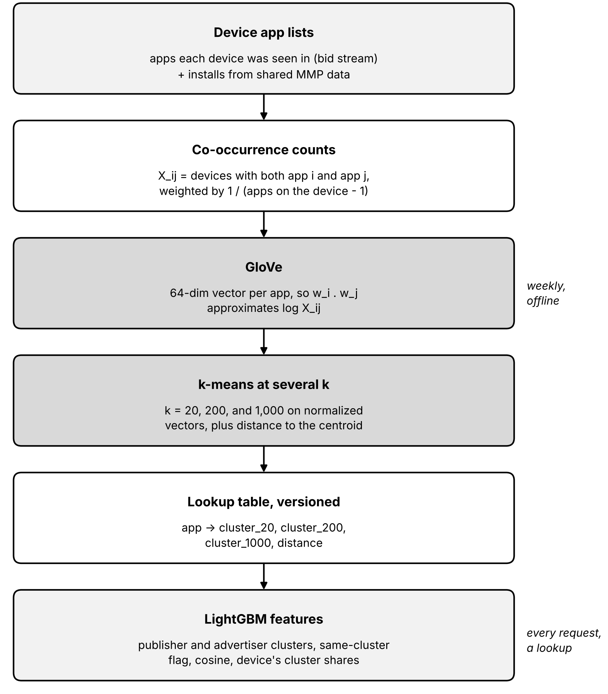
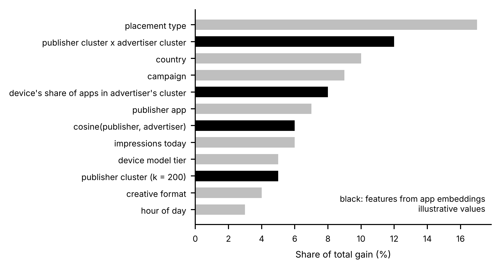
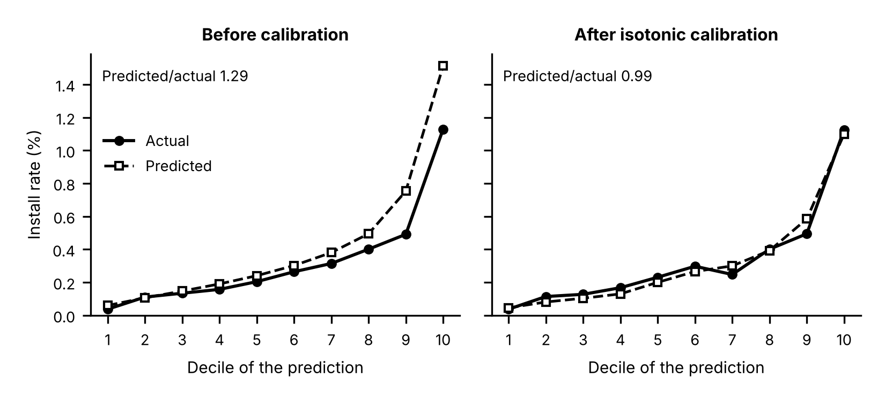

# Gradient Boosted Conversion Models {#sec-gradient-boosted-conversion-models}

The crawl click model taught us a lot with very little: hashed tokens, hand-built crosses, and one weight per token. Its limits came up at the end of @sec-a-click-model. It only learns the interactions we build by hand, it can't learn that a numeric feature matters in a nonlinear way unless we bucket it, and it treats every value as unrelated to every other. With installs and purchases as labels, those limits get more expensive, because the labels are rarer and every hand-built cross splits them further.

Gradient boosted trees are the natural next step. Propensity prediction on tabular, high-cardinality ad data is what boosted trees and logistic regression do well. Trees are fast, handle missing values and mixed feature types natively, and their calibration is well understood.[^c15-intent] They're also the model that the rest of the book keeps. In Part IV, deep models produce signals, and LightGBM still makes the calibrated decision.

In this chapter, we will replace logistic regression with LightGBM for click, install, and purchase prediction. We cover why trees come next, how to structure models for each step of the funnel, how to handle high-cardinality categorical features, and a first value model for ROAS goals. We then argue for one universal model per platform, handle cold start for new campaigns and creatives, calibrate the models for bidding, and choose a retraining cadence.

## Why Trees After Logistic Regression

A gradient boosted tree model is a sum of many small decision trees, each trained to correct the errors of the ones before it. LightGBM is a widely used, fast implementation, and it's the one we use in the reference DSP, though XGBoost and CatBoost would work much the same way.

Trees fix the logistic regression model's main weaknesses:

- **Interactions are learned, not built.** A tree splits on one feature and then another, so it learns that rewarded video on a puzzle game behaves differently from rewarded video on a casino app, without a hand-built cross. The model finds the interactions that matter, rather than the ones we thought of.
- **Numeric features need no buckets.** A tree splits a numeric feature wherever the data says to, so impressions today, time since the last click, or the bid floor can go in as numbers.
- **Missing values are handled natively.** LightGBM learns which branch missing values should take at each split, which fits the FeatureVector's explicit missing values.

They also keep what made logistic regression a good first model. They train quickly on large tabular datasets, a model with a few hundred trees scores in microseconds on a CPU, their predictions can be calibrated well, and their behavior can be inspected with feature importances and per-prediction explanations.

The cost is a different kind of serving. Logistic regression was a lookup and a sum, written by hand in Go. A tree model needs either a Go implementation of tree inference or a runtime, which we cover in @sec-serving-models-in-the-bid-path.

## Click, Install, and Purchase Models

The install equation from @sec-from-clicks-to-installs-and-purchases splits an attributed install into a click-through path and a view-through path. The walk DSP trains a model for each term:

| Model | Trained on | Label | Predicts |
|-------|------------|-------|----------|
| Click | All impressions | Click in the click window | $p_{\text{click}}$ |
| Install after click | Clicked impressions | Click-through install | $p_{\text{install} \mid \text{click}}$ |
| Install after view | Impressions without a click | View-through install | $p_{\text{install} \mid \text{view}}$ |
| Purchase or value | Installs | Purchase, or revenue, in a window | $P(\text{purchase})$ or $E[\text{value}]$ |

: The funnel models in the walk DSP. {#tbl-c15-funnel tbl-colwidths="[22,26,26,26]"}

Training each stage on the population that reaches it keeps each model focused. The install-after-click model only has to tell good clicks from bad ones, and it doesn't have to relearn what makes an impression clickable. The tradeoff is that the stages are trained on different populations, so their errors multiply, and the combined prediction needs its own calibration check, which we cover below.

There's an alternative: one model that predicts an attributed install directly from every impression, with no separate click stage. It's simpler to serve, and with LightGBM it often performs about as well. Separate stages are worth it for a DSP because the two paths behave so differently, and because monitoring each one on its own catches problems, such as a broken click tracker, that a single model would hide. In Part IV, a multi-task network trains all of these heads on a shared base, which gets the benefits of both.

## Categorical Features and High Cardinality

Most of the strong features in a DSP are categorical, and several have very high cardinality: publisher apps, placement IDs, device models, campaigns, and creatives. Trees handle them in a few ways:

- **Native categorical splits.** LightGBM can split a categorical feature into two groups of values directly, choosing the grouping that best separates the labels. It works well for features with up to a few thousand values, after mapping strings to integer codes with a vocabulary that ships with the model, as we described in @sec-logging-at-bid-time.
- **Frequency thresholds.** Values seen fewer than a minimum number of times in training map to a shared "other" code. This keeps the vocabulary small and stops the model from memorizing values it has barely seen.
- **Target encoding.** For very high-cardinality features, replace each value with a smoothed estimate of its label rate, computed on data the model doesn't train on, or out of fold, so that the encoding doesn't leak each row's own label. Done carelessly, target encoding is one of the most common sources of leakage in tabular models.
- **Counts and rates as numeric features.** How many impressions an app had yesterday, or a smoothed click rate for a placement over the last week, as numbers the trees can split on.

IDs can hurt as well as help. A campaign ID lets the model learn things specific to that campaign, but it also lets the model memorize the campaign's past, which may not hold when its targeting or creatives change, and it says nothing about a new campaign. Pair every ID with features that generalize, such as the app's genre and the creative's format, and watch out for IDs that dominate the feature importances.

## App Embeddings as Tree Features: GloVe Clusters

Publisher apps and advertised apps are the two most important categorical features in most DSP models, and they have the cold-start and sharing problems above at their worst. There are hundreds of thousands of publisher apps, new ones appear every day, and the model learns nothing about a new puzzle game from the puzzle games it already knows. Store genres help a little, but they're coarse and self-reported: a "casual" game can be anything from a word game to a slot machine.

A better description of an app comes from who plays it. Two apps that are installed by the same devices are similar, whatever their store categories say. **App embeddings** turn that into a vector for every app, and **cluster IDs** turn the vectors into features a tree model can use. Some of the strongest signals I've used came from exactly this: GloVe embeddings trained on advertiser and publisher apps, grouped with k-means at several values of k, with the cluster IDs used as categorical features in a classic model.[^c15-intent] The embeddings were trained offline, and serving them was a lookup. It's also a gentle first step toward the deep models of Part IV, since it uses non-attributed data without putting a neural network anywhere near the bid path. @fig-c15-glove shows the pipeline.

{#fig-c15-glove width="100%" fig-alt="Vertical pipeline: device app lists become co-occurrence counts, then 64-dimension GloVe vectors trained weekly, then k-means clusters at several sizes, then a versioned lookup table, then LightGBM features looked up on every request."}

### Training the Embeddings

**The corpus.** For each device, collect the set of apps it's known to have: the apps the bidder has seen it in, from the bid stream, and its installs from MMP data that advertisers share. The bid stream is the larger source by far, and it covers every app that sells ads, which is exactly the set of publisher apps the model needs to describe. A device with 40 apps contributes evidence that those 40 apps go together.

**Co-occurrence counts.** Count, for every pair of apps, how many devices have both. A device's apps are a set, not a sentence, so there's no window: every pair on the device counts. Weight each device's pairs by one over the number of other apps on the device, so a device with 300 apps, often a bot or a device farm, doesn't contribute 45,000 pairs of noise, and drop devices flagged as invalid traffic entirely.

**GloVe.** GloVe learns a vector $w_i$ for each app $i$ so that the dot product of two apps' vectors approximates the log of how often they co-occur:[^c15-glove]

$$J = \sum_{i,j} f(X_{ij}) \left( w_i^\top \tilde w_j + b_i + \tilde b_j - \log X_{ij} \right)^2$$

where $X_{ij}$ is the weighted co-occurrence count, $\tilde w_j$ and the $b$ terms are a second set of vectors and biases, and $f$ down-weights rare pairs and caps the weight of very common ones. The final vector for each app is $w_i + \tilde w_i$. Thirty-two to 64 dimensions is enough. Keep only apps seen on at least a few hundred devices, since rare apps get noisy vectors. GloVe trains on the co-occurrence matrix rather than the raw data, so even with hundreds of thousands of apps, it trains in minutes on one machine. Word2vec-style skip-gram on app lists, or a PPMI matrix factored with SVD, work about as well, and any of them can be swapped in later without changing anything downstream.

### Clustering

Trees split on one feature at a time, so a 64-dimension vector is 64 weak columns that mean nothing on their own, and the dimensions change meaning every time the embedding is retrained. A cluster ID is one strong column. Normalize the vectors to unit length, so clustering groups apps by direction rather than popularity, and run k-means, assigning each app to its nearest centroid:

$$c(a) = \arg\min_k \lVert e_a - \mu_k \rVert^2$$

Run it at several scales, such as $k = 20$, 200, and 1,000. The coarse clusters are stable and well populated, and the fine ones separate subgenres, such as cozy farming games from farm-merge puzzles. Trees can use all three, and they'll pick the level that's supported by enough data in each part of the tree. Keep the distance to the centroid too: an app far from every centroid is a poor fit for its cluster, and the tree can learn to trust its cluster less. @fig-c15-appmap shows what the result looks like.

{#fig-c15-appmap width="100%" fig-alt="Scatter plot of app embeddings in two dimensions, grouped into genre clusters such as puzzle, farming and sim, strategy, hypercasual, word and trivia, and casino. Gem Garden sits in the puzzle cluster, Cozy Farm Tycoon in farming, and a new app is placed near the apps it shares players with."}

Before using the clusters, look at them. For each cluster, list its most popular apps and give it a readable name, such as "puzzle" or "casino". Check purity against store genres, without expecting it to be perfect, since the point is to find structure the genres miss. And check stability: retrain the embeddings on a different week, cluster again, and see how many apps change clusters. If a third of apps move every week, $k$ is too large for the data.

### Features for the Trees

The lookup table maps each app to its clusters and distances. From it, the walk DSP builds a handful of features:

- **Publisher cluster and advertiser cluster,** at each scale, as categorical features. A new publisher app gets a cluster as soon as it has co-install data, which is usually within days of its first bid requests.
- **Their cross,** publisher cluster by advertiser cluster at $k = 20$, which is only 400 values. It captures the interaction that matters most, how well this campaign's game fits this publisher's players, as @fig-c15-lift shows.
- **The cosine** between the publisher app's vector and the advertised app's vector, a numeric feature that's comparable across apps.
- **The device's cluster shares:** the share of the device's known apps in each coarse cluster, as 20 numeric features, plus the share in the advertised app's cluster. This is a compact, stable summary of what the device plays, and it's the walk DSP's first step toward the device models of Part IV.

{#fig-c15-lift width="85%" fig-alt="Heatmap of install rate by publisher cluster (rows) and advertised app's cluster (columns), relative to each advertiser's average. The diagonal is darkest, from 2.2x to 3.1x, meaning campaigns install best on publishers in their own genre."}

These features earn their place. In the feature importance readout of an install model, the embedding-derived features typically land among the top features, next to placement type and country, as in @fig-c15-importance. The same readout, with embedding features marked, is worth surfacing in the DSP's admin tool, next to the model's metrics, so it's clear what each model relies on.

{#fig-c15-importance width="100%" fig-alt="Horizontal bar chart of feature importance as share of total gain. Placement type is largest; features from app embeddings, shown in black, include the publisher-by-advertiser cluster cross, the device's share of apps in the advertiser's cluster, and cosine similarity, and several rank near the top."}

### Keeping Them Honest

A few rules keep embedding features from causing the incidents of @sec-logging-at-bid-time:

- **Version everything.** An embedding table and its clusters are an artifact, published once with a version, and a model can only be served with the version it was trained on. Cluster 17 in this week's table has nothing to do with cluster 17 in last week's. @sec-serving-deep-models covers how to serve several versions at once and renumber clusters for continuity.
- **Train on the past.** Train the embeddings only on data from before the model's training window, so co-installs that happened after an impression can't leak into its features.
- **Log the lookup, not the vector.** The FeatureVector records the app and the table version, and the cluster features are rebuilt from the immutable table, as with every lookup.
- **Handle unknown apps.** An app that's missing from the table gets an explicit "unknown" cluster, the same code in training and serving. A store description embedding, as in @sec-deep-models-with-embeddings, can place it in its nearest cluster until it has co-install data.

## A First Value Model

ROAS goals need more than an install rate. They need the predicted revenue from each install, so walk includes a basic value model rather than waiting for the deep value models of Part IV.

Revenue is hard to predict. Most installers never pay anything, and a few pay a lot, so the label is mostly zeros with a long tail. Two approaches work well with LightGBM:

- **A Tweedie objective** on D7 revenue. The Tweedie distribution has a point mass at zero and a continuous tail, which fits revenue data, and LightGBM supports it directly. One model predicts expected revenue per install.
- **A two-part model:** one classifier for the probability that an install pays at all, and one regression for expected spend given that it pays, trained only on payers. Expected revenue is the product.

Both work well with pretrained features, as we'll see in Part IV, and both are much simpler than stacks of models with a separate combiner. The two-part model is easier to debug, because each part can be checked on its own, and the payer classifier is often useful by itself for CPA goals.

Evaluate the value model on two things: the calibration of predicted revenue, by campaign and by country, and how well it ranks installs by value, for example by the share of total revenue in the top 10% of predicted value. Because revenue is so skewed, a few large payers can swing these metrics, so evaluate on enough days to see past them. We return to value prediction in @sec-value-prediction.

## Universal Models and Specialized Models

The walk DSP trains one install model for Android across all campaigns and advertisers whose terms allow pooling, rather than one model per campaign. This is a design choice worth being explicit about, because neither option is better in every case, and the right answer can change as the DSP grows.

A universal model has real advantages for a DSP:

- **Data.** Most campaigns don't have enough installs to train a good model on their own. A universal model learns from all of them, and what it learns about devices and supply transfers across campaigns.
- **Cold start.** A new campaign starts with everything the model knows about its app's genre, its creatives' formats, and the supply it targets, rather than with nothing.
- **A consistent internal auction.** As we'll see in @sec-pricing-for-goals, the bidder compares campaigns by their predicted value. If each campaign has its own model, the comparison mixes models of different quality and calibration, and the best-calibrated campaign doesn't necessarily win. With one model, every campaign is priced by the same predictions.
- **Operations.** One model per model type is something a small team can train, validate, monitor, and roll back. Hundreds of per-campaign models are not.

It also has real costs:

- **Data rights.** A universal model can only pool data that advertisers have agreed to pool. Some will opt out, and their campaigns need a model trained on their own data plus whatever the terms allow.
- **Heterogeneous behavior.** Install behavior differs a lot between a hypercasual game and a casino app, and between iOS and Android. A single model can average them badly, and segments that are a small share of training data get the least attention.
- **Negative transfer.** Adding very different campaigns can make the model worse for the campaigns it was good at. It shows up as a regression for an important segment when the training set grows.
- **Calibration by segment.** A universal model that's calibrated overall is rarely calibrated for every campaign, so it needs the segment-level corrections later in this chapter, and someone has to watch them.

In practice, the choice isn't all or nothing. The common middle ground, and what the walk DSP uses, is one universal model per platform with campaign, app, and genre features, so campaign-specific behavior gets in through the features, plus calibration multipliers by segment. Specialize when the evidence says to: a large campaign with plenty of installs whose calibration stays off after segment correction, an advertiser whose terms don't allow pooling, or a vertical, such as casino, whose behavior is different enough that a separate model wins in an A/B test. Each specialized model is one more model to train, validate, monitor, and roll back, so add them one at a time, and only when a test shows the gain.

## Campaign and Creative IDs, and Cold Start

New campaigns, new apps, and new creatives arrive every week, and every one of them starts with no history. The model's job is to price them reasonably from the start, and to learn their specifics as data arrives.

Cold start is handled with features that describe the new item without its ID:

- **For apps and campaigns:** the app's genre and subgenre, its store rating and size, the advertiser's other apps, and the campaign's goal, target, and geos.
- **For creatives:** format, length, orientation, end card type, and whether it's playable.
- **For new publisher apps:** the publisher's other apps, the app's category, and the placement type.

Because the model also sees IDs for items that do have history, it learns to rely on the ID when there's data and on the descriptive features when there isn't. In LightGBM, an ID below the frequency threshold maps to "other", so a new campaign is treated like the average of rare campaigns with the same descriptive features. Check this explicitly: evaluate the model on campaigns that launched during the evaluation period, separately from established ones, since cold-start performance is easy to miss in an overall metric dominated by large campaigns.

## Calibration for Bidding

As we saw in @sec-a-click-model, calibration matters more than ranking for bidding, because the price is proportional to the prediction. Tree models are usually well calibrated on their training distribution, but several things push them off in practice:

- **Negative downsampling.** Correct predictions with $q = p / (p + (1 - p)/w)$, as in the crawl click model, using the sampling rate stored with the model.
- **Shifts between training and serving.** The model trained on last month's impressions, and it's serving today's, which come from a different mix of campaigns and supply, partly because the model itself changed which impressions the DSP wins.
- **Stacked models.** Errors in the click, install, and value models multiply.

There are a few standard tools for recalibration. **Platt scaling** fits a logistic regression on the model's output, and **isotonic regression** fits a monotone step function, both on a held-out set that the model didn't train on. Isotonic regression is more flexible and needs more data. Either is shipped as part of the model bundle and applied in the bidder.

@fig-c15-calibration shows the effect on an install model. Trained on last month's impressions, it predicts about 30% more installs than happen, and most of the excess is in the top deciles, where the bids are highest. An isotonic fit on a held-out day brings the two lines together.

{#fig-c15-calibration width="100%" fig-alt="Two calibration plots of install rate by decile. Before calibration, predictions run high, especially in the top deciles, with a predicted-to-actual ratio of 1.29. After isotonic calibration the lines nearly overlap, with a ratio of 0.99."}

A few practices matter more than the choice of method:

- **Calibrate by segment.** A model that's calibrated overall can be 30% high on one exchange and 20% low on another. Check calibration by exchange, country, placement type, and campaign, and correct segments that are consistently off. The calibration multiplier $\kappa$ in @sec-pricing-for-goals does this continuously.
- **Report normalized entropy, and AUC within each campaign.** Overall AUC is dominated by differences between placements and campaigns, which are easy to learn. AUC within each campaign shows whether the model ranks impressions well where the bidder actually has to choose.
- **Check the calibration of the product.** For a ROAS goal, the bid depends on $P(\text{install}) \times E[\text{value}]$. Check the calibration of that product by campaign and by bid range, not only of each model on its own.

## Predicted Installs Aren't Caused Installs

The install models in this chapter predict attributed installs: the probability that a device installs and the MMP credits our impression. That's what CPI campaigns pay for, so it's the right target for pricing. But it isn't the same as the probability that the ad causes the install.

Some devices would have installed anyway. A player who already loves farming games, and who has seen Cozy Farm Tycoon in the store, may install it this week whether or not they see our ad. If we win an impression first, the MMP credits us, and the install model learns that devices like this one install at a high rate. The model is right about that, and bidding on it is still a mistake if most of those installs would have happened without the ad: the DSP spends the advertiser's money on installs it didn't cause, and the advertiser's own measurements eventually show it.

The higher the predicted install rate, the more likely this is, because the devices most likely to install are often the ones closest to installing on their own. So better prediction can make the problem worse. We measure how large the gap is in @sec-measuring-incrementality, and price on caused installs in @sec-uplift-modeling. Until then, it's worth remembering that every install prediction in this part answers "who will install?", not "who will install because of the ad?"

## Retraining Cadence

The crawl click model retrained daily. Walk models retrain on a schedule set by two things: how quickly the market changes, and how quickly labels arrive.

Click models can retrain several times a day, since click labels are final within an hour. Install models retrain daily, on a window that ends at the install cutoff. Purchase and value models retrain daily or every few days, on a window that ends ten days or more in the past. Between retrains, the calibration multiplier and the pacing controller absorb drift, as fast-adapting layers on top of slower models.

Retraining runs through a thread that continues across the book: daily in crawl, a few times a day in walk, and near-continuous in run, where Moloco, for example, describes deploying models as often as every two hours.[^c15-moloco] More frequent retraining helps only if the pipeline, validation, and deploys keep up, which is what @sec-pipelines-validation-and-publishing and @sec-shadow-mode-canaries-and-ab-tests are about.

## What This Model Can't Do

LightGBM is a strong model for a DSP, and many teams would be well served stopping here for a long time. It still has limits that show up as the DSP grows:

- **High-cardinality IDs and new values.** Trees can only split IDs into groups, and they share nothing between values that aren't in the same group. Two puzzle games with the same audience are only related if the model happens to split them together.
- **Device history only through hand-built counters.** The model sees a device's past through the features we computed, such as installs in the last 30 days in each genre. It can't learn from the sequence of apps a device used, or which events predicted an install.

Both limits point to Part IV, where embeddings let related values share what they learn, and sequence models learn from device histories directly.

::: {.callout-tip title="Try it on the simulator"}
Train LightGBM click, install-after-click, install-after-view, and purchase models on a simulated month of tier-1 and low-CPM traffic. Compare their calibration by segment with the true rates from the ground truth, and compare the click model with the logistic regression model from Part II. Then hold out the campaigns that launched in the last week, and check cold-start calibration on them separately.

*Status: the simulator already produces the data for this exercise (adsim 0.1). The companion code and exact commands are in progress.*

<!-- Tracker: private/implementation-tracker.md -->
:::

## Conclusion

In this chapter, we replaced logistic regression with LightGBM, which learns interactions without hand-built crosses and stays fast and calibratable. We trained models for clicks, installs by path, and value, handled high-cardinality features, turned GloVe app embeddings into cluster IDs that trees can split on, handled cold start, and calibrated by segment. In the next chapter, we evaluate model changes offline, to decide which ones are worth an online test.

[^c15-intent]: Ben Weber, "Pretrained Deep Learning Intent Signals for Mobile DSPs," *Medium*, October 3, 2026, <https://bgweber.medium.com/pretrained-deep-learning-intent-signals-for-mobile-dsps-2eb1834c62db>

[^c15-moloco]: Moloco, "Inside Moloco's CARA: the AI that compounds," Moloco blog, 2026, <https://www.moloco.com/blog/inside-molocos-cara-the-ai-that-compounds>

[^c15-glove]: Jeffrey Pennington, Richard Socher, and Christopher D. Manning, "GloVe: Global Vectors for Word Representation," EMNLP, 2014.
