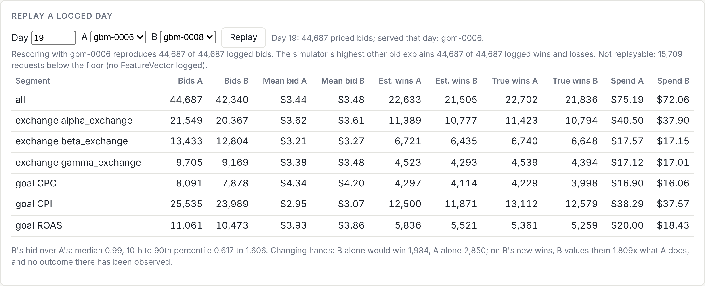
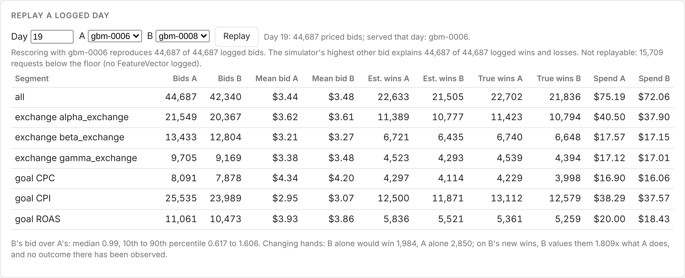
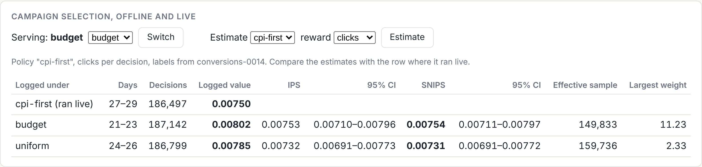
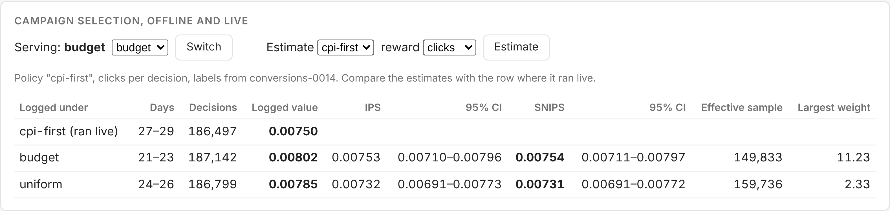

# Offline Evaluation and Model Iteration {#sec-offline-evaluation-and-model-iteration}

Online tests are the final word on whether a model change is better, but they're expensive. An A/B test in a DSP takes days to weeks, because install and purchase labels arrive late, and it spends real budget on the variant that loses. A DSP can only run so many of them, so most model changes need to be judged offline first. The question offline evaluation answers isn't whether a change is better, but whether it's promising enough to be worth an online test.

That's harder than it sounds in a DSP. The data a model is evaluated on was collected by the current model, through an auction the new model would bid in differently. A new model can improve log loss and still lose money, because it changes which impressions the DSP wins. Good offline evaluation measures the things that predict online results, not just the things that are easy to compute.

In this chapter, we will choose metrics that reflect how predictions become money, evaluate out of time with segment breakdowns, and lay out a ladder of model changes from routine retrains to new model forms. We then replay logged traffic to estimate how a new model would change bids and spend, evaluate selection policies offline with the propensities logged since Part II, and measure how stable a model's predictions are from one training run to the next.

## Metrics

The crawl DSP used log loss, AUC, and calibration. Walk keeps all three, and changes how they're computed:

- **Normalized entropy** (log loss divided by the log loss of a model that predicts the base rate) for comparing across days, segments, and label types with different base rates.
- **AUC within each campaign,** averaged with weights by impressions or spend, because overall AUC is dominated by differences between campaigns and placements that any model learns.
- **Calibration error** by segment, as the ratio of predicted to observed outcomes, and as an expected calibration error across prediction buckets.
- **Metrics weighted by spend.** An impression the DSP paid \$10 CPM for matters more than one it paid \$0.50 for. Weighting log loss and calibration by the price paid focuses evaluation on the impressions where errors cost the most.

For models that feed a price, the most useful single check is often the calibration of the bid value: $P(\text{install}) \times E[\text{value}]$ by campaign and by bid range, compared with realized value. That's the number the bidder actually acts on.

All of these metrics share one limit: they measure how well a model predicts attributed outcomes on impressions the DSP already won. They don't measure whether the ads caused those outcomes, and they don't see the impressions the new model would win instead. A model can improve on every offline metric and still make a campaign's ROAS worse, for example by getting better at finding devices that were going to install anyway, or by bidding more on supply where the logged data is thin. Offline metrics decide which models are worth testing. The A/B tests in @sec-shadow-mode-canaries-and-ab-tests and the holdouts in @sec-measuring-incrementality decide which ones are better.

## Out-of-Time Evaluation and Segment Breakdowns

As in @sec-a-click-model, every evaluation is out of time: train on earlier days and evaluate on later ones, with the evaluation days' labels complete. For install and purchase models, that means evaluating on a period that ended at least one label cutoff ago.

Every result is broken down by segment, with the number of examples in each: exchange, country, placement type, campaign, and campaigns that launched during the evaluation period. Most model changes help some segments and hurt others, and an overall improvement can hide a large regression on one exchange or one important campaign. A useful habit is to list the segments where the new model is worst relative to the champion, and to look at each before deciding.

## The Ladder of Model Changes

Not all model changes are equal, and they shouldn't get the same process. A useful way to think about them is as a ladder, from the most routine to the most involved:

| Change | Example | What it needs in serving | Typical evaluation |
|--------|---------|--------------------------|--------------------|
| Retrain on new data | The daily retrain | Nothing new | Validation gates and a canary |
| Hyperparameters | More trees, a different learning rate | Nothing new | Offline comparison, then a canary |
| New features from logged data | A new count from the FeatureVector | A new spec; same runtime | Offline, then an A/B test |
| New logged features | A feature the bidder doesn't compute yet | Bidder code, logging, backfill | Offline after backfill, then an A/B test |
| New model form | LightGBM to a DNN | A new runtime, parity tests | Offline, shadow mode, then an A/B test |

: The ladder of model changes. {#tbl-c16-ladder tbl-colwidths="[22,26,24,28]"}

The higher the rung, the more can go wrong in serving, and the more evaluation it needs before it reaches traffic. Routine retrains go through automated gates. New features and model forms need an online test, because they change the model in ways offline metrics can't fully capture.

## Replaying Logged Traffic to Estimate Bid and Spend Impact

Offline metrics measure predictions. What matters is how the predictions change bids, and through them, wins and spend. Replay estimates that before anything goes live.

Take a day of logged requests, with their FeatureVectors, and run them through the pricing path twice: once with the champion and once with the challenger. For each request, compare the two bids. From there, a few summaries are informative:

- **The distribution of bid changes,** overall and by segment. A new model that raises bids by 30% on one exchange will spend very differently there, even if its log loss is better.
- **Predicted spend and volume.** Using a win rate model, or the observed win rates at each bid level, estimate how many more or fewer impressions the challenger would win, and what it would spend, by campaign.
- **Which impressions change hands.** Impressions where the challenger bids much higher than the champion are the ones it would start winning. Its predictions on those impressions can't be checked against outcomes, because the champion mostly didn't win them, and they're where surprises come from.

Replay doesn't tell us what the challenger's results would be, only how its behavior would differ. That's still valuable: a challenger whose bids differ wildly from the champion's is a bigger risk, and should go through shadow mode and a smaller canary. 
The reference DSP's replay, in @fig-c16-replay, takes a logged day and rescores every bid that was priced, with the bundle that served it and with a challenger, through the bidder's own pricing. Two checks come before any comparison. Rescoring with the serving bundle has to reproduce the logged bids exactly, or the replay isn't replaying what happened; on day 19 it reproduced all 44,687. And the logged wins and losses have to be explained by the competition, which the simulator can confirm: its highest competing bid explained every one. Then the estimates. The replay estimates wins from the win rates the logs show at each bid level, made monotone in the bid. They came within 2% of the true wins, which the simulator also knows.

::: {.content-visible when-format="html"}
{#fig-c16-replay width="100%" fig-alt="Screenshot of the replay tool for day 19. Rescoring with gbm-0006 reproduces 44,687 of 44,687 logged bids, and the simulator's highest other bid explains all logged wins and losses; 15,709 requests below the floor can't be replayed. The table lists bids, mean bid, estimated wins, true wins, and spend for A and B, overall, by exchange, and by goal. Overall: A 44,687 bids, mean $3.44, estimated wins 22,633, true 22,702, spend $75.19; B 42,340 bids, mean $3.48, estimated 21,505, true 21,836, spend $72.06. Below: B's bid over A's has a median of 0.99, 10th to 90th percentile 0.617 to 1.606; B alone would win 1,984 impressions and A alone 2,850, and B values its new wins at 1.809 times what A does."}
:::

::: {.content-visible unless-format="html"}
{#fig-c16-replay width="100%" fig-alt="Screenshot of the replay tool for day 19. Rescoring with gbm-0006 reproduces 44,687 of 44,687 logged bids, and the simulator's highest other bid explains all logged wins and losses; 15,709 requests below the floor can't be replayed. The table lists bids, mean bid, estimated wins, true wins, and spend for A and B, overall, by exchange, and by goal. Overall: A 44,687 bids, mean $3.44, estimated wins 22,633, true 22,702, spend $75.19; B 42,340 bids, mean $3.48, estimated 21,505, true 21,836, spend $72.06. Below: B's bid over A's has a median of 0.99, 10th to 90th percentile 0.617 to 1.606; B alone would win 1,984 impressions and A alone 2,850, and B values its new wins at 1.809 times what A does."}
:::

The line under the table is the useful warning. The two bundles' bids were the same at the median, but about 2,000 impressions would change hands, and the challenger valued the ones it would newly win at 1.8 times what the champion did. No outcome has been observed on any of them. If the challenger is wrong anywhere, it's most likely there.

Our first version of the estimate took, for each bid level, the highest win rate seen at that level or below, a running maximum, so that the curve couldn't fall as the bid rose. It overestimated wins, because one lucky bucket at a low bid set the rate for every bid above it. A monotone fit that pools neighboring buckets, isotonic regression, fixed it. Replay also can't see requests the champion priced below the floor, because the bidder doesn't log a FeatureVector for those, so a challenger that would bid above the floor where the champion didn't is invisible to it.

## Offline Policy Evaluation with Logged Propensities

Some changes aren't to predictions but to decisions, such as a new way to choose which campaign or creative to show. For these, there's a way to estimate online results from logs, thanks to the selection probabilities the bidder has logged since @sec-parsing-bid-requests-and-eligibility.

The idea is **inverse propensity weighting**. The logs record, for each request, the action the logging policy took, the probability $\pi_0(a \mid x)$ it took it with, and the outcome $r$. A new policy $\pi$ would have taken the same action with probability $\pi(a \mid x)$. The expected reward of the new policy can be estimated by reweighting the logged outcomes:

$$\hat{V}(\pi) = \frac{1}{N} \sum_{i=1}^{N} \frac{\pi(a_i \mid x_i)}{\pi_0(a_i \mid x_i)} \, r_i$$

Requests where the new policy would have done what the old one did count for more, and requests where it would have done something different count for less, or not at all.

This works well when the logging policy explored, as the crawl DSP's weighted random selection did, so every action had a reasonable probability. It works poorly when the new policy takes actions the old one almost never took, because the weights become huge and the estimate is dominated by a few rows. Clipping the weights and self-normalizing them, by dividing by the sum of the weights instead of $N$, trade a little bias for much less variance. When the estimate's confidence interval is too wide to decide anything, that's the signal to run an online test instead. We use this method for campaign selection in @sec-learned-campaign-selection.

The reference DSP logs, with every bid, the eligible campaigns and the probability that its selection policy picked the one it did, so the estimate can be checked against a live run in the simulator. We ran three policies for three simulated days each: budget-weighted random selection, uniform random selection, and CPI-first, which picks a CPI campaign whenever one is eligible. Then we estimated CPI-first's clicks per decision from the logs of the other two, in @fig-c16-ope.

::: {.content-visible when-format="html"}
{#fig-c16-ope width="100%" fig-alt="Screenshot of a table. CPI-first ran live on days 27 to 29, 186,497 decisions, 0.00750 clicks per decision. From the budget-weighted logs, days 21 to 23: logged value 0.00802, IPS estimate 0.00753 with 95% interval 0.00710 to 0.00796, SNIPS 0.00754, effective sample 149,833, largest weight 11.23. From the uniform logs, days 24 to 26: logged value 0.00785, IPS 0.00732, interval 0.00691 to 0.00773, SNIPS 0.00731, effective sample 159,736, largest weight 2.33."}
:::

::: {.content-visible unless-format="html"}
{#fig-c16-ope width="100%" fig-alt="Screenshot of a table. CPI-first ran live on days 27 to 29, 186,497 decisions, 0.00750 clicks per decision. From the budget-weighted logs, days 21 to 23: logged value 0.00802, IPS estimate 0.00753 with 95% interval 0.00710 to 0.00796, SNIPS 0.00754, effective sample 149,833, largest weight 11.23. From the uniform logs, days 24 to 26: logged value 0.00785, IPS 0.00732, interval 0.00691 to 0.00773, SNIPS 0.00731, effective sample 159,736, largest weight 2.33."}
:::

From the budget-weighted days, the estimate was 0.00754 clicks per decision, and running CPI-first gave 0.00750. From the uniform days it was 0.00731. Both 95% intervals contain the live value, and both are about 6% wide on either side. That's the practical limit of three days of logs at this scale: they can tell policies apart only when the policies differ by more than that.

## Seeds and Run-to-Run Variance

Every number in an offline comparison comes from one run, and a different run would give a different number. Three things vary from run to run: the data, because a different week or a different simulator seed gives different impressions; the training, because the order of the examples, the initial weights, and dropout all depend on a random seed; and the evaluation sample, because a day of impressions is a sample, too. A model change is only real if its effect is larger than that variation.

The reference DSP's first click model shows how large each source can be. We trained it ten times on the same six simulated days, changing only the seed that shuffles the training examples, and evaluated each on the same seventh day. The AUC ranged from 0.788 to 0.796, and calibration from 1.07 to 1.09. The evaluation sample matters more: resampling the evaluation day's 11,146 impressions with replacement gives a 95% interval for one model's AUC of 0.772 to 0.822, six times wider than the range across training seeds, because 377 clicks isn't many.

Those intervals are wide enough to hide a real improvement. Removing the five crosses from the model lowered its AUC by 0.008 on average, which is well inside the evaluation interval, so a single run of each would leave the question open. But the drop was there for every one of the ten seeds, between 0.007 and 0.010, and log loss was worse for every seed, too. Comparing the two versions seed by seed, on the same evaluation data, removes most of the noise that the two runs share, and what's left is a consistent effect. That says the crosses help on this day. Whether they help on other days, and on real traffic, still takes more evaluation days and an online test.

The variation is much larger for deep models. Random initialization, dropout, the order of minibatches, and GPU kernels that aren't deterministic all change the result, and the gap between two architectures is often smaller than the gap between two seeds of the same one. A few habits keep comparisons honest:

- **Report a spread, not a number.** Train each candidate with at least five seeds and report the mean and the range, or a confidence interval.
- **Compare in pairs.** Use the same seeds, training data, and evaluation data for both versions, and look at the distribution of the per-seed differences.
- **Fix seeds for reproducibility, not for tuning.** A fixed seed makes a run repeatable, which is what a pipeline needs. Tuning hyperparameters on one seed finds the settings that suit that seed.
- **Vary the data, too.** For the simulator, rerun with other seeds, such as `ADSIM_SEED=11 docker compose up`. On real traffic, evaluate on several days.

In production, seed variance doesn't go away. It shows up as churn between model versions, which is the subject of the next section.

## Model Stability Across Training Runs

Two models trained on almost the same data should make almost the same predictions. Often they don't. Retrain a LightGBM model on yesterday's window and today's, and individual predictions can move by a surprising amount, even when the overall metrics are unchanged. In a DSP, that **prediction churn** matters, because every change in a prediction is a change in a bid, and large daily swings make pacing harder, confuse advertisers watching their campaigns, and make it difficult to tell a real change from noise.

Measure churn directly: score a fixed sample of requests with consecutive model versions, and track the distribution of the relative change in predictions, by segment. Some churn is expected and healthy, because the market moved. Churn that's large on stable segments, or that jumps from one day to the next, usually points to a problem: a feature whose coverage changed, a vocabulary that reshuffled, or a hyperparameter that makes the model unstable. Fixing seeds, using longer training windows, and averaging over several runs all reduce churn, and the right amount is a tradeoff against freshness.

::: {.callout-tip title="Try it on the simulator"}
Replay a simulated day of traffic through two install model versions, and compare their bids by exchange and the volume each would win. Then evaluate a new campaign selection policy offline with the logged propensities, and compare the estimate with the result of running that policy on the simulator, where the true outcome is known.

*Status: runs with the companion code (dsp 0.14, adtrain 0.8, adsim 0.3). The Evaluate tab replays a day through two bundles, with the simulator's true wins next to the estimated ones, and estimates one campaign selection policy from another's logged propensities, which you can then run. Commands and screenshots are in `WALKTHROUGH.md`, under this chapter.*

<!-- Tracker: private/implementation-tracker.md -->
:::

## Conclusion

In this chapter, we set up offline evaluation for the walk DSP: normalized metrics within campaigns, focused on calibration, out of time and by segment, with more evaluation for bigger changes. Replay estimates the effect on spend, inverse propensity weighting evaluates selection policies, and churn measures stability. In the next chapter, we make the bid path fast enough to serve the models worth trying.
