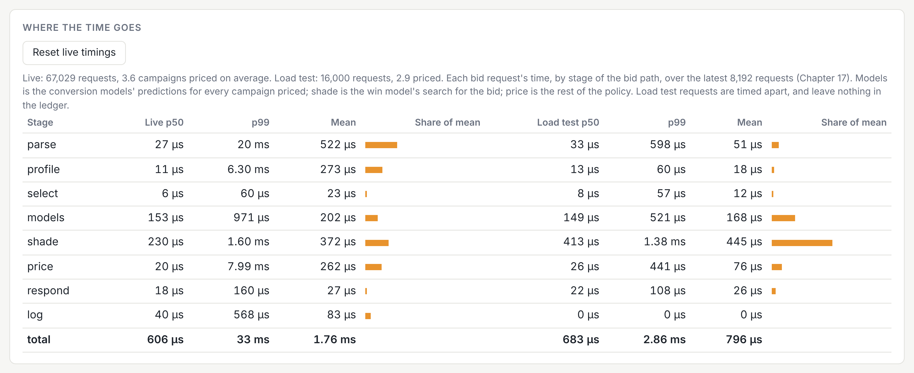
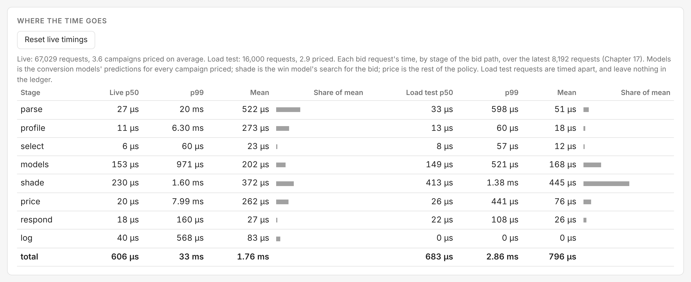

# Serving Models in the Bid Path {#sec-serving-models-in-the-bid-path}

In the crawl DSP, the model was the cheapest part of a bid. Scoring a logistic regression model took microseconds, and almost all of the latency went to parsing and the profile read. Walk changes that. The bidder now runs a click model, two install models, and a value model, plus a win rate model in @sec-win-rate-and-bid-shading, for every candidate campaign on every request. Each is a tree ensemble with hundreds of trees. Suddenly the models are a large share of the latency budget, and of the DSP's compute bill.

Latency in a DSP isn't a nice-to-have. A bid that arrives after the exchange's deadline is a lost bid, and an exchange that sees too many late responses sends less traffic. And because a DSP handles a very large number of requests, every microsecond of model time per request multiplies into servers. This is the practical chapter on latency. We cover deep models in @sec-serving-deep-models, and the habits we build here carry over.

In this chapter, we will split the latency budget across the stages of the bid path, count the model calls a request needs and reduce them, and compare ways to serve LightGBM in Go. We then tune ONNX Runtime, keep Go fast in the hot path, keep data access to one network read, degrade gracefully when a request runs over budget, and measure all of it with benchmarks, load tests, and production histograms.

## The Latency Budget

The exchange's `tmax` is the time from when it sends the request to when it must receive the response. The bidder's own budget is smaller, because the network round trip comes out of it. If `tmax` is 200 ms and the round trip to the exchange is 40 ms in the worst case, the bidder has about 160 ms, minus a safety margin. Bidders placed close to the exchanges, in the trading locations from @sec-inside-a-demand-side-platform, keep more of the budget for themselves.

Split the budget by stage, so each has a target and an owner:

| Stage | What it does |
|-------|--------------|
| Parse | Decode and normalize the request |
| Profile read | One read from the profile store |
| Eligibility | Filter campaigns and select candidates |
| Features | Compute the FeatureVector once, plus per-candidate features |
| Models | Score every candidate with every model |
| Pricing | Calibration, margin, shading, floors, internal auction |
| Response | Build and send the bid response, and log |

: Stages of the bid path, each with its own share of the latency budget. {#tbl-c17-stages}

The reference DSP times every request by these stages, and its console shows each stage's 50th and 99th percentiles over the latest 8,192 requests, as in @fig-c17-latency. The stages are timed on the request's clock, so they add up to the total. Model time is measured inside the pricing code, around each model call, and taken out of pricing, so a slow model shows as a slow model.

::: {.content-visible when-format="html"}
{#fig-c17-latency width="100%" fig-alt="Screenshot of a table of stages: parse, profile, select, models, shade, price, respond, log, and total, with p50, p99, mean, and a bar for the share of the mean, for live and load test requests. Live: total p50 606 microseconds, p99 33 ms, mean 1.76 ms, with parse and profile p99 of 20 ms and 6.3 ms. Load test: total p50 683 microseconds, p99 2.86 ms, mean 796 microseconds; shade is the largest share, mean 445 microseconds, then models at 168 microseconds; log is zero, because load test requests write nothing."}
:::

::: {.content-visible unless-format="html"}
{#fig-c17-latency width="100%" fig-alt="Screenshot of a table of stages: parse, profile, select, models, shade, price, respond, log, and total, with p50, p99, mean, and a bar for the share of the mean, for live and load test requests. Live: total p50 606 microseconds, p99 33 ms, mean 1.76 ms, with parse and profile p99 of 20 ms and 6.3 ms. Load test: total p50 683 microseconds, p99 2.86 ms, mean 796 microseconds; shade is the largest share, mean 445 microseconds, then models at 168 microseconds; log is zero, because load test requests write nothing."}
:::

Two things in it are worth noticing. In the load test, the win model's search for the bid, shading, took more time than the three conversion models together, because it runs the win model at 18 candidate bids for every campaign priced. And the live requests, the simulator's own, have a far longer tail in parsing and profile lookups than the load test's. Nothing in those stages is slow. The simulator runs on the same two cores and sends its requests in bursts, so requests wait for a core, and the stage that's running when they wait looks slow. A stage's tail is often somebody else's work.

Budget for the 99th percentile, not the median. At a high request rate, the slowest 1% of requests is a large number of lost bids, and tail latency usually comes from different causes than typical latency: garbage collection pauses, a slow profile read, or a request with many eligible campaigns.

## Counting the Work

The number of model calls per request is:

$$\text{model calls} = \text{requests} \times \text{eligible candidates} \times \text{models}$$

With 50 eligible campaigns and five models, that's 250 tree ensembles per request. Most of the speedup in a bid path comes from reducing these numbers, not from making each call faster:

- **Filter before predicting.** Every eligibility filter that runs before the models removes candidates from every model call. Cheap filters on request fields first, then the profile, then models, as in @sec-parsing-bid-requests-and-eligibility.
- **Cap the candidates.** Score only the top candidates by a cheap estimate, such as each campaign's recent value per impression in this segment. A cap of 20 or 30 candidates per request usually loses very little.
- **Compute request and device features once.** Most features are the same for every candidate. Build them once per request, and only add the campaign and creative features per candidate.
- **Skip models that can't matter.** A campaign whose maximum possible value is below the floor doesn't need a value model call.

For the reference DSP at the start of a simulated day, when every campaign still has budget, the internal auction of @sec-pricing-for-goals priced about seven campaigns per request. Each needed three conversion model calls and up to 18 win model calls for shading: around 150 tree ensembles of 200 trees each, for one bid. Capping the auction at three campaigns, by each campaign's recent mean score, cut that to about 60, and the median time in the bidder from 1.14 to 0.64 ms. A cap changes decisions, so the reference DSP measures what it costs. During a load test, 5% of capped auctions are priced again in full: with a cap of three, the capped auction found the full auction's best campaign in 97% of them and gave up 1.2% of the best expected surplus. A cap of two gave up 4.7%, and a cap of four 0.3%. Whether a point of surplus is worth half the CPU is a business decision, and the audit is what lets someone make it.

## Serving LightGBM

There are three common ways to serve LightGBM models from a Go bidder:

- **Export to ONNX and run it with ONNX Runtime.** LightGBM models can be converted to the ONNX format, and ONNX Runtime, called from Go through a wrapper such as `onnxruntime_go`, runs them in-process. It's fast, well tested, and it's the same runtime we use for deep models in Part IV.
- **Native Go inference.** Pure Go libraries, such as `leaves`, read LightGBM model files and evaluate the trees directly. There's no C dependency and no cgo overhead, which makes deploys simple, but they support fewer model features and need their own parity checks.
- **Compile the trees to code.** Tools such as Treelite turn a tree ensemble into C code that's compiled into a library, which is often the fastest option, at the cost of a build step for every model.

The cost of evaluating a tree ensemble grows with the number of trees and their depth. A model trained with 2,000 trees and 255 leaves each might be slightly better offline than one with 300 trees and 63 leaves, and many times slower to serve. Train with serving in mind: limit the number of trees and leaves, and measure how much accuracy that gives up. Often it's very little.

For the reference DSP, we measured before choosing. The bidder already had a native Go evaluator, a few hundred lines that read LightGBM's own JSON dump of the model and follow its decision rules, including where missing values and unseen categories go. We converted one 200-tree click model to ONNX and ran both on the same 200 golden examples, on two cores of a shared cloud machine:

| Evaluator | One row | Batch of 8, per row | Larger batches, per row |
|-----------|---------|---------------------|-------------------------|
| Native Go, categories in maps | 17.1 µs | | |
| Native Go, categories as bitsets | 10.2 µs | 8.6–10.1 µs | 7.1–8.6 µs (32 rows) |
| ONNX Runtime from Go | 20.4 µs | 14.7 µs | 11.5 µs (64 rows) |
| ONNX Runtime from Python, one thread | 25.7 µs | 16.6 µs | 10.6 µs (64 rows) |

: The same LightGBM click model, 200 trees of 15 leaves, evaluated four ways. ONNX Runtime 1.29, called from Go through a binding that loads its C library without cgo. {#tbl-c17-onnx tbl-colwidths="[40,16,22,22]"}

The first native version spent half its time in map lookups for categorical splits. Profiling found it, and storing each split's categories as a bitset, as LightGBM does, made it 1.7 times faster with the same predictions to $10^{-16}$. ONNX Runtime agreed with LightGBM to $1.6 \times 10^{-7}$, because it takes 32-bit floats. For trees, the native evaluator was faster at every batch size we use, and it has no runtime to install. So the reference DSP serves trees natively, checks every bundle against its golden examples before serving it, and keeps the ONNX comparison as a benchmark in its companion code. Deep models in Part IV go through ONNX Runtime, where writing our own evaluator isn't an option.

## ONNX Runtime Settings

ONNX Runtime works well in a bidder, but its defaults are tuned for running one large model as fast as possible, not for many small inference calls in parallel. A few settings matter:

- **Threads.** By default, ONNX Runtime parallelizes each inference call across threads. In a Go bidder, concurrency already comes from goroutines, one per request, so per-call parallelism mostly adds contention. I had to reduce the default parallelism to get good latency when serving ONNX models from Go.[^c17-golang] Set intra-op and inter-op threads to one, and let Go handle concurrency.
- **Graph optimization.** Enable the runtime's graph optimizations, and create sessions once, at model load time, never per request.
- **Batch the candidates.** Score all candidates for a request in one call, with one row per candidate, rather than one call per candidate. Calling from Go into ONNX Runtime crosses into C, through cgo or a library such as purego, which has a fixed overhead per call, so batching pays it once per request instead of once per candidate. In @tbl-c17-onnx, batches of 64 cut the time per row nearly in half.
- **Reuse buffers.** Allocate input and output tensors once and reuse them, rather than allocating per request.

## Keeping Go Fast in the Hot Path

Go is a good language for bidders, but its garbage collector and convenience features can add latency in ways that only show at the tail. A few habits keep the hot path fast:

- **No allocations per request where possible.** Reuse request structs, feature buffers, and tensors with `sync.Pool` or preallocated arrays. Fewer allocations mean less garbage collection, and fewer pauses at p99.
- **No JSON or reflection in the hot path,** beyond parsing the request with a fast decoder, as in @sec-parsing-bid-requests-and-eligibility. Log records are serialized as protocol buffers, off the request goroutine where possible.
- **Tune the garbage collector.** `GOGC` sets how much the heap grows before a collection, and `GOMEMLIMIT` sets a soft memory limit. A bidder with plenty of memory can run with a higher `GOGC` and a `GOMEMLIMIT` near its container limit, so it collects less often without running out of memory.
- **Profile, don't guess.** Go's `pprof` shows where CPU time and allocations go, under real load. The slowest part of the path is often not the one anyone expected.

## Data Access

Every network call in the bid path is a chance to blow the latency budget. The rule for walk is one network read per device per request: the profile read, with everything the models need in it, or computed from it.

Data that's small and the same for every request stays in memory: app metadata, vocabularies, segment rates, calibration tables, and campaign configuration. It's loaded at startup and refreshed in the background as versioned snapshots, the same way as models.

Data that's per device lives in the profile store. Choosing that store is a tradeoff between latency, schema flexibility, cost, and how the bidder talks to it. Options range from in-memory stores such as Redis, to Aerospike, which ad tech companies such as Nativo use as a profile store for its low latency at high request rates,[^c17-aerospike] to managed wide-column stores such as Bigtable. Whichever you choose, the read gets a strict timeout, and a timeout is treated as a missing profile, as in @sec-parsing-bid-requests-and-eligibility. A slow store should make a few bids less accurate, never late.[^c17-intent]

## Degrading Gracefully

Some requests will run long: a profile read that takes the whole timeout, a request with an unusually large number of candidates, or a burst of traffic that queues requests. The bidder should notice and do less work, rather than finish late.

- **A deadline per request.** Every request carries a deadline derived from `tmax`, and every stage checks it. When a request is running out of time, later stages take shortcuts.
- **Skip expensive models when over budget.** If the deadline is close, skip the value model and price on install predictions with a segment value, or skip the win model and use the fixed shade. This connects directly to the fallback ladder in @sec-operating-a-competitive-dsp: an over-budget request steps down a level, and the step is logged.
- **Shed load under spikes.** When the bidder is overloaded, respond no-bid to a share of requests immediately, rather than queuing everything and answering all of it late.

## Measuring

Latency work without measurements is guesswork. Measure at three levels:

- **Go benchmarks for each stage,** run in CI, so that a change that makes feature computation twice as slow fails a check rather than reaching production.
- **Load tests that replay logged requests** at increasing rates, to find the request rate where p99 latency starts to climb. Replayed requests have the real distribution of sizes and candidate counts, which synthetic ones usually don't.
- **Per-stage latency histograms in production,** by exchange and trading location, next to the end-to-end latency the exchange sees.

The number that ties it together is **cost per million requests**: the compute cost of the bidder fleet divided by the requests it handles. It turns latency and efficiency into money, and makes it possible to ask whether a new model is worth what it costs to serve. All numbers in this chapter come from benchmarks on the reference DSP, and the book's numbers will differ from yours, so measure your own.

The reference DSP's load generator replays the bidder's sample of raw requests, dated the day after the log's last so that every budget is fresh, at fixed rates. It's open loop: requests leave on schedule whether or not earlier ones have answered, as an exchange's do. A closed-loop test, which waits for each answer before sending the next, slows down with the bidder and never sees the queue. The requests carry a header that tells the bidder to run the whole bid path but write nothing: no ledger rows, no device profiles, no budgets, no alerts. @fig-c17-loadtest shows three runs on the same two shared cores, with the load generator running beside the bidder.

::: {.content-visible when-format="html"}
{#fig-c17-loadtest width="100%" fig-alt="Line chart with a log-scale y axis from 0.1 to 1,000 ms and a dashed line at 100 ms; the x axis is the rate, 100, 400, 800, and 1,600 requests a second. Before: p99 about 4 ms at 100 and 400 per second, 42 ms at 800, and 100 ms at 1,600, where 98% of requests were late or dropped. After the exact fixes: about 3 to 4 ms, then 9.7 ms at 800 and 99 ms at 1,600, 96% late. With a cap of three: 2.8 to 4.4 ms through 800 per second and 21.8 ms at 1,600, with none late."}
:::

::: {.content-visible unless-format="html"}
{#fig-c17-loadtest width="100%" fig-alt="Line chart with a log-scale y axis from 0.1 to 1,000 ms and a dashed line at 100 ms; the x axis is the rate, 100, 400, 800, and 1,600 requests a second. Before: p99 about 4 ms at 100 and 400 per second, 42 ms at 800, and 100 ms at 1,600, where 98% of requests were late or dropped. After the exact fixes: about 3 to 4 ms, then 9.7 ms at 800 and 99 ms at 1,600, 96% late. With a cap of three: 2.8 to 4.4 ms through 800 per second and 21.8 ms at 1,600, with none late."}
:::

The three changes that kept the decisions the same came from the profiler, not from guessing. The tree walk was two thirds of the CPU, and the map lookups inside it were fixed with bitsets. The second surprise was Thompson sampling over creatives, from @sec-pricing-for-goals, at a seventh of the CPU: to log the chance of each choice for offline evaluation, every request drew 200 more times from each campaign's posteriors. The posteriors change only as day-old installs arrive, so the bidder now caches them, with the chances from 4,000 draws, for 1,000 picks. And the win model's inputs don't depend on the campaign, so they're built once per request, and the 18 candidate bids go through the trees together. Together these took a fifth off the median, and pricing's own time from 224 to 44 µs.

They didn't move the knee. At 1,600 requests a second, both versions fell behind: requests arrived faster than two cores could price them, they queued, and almost all of them missed the deadline. The bidder's own stage timings barely changed while that happened, because the time was spent waiting to start. Past the knee, the exchange's view and the bidder's disagree, and only the exchange's matters. Capping the auction moved the knee past 1,600. We didn't price the bidder in dollars, but the same runs give the number that cost per million requests is built from: requests per second per core at the p99 the exchanges need.

## First-Time Pitfalls

- **Garbage collection pauses and cold starts show up first in p99 after a deploy.** Measure p99 during and right after rollouts, not only in steady state.
- **Hot-reloading configuration while requests are in flight.** Swap whole snapshots atomically, never field by field, as in @sec-parsing-bid-requests-and-eligibility.
- **Benchmarking the wrong thing.** A benchmark on one candidate per request says little about a request with 50. Benchmark with the real distribution of candidates. The reference DSP's first load test played requests at the end of a simulated day, when most budgets were spent and the auction priced fewer than two campaigns; at the start of a day it priced seven.
- **A load test that changes what it measures.** Replayed requests that update device profiles, budgets, and the clock change the bidder's state for the real traffic that follows. Mark load test requests, and have the bidder answer them without writing anything.

::: {.callout-tip title="Try it on the simulator"}
Profile the walk bidder under load with replayed simulated traffic. Find the slowest stage at p99, then cap the candidates per request and batch the model calls, and measure the change. Compare LightGBM served through ONNX Runtime with a native Go implementation on the same model.

*Status: runs with the companion code (dsp 0.14, adtrain 0.8, adsim 0.3). The bidder times every stage of the bid path (the Serving tab), the load generator replays logged requests at rising rates (`docker compose run --rm loadgen`), Go's profiler is on the admin port, and the auction's candidate cap comes with an audit of what it gives up. `code/onnxbench` compares ONNX Runtime from Go, without cgo, with the native evaluator on the same model. Commands and screenshots are in `WALKTHROUGH.md`, under this chapter.*

:::

## Conclusion

In this chapter, we made the walk bid path fast enough, measurably. We split the latency budget by stage and budgeted for p99, reduced model calls by filtering first, capping candidates, and computing shared features once, and measured LightGBM served natively in Go against ONNX Runtime before choosing the native evaluator, with ONNX Runtime settings tuned for many small calls for the deep models to come. We kept the hot path free of allocations and reflection, limited data access to one profile read with a strict timeout, degraded gracefully when requests ran long, and measured everything, down to cost per million requests.

With several models in the bid path and more on the way, a daily training script is no longer enough. In the next chapter, we build pipelines that train, validate, and publish models safely.

[^c17-golang]: Ben Weber, "Options for ML Serving with Golang," *Medium*, May 7, 2026, <https://medium.com/@bgweber/options-for-ml-serving-with-golang-3b1afa3a6182>

[^c17-aerospike]: Aerospike, "Nativo Serves 1.4 T Monthly Bid Requests with Aerospike," customer story, <https://aerospike.com/resources/customer-stories/nativo/>. Nativo keeps frequency caps and audience segments, used to decide which ads to bid on, in Aerospike.

[^c17-intent]: Ben Weber, "Pretrained Deep Learning Intent Signals for Mobile DSPs," *Medium*, October 3, 2026, <https://bgweber.medium.com/pretrained-deep-learning-intent-signals-for-mobile-dsps-2eb1834c62db>
