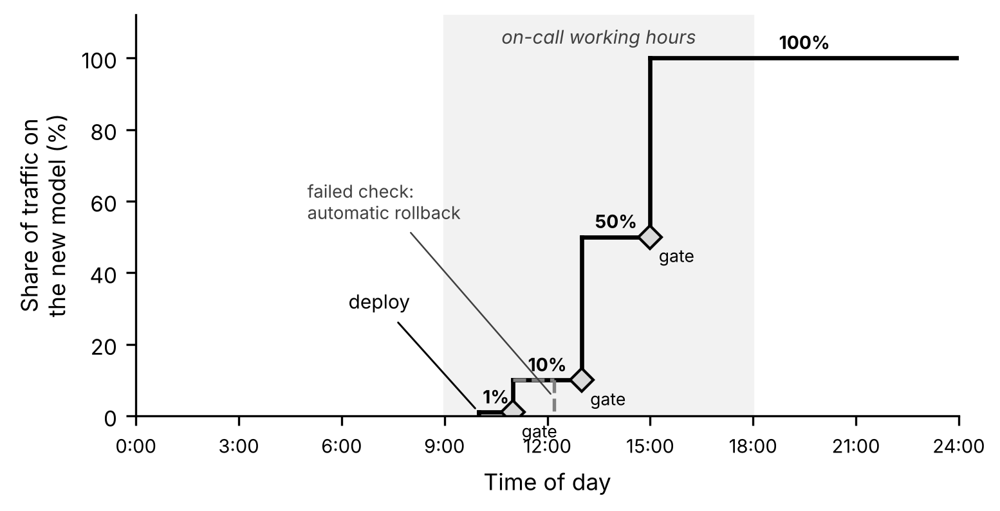
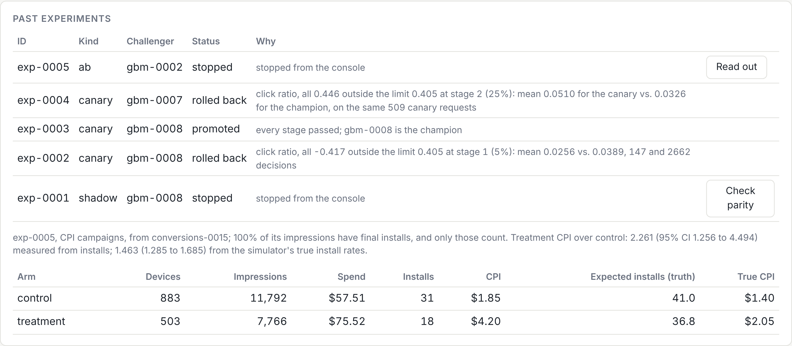
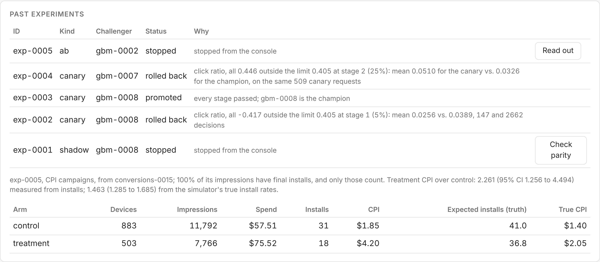

# Shadow Mode, Canaries, and A/B Tests {#sec-shadow-mode-canaries-and-ab-tests}

Offline evaluation tells us which model changes are promising. It can't tell us how a change performs once it's bidding, because a new model changes which impressions the DSP wins, and the outcomes of impressions the old model never won aren't in the logs. The only way to know is to let the new model bid. The question is how to do that without risking the budget, and how to measure the result inside an auction, where the variants compete for the same budgets and the same traffic.

This chapter is about launching changes safely and measuring them honestly. From here on, every model change in the book ships through the same sequence: a shadow run, a canary, and an A/B test.

In this chapter, we will shadow a new model on live traffic, ramp it up through canary stages with guardrails and automated rollback, and run A/B tests designed for auctions, with the right randomization unit and budget splits that keep the arms from competing. We cover running many experiments at once with layers, metrics with delayed labels and variance reduction, and when to stop. We then walk through replacing logistic regression with LightGBM, distribute models to every trading location, and treat configuration changes like deploys.

## Shadow Scoring

In shadow mode, the challenger scores live requests alongside the champion. The bidder computes both predictions, logs both, and bids with the champion's. It's the same idea as listen-only mode in @sec-listening-before-bidding, applied to one model instead of the whole bidder.

Shadow scoring answers questions that offline evaluation can't, without spending anything:

- **Do the predictions match offline?** Compare the challenger's predictions on live traffic with its predictions on the same requests offline, through the FeatureVector logged for each. A gap is a parity problem.
- **How do they differ from the champion's?** The ratio of the two models' predictions, by segment, shows where the challenger would bid more or less, as replay did in @sec-offline-evaluation-and-model-iteration, but on today's traffic.
- **Does it fit the latency budget?** The challenger's latency and error rates under real load, at p99.

Shadow scoring doubles the model work, so it's usually run on a sample of requests, such as 10%. It can't measure outcomes, because the challenger never decides anything. That's what the canary and the A/B test are for.

## Canary Deployments and Ramp-Ups

A new model starts on a small share of traffic, the **canary**, with the rest of the traffic as the control. For routine deploys, the comparison uses the same signals as monitoring, computed for canary and control traffic over the same interval:

$$\delta_{canary} = \ln\left(\frac{\bar{p}_{canary}}{\bar{p}_{control}}\right)$$

where $\bar{p}$ is the mean prediction for each group on comparable requests. The deploy system checks this ratio, the share of fallback predictions, the input missing rates, and the version parity check at each stage. If any check fails, it rolls back automatically and notifies the on-call engineer. If all checks pass, traffic moves to the next stage, such as 1%, then 10%, then 50%, then 100%, as shown in @fig-c20-canary.

{#fig-c20-canary width="100%" fig-alt="Step chart of the new model's share of traffic over a day. The deploy starts at 1% during on-call working hours and steps through gates to 10%, 50% and 100%; a failed check would trigger an automatic rollback."}

Teams should move toward automated rollback for these checks. A human reviewing a canary chart at every stage is slow and inconsistent, and the checks are well defined. What should stay with people is promotion to full traffic for large changes, and the decision to try again after a rollback.

Each stage also has an **exposure budget**, the most a new model can affect before its checks pass:

$$E_{stage} = c_{stage} \times S_{daily} \times \frac{h_{stage}}{24}$$

where $c_{stage}$ is the traffic share, $S_{daily}$ is daily spend on the affected traffic, and $h_{stage}$ is the number of hours the stage runs. Keeping early stages small and short keeps the worst case of a bad deploy small.

## Guardrails and Rollback Criteria

Because model bundles, vocabularies, and embeddings are immutable, versioned artifacts, as described in @sec-logging-at-bid-time, rolling back is a change to which version a manifest points to, not a rebuild. That makes rollback fast, and safe enough to automate.

It's worth automating early. In one untrained model incident, where a bad training run produced a click model that predicted 25% for every request, the rollback itself was simple: point back to the previous day's model. What slowed us down was that the process was still partly manual, so it took time to detect the problem, decide, and act. Automating that path was one of the main follow-ups.[^c19-incidents]

[^c19-incidents]: Ben Weber, "Machine Learning Incidents in AdTech," *Towards Data Science*, January 29, 2025, <https://medium.com/data-science/machine-learning-incidents-in-adtech-e3f48d858054>

The guardrails for a model canary compare it with the control on signals that are available within minutes, long before installs arrive:

- **The prediction ratio,** $\delta_{canary}$ above, by segment. A ratio far from zero means the canary is pricing very differently.
- **The fallback share,** the share of bids priced by a fallback instead of the canary model.
- **The spend rate,** for the canary's traffic relative to its share.
- **Input health,** the missing and out-of-vocab rates of the canary's features.

Outcome metrics, such as CPI and ROAS, take days, so they belong to the A/B test, not to the canary's guardrails.

## Randomization Units and Interference

An A/B test splits traffic between a control arm, running the champion, and a treatment arm, running the challenger, and compares outcomes. In a DSP, the choice of what to randomize matters more than in most systems:

- **Device.** Each device is assigned to one arm, by hashing its device ID with a salt for the experiment. A device sees only one model's bids, so its outcome reflects one model. This is the default for model tests.
- **Request.** Each request is assigned independently. It's simpler and has more statistical power, but the same device can be bid on by both arms, and an install can't be credited cleanly to either.
- **Campaign.** Each campaign runs one arm. This avoids interference between arms within a campaign, but there are few campaigns, so tests have little power and are easily confounded by differences between campaigns.

The harder problem is **interference**: one arm's behavior affecting the other's results. In a DSP, the arms share campaign budgets. If the treatment model wins more impressions, it spends more of each campaign's budget, the pacing system lowers bids or throttles for the whole campaign, and the control arm wins less. The treatment arm looks better partly because it took the control's budget. Both arms also bid into the same auctions on different devices, which is mostly fine, and share frequency caps and pacing state, which isn't.

## Budget-Split Designs

The fix for budget interference is to split each campaign's budget between the arms in proportion to their traffic share. With 10% of devices in treatment, the treatment arm gets 10% of each campaign's daily budget, and each arm paces its own share. Neither arm can spend the other's money, and each arm's spend reflects how well it bids on its own traffic.

Budget-split designs make the comparison fair, at a cost: with smaller budgets per arm, pacing is noisier, and a campaign with a small budget may not spend evenly in a small arm. Check spend by arm as well as outcomes, and treat an arm that underspent its share as a result to explain, not a win.

## Running Many Experiments at Once

A DSP rarely runs one experiment at a time. A new install model, a change to shading, and a pacing tweak may all be in test in the same week. If each experiment takes its own slice of traffic, the slices get small quickly. If they overlap without structure, they contaminate each other.

The standard design is **layers**. Each layer holds experiments on one part of the system, such as the model layer, the pricing layer, and the pacing layer, and each layer hashes devices with its own salt. Within a layer, experiments take disjoint slices of traffic. Across layers, every device is in one arm of every layer, and because the salts differ, the assignments are independent, so the effect of a model experiment averages out over the arms of the pricing experiment. Google's overlapping experiment infrastructure is the classic description of this design,[^c19-google] and Moloco describes running over 100 concurrent live experiments.[^c19-moloco]

In walk, a few layers are enough: models, pricing, and pacing, plus the holdout from @sec-logging-at-bid-time, which has its own salt and sits outside all of them. We return to experimentation at scale in @sec-operating-at-scale.

## Metrics, Significance Testing, and Variance Reduction

The primary metrics of a DSP test are the ones advertisers judge it by: CPI, cost per action, and ROAS for each campaign's goal, together with the DSP's own margin. Guardrail metrics, such as spend delivery, win rate, and latency, make sure a win on the primary metric isn't bought with a problem elsewhere.

Three things make these metrics harder to test than a click rate:

- **Delayed metrics.** Installs and revenue arrive over days. A test's results for a given day aren't final until that day's labels have passed their cutoffs, as in @sec-from-clicks-to-installs-and-purchases. Read results on complete days only.
- **Ratio metrics.** CPI is spend divided by installs, and both vary by device. The variance of a ratio needs the delta method, or a bootstrap over devices, rather than the formula for a simple mean.
- **Noise.** Installs are rare and revenue is heavy-tailed, so tests need a lot of traffic. **CUPED** reduces variance by adjusting each device's outcome for a covariate measured before the test, such as its activity in the previous weeks, which often shortens tests substantially without biasing them.[^c19-cuped]

## When to Stop Early, and Go/No-Go Checklists

Checking a test's p-value every day and stopping as soon as it's significant inflates the false positive rate badly, because with enough looks, noise eventually crosses the threshold. Either decide the test's length in advance from a power calculation and read it once, or use a sequential testing method designed for repeated looks.

There are good reasons to stop a test early: a guardrail failed, the treatment is clearly losing money, or the test is broken. These aren't the same as stopping early because it looks like a win.

At the end, a go/no-go checklist turns the result into a decision:

- **The test was valid:** no sample ratio mismatch, each arm spent its share, and no other changes landed during the test.
- **The primary metric improved,** with a confidence interval that excludes no change, on complete days.
- **No guardrail regressed,** and no major segment, such as a top campaign or exchange, got significantly worse.
- **The result makes sense,** given the offline evaluation and the shadow comparison.

## Worked Launch: Replacing Logistic Regression with LightGBM

Here's how the first big model change of Part III goes through the process: replacing the crawl click model and segment install rates with the LightGBM models from @sec-gradient-boosted-conversion-models.

1. **Offline.** The LightGBM models beat logistic regression on normalized entropy and on AUC within campaigns, out of time, and their calibration by segment is within bounds. Replay shows bids rising on rewarded video and falling on banners, which matches the view-through installs the old pricing ignored.
2. **Shadow.** The models score 10% of live requests for three days. Live predictions match offline predictions on the logged FeatureVectors, and p99 latency stays within budget.
3. **Canary.** The models price 1%, then 10% of traffic, with prediction ratio, fallback share, and spend rate guardrails at each stage.
4. **A/B test.** A budget-split test with 50% of devices in each arm, for two weeks plus the install cutoff, measures CPI and D7 ROAS by campaign.
5. **Rollout.** With the go/no-go checklist passed, the models go to 100% of traffic, and the logistic regression model becomes a level on the fallback ladder.

The reference DSP runs each of these stages on the simulator, one experiment at a time, next to the champion. @fig-c19-experiments shows its history. A 10% shadow of a new bundle logged 4,778 scores next to the champion's, and every one matched the bundle's offline prediction on the logged FeatureVector to $10^{-16}$: the parity check that should pass before a shadow's numbers mean anything. A staged canary of the same bundle, at 5%, 25%, and 50% of devices for four simulated hours each, passed every stage and promoted itself. Another, which we broke on purpose at the 25% stage by tripling its click and install predictions, rolled itself back 18 simulated minutes later.

::: {.content-visible when-format="html"}
{#fig-c19-experiments width="100%" fig-alt="Screenshot of a table of past experiments and a readout. exp-0001, shadow of gbm-0008, stopped, with a Check parity button. exp-0002, canary of gbm-0008, rolled back at stage 1 (5%): click ratio -0.417 outside the limit 0.405, mean 0.0256 against 0.0389, from 147 and 2,662 decisions. exp-0003, canary of gbm-0008, promoted after every stage passed. exp-0004, canary of gbm-0007, rolled back at stage 2 (25%): click ratio 0.446 outside the limit, mean 0.0510 for the canary against 0.0326 for the champion on the same 509 canary requests. exp-0005, A/B test of gbm-0002, stopped, with a Read out button. The readout: treatment CPI over control 2.261, 95% interval 1.256 to 4.494, measured from installs; 1.463, 1.285 to 1.685, from the simulator's true install rates. Control: 883 devices, 11,792 impressions, $57.51 spend, 31 installs, CPI $1.85, true CPI $1.40. Treatment: 503 devices, 7,766 impressions, $75.52, 18 installs, CPI $4.20, true CPI $2.05."}
:::

::: {.content-visible unless-format="html"}
{#fig-c19-experiments width="100%" fig-alt="Screenshot of a table of past experiments and a readout. exp-0001, shadow of gbm-0008, stopped, with a Check parity button. exp-0002, canary of gbm-0008, rolled back at stage 1 (5%): click ratio -0.417 outside the limit 0.405, mean 0.0256 against 0.0389, from 147 and 2,662 decisions. exp-0003, canary of gbm-0008, promoted after every stage passed. exp-0004, canary of gbm-0007, rolled back at stage 2 (25%): click ratio 0.446 outside the limit, mean 0.0510 for the canary against 0.0326 for the champion on the same 509 canary requests. exp-0005, A/B test of gbm-0002, stopped, with a Read out button. The readout: treatment CPI over control 2.261, 95% interval 1.256 to 4.494, measured from installs; 1.463, 1.285 to 1.685, from the simulator's true install rates. Control: 883 devices, 11,792 impressions, $57.51 spend, 31 installs, CPI $1.85, true CPI $1.40. Treatment: 503 devices, 7,766 impressions, $75.52, 18 installs, CPI $4.20, true CPI $2.05."}
:::

The first canary in the figure, exp-0002, is a lesson we learned the hard way. It rolled back a healthy bundle at the 5% stage, because our first guardrail compared the mean prediction of the canary's requests with the mean of the control's. Those are different devices, and a few hundred canary decisions are a noisy sample. The same bundle passed when the guardrail compared the two models on the same requests: for each canary request, the bidder also scores the champion and logs both. A paired comparison removes the difference between the devices, which was most of the noise.

For the A/B test, we used a bundle we knew was worse, the leaky one from @sec-building-training-datasets, against the champion, with half the devices and half of each campaign's budget in each arm, for three days. Measured from installs, its CPI was 2.26 times the champion's, with a 95% interval, from a bootstrap over devices, of 1.26 to 4.49. Each arm had only a few dozen installs. The simulator knows each impression's true install probability, so it can say what the ratio would be without the noise of which devices happened to install: 1.46, with an interval of 1.29 to 1.69. The measured interval contained it and was more than ten times wider. That's the case for the variance reduction above, and for patience: at this scale, a three-day test can tell a broken model from a good one, and not much more.

## Distributing Models to Every Trading Location

In @sec-from-clicks-to-installs-and-purchases, the DSP added a trading location for tier-1 traffic. From then on, every model, embedding, vocabulary, and calibration table has to reach every location, and a model that's champion in one region but not another is a parity problem.

- **Sync artifacts from the registry to each region,** with checksums, and have each region's bidders report which version they loaded.
- **Roll out region by region,** starting with the region that carries the least spend, so a bad model reaches a small share of spend first.
- **Handle a lagging region.** If one region fails to load a new version, it keeps serving the old one. That's safe for a while, but it should alert.
- **Log the region with every bid,** and alert when regions serve different champions for longer than a rollout window.

## Configuration Changes as Deploys

In @sec-operating-the-first-dsp, we put configuration under version control and logged its version with every bid. In walk, configuration changes get the same staged treatment as models. Feature flags, bid multipliers, pacing settings, and exchange settings are versioned, reviewed, rolled out in stages, and reversible, with the same guardrails as a model canary.

This matters because many incidents in a DSP come from configuration rather than models. When something goes wrong, the investigation checks recent configuration changes first.

## First-Time Pitfalls

- **Sample ratio mismatch.** Before reading any result, check that each arm received the traffic share it was assigned. If a 50/50 test has 52% of devices in one arm, the experiment is broken, not the model.
- **Requests with no device ID** can all hash to the same bucket and skew one arm. Route them deterministically and separately, outside the experiment.
- **Reusing a hash salt across layers** correlates experiments that should be independent. Give every layer, and the holdout, its own salt.
- **Pacing interference.** Budget-split arms that share a campaign can still interfere through shared pacing state. Check spend by arm, not only outcomes.
- **Counting devices that were reached, not devices that were assigned.** In the reference DSP's A/B readout, the control had 883 devices with impressions and the treatment 503, from a 50/50 split. That's not a broken split: the leaky model bid less where the champion won, so it reached fewer devices. Check the sample ratio on assignments, every device that received a bid request, and read reach as a result.

::: {.callout-tip title="Try it on the simulator"}
Shadow a new install model on 10% of simulated traffic, and compare its live and offline predictions. Run a staged canary, inject a broken model at the 10% stage, and watch the automated rollback. Then run a budget-split A/B test between two models, and compare the measured difference in CPI with the true difference from the ground truth.

*Status: runs with the companion code (dsp 0.14, adtrain 0.8, adsim 0.3). The Experiments tab runs a 10% shadow with a parity check, a staged canary with a **Break the challenger** button and automated rollback, and a budget-split A/B test read out against the simulator's true install rates. Commands and screenshots are in `WALKTHROUGH.md`, under this chapter.*

<!-- Tracker: private/implementation-tracker.md -->
:::

## Conclusion

In this chapter, we built the process every change in the rest of the book ships through. Shadow scoring compares a challenger with the champion on live traffic without affecting bids. Canaries ramp it up in stages, with guardrails on prediction ratios, fallback share, and spend, and automated rollback. A/B tests randomize by device, split budgets so the arms can't compete for spend, run in independent layers, and read delayed, ratio, and heavy-tailed metrics carefully, with variance reduction and a go/no-go checklist. Models and configuration reach every trading location through the same staged process.

With a way to launch changes safely, we can start changing how the DSP prices. The first change is to replace the fixed shade with a win rate model.

[^c19-google]: Diane Tang, Ashish Agarwal, Deirdre O'Brien, and Mike Meyer, "Overlapping Experiment Infrastructure: More, Better, Faster Experimentation," KDD, 2010, <https://research.google/pubs/pub36500/>

[^c19-moloco]: Moloco, "Inside Moloco's CARA: the AI that compounds," Moloco blog, 2026, <https://www.moloco.com/blog/inside-molocos-cara-the-ai-that-compounds>

[^c19-cuped]: Alex Deng, Ya Xu, Ron Kohavi, and Toby Walker, "Improving the Sensitivity of Online Controlled Experiments by Utilizing Pre-Experiment Data," WSDM, 2013.
