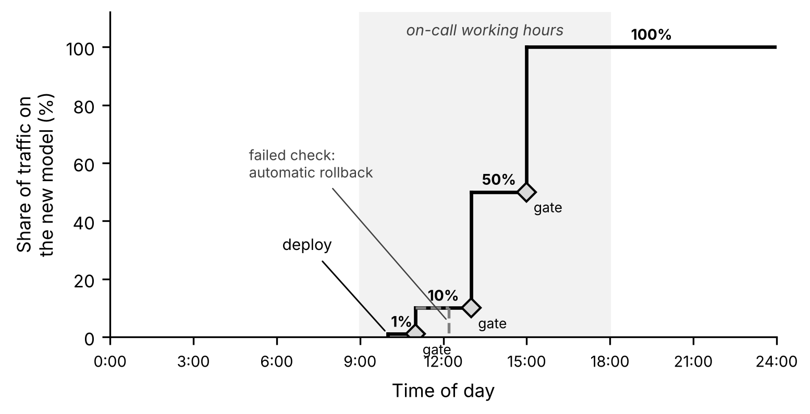
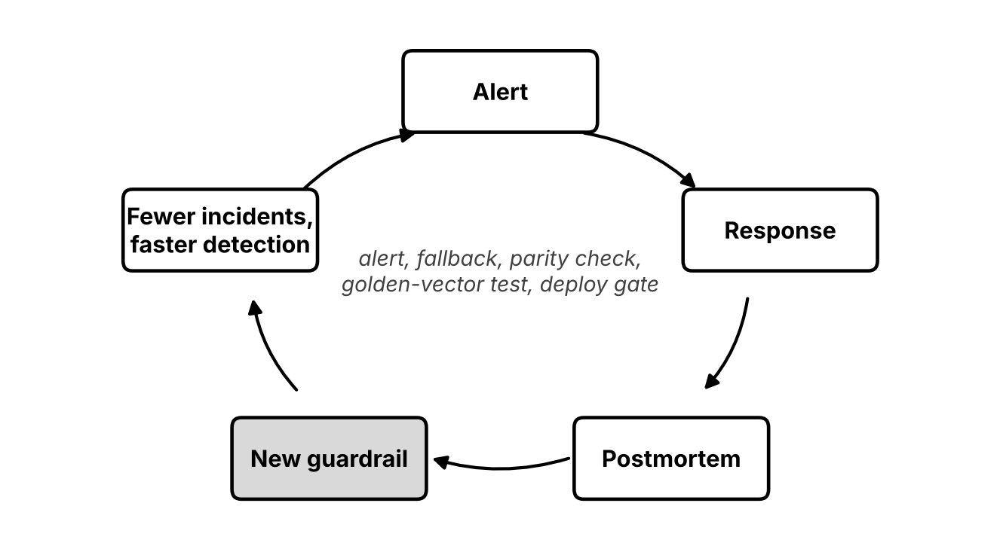

# Fallbacks, Playbooks, and On-Call {#sec-fallbacks-playbooks-and-on-call}

@sec-monitoring-and-parity covered how an ML team detects that a model is wrong. Detection is only half of the job. A DSP buys impressions continuously, so every minute that a bad model stays live costs money, and a fast, safe response matters as much as a fast alert. When I think back on the incidents I've been part of, the ones that hurt most weren't the hardest to diagnose. They were the ones where we knew roughly what was wrong but didn't have a quick, safe way to undo it, such as a rollback process that was still partly manual.

In this chapter, we will cover how to design the bidder so that model failures degrade gracefully, how to deploy and roll back models safely, how to classify incidents by severity, how to run on-call for an ML team, and how to turn each incident into a guardrail that prevents the next one. The scope is incidents the ML team owns, such as models, features, lookups, and calibration. Bidder outages belong to bidder engineering, and campaign performance questions belong mostly to analysts and to the investigation process in @sec-root-cause-analysis.

## Designing for Failure

Model failures in a bidder fall into a small number of patterns, shown in @tbl-c20-failures.

| Failure | Example |
|---|---|
| Model fails to load or score | A new bundle has a missing file, or the inference runtime errors on some inputs |
| Predictions are wrong | A deploy shifts predictions, or calibration drifts on a segment |
| Inputs are missing | An upstream source stops sending a profile field |
| Lookups are missing | An embedding or vocabulary version isn't loaded on some hosts |
| State is stale | The pacing or calibration snapshot stops updating |

: The main ways models fail in a bidder. {#tbl-c20-failures}

Two principles guide the design. First, **contain the blast radius**, so that a failure in one model, exchange, or campaign doesn't spread to the rest. Second, **fail toward safer bidding**. When something is wrong, the bidder should bid less, bid more simply, or not bid at all. It should never fail in a way that raises bids.

## Fallback Models and Kill Switches

### The Fallback Ladder

When a model can't produce a trustworthy prediction, the bidder steps down a ladder of simpler alternatives, each with fewer dependencies than the one above, as shown in @fig-c20-ladder:

1. **The previous model version**, kept loaded alongside the current one.
2. **A simple model**, such as a LightGBM or logistic regression model on a small set of reliable features.
3. **Segment rates**, a lookup table of historical rates by exchange, country, and platform.
4. **No bid.**

{#fig-c20-ladder width="100%"}

Every prediction logs which step produced it, so the share of fallback predictions is visible on the dashboards from @sec-monitoring-and-parity. Inputs get their own fallbacks. A missing feature takes the model's missing-value path, an OOV value takes the bundle's OOV rule, and a stale snapshot falls back to the last good state, then to safe defaults once it passes a time limit.

The second rung deserves a comment. When I worked on migrating from logistic regression to deep learning, the logistic regression models stayed around for a long time as the champion we compared against, and that turned out to be useful well beyond the A/B tests. A simple, well-understood model that you trust is the best fallback you can have.

### Guardrails on Pricing

Even with fallbacks, a wrong prediction can raise bids. A few hard limits bound the damage, regardless of what the models say:

- **Prediction bounds.** Clip predictions to the range seen in training.
- **A CPM ceiling per campaign**, applied after shading.
- **A cap on multipliers**, so the pacing and calibration terms can't move bids beyond a set range.
- **A spend-rate circuit breaker** that stops bidding for a campaign or exchange when spend in a short window far exceeds its forecast.

We'll define the pricing terms used here, such as shading and the pacing and calibration multipliers, in @sec-inside-a-demand-side-platform and @sec-from-predictions-to-bids.

### Kill Switches

Kill switches turn a component off quickly, without a deploy. They exist at several levels, each with a clear owner and an audit log.

| Level | Effect | Typical use |
|---|---|---|
| Model | Route its traffic to the next step on the fallback ladder | A bad model version |
| Feature | Treat the feature as missing everywhere | A corrupted upstream source |
| Exchange | Stop bidding on one exchange | Integration or pricing problems on that exchange |
| Campaign | Pause one campaign | Runaway spend or a configuration error |
| Global | Stop all bidding | A severe incident while the cause is unknown |

: Kill switches at each level. {#tbl-c20-kill-switches}

## Manual and Automated Rollback

Because model bundles, vocabularies, and embeddings are immutable, versioned artifacts, as described in @sec-feature-logging-and-feature-stores, rolling back is a change to which version a manifest points to, not a rebuild. That makes rollback fast, and safe enough to automate.

It's worth automating early. In the untrained model incident from @sec-monitoring-and-parity, where a bad training run produced a click model that predicted 25% for every request, the rollback itself was simple: point back to the previous day's model. What slowed us down was that the process was still partly manual, so it took time to detect the problem, decide, and act. Automating that path was one of the main follow-ups.[^c20-incidents]

[^c20-incidents]: Ben Weber, "Machine Learning Incidents in AdTech," *Towards Data Science*, January 29, 2025, <https://medium.com/data-science/machine-learning-incidents-in-adtech-e3f48d858054>

### Canary Deploys and Automated Rollback

A new model starts on a small share of traffic, the **canary**, with the rest of the traffic as the control. We cover shadow mode and canaries for launching new functionality in @sec-shadow-mode-and-canaries. For routine deploys, the comparison uses the same signals as monitoring, computed for canary and control traffic over the same interval:

$$\delta_{canary} = \ln\left(\frac{\bar{p}_{canary}}{\bar{p}_{control}}\right)$$

where $\bar{p}$ is the mean prediction for each group on comparable requests. The deploy system checks this ratio, the share of fallback predictions, the input missing rates, and the version parity check at each stage. If any check fails, it rolls back automatically and notifies the on-call engineer. If all checks pass, traffic moves to the next stage, such as 1%, then 10%, then 50%, then 100%, as shown in @fig-c20-canary.

Teams should move toward automated rollback for these checks. A human reviewing a canary chart at every stage is slow and inconsistent, and the checks are well defined. What should stay with people is promotion to full traffic for large changes, and the decision to try again after a rollback.

Each stage also has an **exposure budget**, the most a new model can affect before its checks pass:

$$E_{stage} = c_{stage} \times S_{daily} \times \frac{h_{stage}}{24}$$

where $c_{stage}$ is the traffic share, $S_{daily}$ is daily spend on the affected traffic, and $h_{stage}$ is the number of hours the stage runs. Keeping early stages small and short keeps the worst case of a bad deploy small.

### Gates Before the Canary

Some failures shouldn't reach even 1% of traffic. Another incident from the same migration: we used warmup files to speed up model rollouts on our in-house TensorFlow Serving cluster, and a model whose tensor definitions didn't match its warmup file brought model serving to a halt until we rolled back. The fix was a pre-deploy check that started a local instance of the serving stack in the training pipeline and sent it sample requests, followed later by a proper staging environment.[^c20-incidents] The general lesson is to load and score every new bundle in an environment that matches production before the canary starts. The golden vectors from @sec-feature-logging-and-feature-stores are part of the same gate.

### Deploy Windows

Model deploys should happen when the people who can respond are awake. Deploy during the working hours of the on-call engineer and the team, which can include weekends if the rotation covers them, and never late at night or just before the on-call engineer goes offline. Automated rollback reduces the risk of a bad deploy, but it doesn't remove the need for someone to follow up, and many problems only appear hours later as traffic patterns change.

{#fig-c20-canary width="100%"}

## Incident Tiers

Not every problem is an incident, and incidents differ enormously in urgency. A clear set of tiers decides who responds, how fast, and whether the response belongs to on-call at all.

| Tier | Examples | Response | Owner |
|---|---|---|---|
| 1, critical | Runaway bidding, bids at the CPM ceiling across campaigns, spend far above forecast, all models failing | Page immediately; use kill switches first and investigate after | On-call engineer as incident commander, with escalation |
| 2, major | Click predictions up 10% everywhere after a deploy, fallback share spike, lookup misses on part of the fleet, a missing high-importance feature | Page; follow the playbook, usually rollback or fallback | On-call engineer |
| 3, investigation | One account's performance declining, gradual calibration drift on a segment, a slow rise in OOV rates | Ticket during working hours | ML team and analysts, outside on-call |

: Incident tiers. {#tbl-c20-tiers}

The difference between tiers 1 and 2 is the rate of damage. Runaway bidding can spend a day's budget in minutes, so the first action is to stop it, even before the cause is known. A 10% shift in click predictions everywhere is serious, but its damage accumulates more slowly, and the playbook response, rolling back the last deploy, is usually enough.

Tier 3 problems are different in kind. A single account whose performance is dropping rarely has a well-defined playbook. It needs exploratory analysis, breaking performance down by supply, win rate, click and install rates, and value, and checking for advertiser changes, creative fatigue, and attribution issues. That work is better done during working hours by people with time to dig in, using the process in @sec-root-cause-analysis. Paging someone at night for it leads to rushed changes and burnout. The feedback loop incident from @sec-monitoring-and-parity is a good example of a tier 3 problem: it took careful analysis over days to find, and no amount of nighttime urgency would have found it faster. @fig-c20-triage shows how signals map to tiers.

{#fig-c20-triage width="100%"}

## On-Call for ML Teams

### Run On-Call in a System

On-call should be managed in an incident management system, not in a chat channel. A Slack channel where alerts post and a list of team members get mentioned doesn't guarantee that anyone acknowledges an alert, doesn't escalate when no one does, and leaves no record of who responded. An incident management system provides the pieces that matter:

- **Schedules** that define who is on call at every moment, with handoffs and overrides.
- **Escalation policies** that page a secondary engineer and then a manager if an alert isn't acknowledged within a set time.
- **Routing** from each alert in @sec-monitoring-and-parity to the right rotation and tier.
- **A record** of every alert, acknowledgment, and action, which feeds postmortems.

PagerDuty is the most common choice, and Grafana Cloud IRM and Jira Service Management also cover these needs. The market has shifted recently, which is worth knowing if you're choosing a tool. Atlassian stopped selling Opsgenie in June 2025 and ends support for it in April 2027, folding its on-call features into Jira Service Management.[^c20-opsgenie] Grafana's open source OnCall project was archived in March 2026, with development continuing in Grafana Cloud IRM.[^c20-grafana]

Problems are still often raised in chat, by an analyst or an account manager noticing something odd. Make it easy to find the right person with a chat command, such as `/oncall`, that shows who is currently on call for the ML rotation and lets the person raise an incident in the system directly, rather than mentioning individuals.

[^c20-opsgenie]: Atlassian, "Opsgenie end of sale and support," <https://www.atlassian.com/licensing/opsgenie>. New sales ended on June 4, 2025, and support ends on April 5, 2027.
[^c20-grafana]: Grafana Labs, "Grafana OnCall OSS archival notice," <https://grafana.com/docs/oncall/latest/set-up/open-source/>

### A Chain of Command

Every incident needs a clear chain of command, so that people know who decides and who acts. For most tier 2 incidents, the on-call engineer handles everything. For tier 1 incidents, or anything involving several teams, the roles separate, as shown in @tbl-c20-roles.

| Role | Responsibility |
|---|---|
| Incident commander | Owns the incident, coordinates the response, and makes the final call on actions such as kill switches |
| Operations lead | Investigates and makes changes, such as rollbacks or fallbacks |
| Communications lead | Keeps stakeholders, such as account managers and leadership, informed |
| Escalation contacts | Secondary on-call, the engineering manager, and bidder engineering on-call |

: Incident roles. {#tbl-c20-roles}

The on-call engineer starts as incident commander, and can hand off the role as more people join. One person deciding avoids the common failure where several people make conflicting changes at the same time.

### Keeping On-Call Sustainable

As I mentioned in the Preface, ML work in ad tech can be stressful, and on-call is where much of that stress lands. A rotation that pages people for problems they can't fix wears them down. A few practices help:

- **Page only for tiers 1 and 2**, and route tier 3 to tickets.
- **Review alert quality regularly**, and remove or tune alerts that rarely lead to action.
- **Keep rotations large enough** that each person is on call for a week at a time or less, with time off after a heavy shift.
- **Hand off with notes** on open issues, recent deploys, and anything fragile.

The goal is a system that lets you sleep at night. Every guardrail that catches a bad deploy automatically is a page that nobody has to answer at 3 a.m.

## Playbooks

Each paging alert links to a short **playbook**, stored in the incident management system or a linked document, so that it's one click away when the alert fires. A playbook doesn't need to be long. It should answer a few questions:

1. What the alert means and what usually causes it.
2. How to confirm it, with links to the relevant dashboard panels.
3. Safe first actions, such as rolling back the last deploy or switching a model to its fallback.
4. When to escalate, and to whom.
5. How to verify recovery.

For example, a playbook for a prediction shift after a deploy would say to check whether the shift lines up with a model, vocabulary, or bidder deploy, and whether it's limited to certain hosts or segments. If it lines up with a deploy, roll it back. If it's limited to some hosts and no deploy matches, escalate to bidder engineering. Recovery is confirmed when predictions return to their baseline band.

## Postmortems and Guardrails

Every tier 1 incident, and any tier 2 incident with real impact, gets a **blameless postmortem**. It records the timeline, the impact, how the problem was detected, how the team responded, the root cause and contributing factors, and follow-up actions. Blameless means that the focus is on the system that allowed the failure, not on the person who made the last change. Google's SRE book has the classic description of this philosophy, and it's worth reading in full.[^c20-sre]

I like a simple structure for postmortems. On one team I worked on, we used the "five W's": what went wrong, when and where it happened, who was involved, and why it happened, followed by how to keep it from happening again. For ML incidents specifically, I've used four questions, which you've seen throughout these chapters: What was the issue? How was it found? How was it fixed? What did we learn?[^c20-incidents]

Impact should be measured in money and delivery where possible. For an overspend incident, the excess spend over the incident window $I$ compares actual spend with the forecast that the pacing system would have made:

$$\text{excess spend} = \sum_{t \in I} \left(S_t - \hat{S}_t\right)$$

and the same comparison applies to installs or revenue for incidents that hurt delivery or performance. Track three times for every incident (time to detect, time to mitigate, and time to recover), and watch how they change across incidents.

The most important output of a postmortem is a new guardrail. Each incident should add at least one of the following: a new alert, a new fallback, a new parity check, a new test with golden vectors, or a new deploy gate. Over time, the same class of incident should become impossible or caught automatically, as shown in @fig-c20-loop. This is what happened with the incidents in my post: the untrained model led to validation thresholds and automated rollback, the warmup file mismatch led to a staging environment, and the parity issues led to cross-team code reviews. Each fix made the system a little more robust than before.

{#fig-c20-loop width="80%"}

[^c20-sre]: Betsy Beyer, Chris Jones, Jennifer Petoff, and Niall Richard Murphy, eds., *Site Reliability Engineering: How Google Runs Production Systems*, O'Reilly, 2016, Chapter 15, "Postmortem Culture: Learning from Failure," <https://sre.google/sre-book/postmortem-culture/>

## Incident Case Studies

The cases below follow the same four questions. They are composites of common patterns rather than accounts of specific incidents, except where noted.

**An embedding version fails to load on part of the fleet.**

- *What was the issue?* After a deploy, a third of the bidder hosts failed to load the new app embedding version, and their models fell back to OOV handling.
- *How was it found?* Predictions dropped on those hosts, and the lookup miss alert paged the on-call engineer.
- *How was it fixed?* The on-call engineer rolled back the deploy.
- *What did we learn?* The postmortem added a deploy gate that blocks promotion when lookup coverage is below a threshold on any host.

**An upstream change empties a feature.**

- *What was the issue?* An SDK update stopped sending a session count on iOS.
- *How was it found?* The missing feature alert fired within the hour.
- *How was it fixed?* The playbook switched the affected models to their fallback while the upstream team fixed the field.
- *What did we learn?* The postmortem added a canary on missing rates for new SDK releases.

**A new model shifts click predictions everywhere.**

- *What was the issue?* A retrained click model raised predictions by about 10% across all exchanges.
- *How was it found?* The canary check caught the shift at the 1% stage and rolled back automatically, so the impact was small.
- *How was it fixed?* The investigation, done during working hours, found a change in negative downsampling that the calibration step didn't account for.
- *What did we learn?* The postmortem added a validation check comparing mean predictions with the previous model on a fixed sample, which is the same check that came out of the untrained model incident.

**Runaway bidding on one exchange.**

- *What was the issue?* A currency conversion error on a new exchange made floors and bids appear much lower than they were, and spend climbed far above forecast.
- *How was it found?* The spend-rate circuit breaker paused bidding on the exchange within minutes.
- *How was it fixed?* The incident commander kept the exchange disabled while the integration was fixed.
- *What did we learn?* The postmortem added a currency sanity check to exchange onboarding, the process we described in @sec-the-auction-lifecycle.

## Conclusion

Recovering from model failures quickly is a matter of design and process more than heroics. A fallback ladder and pricing guardrails make the bidder fail toward safer bidding. Immutable, versioned bundles make rollback a manifest change, and canary deploys with automated rollback catch most bad models before they reach full traffic, provided deploys happen while the team is awake. Clear incident tiers keep on-call focused on runaway spend and broad model failures, and leave single-account performance questions to working-hours investigation. On-call runs in an incident management system with escalation and a chain of command, not in a chat channel, and every serious incident ends with a postmortem that adds a guardrail.

In the next chapter, we turn to the investigations that tier 3 problems need.
