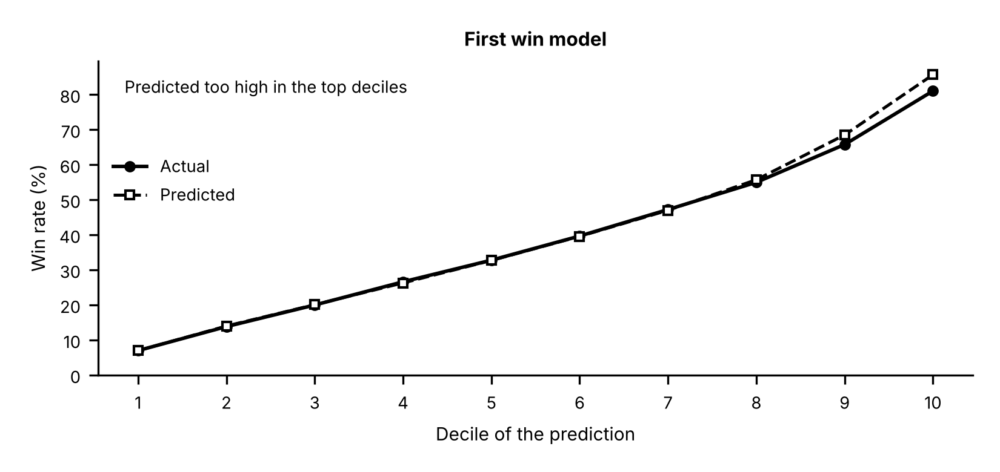
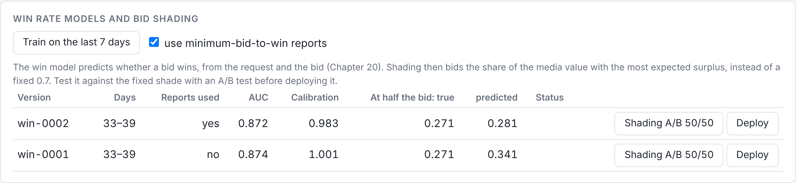
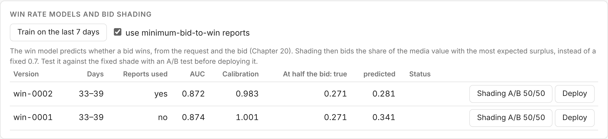

# Win Rate Models and Bid Shading {#sec-win-rate-and-bid-shading}

In @sec-pricing-a-click, the crawl DSP shaded every bid by a fixed factor, with a small randomized multiplier on a share of bids. A fixed shade overpays where competition is thin and loses impressions where it's heavy. Doing better needs a model of the auction itself, the chance that a given bid wins. Most of this book is about predicting what a user will do after seeing an ad. This chapter is about predicting what everyone else in the auction will do, which turns out to be just as important for making money.

In this chapter, we will build that model. We start with why shading matters in first-price auctions, define the win rate curve, and choose the features and labels for a win model. We then cover what wins, losses, and minimum-bid-to-win reports tell us, simple shading heuristics, a LightGBM win model trained on the randomized bids logged since @sec-pricing-a-click, and model-based shading. Pacing with the win model comes in @sec-basic-pacing, and curve-head models, safe exploration, and the winner's curse come in @sec-win-rate-curves-and-the-winners-curse. Throughout the chapter, we assume first-price auctions, as a new DSP would face today.

## Why Bid Shading Matters

In a first-price auction, the winner pays its own bid. As we saw in @sec-the-auction-lifecycle, most mobile in-app supply now runs this way, because mediation platforms moved from waterfalls to in-app bidding, where each demand source submits one price. Bidding the full value of an impression in a first-price auction wins often, but leaves no surplus for the advertiser or the DSP. **Bid shading** lowers the bid, trading some chance of winning for a lower price.

The shading step from @sec-inside-a-demand-side-platform chooses the bid that maximizes expected surplus:

$$b^* = \arg\max_b\; (v_m - b) \times W(b \mid x)$$

Here, $v_m$ is the **media value** of the impression, what it's worth to the DSP after calibration, pacing, margin, and fees, and $W(b \mid x)$ is the **win rate**, the probability that a bid of $b$ wins the auction for a request with features $x$. Everything in this chapter is about estimating $W$ well and using it carefully. Win-rate-based shading of this form is well documented in the literature. For example, a team at Verizon Media described a win-rate shading algorithm that explicitly maximizes surplus, and reported that it captured more surplus than a sell-side shading service.[^c20-pan]

[^c20-pan]: Shengjun Pan, Brendan Kitts, Tian Zhou, Hao He, Bharatbhushan Shetty, Aaron Flores, Djordje Gligorijevic, Junwei Pan, Tingyu Mao, San Gultekin, and Jianlong Zhang, "Bid Shading by Win-Rate Estimation and Surplus Maximization," AdKDD, 2020, <https://arxiv.org/abs/2009.09259>

### Where Second-Price Auctions Still Appear

Second-price auctions, where the winner pays the second-highest bid, were common in early programmatic advertising, and bidding the full value is optimal in them. A new DSP will rarely see them on the open market today. They still come up inside companies that run both a DSP and an exchange or mediation platform. When the company's own demand competes in its own auction, the internal pricing rule can differ from what outside bidders face, and the internal bidder may effectively pay the second price or a floor. A few exchanges also run hybrid rules, such as soft floors. The auction type is sent in the bid request (the OpenRTB `at` field), and the pricing logic bids the full media value whenever it says second price.

## The Bid Landscape and the Win Label

For a given request, the win rate curve $W(b \mid x)$ rises from zero for very low bids to nearly one for very high bids. Its shape depends on how many other buyers want the impression and how much they value it, which varies widely by supply, geography, device, and user. The set of these curves across all requests is often called the **bid landscape**.[^c20-rtbmono]

A useful parametric form is the log-logistic curve:

$$W(b \mid x) = \sigma\big(a(x) + \beta(x)\ln b\big), \qquad \beta(x) > 0$$

Here, $\sigma$ is the logistic function, and $a(x)$ and $\beta(x)$ are predicted for each request. The median price, where the bid wins half the time, is $\exp(-a/\beta)$, and $1/\beta$ controls how spread out the competing bids are. The form is monotone in the bid by construction, and it makes the optimal bid easy to compute, as we show later in the chapter. @fig-c25-curves shows how different these curves can be.

{#fig-c25-curves width="100%" fig-alt="Three S-shaped win rate curves against bid on a log scale, for low-competition, typical and premium supply. At a $4.00 bid, the win rate is 94%, 72% and 18% respectively."}

[^c20-rtbmono]: Jun Wang, Weinan Zhang, and Shuai Yuan, "Display Advertising with Real-Time Bidding (RTB) and Behavioural Targeting," *Foundations and Trends in Information Retrieval*, 2017, <https://arxiv.org/abs/1610.03013>. Chapter 6 covers bid landscape forecasting.

### The Label Is the Win

We train the win model on the **win notice**, the exchange's signal that our bid won the auction. A win is the event that the auction controls, and it's available for every bid within seconds. As we discussed in @sec-the-auction-lifecycle, winning is not showing: a won impression may never be billed if the ad expires in the cache, fails to render, or the mediation layer shows another source. That's why we model the **clear rate**, the share of wins that become billable impressions, separately. For pacing and spend forecasts, we multiply the two:

$$P(\text{billed} \mid b, x) = W(b \mid x) \times p_{clear}(x)$$

Keeping the two apart keeps the win model about the auction, and lets the clear rate be tracked as an operational metric, since sudden changes in it usually mean a rendering or integration problem rather than a change in competition.

## Features for the Win Model

The win model estimates what the other bidders will pay. The right features are therefore the ones that other bidders use to price the impression, not the ones that describe what we plan to show. @tbl-c25-features lists the main groups.

| Group | Examples | Why |
|---|---|---|
| Supply | Exchange, publisher app, placement type, ad format, floor | Supply drives competition and floor prices |
| Geography and time | Country, region, hour, day of week | Demand and budgets vary by market and time |
| Device | Device model, OS version, connection type, device price tier | Proxies for user value that every bidder sees |
| Device profile | Known installed apps and categories, prior spending behavior, recent ad activity, sessions | Other DSPs bid on the same signals, so they predict competition |
| Market history | Our recent win rate, and the distribution of reported minimum bids to win for the segment | Summaries of what the market has paid recently |
| Our bid | The candidate bid, as $\ln b$ and as a ratio to the floor | The variable the curve is a function of |

: Feature groups for the win model. {#tbl-c25-features}

Two groups are deliberately left out. Advertiser, campaign, and creative features don't belong in the win model. What we choose to show doesn't change how valuable the impression is to other advertisers, so it doesn't change what they bid. Those features belong in the value models, which estimate what the impression is worth to our advertiser. Leaving them out also lets one win model serve every campaign in the internal auction.

The second group is anything from this auction's outcome. The minimum bid to win reported after an auction is a strong signal about that segment, but it doesn't exist at bid time. It can be used as a label, which we cover next, or as a lagged aggregate feature, such as the median reported minimum bid to win for the same exchange, publisher, and country over the last hour. Using the current auction's value as a feature is leakage.

Features built from our own past bids need extra care. On a DSP team I worked on, we had a `clearing_price` feature that recorded how much we had been willing to bid for a device the last time we served it. It was useful, until a small experiment introduced false positive labels into training data. The models bid higher on the affected devices, which raised the feature, which raised the bids, in what I described at the time as a tail-spin effect. We removed the feature and replaced it with features built from the minimum bid to win values in auction callbacks, which describe the market rather than our own behavior.[^c20-incidents] @sec-operating-a-competitive-dsp covers how to watch for this kind of feedback loop.

The device profile features also deserve a note. Including installed apps or prior spending in the win model may seem like overreach for a model of the auction, but competitors use the same signals to bid. A device with a history of purchases in strategy games will draw high bids from every DSP running strategy campaigns, and the win model should know that. It also means that the win model learns how much the market values a user, which we use later to address the winner's curse.

[^c20-incidents]: Ben Weber, "Machine Learning Incidents in AdTech," *Towards Data Science*, January 29, 2025, <https://medium.com/data-science/machine-learning-incidents-in-adtech-e3f48d858054>

## Wins, Losses, and the Minimum Bid to Win

In a first-price auction, a bid of $b$ wins if it beats the highest competing bid, including any floor. Let $H$ be that highest competing price, with distribution $F(h \mid x) = P(H < h \mid x)$. Then the win rate is $W(b \mid x) = F(b \mid x)$, and each auction tells us something about $H$, as shown in @tbl-c25-outcomes.

| Outcome | What it tells us about $H$ |
|---|---|
| Win | $H < b$ |
| Loss | $H \ge b$ |
| Minimum bid to win reported | $H = m$, the reported value |

: What each auction outcome tells us about the highest competing price. {#tbl-c25-outcomes}

Wins and losses are **censored** observations. They tell us whether $H$ was above or below our bid, but not its value. A reported minimum bid to win is an exact observation, when it can be trusted. The likelihood for a model of $F$ combines all three:

$$\log L = \sum_{\text{wins}} \log F(b_i \mid x_i) + \sum_{\text{losses}} \log\big(1 - F(b_i \mid x_i)\big) + \lambda \sum_{\text{reported}} \log f(m_i \mid x_i)$$

where $f$ is the density of $H$, and $\lambda \in [0, 1]$ sets how much weight the reported values get. With only the first two terms, this is ordinary logistic regression on the win label, with the bid as an input. The third term adds information where exchanges report the price. Learning winning prices from censored data has a long history in real-time bidding research, from censored regression approaches to mixture density networks.[^c20-censored]

[^c20-censored]: Wush Chi-Hsuan Wu, Mi-Yen Yeh, and Ming-Syan Chen, "Predicting Winning Price in Real Time Bidding with Censored Data," KDD, 2015; and Aritra Ghosh et al., "Scalable Bid Landscape Forecasting in Real-time Bidding," <https://arxiv.org/abs/2001.06587>

## Bid Shading Heuristics

Before a win model exists, or as a fallback when it's unavailable, a DSP needs a simpler rule. @tbl-c25-heuristics compares the common ones.

| Heuristic | Rule | Strengths | Weaknesses |
|---|---|---|---|
| Truthful | $b = v_m$ | No model needed | Pays the full value in first-price auctions |
| Fixed factor | $b = k_e v_m$ per exchange, such as $k_e = 0.85$ | Simple, easy to tune from win price analysis | Ignores how competition varies across requests |
| Target win rate | Choose $b$ so that $W(b) = w^*$, such as 50% | Stable delivery, easy to explain | Ignores value, so it overpays on low-value requests |
| Median price | Bid the predicted median clearing price when it's below $v_m$ | Uses the market directly | Wins only half the time, even when surplus is large |

: Bid shading heuristics. {#tbl-c25-heuristics}

The target win rate rule is common in self-serve platforms where the advertiser sets a target CPM, because it keeps delivery predictable. For performance goals, the value-based shading below does better, because it bids more aggressively where the surplus is large and less where it's small. In my experience, a fixed factor per exchange is a perfectly reasonable place for a new DSP to start. It's easy to explain, and it gives you a baseline to beat.

## LightGBM with the Bid as a Feature

The simplest strong baseline is a gradient-boosted classifier on the win label, with $\ln b$ and $b/\text{floor}$ as features alongside the request features. Two settings matter:

- **A monotone constraint on the bid.** Without it, the model can learn a win rate that falls as the bid rises, or that is jagged between the bid levels in the training data, and either breaks the search for the best bid. LightGBM supports monotone constraints per feature.[^c20-lgbm]
- **A grid of candidate bids.** Because the bid is an input, the model runs once per candidate. A grid of 10 to 20 multipliers of the media value, from about 0.3 to 1.0, is usually enough, followed by choosing the grid point with the highest expected surplus. On a fast tree model this is affordable, but it multiplies inference cost by the grid size.

The reference DSP's win model is this baseline: LightGBM on the win notice, with $\ln b$ and $\ln(b/\text{floor})$ as inputs, a monotone constraint on both, and the request's features from the FeatureVector. Two of the simulated exchanges report the minimum bid to win, one exactly and one rounded up; each report adds a row just above it, as a win, and one just below, as a loss. Its shading is a grid of 17 shares of the media value, from 0.2 to 1.0, plus the floor. This is the Go code, lightly trimmed:

```go
for _, k := range ShadeGrid { // 0.2, 0.25, ..., 1.0
    if b := k * media; b > 0 && b <= media && b >= floor {
        bids = append(bids, b)
    }
}
if floor > 0 && floor <= media {
    bids = append(bids, floor)
}
rows := make([][]float64, len(bids)) // the request's inputs, once per bid
for i, b := range bids {
    rows[i] = append([]float64(nil), x...)
    w.setBid(rows[i], b, floor) // ln(bid) and ln(bid / floor)
}
p := make([]float64, len(bids))
w.Models["win"].PredictBatch(rows, p) // every bid through the trees together
for i, b := range bids {
    if s := (media - b) * p[i]; s > best {
        best, bestB, bestP = s, b, p[i]
    }
}
```

Eighteen candidate bids for every campaign priced made shading the largest cost in the bid path, as @sec-serving-models-in-the-bid-path measured. The closed form below, or a coarse grid refined around its best point, is how to make it cheaper.

[^c20-lgbm]: LightGBM documentation, "Parameters: monotone_constraints," <https://lightgbm.readthedocs.io/en/latest/Parameters.html>

Manual overbids, which we met in @sec-inside-a-demand-side-platform, are the opposite of the randomized multipliers. They change bids for reasons unrelated to the user, but they aren't random, logged as such, or bounded. Bids raised by an overbid look to the win model like ordinary bids, so it learns a win curve that's shifted by whatever the account managers happened to do that week. If your DSP has overbids, log them as a separate field in the bid ledger, and either exclude those bids from win model training or treat the overbid as a feature.

## Model-Based Shading and Calibrating the Win Model

With a win model in hand, the best bid maximizes expected surplus. For the log-logistic form, setting the derivative of $(v_m - b)\,W(b)$ to zero gives a simple condition:

$$b^* = \beta\,(v_m - b^*)\,\big(1 - W(b^*)\big)$$

This has exactly one solution between zero and $v_m$, and a few dozen steps of bisection find it in well under a microsecond. For a price-grid head, evaluate the expected surplus at each grid point and refine between the best point and its neighbors.

Let's make this concrete with an example. The media value is \$4.00 CPM, and the win rate curve has a median of \$3.00 and a spread of $1/\beta = 0.3$. @tbl-c25-example compares three bids.

| Bid | Win rate | Surplus per win | Expected surplus per 1,000 requests | Expected spend per 1,000 requests |
|---|---|---|---|---|
| \$4.00 (truthful) | 72% | \$0.00 | \$0.00 | \$2.89 |
| \$3.00 (median) | 50% | \$1.00 | \$0.50 | \$1.50 |
| \$2.66 (optimal) | 40% | \$1.34 | \$0.54 | \$1.07 |

: Comparing bids for a request with a \$4.00 media value. {#tbl-c25-example}

The optimal bid wins less often than the other two, but it earns the most surplus and spends the least. The floor and cap rules from @sec-pricing-a-click still apply after shading: the bid never goes below the floor, never above the media value, and never above the campaign's maximum bid.

### Calibrating the Win Model

Because the win rate multiplies directly into the surplus, it has to be calibrated where decisions are made, not just on average. Check reliability by exchange, by publisher tier, and by bid level. The most important check uses the exploration traffic described below. For each exploration multiplier bucket, compare the predicted and observed win rates. If the model is calibrated at the bids it usually makes, but not at higher or lower ones, its slope is wrong, and the shaded bids will be systematically too high or too low.

@fig-c20-calibration shows a typical first win model. It's well calibrated through the middle deciles and too high at the top, where most of the bids are exploration bids above the usual shade and where the model has seen fewer examples. A win model that's too high at high bids makes raising the bid look more valuable than it is, so the shading step leaves too little room below the value.

{#fig-c20-calibration width="100%" fig-alt="Calibration plot of actual and predicted win rate across ten deciles. The lines match closely from about 7% to 80%, with predictions slightly too high in the top deciles."}

Calibration at the bids the DSP made isn't enough, because shading bids where it hasn't. The simulator knows the highest competing price in every auction, so the reference DSP can check the model at bids it never made. @fig-c20-win compares two win models trained on the same seven days, one with the minimum-bid-to-win reports and one without. Both were calibrated at the logged bids, at 0.98 and 1.00. At half the logged bid, the true win rate was 27.1%. The model trained without the reports predicted 34.1%, and the one with them 28.1%. Without the reports, the model only saw wins and losses near the bids the fixed shade made, and it extended the curve too gently below them. That overstates what a lower bid wins, which pushes shading too low.

::: {.content-visible when-format="html"}
{#fig-c20-win width="100%" fig-alt="Screenshot of a table of win models. win-0002, days 33 to 39, reports used: AUC 0.872, calibration 0.983, at half the bid true 0.271 and predicted 0.281. win-0001, the same days, no reports: AUC 0.874, calibration 1.001, at half the bid true 0.271 and predicted 0.341. Each row has Shading A/B 50/50 and Deploy buttons."}
:::

::: {.content-visible unless-format="html"}
{#fig-c20-win width="100%" fig-alt="Screenshot of a table of win models. win-0002, days 33 to 39, reports used: AUC 0.872, calibration 0.983, at half the bid true 0.271 and predicted 0.281. win-0001, the same days, no reports: AUC 0.874, calibration 1.001, at half the bid true 0.271 and predicted 0.341. Each row has Shading A/B 50/50 and Deploy buttons."}
:::

Then the test that matters. The reference DSP ran an A/B test with the model trained on the reports in the treatment arm and the fixed 0.7 shade in the control, with half the devices and half of each budget in each arm, for three simulated days:

| Arm | Mean shade | Win rate | Spend | Media value won | Surplus |
|-----|-----------|----------|-------|-----------------|---------|
| Fixed 0.7 | 0.70 | 52.8% | \$135 | \$194 | \$58 |
| Model shading | 0.48 | 42.8% | \$62 | \$176 | \$114 |

: A shading A/B test on the reference DSP, three simulated days. Surplus is the media value won minus what was paid. {#tbl-c20-shading tbl-colwidths="[20,14,14,14,22,16]"}

Model shading won fewer auctions and paid less than half as much, for 9% less media value, and nearly doubled the surplus. Its predicted win rate, 45.8%, was close to the 42.8% it got. Three days later, with the installs in, its cost per install on CPI campaigns was 0.62 times the control's, with a 95% interval of 0.37 to 0.98; the simulator's true install rates put it at 0.57. The test also showed the cost: the treatment arm spent less than its half of each budget. A DSP that pays less per impression has to buy more of them to deliver its budgets, which is the job of the pacing in @sec-basic-pacing.

## Floors

Floors set by exchanges and mediation platforms carry real information. A mediation floor often reflects what other demand sources have paid for the same placement and user, so it's a strong feature for the win model. The pricing rules are simple. If the media value is at or below the floor, don't bid. If the shaded bid is below the floor, raise it to the floor, which still leaves surplus, because the value is above it. For a parametric win model, the floor also truncates the curve, since bids below it can't win:

$$W(b \mid x) = 0 \quad \text{for } b < \text{floor}$$

Logging the floor with every bid, and every request skipped because of it, lets the DSP see how much of its lost delivery comes from floors rather than from being outbid.

## First-Time Pitfalls

- **Minimum bid to win means different things on different exchanges.** It can include or exclude fees, be rounded, be reported only for losses, or be in another currency. Normalize it per exchange, as with every other field in @sec-parsing-bid-requests-and-eligibility, before training on it.
- **Training only on the explored share.** The randomized bids are what identify the slope of the curve, but the model still needs every bid to learn the level. Train on all bids, with the explored share telling the model how the win rate responds to the bid.
- **Shading before the floor and cap checks.** The optimal shaded bid can fall below the floor or above the cap. Apply the floor and cap rules after shading, every time.
- **Checking the win model against the wrong truth.** The reference DSP's first check against the simulator counted a bid as a winner if it beat the highest competing bid, and forgot the floor. A bid below the floor loses no matter what the others bid, so the "true" win rate at low bids was too high, and the model looked worse than it was. Whatever defines winning, floors, ties, and fees included, has to be the same in the label, the check, and the shading.

::: {.callout-tip title="Try it on the simulator"}
Train a LightGBM win model on the simulated bids, including the randomized multipliers logged since Part II, and the minimum bids to win from the exchanges that report them. Check its calibration by bid level. Then replace the fixed shade with model-based shading in an A/B test, and compare surplus, spend, and win rate between the arms.

*Status: runs with the companion code (dsp 0.14, adtrain 0.8, adsim 0.3). Train win models with and without the minimum-bid-to-win reports, check them at bids the bidder didn't make against the simulator's true win rates, and run a shading A/B test against the fixed 0.7. Commands and screenshots are in `WALKTHROUGH.md`, under this chapter.*

<!-- Tracker: private/implementation-tracker.md -->
:::

## Conclusion

In this chapter, we replaced the crawl DSP's fixed shade with a model of the auction. The win rate curve describes the chance of winning at each bid, trained on wins and losses, with the clear rate modeled separately, and informed by loss notices and minimum bids to win where exchanges send them. Features describe what other bidders see, not the advertiser. Heuristics leave money on the table, so a LightGBM win model with a monotone constraint on the bid, trained on the randomized bids logged since @sec-pricing-a-click, feeds a shading step that maximizes expected surplus, with floors as both constraints and signals.

Shading is the last step of pricing. In the next chapter, we work on the steps before it: turning install and value predictions into a price for each goal, with calibration, margins, and an internal auction to pick the winning campaign.
