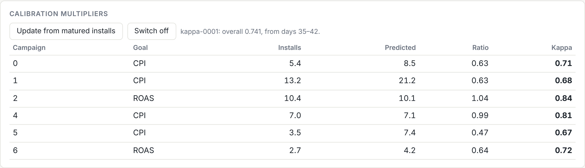
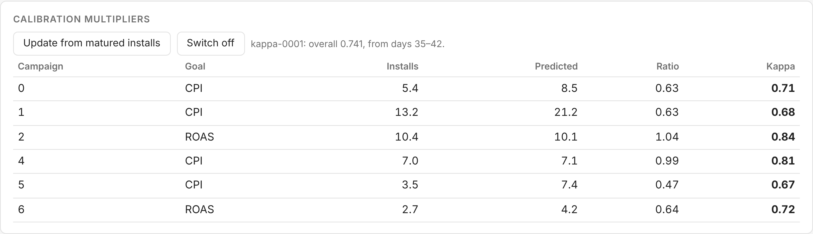
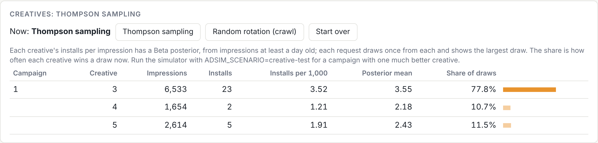
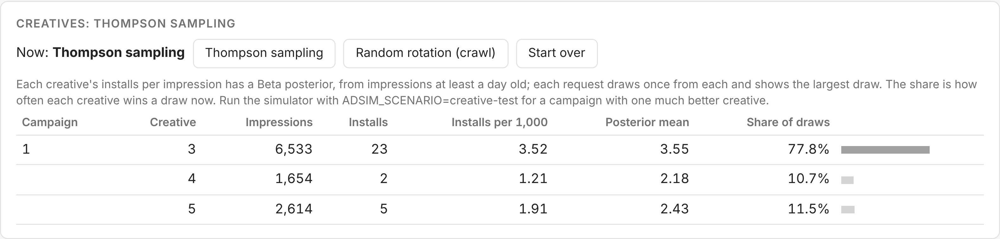

# Pricing for Goals {#sec-pricing-for-goals}

The walk DSP now predicts clicks, installs after clicks and after views, and purchase value, and it has a win model to shade its bids. Pricing ties them together. For each candidate campaign, the bidder has to turn a stack of predictions into one number, what the impression is worth to that campaign's advertiser given its goal, correct it for what the models get wrong, take the DSP's margin and fees out of it, and only then shade it. It also has to pick which of the candidate campaigns gets to bid at all.

In @sec-inside-a-demand-side-platform, we laid out the vocabulary for this, and walked through one bid for Cozy Farm Tycoon by the numbers. In crawl, most of the terms were fixed. In this chapter, they all become real: the advertiser value for each goal type, a calibration multiplier that adapts continuously, margins and fees under each billing model, a fixed order of operations, the combination of install and value predictions for ROAS goals, an internal auction that picks the winning campaign, how to handle uncertainty in low-volume segments, and Thompson sampling for creatives.

<!-- NOTE: Ben's pricing drafts (patches 0001 to 0003) aren't in the repo. This chapter is drafted from the TOC and Chapter 4; reconcile with the patches when they're available. -->

## From Probabilities to Value

Each walk campaign has one goal, and the goal decides how predictions become the **advertiser value** $A$, what a thousand impressions are worth to the advertiser. Every goal starts from the install equation in @sec-from-clicks-to-installs-and-purchases:

$$P(\text{install}) = p_{\text{click}} \times p_{\text{install} \mid \text{click}} + (1 - p_{\text{click}}) \times p_{\text{install} \mid \text{view}}$$

and multiplies the predicted installs per thousand impressions by what each install is worth under the goal:

| Goal | Advertiser value per thousand impressions |
|------|-------------------------------------------|
| CPI | $A = \text{target CPI} \times P(\text{install}) \times 1000$ |
| CPA | $A = \text{target CPA} \times P(\text{install}) \times P(\text{action} \mid \text{install}) \times 1000$ |
| D7 ROAS | $A = P(\text{install}) \times E[\text{D7 revenue} \mid \text{install}] / \text{target ROAS} \times 1000$ |
| D1 retention | $A = \text{target cost per retained user} \times P(\text{install}) \times P(\text{D1} \mid \text{install}) \times 1000$ |
| Ad ROAS | Like D7 ROAS, with predicted ad revenue in place of purchase revenue |

: Advertiser value for each goal type. {#tbl-c21-goal-values tbl-colwidths="[18,82]"}

Using the numbers from @sec-inside-a-demand-side-platform, Cozy Farm Tycoon's D7 ROAS campaign has a predicted click rate of 2%, an install rate after a click of 5%, and predicted D7 revenue of \$2.00 per install, at a 40% ROAS target. Ignoring view-through installs for the moment, the predicted IPM is 1.0, an install is worth $\$2.00 / 0.40 = \$5.00$, and $A = \$5.00$ CPM. If the view-through path adds another 0.2 installs per thousand impressions, $A$ rises to \$6.00.

Walk campaigns have one goal each. Advertisers often want more than one, such as installs at a target CPI with a D7 ROAS floor, and @sec-the-unified-pricing-equation explains why and prices them together.

## The Calibration Multiplier

Even well-calibrated models drift between retrains, and some segments are consistently off. The **calibration multiplier** $\kappa$ corrects for both. For a segment $s$, such as a campaign on one exchange, it's the ratio of realized outcomes to predicted outcomes on recent wins:

$$\kappa_s = \frac{O_s + k \times \kappa_{\text{parent}}}{E_s + k}$$

where $O_s$ is the number of outcomes, such as installs, that arrived for the segment's recent impressions, $E_s$ is the number the models predicted for the same impressions, and $k$ is a smoothing weight, in units of predicted outcomes, that shrinks small segments toward their parent segment's multiplier. A segment with 2 predicted installs barely moves from its parent, and one with 2,000 gets its own value. The parent, in turn, shrinks toward the campaign or the whole platform.

A few practical choices make $\kappa$ work:

- **Use matured labels.** Only count impressions whose labels have passed their cutoff, or scale $O_s$ by the expected completion for impressions that are still maturing. Otherwise every recent segment looks miscalibrated low.
- **Weight recent data more,** with an exponential decay over days, so $\kappa$ tracks drift without overreacting to one day.
- **Bound it,** such as between 0.5 and 2. A multiplier outside the bounds means something is broken, and it should alert rather than keep correcting.
- **Measure it on wins.** $\kappa$ is computed on the impressions the DSP actually won and showed, which matters for the winner's curse in @sec-win-rate-curves-and-the-winners-curse.

$\kappa$ is the first **fast-adapting layer** in the DSP. The base models retrain daily, and $\kappa$ updates every hour or so, absorbing drift in between. The pacing multiplier in @sec-basic-pacing is the second. @sec-retraining-and-real-time-learning frames both as part of real-time learning.

The reference DSP computes $\kappa$ by campaign from impressions at least three days old, whose installs have mostly arrived, with the predicted installs from what the bidder logged when it bought them, shrunk toward the overall ratio and bounded to 0.5–2. @fig-c21-calibration shows the first update. Overall, the models had predicted about a third more installs than arrived: $\kappa = 0.74$. That's the overconfidence on won impressions that @sec-gradient-boosted-conversion-models found in the as-of bundle's report, now measured on live outcomes, and the multipliers pull each campaign's value down to match.

::: {.content-visible when-format="html"}
{#fig-c21-calibration width="100%" fig-alt="Screenshot of a table: kappa-0001, overall 0.741, from days 35 to 42. Campaign 0, CPI, 5.4 installs against 8.5 predicted, ratio 0.63, kappa 0.71; campaign 1, CPI, 13.2 against 21.2, ratio 0.63, kappa 0.68; campaign 2, ROAS, 10.4 against 10.1, ratio 1.04, kappa 0.84; campaign 4, CPI, 7.0 against 7.1, ratio 0.99, kappa 0.81; campaign 5, CPI, 3.5 against 7.4, ratio 0.47, kappa 0.67; campaign 6, ROAS, 2.7 against 4.2, ratio 0.64, kappa 0.72."}
:::

::: {.content-visible unless-format="html"}
{#fig-c21-calibration width="100%" fig-alt="Screenshot of a table: kappa-0001, overall 0.741, from days 35 to 42. Campaign 0, CPI, 5.4 installs against 8.5 predicted, ratio 0.63, kappa 0.71; campaign 1, CPI, 13.2 against 21.2, ratio 0.63, kappa 0.68; campaign 2, ROAS, 10.4 against 10.1, ratio 1.04, kappa 0.84; campaign 4, CPI, 7.0 against 7.1, ratio 0.99, kappa 0.81; campaign 5, CPI, 3.5 against 7.4, ratio 0.47, kappa 0.67; campaign 6, ROAS, 2.7 against 4.2, ratio 0.64, kappa 0.72."}
:::

## Margin, Fees, and Billing Models

With $A$ and $\kappa$, the media value follows the equation from @sec-inside-a-demand-side-platform:

$$v_m = A \times \kappa \times \gamma \times (1 - m) - f$$

How the margin $m$ works depends on how the advertiser is billed:

- **CPM billing with a fixed margin.** The advertiser pays for the media plus a fixed share, as in crawl. Pricing at $(1 - m)$ of the advertiser value means the DSP meets the advertiser's target if the predictions are right, and keeps its margin either way.
- **CPI billing.** The advertiser pays the target CPI per attributed install, and the DSP pays for the media. The DSP's revenue per thousand impressions is $A \times \kappa$, its cost is the media, and its margin is whatever is left. A model that's too optimistic loses the DSP money directly, the same day, as we saw in @sec-inside-a-demand-side-platform. Under CPI billing, $m$ is a target margin the DSP builds into its bids, not a fee it's guaranteed.
- **Dynamic margin.** Under either model, the margin can vary from impression to impression, within bounds, as long as the campaign's average margin meets its target. A higher margin where the DSP has a lot of surplus, and a lower one where it would otherwise lose a valuable impression, can increase both the DSP's revenue and the advertiser's results. We come back to this in @sec-the-unified-pricing-equation.

Fees $f$ are per-impression costs the DSP pays on top of the media, such as measurement or data fees, subtracted after the margin.

## The Order of Operations

The order of the steps matters, because several of them are nonlinear. The walk DSP always applies them in this order:

1. **Predict** the probabilities and values the goal needs.
2. **Compute the advertiser value** $A$ for the goal.
3. **Apply all multipliers:** calibration $\kappa$ and pacing $\gamma$, and, in Part IV, the incrementality tilt.
4. **Apply the margin and fees** to get the media value $v_m$.
5. **Shade** $v_m$ with the win model from @sec-win-rate-and-bid-shading.
6. **Apply floors and caps:** no bid if $v_m$ is below the floor, the floor if the shaded bid is below it, and never above the campaign's and the DSP's caps.

All multipliers come before shading, because the optimal shaded bid depends on the value being shaded. Scaling the bid after shading by a pacing multiplier, for example, gives a different and worse bid than shading the scaled value. Floors and caps come last, because they're hard limits that nothing else should override.

The bid ledger records the output of every step, so a bid can always be explained term by term. In the reference DSP, the steps are a few lines of Go, lightly trimmed:

```go
pc := pr.PClick
pInst := pc*pr.PInstallClick + (1-pc)*pr.PInstallView // the install equation
k := p.Kappa.Get(campaign.ID)                          // calibration
value := p.GoalValue(campaign, pc, pr.PInstallClick, pr.PInstallView, vpi) * k
gamma, overbid := p.Pace(campaign.ID)                  // pacing
media := value * gamma * overbid * (1 - p.Margin)      // margin
shaded, win := shade(media, floor)                     // the win model
score := win * (value - math.Max(shaded, floor))       // the internal auction's score
```

`adtrain trace` prints the same terms for any logged bid, from the ledger, which is the first thing to run when someone asks why the DSP bid what it did.

## Combining Install and Value Predictions

For ROAS goals, the value depends on the product of two models: the install probability and the expected value per install. Their errors multiply, so a 10% overprediction in each becomes a 21% overprediction in the bid.

Three practices keep the product honest:

- **Check the calibration of the product,** by campaign and by bid range, against realized revenue, not just each model on its own, as in @sec-gradient-boosted-conversion-models.
- **Keep separate multipliers,** one for installs and one for value per install, so a drift in one doesn't get corrected by a change in the other. The overall correction is their product.
- **Use enough data for value.** Revenue labels are sparse and heavy-tailed, so value calibration needs larger segments and longer windows than install calibration.

The reference DSP has no value model yet. Its ROAS campaigns price with each app's average D7 revenue per install in the bundle's training data, shrunk toward the average over all apps. In the simulated walk market, payers are rare enough that this average is tiny, and with it the ROAS campaigns could barely bid above the floors. That's the right answer for their targets in this market, and a reminder that a ROAS campaign's value depends on a number that's much harder to estimate than an install rate.

## Choosing the Winning Campaign

After pricing, each eligible campaign has a media value and a shaded bid. The DSP can only send one bid per impression, so it runs an **internal auction** to choose. The crawl DSP chose at random. The walk DSP chooses the campaign with the highest expected surplus:

$$\text{score}_c = W(b_c) \times (A_c \times \kappa_c - b_c - f)$$

Here, $A_c \times \kappa_c$ is the calibrated value of the impression to campaign $c$'s advertiser, $b_c$ is the campaign's shaded bid, and $W(b_c)$ is the chance that bid wins. The score is the expected value created if the campaign bids: the value to the advertiser, minus what the DSP pays for the media, times the chance of winning.

The score doesn't depend on the billing model. Billing decides how the surplus is split between the advertiser and the DSP, through the margin or the CPI, but the surplus itself is the same, so the campaign that creates the most of it should win. That keeps the internal auction fair to campaigns with different goals and billing models, and it's one more reason for universal, calibrated models: the comparison is only fair if every campaign's value comes from the same models.

Continuing the example, suppose a second campaign is eligible for the same request: a CPI campaign for another game with a target CPI of \$3.00 and a predicted IPM of 1.2, so $A = \$3.60$. With the same multipliers, its media value and shaded bid are lower than Cozy Farm Tycoon's, and so is its expected surplus, so Cozy Farm Tycoon bids. On a different request, where the second game's audience is a better match, the order flips.

Pacing interacts with the internal auction. A campaign that's behind on spend has a higher $\gamma$, which raises its media value and its bid. That lowers its surplus at the margin, but raises its chance of winning, and the internal auction takes both into account.

The reference DSP's internal auction prices every eligible campaign, picks the highest score, and logs the top five candidates with their values, bids, win probabilities, and scores. One request in ten picks a campaign at random instead, weighted by remaining budget, and logs the probability of the choice either way, so the selection stays evaluable offline as in @sec-offline-evaluation-and-model-iteration. Our first version logged the wrong ad. It priced every campaign through one shared function that recorded the ad it was pricing, so the ledger ended up with the last campaign priced, not the winner. Bids went out right and the training rows came out wrong. A test that runs an auction with a known winner and checks the logged ad now guards it.

## Uncertainty and Low-Volume Segments

Every number in the pricing equation is an estimate, and some are much less certain than others. A campaign's install rate on a large exchange might rest on thousands of installs. The same campaign's rate on a new publisher, or in a small country, might rest on ten. Treating both as equally reliable is one of the easiest ways to make expensive mistakes, because the bidder acts on point estimates, and a small segment's point estimate can be far from the truth.

Install counts are roughly Poisson, so the uncertainty in a segment's observed rate depends mostly on how many installs it has seen, as @tbl-c21-intervals shows.

| Installs observed | 95% interval, as a share of the observed rate |
|---:|---|
| 10 | 0.48x to 1.84x |
| 30 | 0.67x to 1.43x |
| 100 | 0.81x to 1.22x |
| 300 | 0.89x to 1.12x |
| 1,000 | 0.94x to 1.06x |

: Exact Poisson 95% intervals for an observed install rate, by the number of installs it's based on. {#tbl-c21-intervals tbl-colwidths="[35,65]"}

With 10 installs, a segment whose true rate matches the campaign average can easily look 50% better or worse than it is. A dashboard that sorts segments by CPI will put the luckiest small segments at the top, and anyone who raises their bids, by hand or with a multiplier, is reacting to noise.

A few practices keep the DSP from overreacting:

- **Shrink small segments.** The calibration multiplier above already does this: a segment's $\kappa$ moves away from its parent's only as fast as the evidence allows. Apply the same shrinkage to any segment-level number that feeds a bid, such as a publisher's install rate or a creative's completion rate.
- **Show intervals, not just point estimates.** Report the number of outcomes and an interval next to every segment-level rate, in dashboards and readouts. It changes how people read them.
- **Set a minimum sample for decisions.** Don't block a publisher, raise a bid, or call an A/B test on a segment until it has enough outcomes for the interval to be useful, such as 100 installs. Below that, let shrinkage handle it.
- **Decide whether to be cautious or curious.** When overpaying is costly, such as for a campaign close to its CPI target, bidding on a lower quantile of a segment's value protects the target. When learning is valuable, such as for a new campaign or creative, bidding on a sample from the posterior, as Thompson sampling does, gives uncertain options a chance. Being cautious everywhere starves new segments of the data they need, and being curious everywhere spends the advertiser's money on noise, so budget the exploration explicitly.

Uncertainty also explains a common incident: a segment-level estimate looks strong, someone acts on it, and performance falls back. Usually nothing broke. The estimate was based on too little data, and it regressed toward the mean.

## Creative Testing

In crawl, creatives within a campaign were rotated at random. Walk replaces rotation with **Thompson sampling** for each campaign: keep a posterior distribution over each creative's install rate per impression, sample once from each creative's posterior for each request, and show the creative with the highest sample.

With a Beta posterior for each creative, updated from its impressions and attributed installs, creatives with strong results are shown more, creatives with poor results less, and creatives with little data still get shown, because their posteriors are wide. Concretely, if creative $j$ starts from a prior $\text{Beta}(a_0, b_0)$, and has had $n_j$ impressions with matured labels and $k_j$ installs, its posterior is

$$\theta_j \sim \text{Beta}(a_0 + k_j,\; b_0 + n_j - k_j)$$

and for each request, the bidder draws one $\tilde\theta_j$ from each creative's posterior and shows the creative with the largest draw.

Here's an example with three creatives for one campaign, and a prior of $\text{Beta}(2, 1000)$, an install rate of about 0.2% worth about a thousand impressions of evidence, set from the campaign's other creatives. Creative A has 60 installs from 30,000 impressions, a rate of 0.20%. Creative B has 45 from 30,000, a rate of 0.15%. Creative C is new, with no impressions. Their posteriors are $\text{Beta}(62, 30{,}940)$, $\text{Beta}(47, 30{,}955)$, and $\text{Beta}(2, 1{,}000)$. A and C have about the same mean, but C's posterior is far wider. Sampling all three for each request, A wins about 56% of draws, C about 40%, and B about 4%. B gets a little traffic in case its rate is better than it looks. C gets a lot, because its true rate could be much higher or much lower than A's, and the only way to find out is to show it. As C collects impressions, its posterior narrows, and its share settles near A's if it's as good, or falls toward B's if it isn't.

A few details matter in practice:

- **An exploration floor for new creatives.** A new creative starts with a prior from the campaign's other creatives, and gets a minimum share of traffic until it has enough impressions to judge.
- **Delayed rewards.** Installs arrive hours or days after the impression, so the posteriors update in batches, on matured labels, and a creative's recent impressions are excluded from its posterior until their labels mature.
- **Creative attributes as features.** The LightGBM models also get the creative's format, length, orientation, and end card type as features, so a new creative borrows from similar ones in the base predictions too.
- **Log the selection probability.** Thompson sampling's probability of choosing each creative isn't returned directly, but it can be estimated by sampling the posteriors many times. Log it, so that @sec-personalized-creative-selection can evaluate learned policies offline.

The simulator's `creative-test` scenario gives one of a campaign's three creatives a much higher install rate. @fig-c21-creatives shows the reference DSP's posteriors after six simulated days of Thompson sampling: the strong creative went from a third of the draws to 78%, at 3.5 installs per thousand impressions against 1.2 and 1.9 for the others, and the other two still get about a tenth of the traffic each, which is how the bandit would notice if one of them improved. The bidder estimates each creative's chance of being shown from 4,000 draws, and keeps it for 1,000 picks, since the posteriors change only as day-old installs arrive; estimating it on every request was a seventh of the bidder's CPU, as @sec-serving-models-in-the-bid-path found.

::: {.content-visible when-format="html"}
{#fig-c21-creatives width="100%" fig-alt="Screenshot of a table for campaign 1. Creative 3: 6,533 impressions, 23 installs, 3.52 per 1,000, posterior mean 3.55, 77.8% of draws. Creative 4: 1,654 impressions, 2 installs, 1.21 per 1,000, posterior mean 2.18, 10.7% of draws. Creative 5: 2,614 impressions, 5 installs, 1.91 per 1,000, posterior mean 2.43, 11.5% of draws."}
:::

::: {.content-visible unless-format="html"}
{#fig-c21-creatives width="100%" fig-alt="Screenshot of a table for campaign 1. Creative 3: 6,533 impressions, 23 installs, 3.52 per 1,000, posterior mean 3.55, 77.8% of draws. Creative 4: 1,654 impressions, 2 installs, 1.21 per 1,000, posterior mean 2.18, 10.7% of draws. Creative 5: 2,614 impressions, 5 installs, 1.91 per 1,000, posterior mean 2.43, 11.5% of draws."}
:::

## Inputs to the Pricing Equation

Every term in the walk pricing equation, with where it comes from:

| Input | Source | Default when unavailable |
|-------|--------|--------------------------|
| $p_{\text{click}}$ | LightGBM click model | Logistic regression, then segment rate |
| $p_{\text{install} \mid \text{click}}$, $p_{\text{install} \mid \text{view}}$ | LightGBM install models | Smoothed segment rates |
| $E[\text{value} \mid \text{install}]$ | Value model | Campaign average over 30 days |
| Target and goal | Campaign configuration | None; no bid without a target |
| $\kappa$ | Calibration service, by segment | Parent segment, then 1.0 |
| $\gamma$ | Pacing controller, by campaign | 1.0 |
| $m$, $f$ | Campaign and DSP configuration | Configured defaults |
| $W(b)$ | Win model | Fixed shade |
| Floor | Bid request | No floor |
| Caps | Campaign and DSP configuration | DSP-wide cap |

: Inputs to the walk pricing equation. {#tbl-c21-inputs tbl-colwidths="[30,36,34]"}

The defaults form the pricing side of the fallback ladder in @sec-operating-a-competitive-dsp, and the bid ledger records which default, if any, priced each bid.

::: {.callout-tip title="Try it on the simulator"}
Price a CPI campaign and a D7 ROAS campaign on the same requests, and trace each bid term by term. Run the internal auction, and check which campaign wins as the request's publisher and device change. Then add three creatives to a campaign, one much better than the others, and watch Thompson sampling shift traffic toward it as installs arrive.

*Status: runs with the companion code (dsp 0.14, adtrain 0.8, adsim 0.3). The Pricing tab switches on the internal auction, calibration multipliers, and Thompson sampling; `adtrain trace` shows every term of a bid and every campaign's score; `ADSIM_SCENARIO=creative-test` gives one campaign a much better creative. Commands and screenshots are in `WALKTHROUGH.md`, under this chapter.*

<!-- Tracker: private/implementation-tracker.md -->
:::

## Conclusion

In this chapter, we made every term of the pricing equation real. Each goal type turns the install equation and value predictions into an advertiser value, a calibration multiplier by segment corrects for drift and bias as the first fast-adapting layer, and margins and fees work differently under CPM and CPI billing. Multipliers come before shading and floors and caps come last, ROAS goals check the calibration of the product of two models, and an internal auction picks the campaign with the highest expected surplus, independent of billing. Small segments are shrunk toward their parents and reported with intervals, so the DSP doesn't chase noise. Creatives are chosen by Thompson sampling, with their selection probabilities logged.

The pacing multiplier $\gamma$ has been 1 so far, and throttling has done the job of spreading spend. In the next chapter, we replace throttling with a controller on $\gamma$.
