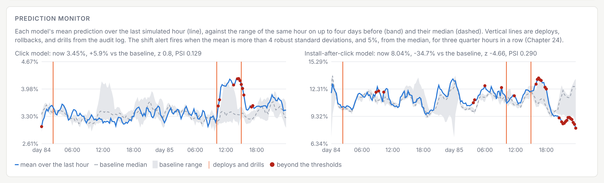
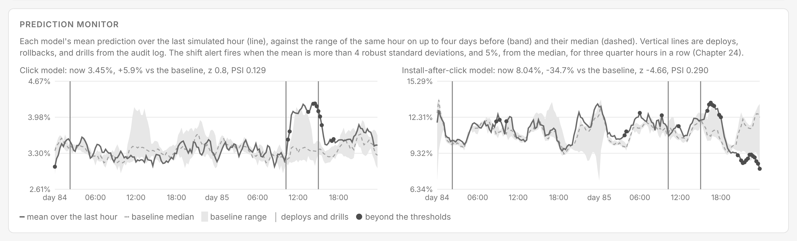
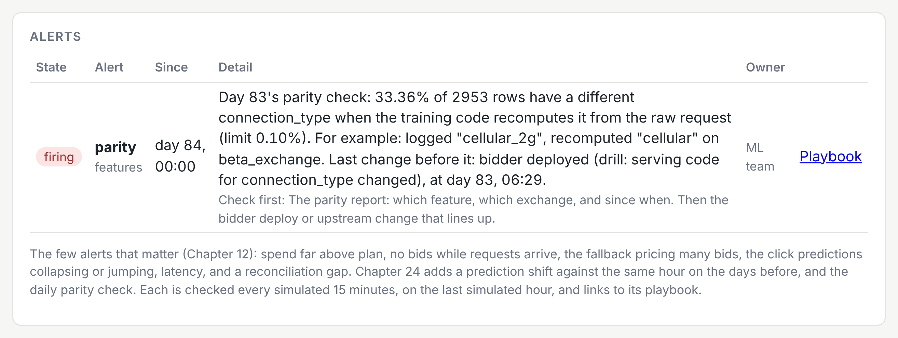
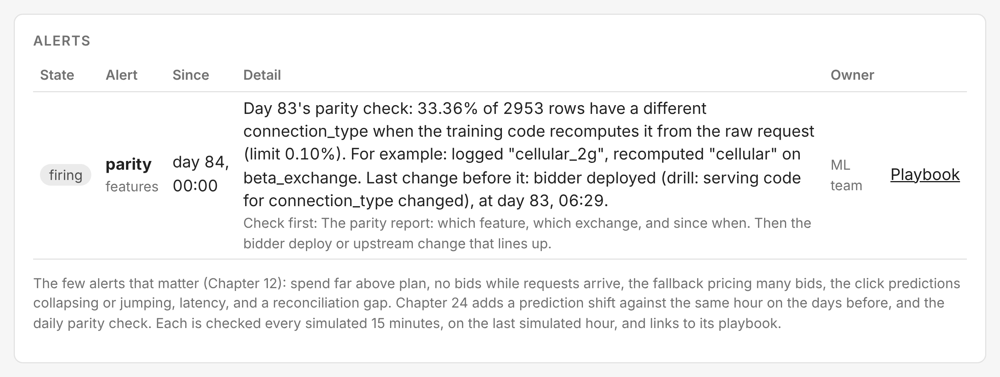
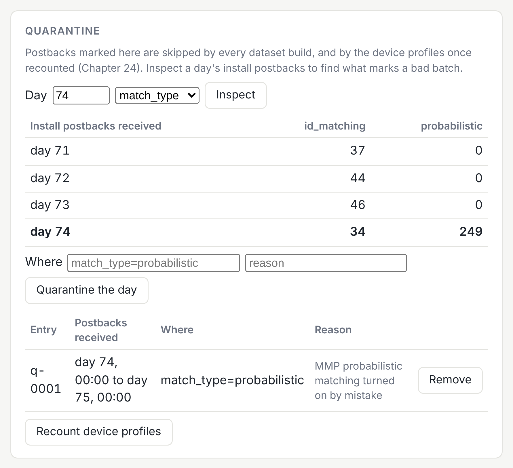
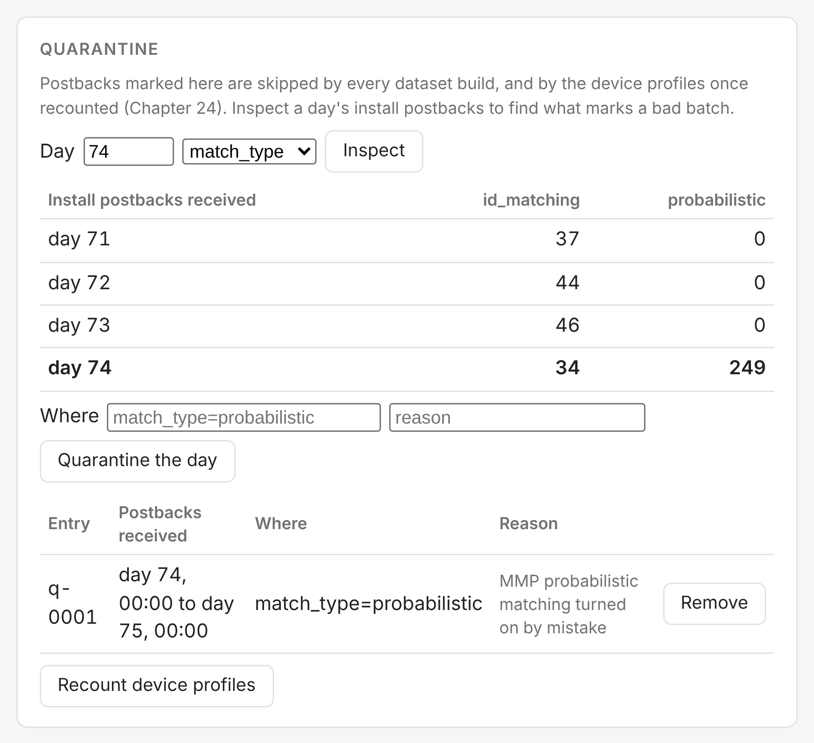
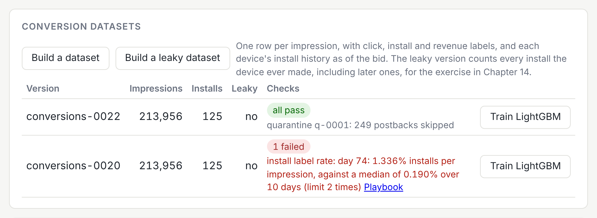
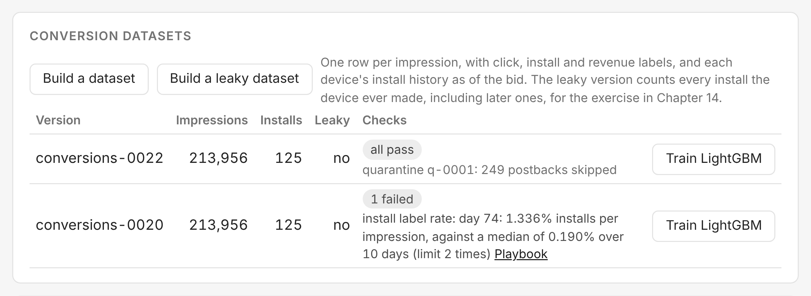

# Operating a Competitive DSP {#sec-operating-a-competitive-dsp}

A DSP is watched by many people. Bidder engineers watch latency and error rates, analysts and account managers watch spend and campaign goals, and finance watches revenue and margin. None of those views is designed to answer the question an ML team cares about most: are the models still producing the predictions they were trained to produce? A model can drift badly while spend looks normal, because the pacing system compensates, and spend can swing wildly for reasons that have nothing to do with the models, such as an analyst changing a campaign's targets.

One of the incidents I've written about shows why this matters. On a DSP team I worked on, a daily retraining run produced a click model that predicted a 25% click rate for every request, regardless of the inputs. Its AUC on the validation set was 0.5, and our pipeline deployed it anyway. We caught it because we logged click predictions as a histogram metric, and the p50 and p99 of the predictions collapsed onto the same value right after the deploy.[^c24-incidents] No spend dashboard would have told us that as quickly. The model metrics did.

Detection is only half of the job. A DSP buys impressions continuously, so every minute that a bad model stays live costs money, and a fast, safe response matters as much as a fast alert. When I think back on the incidents I've been part of, the ones that hurt most weren't the hardest to diagnose. They were the ones where we knew roughly what was wrong but didn't have a quick, safe way to undo it.

The crawl DSP in @sec-operating-the-first-dsp had dashboards, a few alerts, and kill switches. In this chapter, we will build the operations a DSP needs once real goals and real budgets are at stake. We start with monitoring that is routed first to the ML team: the distribution of predictions over time, calibration when labels arrive late, and parity between the training and serving pipelines, with alerts and two monitoring stacks, one open source for on-premises infrastructure and one on Google Cloud. We then cover the fallback ladder, incident tiers and on-call, playbooks, root-cause analysis for account-level issues, service levels for ML, and quarantining bad data. Drift across many model families and the postmortem loop come in @sec-operating-at-scale.

[^c24-incidents]: Ben Weber, "Machine Learning Incidents in AdTech," *Towards Data Science*, January 29, 2025, <https://medium.com/data-science/machine-learning-incidents-in-adtech-e3f48d858054>. The incidents in this chapter are drawn from that post unless noted otherwise.

## Operational Metrics vs. Model Metrics

The first design decision is which signals belong to the ML team. A useful rule is to route an alert to the team that can act on it first. @tbl-c19-owners shows how that plays out.

| Signal | Examples | First owner |
|---|---|---|
| Bidder health | Requests per second, latency, timeouts, error rates | Bidder engineering |
| Model inputs | Feature missing rates, out-of-vocab rates, lookup misses, feature distributions | ML team |
| Model outputs | Prediction distributions, share of fallback predictions, share of predictions at bounds | ML team |
| Calibration | Predicted vs. realized outcomes by segment, the calibration multiplier $\kappa$ | ML team |
| Parity | Feature, tensor, prediction, and version mismatches between training and serving | ML team |
| Delivery and spend | Spend against plan, CPI, ROAS, win rate on a campaign | Analysts and account managers |

: Routing signals to the team that can act on them first. {#tbl-c19-owners}

Delivery and spend are deliberately not ML alerts. Spend changes when advertisers change budgets or goals, when analysts adjust campaigns, when supply shifts, and when the pacing system reacts, and most of those causes are outside the ML team's control. If a model problem is serious, it shows up in the model layers first, usually hours before it reaches spend. Spend metrics still matter to the ML team during investigations, which we cover later in this chapter, but they make poor first alerts.

The calibration multiplier $\kappa$ is the ratio of realized outcomes to predicted outcomes, which the pricing logic in @sec-pricing-for-goals uses to correct predictions that run high or low. It shows up throughout this chapter, because a drifting $\kappa$ is often the first long-term sign that a model is wrong.

### What the ML Team Should Watch

Each model gets the same set of signals, broken out by model version and by a small number of segments, such as exchange, platform, and country tier. @tbl-c19-signals lists them by layer, along with what a change in each one usually means.

| Layer | Signal | What a change usually means |
|---|---|---|
| Inputs | Missing rate per feature | An upstream source stopped sending a field |
| Inputs | Out-of-vocab (OOV) rate per categorical feature | New apps, placements, or devices the vocabulary does not cover |
| Inputs | Lookup miss rate per lookup table and version | A table or embedding version is not loaded |
| Inputs | Feature distribution shift (PSI) | Data drift, or a change in an upstream definition |
| Outputs | Prediction quantiles: p1, p50, p99 | The model is scoring traffic differently |
| Outputs | Mean prediction, log ratio to baseline | Overall level shift, often from a deploy or an input problem |
| Outputs | Share of fallback or default predictions | Models failing to load or to score |
| Outputs | Share of predictions at clip bounds | Inputs outside the training range |
| Calibration | Predicted vs. realized by segment, with label delay | Concept drift or model bias |
| Calibration | $\kappa$ on wins vs. $\kappa$ by margin over market price | The winner's curse growing on some supply |
| Parity | Mismatch rates for features, tensors, predictions, and versions | Training and serving disagree |

: The signals each model gets, by layer. {#tbl-c19-signals}

## Baselines and Comparing Distributions

The most useful real-time signal for an ML team is the distribution of predictions over time. Almost every model problem, from a missing feature to a bad deploy to an embedding version that failed to load, changes the distribution of what the model outputs, and it does so within minutes. The 25% click model is the extreme case, where the whole distribution collapses to a point, but most problems are subtler shifts in one part of the distribution.

### Baselines

Prediction distributions have strong daily and weekly cycles, because the mix of traffic changes by hour. A fixed threshold either fires every evening or misses real problems. Compare each interval to a baseline built from the same hour of the same weekday over the previous few weeks, such as the median of the last four weeks:

$$\delta_t = \ln\left(\frac{\bar{p}_t}{\bar{p}^{\,base}_t}\right)$$

where $\bar{p}_t$ is the mean prediction in interval $t$, and $\bar{p}^{\,base}_t$ is the baseline for the same hour. A value of $\delta_t = 0.2$ means predictions are about 22% higher than usual for this time of week. The same comparison applies to quantiles, so the dashboard shows p1, p50, and p99 against bands built from the baseline weeks.

To decide when a change is unusual, use a robust z-score against the baseline weeks:

$$z_t = \frac{x_t - \text{median}(x_{base})}{1.4826 \times \text{MAD}(x_{base})}$$

where MAD is the median absolute deviation of the baseline values. The factor 1.4826 makes the score comparable to a standard z-score for normally distributed data, while staying robust to the occasional bad week in the baseline. An alert fires when $|z_t|$ exceeds a threshold, such as 4, for several consecutive intervals.

### Comparing Whole Distributions

Means and quantiles catch level shifts. To catch changes in shape, compare the binned distribution of predictions, or of any feature, against the baseline with the **population stability index** (PSI):

$$\text{PSI} = \sum_{i=1}^{B} (a_i - e_i)\ln\left(\frac{a_i}{e_i}\right)$$

where $a_i$ and $e_i$ are the shares of observations in bin $i$ for the current interval and the baseline, and the bins are fixed from the baseline quantiles. PSI comes from credit risk scoring, where a common rule of thumb treats values below 0.1 as stable, 0.1 to 0.25 as a moderate shift, and above 0.25 as a large shift.[^c24-psi] Those cutoffs are heuristics, and PSI also grows with the number of bins and shrinks with sample size, so it's worth tuning thresholds on your own history rather than taking them as given. Because predictions span orders of magnitude, bin them on the log scale.

{#fig-c19-dashboard width="100%" fig-alt="Four mock monitoring panels over a week with a deploy marked: predicted install rate percentiles, which jump after the deploy; fallback predictions with a brief spike above the 1% alert line; a feature's missing rate that jumps from about 4% to 30%; and an out-of-vocabulary rate that rises steadily."}

@fig-c19-dashboard shows what this looks like for one conversion model. Each panel answers a different question, and most real incidents show up in more than one of them at once.

### The Reference DSP's Prediction Monitor

The reference DSP monitors the mean prediction of its click and install-after-click models this way. Every simulated quarter hour, it compares the mean over the last hour with the same hour on up to four earlier days. The alert fires when the robust z-score is above 4, and the change above 5%, for three quarter hours in a row; the 5% floor and a floor on the MAD keep baseline days that happen to agree closely from turning every wobble into a page. PSI against the baseline days is shown with it. The alert names the last deploy, rollback, or drill in the audit log before the shift began.

To see what it catches, we ran drills. A deploy that multiplied the serving bundle's click predictions by 1.3 at 10:29 on a simulated day paged at 13:00: the mean was 27% above the baseline, with a z of 8.3 and a PSI of 0.17, and the alert named the deploy. Rolling back at once resolved it by 14:30. A 10% shift took about three hours to page, at a z of 6.3, and between pages its z-score wandered between 1.5 and 5. That's the volume problem from earlier in this chapter: at the simulator's small scale, an hour's mean click prediction moves 3 to 6% from one day to the next, so a 10% shift is only two or three of its standard deviations at any moment. @fig-c24-monitor shows a repeat of the 1.3 drill, and something we didn't plan: the rollback went to an older bundle, whose install-after-click model predicts differently, and the monitor flagged that too. A rollback is a deploy.

::: {.content-visible when-format="html"}
{#fig-c24-monitor width="100%" fig-alt="Screenshot of two line charts over days 84 and 85, each with the hourly mean prediction, the baseline median as a dashed line, and the baseline range as a gray band. Click model: the mean stays near the band around 3.3% until a vertical line at about 10:30 on day 85, then rises to about 4.2%; red dots mark points beyond the thresholds; a second vertical line at about 15:00 marks the rollback, after which the mean falls back near the band. The header reads now 3.45%, +5.9% against the baseline, z 0.8, PSI 0.129. Install-after-click model: the mean tracks the band until after the rollback, then falls to about 8%, 34.7% below the baseline, z -4.66, with red dots marking points beyond the thresholds."}
:::

::: {.content-visible unless-format="html"}
{#fig-c24-monitor width="100%" fig-alt="Screenshot of two line charts over days 84 and 85, each with the hourly mean prediction, the baseline median as a dashed line, and the baseline range as a gray band. Click model: the mean stays near the band around 3.3% until a vertical line at about 10:30 on day 85, then rises to about 4.2%; red dots mark points beyond the thresholds; a second vertical line at about 15:00 marks the rollback, after which the mean falls back near the band. The header reads now 3.45%, +5.9% against the baseline, z 0.8, PSI 0.129. Install-after-click model: the mean tracks the band until after the rollback, then falls to about 8%, 34.7% below the baseline, z -4.66, with red dots marking points beyond the thresholds."}
:::

[^c24-psi]: Bilal Yurdakul and Joshua Naranjo, "Statistical Properties of the Population Stability Index," *Journal of Risk Model Validation*. The paper notes that the 0.10 and 0.25 cutoffs are an industry convention without a statistical basis, and that the right threshold depends on sample sizes and the number of bins.

### Segments and Volume

A problem that affects one exchange or one platform can be invisible in the overall distribution. Breaking out every signal by a handful of segments catches these, but small segments are noisy. Only evaluate a segment when it has enough volume in the interval, such as a few thousand scored requests, and for rare outcomes, enough expected conversions. Keep the number of segments small for real-time alerts, and push finer breakdowns to the daily analyses.

## Calibration with Label Delay

Real-time monitoring catches broken inputs and bad deploys. It can't tell whether a model is still right, because outcomes arrive hours or days later. Long-term health is about calibration: comparing predicted and realized outcomes once labels mature.

For a segment $s$ and a cohort of impressions served on a given day, the calibration ratio is the realized outcomes divided by the predicted outcomes:

$$\kappa_s = \frac{\sum_i y_i}{\sum_i \hat{p}_i}$$

The difficulty is that recent cohorts are incomplete. As we saw in @sec-measurement-and-mmps, installs trickle in over the attribution window, and D7 revenue takes at least a week. A dashboard that plots raw $\kappa$ by day always shows the last few days falling off a cliff, which trains the team to ignore it. Instead, project each cohort's final outcomes with a completion curve:

$$\hat{Y}_{final} = \frac{Y_{observed}(a)}{F(a)}$$

where $a$ is the cohort's age, and $F(a)$ is the share of final outcomes that have usually arrived by that age, estimated from older, mature cohorts. Show projected values for immature cohorts in a different style, as in @fig-c19-calibration, and only alert on cohorts that are mature enough for $F(a)$ to be reliable. Delayed labels are a well-studied problem in conversion modeling, and Chapelle's work on delayed feedback is a good starting point if you want to go further.[^c24-chapelle]

{#fig-c19-calibration width="100%" fig-alt="Calibration ratio by cohort day for three exchanges. Exchanges A and B stay within a band of plus or minus three standard errors around 1.0, while exchange C drifts down to about 0.8, with recent immature cohorts projected."}

Calibration by segment is also where problems with rare categories show up. In one incident, our install models were badly overconfident, and the miscalibration was worst for categorical features with sparse training data. The cause turned out to be embedding entries that never received a gradient update during training, because no training examples used them, so they kept their random initial weights. Breaking calibration out by segment pointed us in the right direction, and we later added a check to the validation pipeline that compares embedding weights before and after training.

Two more summaries are worth tracking per model. The **expected calibration error** (ECE) measures how far predictions are from outcomes across the range of predicted values:[^c24-ece]

$$\text{ECE} = \sum_{b=1}^{B} \frac{n_b}{N}\,\lvert\bar{y}_b - \bar{p}_b\rvert$$

where predictions are grouped into $B$ bins, $n_b$ is the count in bin $b$, and $\bar{y}_b$ and $\bar{p}_b$ are the mean outcome and mean prediction in that bin. And for value models, track $\kappa$ on won impressions by margin over the predicted market price, as described in @sec-win-rate-and-bid-shading. A widening gap between narrow and wide wins means the winner's curse is growing on some supply.

[^c24-chapelle]: Olivier Chapelle, "Modeling Delayed Feedback in Display Advertising," KDD, 2014.
[^c24-ece]: Chuan Guo, Geoff Pleiss, Yu Sun, and Kilian Q. Weinberger, "On Calibration of Modern Neural Networks," ICML, 2017.

### How Much Data a Calibration Estimate Needs

Calibration on rare events is noisy. With $n$ expected conversions in a segment, the relative standard error of $\kappa$ is roughly $1/\sqrt{n}$. A segment with 100 expected installs gives about a 10% standard error, so a 15% drop is barely detectable in one day. Aggregate small segments over longer windows, and set alert thresholds in units of standard error rather than fixed percentages.

## Parity Checks

@sec-logging-at-bid-time argued for logging features at bid time, which removes most sources of training-serving skew by construction. Some failures remain, and monitoring is how they are caught. @fig-c19-psi shows what two of them look like in a PSI heatmap, and @tbl-c19-parity lists the most common ones.

{#fig-c19-psi width="100%" fig-alt="Heatmap of population stability index for ten features over three weeks. Most cells are near zero; os_version shows gradual drift, and sessions_7d turns dark after an upstream change around day 13."}

| Failure | How it happens | Where it shows up |
|---|---|---|
| Missing upstream field | A profile source or SDK stops sending a field | Missing rate jumps; prediction distribution shifts |
| Vocabulary gap | New apps or placements appear after training | OOV rate rises gradually |
| Version mismatch | A model is served with the wrong embedding or vocabulary version | Version parity fails; predictions shift on some hosts |
| Partial rollout | A lookup table loads on some bidder hosts and not others | Lookup miss rate and prediction mean differ by host |
| Preprocessing drift | The Go preprocessing library changes in a way a model's bundle didn't expect | Tensor parity fails |
| Canonicalization change | A string normalization or unit change in the FeatureVector | Feature parity fails for backfills; categorical OOV rises |
| Clipping and ranges | Inputs move outside the training range | Share of predictions at bounds rises |
| Stale state | The pacing or calibration snapshot stops updating | Snapshot age rises; $\kappa$ frozen |

: Failures between training and serving that logging at bid time doesn't prevent. {#tbl-c19-parity}

### Parity Checks

Parity checks run as a daily batch job over a sample of the bid ledger, and each produces a mismatch rate with a threshold. @fig-c19-parity shows the four checks, and @tbl-c19-checks gives typical thresholds.

{#fig-c19-parity width="100%" fig-alt="Diagram of daily parity checks. Raw context, the feature vector, a sample of model inputs and predictions are logged at bid time; offline, each is rebuilt with the same code and compared, giving feature, tensor and prediction parity, plus a check of logged model versions."}

| Check | Compares | Metric | Typical threshold |
|---|---|---|---|
| Feature parity | Logged FeatureVector vs. recomputed from logged raw context | Share of rows where a feature differs | Below 0.1% per feature |
| Tensor parity | Logged model inputs vs. rebuilt from the FeatureVector with the model bundle | Share of rows where any input differs | Below 0.01% |
| Prediction parity | Logged prediction vs. offline score of the same inputs | Share of rows with relative difference above $\tau$ | Below 0.1%, with $\tau$ around 1% |
| Version parity | Logged lookup and vocabulary versions vs. the model's manifest | Share of predictions with a mismatch | Zero |

: The four daily parity checks. {#tbl-c19-checks}

Prediction parity uses a relative tolerance, because inference libraries can differ slightly in floating-point results:

$$\text{mismatch}_{pred} = \frac{1}{N}\sum_{i=1}^{N} \mathbb{1}\left[\frac{\lvert\hat{p}^{\,offline}_i - \hat{p}^{\,logged}_i\rvert}{\hat{p}^{\,logged}_i} > \tau\right]$$

These checks pay for themselves. The divide-by-zero and string parsing incidents from @sec-logging-at-bid-time were both found by a parity checker that logged model tensors for a subset of impressions and compared them with what the training pipeline produced for the same impressions. Golden test vectors in continuous integration catch most tensor and prediction mismatches before deploy. The daily job catches what slips through, such as differences between hosts or problems that only appear on real traffic.

The reference DSP runs feature parity as a daily job: when the simulated day turns, the training service recomputes the FeatureVector of the day's sampled bids from their raw requests, with its second implementation of the bidder's feature code, and an alert fires if any feature mismatches on more than 0.1% of rows. To test it, we changed the bidder's serving code for one feature at 06:29 on a simulated day, so that it logged finer cellular connection types, such as `cellular_2g`, than training computes. The next morning's check, in @fig-c24-parity, found it on a third of the rows, with an example and the change that lined up.

::: {.content-visible when-format="html"}
{#fig-c24-parity width="100%" fig-alt="Screenshot of the alerts table with one row: parity, features, firing since day 84, 00:00. Detail: Day 83's parity check: 33.36% of 2,953 rows have a different connection_type when the training code recomputes it from the raw request, limit 0.10%. For example, logged cellular_2g, recomputed cellular, on beta_exchange. Last change before it: bidder deployed, drill: serving code for connection_type changed, at day 83, 06:29. Check first: the parity report, which feature, which exchange, and since when, then the bidder deploy or upstream change that lines up. Owner: ML team. A Playbook link."}
:::

::: {.content-visible unless-format="html"}
{#fig-c24-parity width="100%" fig-alt="Screenshot of the alerts table with one row: parity, features, firing since day 84, 00:00. Detail: Day 83's parity check: 33.36% of 2,953 rows have a different connection_type when the training code recomputes it from the raw request, limit 0.10%. For example, logged cellular_2g, recomputed cellular, on beta_exchange. Last change before it: bidder deployed, drill: serving code for connection_type changed, at day 83, 06:29. Check first: the parity report, which feature, which exchange, and since when, then the bidder deploy or upstream change that lines up. Owner: ML team. A Playbook link."}
:::

The prediction monitor never moved during this drill: the mean click prediction stayed within 1.7 robust standard deviations of its baseline all day. The serving model barely used connection type, so the bug changed the logged features without changing the predictions much. It would still have changed the next model, trained on features that serving and training compute differently. Some bugs only parity can see.

## Alerting and Tooling

Good alerts are few, specific, and actionable by the team that receives them. Each alert should name the model, version, and segment, link to the relevant dashboard panel, and link to a playbook, as described later in this chapter. @tbl-c19-alerts is a reasonable starting set.

| Alert | Signal | Condition | Severity |
|---|---|---|---|
| Prediction shift | $\delta_t$ or quantiles vs. baseline | $\lvert z_t\rvert > 4$ for 3 intervals | Page |
| Fallback share | Share of requests with fallback predictions | Above 1% for 10 minutes | Page |
| Missing feature | Missing rate per feature | Robust z above 5, or above an absolute ceiling | Page if the feature is high-importance, otherwise ticket |
| Lookup misses | Miss rate per lookup table and version | Above 0.5% | Page |
| OOV rise | OOV rate per categorical feature | Gradual rise over days | Ticket |
| Feature drift | PSI per feature | Above 0.25 for a day | Ticket |
| Calibration drift | $\kappa$ by segment on mature cohorts | Outside 3 standard errors for 2 days | Ticket, or page for large segments |
| Parity failure | Any parity mismatch rate | Above threshold | Ticket; page for version parity |

: A starting set of ML alerts. {#tbl-c19-alerts}

A few practices keep alerts useful:

- **Require volume.** Only evaluate a segment when it has enough requests or expected conversions in the window.
- **Require persistence.** Look for several consecutive intervals beyond the threshold, rather than one.
- **Annotate deploys.** Mark model, vocabulary, and bidder deploys on every dashboard, since most real-time alerts follow one.
- **Review alert quality.** Track how many alerts led to action. Alerts that rarely do should be tuned or removed.

### Tales from the Trenches

Here are a few incidents that show how these signals work together. I've told each one using the four questions I use for incident reviews: what was the issue, how was it found, how was it fixed, and what did we learn? The first two are from my own experience, and the last two are composites of common patterns.

**An untrained model reaches production.** *What was the issue?* A daily retraining run produced a click model that predicted 25% for every request. *How was it found?* The p50 and p99 of logged click predictions converged right after the deploy, and the training logs showed a validation AUC of 0.5. *How was it fixed?* A rollback to the previous day's model, which at the time was somewhat manual. *What did we learn?* Bad training runs happened about 2% of the time, which is often enough to need guardrails. We added validation thresholds on offline metrics, a comparison of new and prior model outputs on the same data, an alert on large changes in the median click prediction, and automated rollback, which @sec-operating-a-competitive-dsp describes.

**A feature means something different in serving.** *What was the issue?* Ratio features, such as a device's historical click rate, encoded divide by zero as -1 in training and 0 in serving. *How was it found?* The daily parity check showed a large mismatch rate for the ratio features. *How was it fixed?* The serving code was changed to match training. *What did we learn?* Parity checks find these problems quickly once a model is live, but it's better to catch them before. Golden vectors in CI, and reviews from both the training and serving sides, are the cheaper fix.

**An SDK update stops sending a profile field.** The missing rate for that feature jumps for one platform, and predictions for that platform shift within the hour. The missing feature alert points directly at the cause, and the playbook switches the affected models to their fallback while the upstream team fixes the field.

**An exchange adds a new placement type.** The OOV rate for placements rises over several days. No page fires, but a ticket prompts a vocabulary refresh before the next retrain.

### Tooling

The same design works on very different infrastructure. The key split is between metrics, which are low-cardinality time series for real-time dashboards and alerts, and analytical data, which is high-cardinality logs for segment breakdowns, calibration, and parity. I've written before about the tradeoffs between running ML infrastructure on premises and on a public cloud for ad tech, and monitoring is one of the places where the cloud saves the most setup work.[^c24-onprem] @fig-c19-stacks shows the two stacks side by side.

{#fig-c19-stacks width="100%" fig-alt="Two side-by-side monitoring stacks with the same shape. On premises, the Go bidder sends coarse metrics to Prometheus and Grafana and logs through Kafka to ClickHouse and Airflow jobs. On Google Cloud, it uses Cloud Monitoring and alerting, and logs through Pub/Sub to BigQuery jobs."}

[^c24-onprem]: Ben Weber, "OnPrem vs Public Cloud for AdTech ML," *Data Science Collective*, May 15, 2026, <https://medium.com/data-science-collective/on-prem-vs-public-cloud-for-ml-3fb4568bd589>

#### An Open Source Stack for On-Premises Infrastructure

| Role | Tool | Notes |
|---|---|---|
| Instrumentation | OpenTelemetry SDK in the Go bidder | Emits metrics and traces in a standard format |
| Real-time metrics | Prometheus | Prediction histograms, missing and OOV rates, fallback counts, per model version and coarse segment |
| Dashboards | Grafana | Reads Prometheus for real-time panels and ClickHouse for analytical panels |
| Alert routing | Prometheus Alertmanager | Routes ML alerts to the ML on-call rotation through an incident management system |
| Prediction logs | Kafka into ClickHouse | A sample of the bid ledger with predictions, versions, and segments |
| Batch jobs | Airflow running Spark or Python | Daily calibration, PSI, and parity jobs, writing results back to ClickHouse |

: An open source monitoring stack. {#tbl-c19-oss}

The main trap in this stack is label cardinality in Prometheus. Every distinct combination of labels creates a separate time series, so labels must stay coarse, such as model, version, exchange, platform, and host.[^c24-prometheus] Breakdowns by publisher app, country, or campaign belong in ClickHouse, which handles high-cardinality aggregation well. For prediction distributions, export Prometheus histograms with log-spaced buckets, so quantiles can be estimated across hosts.

[^c24-prometheus]: Prometheus documentation, "Metric and label naming," <https://prometheus.io/docs/practices/naming/>. The documentation warns against using labels with unbounded values, such as user IDs, because each label combination creates a new time series.

#### A Google Cloud Stack

| Role | Tool | Notes |
|---|---|---|
| Instrumentation | OpenTelemetry SDK in the Go bidder | Same instrumentation as on premises |
| Real-time metrics | Cloud Monitoring, with Managed Service for Prometheus | Accepts Prometheus-style metrics, so the bidder code doesn't change |
| Dashboards | Cloud Monitoring dashboards, Grafana, or Looker Studio | Grafana can read both Cloud Monitoring and BigQuery |
| Alert routing | Cloud Monitoring alerting policies | Notification channels to an incident management system, Slack, or email |
| Prediction logs | Pub/Sub into BigQuery | Streaming inserts or a Dataflow pipeline from the bid ledger sample |
| Batch jobs | BigQuery scheduled queries, Dataflow, or Agent Platform Pipelines | Daily calibration, PSI, and parity, with results in BigQuery tables |

: A Google Cloud monitoring stack. {#tbl-c19-gcp}

Google's managed model monitoring, now part of the Gemini Enterprise Agent Platform (formerly Vertex AI), can detect skew and drift for models served on its endpoints. Most DSPs run inference inside the Go bidder for latency, as described in @sec-serving-models-in-the-bid-path, so they build these checks as their own BigQuery jobs instead. The same cardinality advice applies, with coarse labels in Cloud Monitoring and fine breakdowns in BigQuery.

The specific tools matter less than the habit. On the team where the 25% click model shipped, the monitoring was a single histogram metric in Datadog, and it was enough to catch that incident. What it couldn't catch were the slow problems, like the feedback loop, which needed the analytical side: logged predictions and features that we could break out by segment and look at over weeks.

## The Fallback Ladder

Model failures in a bidder fall into a small number of patterns, shown in @tbl-c20-failures.

| Failure | Example |
|---|---|
| Model fails to load or score | A new bundle has a missing file, or the inference runtime errors on some inputs |
| Predictions are wrong | A deploy shifts predictions, or calibration drifts on a segment |
| Inputs are missing | An upstream source stops sending a profile field |
| Lookups are missing | An embedding or vocabulary version isn't loaded on some hosts |
| State is stale | The pacing or calibration snapshot stops updating |

: The main ways models fail in a bidder. {#tbl-c20-failures}

Two principles guide the design. First, **contain the blast radius**, so that a failure in one model, exchange, or campaign doesn't spread to the rest. Second, **fail toward safer bidding**. When something is wrong, the bidder should bid less, bid more simply, or not bid at all. It should never fail in a way that raises bids.

When a model can't produce a trustworthy prediction, the bidder steps down a ladder of simpler alternatives, each with fewer dependencies than the one above, as shown in @fig-c20-ladder:

1. **The previous model version**, kept loaded alongside the current one.
2. **A simple model**, such as a LightGBM or logistic regression model on a small set of reliable features.
3. **Segment rates**, a lookup table of historical rates by exchange, country, and platform.
4. **No bid.**

{#fig-c20-ladder width="100%" fig-alt="A descending staircase of fallbacks: current model, previous version, a simple model with few features, segment rates from a lookup table, and finally no bid. Each step down is safer and simpler but less accurate."}

Every prediction logs which step produced it, so the share of fallback predictions is visible on the dashboards from earlier in this chapter. Inputs get their own fallbacks. A missing feature takes the model's missing-value path, an OOV value takes the bundle's OOV rule, and a stale snapshot falls back to the last good state, then to safe defaults once it passes a time limit.

The second rung deserves a comment. When I worked on migrating from logistic regression to deep learning, the logistic regression models stayed around for a long time as the champion we compared against, and that turned out to be useful well beyond the A/B tests. A simple, well-understood model that you trust is the best fallback you can have.

### Guardrails on Pricing

Even with fallbacks, a wrong prediction can raise bids. A few hard limits bound the damage, regardless of what the models say:

- **Prediction bounds.** Clip predictions to the range seen in training.
- **A CPM ceiling per campaign**, applied after shading.
- **A cap on multipliers**, so the pacing and calibration terms can't move bids beyond a set range.
- **A spend-rate circuit breaker** that stops bidding for a campaign or exchange when spend in a short window far exceeds its forecast.

The pricing terms used here, such as shading and the pacing and calibration multipliers, are defined in @sec-inside-a-demand-side-platform and covered in full in @sec-pricing-for-goals.

## Incident Tiers, On-Call in a System, and a Chain of Command

Not every problem is an incident, and incidents differ enormously in urgency. A clear set of tiers decides who responds, how fast, and whether the response belongs to on-call at all.

| Tier | Examples | Response | Owner |
|---|---|---|---|
| 1, critical | Runaway bidding, bids at the CPM ceiling across campaigns, spend far above forecast, all models failing | Page immediately; use kill switches first and investigate after | On-call engineer as incident commander, with escalation |
| 2, major | Click predictions up 10% everywhere after a deploy, fallback share spike, lookup misses on part of the fleet, a missing high-importance feature | Page; follow the playbook, usually rollback or fallback | On-call engineer |
| 3, investigation | One account's performance declining, gradual calibration drift on a segment, a slow rise in OOV rates | Ticket during working hours | ML team and analysts, outside on-call |

: Incident tiers. {#tbl-c20-tiers}

The difference between tiers 1 and 2 is the rate of damage. Runaway bidding can spend a day's budget in minutes, so the first action is to stop it, even before the cause is known. A 10% shift in click predictions everywhere is serious, but its damage accumulates more slowly, and the playbook response, rolling back the last deploy, is usually enough.

Tier 3 problems are different in kind. A single account whose performance is dropping rarely has a well-defined playbook. It needs exploratory analysis, breaking performance down by supply, win rate, click and install rates, and value, and checking for advertiser changes, creative fatigue, and attribution issues. That work is better done during working hours by people with time to dig in, using the root-cause process later in this chapter. Paging someone at night for it leads to rushed changes and burnout. The feedback loop incident from @sec-operating-a-competitive-dsp is a good example of a tier 3 problem: it took careful analysis over days to find, and no amount of nighttime urgency would have found it faster. @fig-c20-triage shows how signals map to tiers.

{#fig-c20-triage width="100%" fig-alt="Triage diagram. A signal is sorted into three tiers: critical issues like runaway spend page immediately and hit the kill switch first; major issues page and follow a playbook; narrower problems become a ticket for working hours."}

### Run On-Call in a System

On-call should be managed in an incident management system, not in a chat channel. A Slack channel where alerts post and a list of team members get mentioned doesn't guarantee that anyone acknowledges an alert, doesn't escalate when no one does, and leaves no record of who responded. An incident management system provides the pieces that matter:

- **Schedules** that define who is on call at every moment, with handoffs and overrides.
- **Escalation policies** that page a secondary engineer and then a manager if an alert isn't acknowledged within a set time.
- **Routing** from each alert in @sec-operating-a-competitive-dsp to the right rotation and tier.
- **A record** of every alert, acknowledgment, and action, which feeds postmortems.

PagerDuty is the most common choice, and Grafana Cloud IRM and Jira Service Management also cover these needs. The market has shifted recently, which is worth knowing if you're choosing a tool. Atlassian stopped selling Opsgenie in June 2025 and ends support for it in April 2027, folding its on-call features into Jira Service Management.[^c24-opsgenie] Grafana's open source OnCall project was archived in March 2026, with development continuing in Grafana Cloud IRM.[^c24-grafana]

Problems are still often raised in chat, by an analyst or an account manager noticing something odd. Make it easy to find the right person with a chat command, such as `/oncall`, that shows who is currently on call for the ML rotation and lets the person raise an incident in the system directly, rather than mentioning individuals.

[^c24-opsgenie]: Atlassian, "Opsgenie end of sale and support," <https://www.atlassian.com/licensing/opsgenie>. New sales ended on June 4, 2025, and support ends on April 5, 2027.
[^c24-grafana]: Grafana Labs, "Grafana OnCall OSS archival notice," <https://grafana.com/docs/oncall/latest/set-up/open-source/>

### A Chain of Command

Every incident needs a clear chain of command, so that people know who decides and who acts. For most tier 2 incidents, the on-call engineer handles everything. For tier 1 incidents, or anything involving several teams, the roles separate, as shown in @tbl-c20-roles.

| Role | Responsibility |
|---|---|
| Incident commander | Owns the incident, coordinates the response, and makes the final call on actions such as kill switches |
| Operations lead | Investigates and makes changes, such as rollbacks or fallbacks |
| Communications lead | Keeps stakeholders, such as account managers and leadership, informed |
| Escalation contacts | Secondary on-call, the engineering manager, and bidder engineering on-call |

: Incident roles. {#tbl-c20-roles}

The on-call engineer starts as incident commander, and can hand off the role as more people join. One person deciding avoids the common failure where several people make conflicting changes at the same time.

### Keeping On-Call Sustainable

As I mentioned in the Preface, ML work in ad tech can be stressful, and on-call is where much of that stress lands. A rotation that pages people for problems they can't fix wears them down. A few practices help:

- **Page only for tiers 1 and 2**, and route tier 3 to tickets.
- **Review alert quality regularly**, and remove or tune alerts that rarely lead to action.
- **Keep rotations large enough** that each person is on call for a week at a time or less, with time off after a heavy shift.
- **Hand off with notes** on open issues, recent deploys, and anything fragile.

The goal is a system that lets you sleep at night. Every guardrail that catches a bad deploy automatically is a page that nobody has to answer at 3 a.m.

## Playbooks

Each paging alert links to a short **playbook**, stored in the incident management system or a linked document, so that it's one click away when the alert fires. A playbook doesn't need to be long. It should answer a few questions:

1. What the alert means and what usually causes it.
2. How to confirm it, with links to the relevant dashboard panels.
3. Safe first actions, such as rolling back the last deploy or switching a model to its fallback.
4. When to escalate, and to whom.
5. How to verify recovery.

For example, a playbook for a prediction shift after a deploy would say to check whether the shift lines up with a model, vocabulary, or bidder deploy, and whether it's limited to certain hosts or segments. If it lines up with a deploy, roll it back. If it's limited to some hosts and no deploy matches, escalate to bidder engineering. Recovery is confirmed when predictions return to their baseline band.

The reference DSP's playbooks are short Markdown files in its console, one per alert, with these five sections and the exact commands; the alerts table in @fig-c24-parity links each alert to its own. Writing them found two gaps. The fallback and prediction-collapse alerts from @sec-operating-the-first-dsp had never fired in the walk stage: they counted only bids priced by the Part II click model, and walk prices with the LightGBM bundle, so they were watching nothing. And the bad-labels playbook needed a command that didn't exist yet, the profile recount below. Writing the playbook before the incident is how both turned up.

Playbooks cover what to do when an alert fires. Two related documents cover the rest:

- **Runbooks** for procedures done under time pressure, such as promoting a champion, rolling back a model, or rebuilding a base image. Each step has the exact command, and what a failure at that step means. A runbook written during a calm afternoon is much better than one improvised during an incident.
- **A gotchas file**, append-only, where each entry records a trap the team fell into, with the date, the symptom, the cause, and the fix. Entries are removed only when the trap becomes structurally impossible, such as when a check is added that prevents it.

Every Tier 1 and Tier 2 incident ends with a short postmortem, written with the five W's: what happened, when, where, who was involved, and why, followed by the guardrail that will stop it from happening again. We build the postmortem loop out in @sec-operating-at-scale.

## Root-Cause Analysis for Account-Level Issues

Most Tier 3 problems start with a question from an account manager: why did this campaign's performance drop? Answering it well is one of the most valuable things a DSP's ML team does, and one of the easiest to do badly, by jumping to the first plausible cause.

A useful start is to decompose the campaign's result into its parts. For a CPI campaign:

$$\text{CPI} = \frac{\text{spend}}{\text{installs}} = \frac{\text{impressions} \times \text{CPM} / 1000}{\text{impressions} \times \text{IPM} / 1000} = \frac{\text{CPM}}{\text{IPM}}$$

So a rise in CPI is either a rise in the price per impression, a fall in installs per impression, or both. Each breaks down further: CPM into bids, win rates, and the mix of supply, and IPM into click rates, install rates after a click, and view-through installs. Breaking each by exchange, country, placement, and creative usually narrows the problem to a few segments within an hour.

The causes then fall into three families:

- **Model issues.** Predictions for the campaign moved, or calibration drifted, often after a deploy or a change in feature coverage. The prediction and calibration dashboards by campaign and version show these.
- **Market issues.** Competition rose on the campaign's main supply, floors went up, or an exchange changed its auction. Win rates and clearing prices show these, and they affect other campaigns on the same supply too.
- **Advertiser and campaign changes.** A new creative, a changed target, a changed attribution window, a store page update, or a game update that changed retention. The configuration version in the bid ledger and the advertiser's own change log show these.

A few causes come up often enough to check every time: **creative fatigue**, where a campaign's creatives have been shown to the same devices too often; **pacing problems**, where a campaign's goal controller has been binding and it's buying less of its best traffic; and **MMP issues**, where postbacks were delayed, dropped, or changed format.

An investigation playbook, in order:

1. Confirm the drop on matured labels, so it isn't just label delay.
2. Decompose the metric into price and conversion, then by segment.
3. Check the configuration and model versions for changes that line up with the drop.
4. Compare with similar campaigns on the same supply, to separate market changes from campaign changes.
5. Check creatives, pacing, and postback delivery.
6. Write down the cause, with the evidence, and the action.

## Service Levels for ML

Monitoring tells the team what's happening. **Service levels** turn it into commitments, each with an owner, a target, and an alert:

| Service level | What it measures | Example target |
|---------------|------------------|----------------|
| Model freshness | How old the serving model is, by model type | Click under 12 hours; install under 2 days |
| Prediction availability | The share of bids priced by the champion rather than a fallback | Above 99.5% |
| Parity | The mismatch rate between logged and recomputed features | Below 0.1% per feature |
| Label latency | How long postbacks take to arrive and join, by MMP | 95% within the cutoff |
| Data freshness | How far behind device profiles are | Under 15 minutes |

: Service levels for ML in the walk DSP. The targets are illustrative. {#tbl-c24-slos tbl-colwidths="[24,46,30]"}

The useful idea from site reliability engineering is the **error budget**: each service level allows a small amount of failure, and when it's used up, the team stops shipping model changes until the service level recovers. That gives reliability work a clear priority, without arguing about it case by case.

## Quarantining Bad Data and Retraining

When bad data reaches training, such as a day of duplicated postbacks, a feature broken by an upstream change, or labels from a misconfigured experiment, it doesn't go away on its own. Every retrain over a window that includes the bad data learns from it again, and features computed from it can carry it forward.

The response has four steps:

1. **Quarantine.** Mark the affected partitions, by source and time range, in a quarantine list that every dataset build reads and skips.
2. **Rebuild.** Rebuild the datasets whose windows include the quarantined partitions, as new dataset versions.
3. **Retrain from a known-good point.** Retrain the affected models on the rebuilt datasets, and validate them against the champion trained before the bad data arrived.
4. **Check features that carry it forward.** Any feature computed from the bad data, such as a running count or a rate, has to be recomputed too.

The last step is the easiest to miss. In one incident I've written about, false-positive labels from a small experiment drove a clearing-price feature upward, which pushed bids up, which pushed the feature up further, a feedback loop that outlived the experiment. Removing the bad labels wasn't enough. The feature had to be rebuilt as well.

### A Bad-Labels Drill on the Reference DSP

The simulator can break the labels on purpose. In its `bad-labels` scenario, the advertisers' MMP turns on probabilistic matching for view-throughs from 06:00 to 18:00 on one day, and credits the DSP with installs on 2% of that day's impressions, on devices that never installed. In our run, that was 249 false installs on day 74, against about 40 real ones a day. Here's how it played out, step by step.

**The first sign was the prediction monitor, a day before anything else.** The bidder's device profiles count each device's installs credited to us, and the model uses that count. The false installs raised it for 212 devices, and those devices were busy ones. From day 75, the mean click prediction fell 12%, and the shift alert fired at 01:30 on day 75: 16% below the baseline, at a z of $-8$, with no deploy before it. Its playbook says that a shift with no deploy points at the inputs.

**The dataset check found the cause.** The next dataset build failed a check the reference DSP added for this: the install rate by day of impression, against the median of the other days, with a limit of twice the median. Real performance doesn't jump sevenfold in a day, and labels can. Day 74 had 1.34% installs per impression against a median of 0.19%, and the pipeline stopped before training. The bad day hadn't reached the install models yet, because its labels hadn't passed the three-day cutoff, but it was already in the evaluation days: a model trained anyway had an install-after-view AUC of 0.49 and a calibration of 0.14 on them, against labels that were mostly wrong.

**What marks the bad postbacks.** The failed check links to its playbook, which says to break the day's install postbacks down by the fields the MMP sends. By `match_type`, the answer was immediate: on day 74, 34 postbacks matched by advertising ID, as usual, and 249 by probabilistic matching, a value the MMP had never sent before, between 07:00 and 20:00. In real integrations the marker is often subtler, but there usually is one: a field value, an app, a campaign, or a block of hours.

::: {.content-visible when-format="html"}
{#fig-c24-quarantine width="100%" fig-alt="Screenshot of the quarantine card. Day 74 inspected by match_type: day 71, 37 id_matching and 0 probabilistic; day 72, 44 and 0; day 73, 46 and 0; day 74, 34 and 249. A form to quarantine the day where match_type=probabilistic with a reason. The entry q-0001: postbacks received from day 74 00:00 to day 75 00:00, where match_type=probabilistic, reason MMP probabilistic matching turned on by mistake, with a Remove button. A Recount device profiles button."}
:::

::: {.content-visible unless-format="html"}
{#fig-c24-quarantine width="100%" fig-alt="Screenshot of the quarantine card. Day 74 inspected by match_type: day 71, 37 id_matching and 0 probabilistic; day 72, 44 and 0; day 73, 46 and 0; day 74, 34 and 249. A form to quarantine the day where match_type=probabilistic with a reason. The entry q-0001: postbacks received from day 74 00:00 to day 75 00:00, where match_type=probabilistic, reason MMP probabilistic matching turned on by mistake, with a Remove button. A Recount device profiles button."}
:::

**The four steps.** We quarantined the postbacks received on day 74 with `match_type=probabilistic`. The quarantine list is a small file that every dataset build reads; each build skips what it marks, for labels and for device history alike, and records which entries it applied. The rebuilt dataset skipped the 249 postbacks and passed every check, in @fig-c24-datasets, and the retrained model's evaluation on the same days was sane again: 48 installs to predict instead of 290, with a calibration of 0.82.

::: {.content-visible when-format="html"}
{#fig-c24-datasets width="100%" fig-alt="Screenshot of a table of datasets. conversions-0022, 213,956 impressions, 125 installs, not leaky: all pass; quarantine q-0001: 249 postbacks skipped. conversions-0020, the same impressions and installs: 1 failed, install label rate: day 74: 1.336% installs per impression, against a median of 0.190% over 10 days, limit 2 times; a Playbook link."}
:::

::: {.content-visible unless-format="html"}
{#fig-c24-datasets width="100%" fig-alt="Screenshot of a table of datasets. conversions-0022, 213,956 impressions, 125 installs, not leaky: all pass; quarantine q-0001: 249 postbacks skipped. conversions-0020, the same impressions and installs: 1 failed, install label rate: day 74: 1.336% installs per impression, against a median of 0.190% over 10 days, limit 2 times; a Playbook link."}
:::

The fourth step, rebuilding what carries the bad data forward, is the one the drill made concrete. The bidder's device profiles still counted the false installs, so it priced those 212 devices with the wrong install history, and logged it on every bid. The rebuilt datasets didn't, so training and serving disagreed on that feature for every one of those devices. The reference DSP recounts each device's installs and purchases from the postback log, with the same quarantine list. Before the recount, every bid on the affected devices logged a count that included the false installs, about 5,500 rows a day; on the day after it, none did.

The drill had one more lesson. The recount moved the mean click prediction back up by 15%, to where it was before day 75, and the shift alert fired again, against a baseline of four days that were themselves wrong. An incident poisons the baselines that are supposed to catch the next one. Mark incident days, and leave them out of baselines, the same way the quarantine leaves bad postbacks out of datasets.

## First-Time Pitfalls

- **New baselines are noisy.** In the first weeks, alerts fire too often, because the baselines haven't settled. Start with a few alerts on high-volume segments, and tune them before paging anyone.
- **Alerts on low-volume segments flap.** Set a minimum volume before an alert can fire on a segment.
- **Root-cause analysis on immature labels.** A campaign that looks like it dropped yesterday often just hasn't received yesterday's installs yet. Check label maturity first.
- **Alerts that watch the wrong thing.** An alert that never fires is either a healthy system or a broken alert. Run a drill for each one, and check that it pages.

## What Breaks Next

The competitive DSP holds its own. It prices the goals advertisers buy with calibrated LightGBM models, shades with a win model, paces with a controller, measures incrementality, and ships every change through an A/B test. It also has limits that point to Part IV:

- **Trees can't share across IDs or remember devices.** Two apps with the same audience are unrelated to the model unless it happens to split them together, and a device's history reaches the model only through hand-built counters.
- **Pricing has grown term by term.** Each goal has its own formula, campaigns can have only one goal, and margins, pacing, and incrementality are bolted on in different places. It needs one equation.
- **Attributed results overstate what the DSP causes.** We can measure incrementality, but the models still optimize attributed installs, and nothing in the bid prices the lift.

::: {.callout-tip title="Try it on the simulator"}
Run an incident drill: a day of bad install labels from a misconfigured MMP. Find it with the dataset checks, follow the playbook to what marks the bad postbacks, quarantine them, rebuild the datasets, retrain, and recount the device history that carried them forward. Then, as homework, run two more: a deploy that shifts click predictions up by 10% everywhere, which you follow from the prediction monitor to its playbook and a rollback, and a parity bug in one feature's serving code, which the daily parity check finds. How large a shift can the monitor see at the simulator's scale?

*Status: runs with the companion code (dsp 0.14, adtrain 0.8, adsim 0.3). The bad-labels drill runs end to end: `ADSIM_SCENARIO=bad-labels`, the dataset check that stops the pipeline, its playbook, and the Quarantine card on the Controls tab, which also recounts the device profiles. The other two drills are built for you to run as homework, under **Incident drills** on the Controls tab: a bad deploy that shifts click predictions, which the prediction monitor watches, and a serving bug that the daily parity check finds. Commands and screenshots are in `WALKTHROUGH.md`, under this chapter.*

<!-- Tracker: private/implementation-tracker.md -->
:::

## Conclusion

In this chapter, we built the operations a DSP needs once real goals and budgets are at stake. Monitoring routed to the ML team watches prediction distributions against baselines, calibration with label delay, and parity between training and serving, with a few actionable alerts and an open source or Google Cloud stack. The fallback ladder and pricing guardrails bound the damage of a model failure. Incident tiers, on-call in a system, a chain of command, playbooks, runbooks, and a gotchas file make the response fast and repeatable. Root-cause analysis decomposes account-level problems into price and conversion, service levels with error budgets set priorities, and quarantine keeps bad data from coming back with every retrain.

The competitive DSP is now built and running. Part IV builds a state-of-the-art one, starting with where trees stop.
