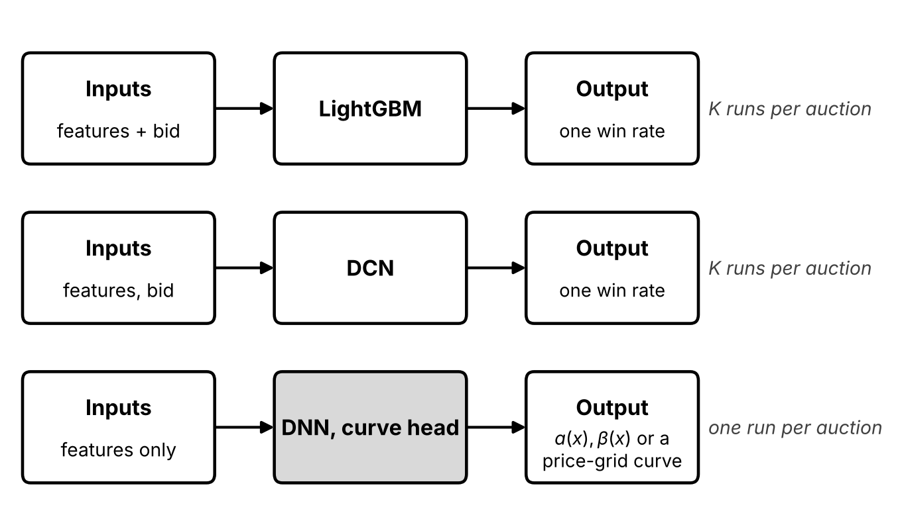

# Win Rate and Bid Shading {#sec-win-rate-and-bid-shading}

In @sec-from-predictions-to-bids, we built a pricing equation that ends with one step: shading the media value into a bid. That step needs a model of the auction itself, the chance that a given bid wins. Most of this book is about predicting what a user will do after seeing an ad. This chapter is about predicting what everyone else in the auction will do, which turns out to be just as important for making money.

In this chapter, we will build that model. We start with why shading matters in first-price auctions, define the win rate curve, and choose the features and labels for a win model. We then cover what wins, losses, and minimum-bid-to-win reports tell us, simple shading heuristics, and a progression of model forms from LightGBM to DNNs that predict the whole curve in one pass. Finally, we connect the win model to pacing, show how to explore the bid landscape safely, and spend a full section on the winner's curse, the reason a calibrated DSP can still lose money on the impressions it wins. Throughout the chapter, we assume first-price auctions, as a new DSP would face today.

## Why Bid Shading Matters

In a first-price auction, the winner pays its own bid. As we saw in @sec-the-auction-lifecycle, most mobile in-app supply now runs this way, because mediation platforms moved from waterfalls to in-app bidding, where each demand source submits one price. Bidding the full value of an impression in a first-price auction wins often, but leaves no surplus for the advertiser or the DSP. **Bid shading** lowers the bid, trading some chance of winning for a lower price.

The shading step from @sec-from-predictions-to-bids chooses the bid that maximizes expected surplus:

$$b^* = \arg\max_b\; (v_m - b) \times W(b \mid x)$$

Here, $v_m$ is the **media value** of the impression, what it's worth to the DSP after calibration, pacing, margin, and fees, and $W(b \mid x)$ is the **win rate**, the probability that a bid of $b$ wins the auction for a request with features $x$. Everything in this chapter is about estimating $W$ well and using it carefully. Win-rate-based shading of this form is well documented in the literature. For example, a team at Verizon Media described a win-rate shading algorithm that explicitly maximizes surplus, and reported that it captured more surplus than a sell-side shading service.[^c25-pan]

[^c25-pan]: Shengjun Pan, Brendan Kitts, Tian Zhou, Hao He, Bharatbhushan Shetty, Aaron Flores, Djordje Gligorijevic, Junwei Pan, Tingyu Mao, San Gultekin, and Jianlong Zhang, "Bid Shading by Win-Rate Estimation and Surplus Maximization," AdKDD, 2020, <https://arxiv.org/abs/2009.09259>

### Where Second-Price Auctions Still Appear

Second-price auctions, where the winner pays the second-highest bid, were common in early programmatic advertising, and bidding the full value is optimal in them. A new DSP will rarely see them on the open market today. They still come up inside companies that run both a DSP and an exchange or mediation platform. When the company's own demand competes in its own auction, the internal pricing rule can differ from what outside bidders face, and the internal bidder may effectively pay the second price or a floor. A few exchanges also run hybrid rules, such as soft floors. The auction type is sent in the bid request (the OpenRTB `at` field), and the pricing logic bids the full media value whenever it says second price.

## The Bid Landscape and Win Rate Curves

For a given request, the win rate curve $W(b \mid x)$ rises from zero for very low bids to nearly one for very high bids. Its shape depends on how many other buyers want the impression and how much they value it, which varies widely by supply, geography, device, and user. The set of these curves across all requests is often called the **bid landscape**.[^c25-rtbmono]

A useful parametric form is the log-logistic curve:

$$W(b \mid x) = \sigma\big(a(x) + \beta(x)\ln b\big), \qquad \beta(x) > 0$$

Here, $\sigma$ is the logistic function, and $a(x)$ and $\beta(x)$ are predicted for each request. The median price, where the bid wins half the time, is $\exp(-a/\beta)$, and $1/\beta$ controls how spread out the competing bids are. The form is monotone in the bid by construction, and it makes the optimal bid easy to compute, as we show later in the chapter. @fig-c25-curves shows how different these curves can be.

{#fig-c25-curves width="100%"}

[^c25-rtbmono]: Jun Wang, Weinan Zhang, and Shuai Yuan, "Display Advertising with Real-Time Bidding (RTB) and Behavioural Targeting," *Foundations and Trends in Information Retrieval*, 2017, <https://arxiv.org/abs/1610.03013>. Chapter 6 covers bid landscape forecasting.

### The Label Is the Win

We train the win model on the **win notice**, the exchange's signal that our bid won the auction. A win is the event that the auction controls, and it's available for every bid within seconds. As we discussed in @sec-the-auction-lifecycle, winning is not showing: a won impression may never be billed if the ad expires in the cache, fails to render, or the mediation layer shows another source. That's why we model the **clear rate**, the share of wins that become billable impressions, separately. For pacing and spend forecasts, we multiply the two:

$$P(\text{billed} \mid b, x) = W(b \mid x) \times p_{clear}(x)$$

Keeping the two apart keeps the win model about the auction, and lets the clear rate be tracked as an operational metric, since sudden changes in it usually mean a rendering or integration problem rather than a change in competition.

## Features for the Win Model

The win model estimates what the other bidders will pay. The right features are therefore the ones that other bidders use to price the impression, not the ones that describe what we plan to show. @tbl-c25-features lists the main groups.

| Group | Examples | Why |
|---|---|---|
| Supply | Exchange, publisher app, placement type, ad format, floor | Supply drives competition and floor prices |
| Geography and time | Country, region, hour, day of week | Demand and budgets vary by market and time |
| Device | Device model, OS version, connection type, device price tier | Proxies for user value that every bidder sees |
| Device profile | Known installed apps and categories, prior spending behavior, recent ad activity, sessions | Other DSPs bid on the same signals, so they predict competition |
| Market history | Our recent win rate, and the distribution of reported minimum bids to win for the segment | Summaries of what the market has paid recently |
| Our bid | The candidate bid, as $\ln b$ and as a ratio to the floor | The variable the curve is a function of |

: Feature groups for the win model. {#tbl-c25-features}

Two groups are deliberately left out. Advertiser, campaign, and creative features don't belong in the win model. What we choose to show doesn't change how valuable the impression is to other advertisers, so it doesn't change what they bid. Those features belong in the value models, which estimate what the impression is worth to our advertiser. Leaving them out also lets one win model serve every campaign in the internal auction.

The second group is anything from this auction's outcome. The minimum bid to win reported after an auction is a strong signal about that segment, but it doesn't exist at bid time. It can be used as a label, which we cover next, or as a lagged aggregate feature, such as the median reported minimum bid to win for the same exchange, publisher, and country over the last hour. Using the current auction's value as a feature is leakage.

Features built from our own past bids need extra care. On a DSP team I worked on, we had a `clearing_price` feature that recorded how much we had been willing to bid for a device the last time we served it. It was useful, until a small experiment introduced false positive labels into training data. The models bid higher on the affected devices, which raised the feature, which raised the bids, in what I described at the time as a tail-spin effect. We removed the feature and replaced it with features built from the minimum bid to win values in auction callbacks, which describe the market rather than our own behavior.[^c25-incidents] @sec-monitoring-and-parity covers how to watch for this kind of feedback loop.

The device profile features also deserve a note. Including installed apps or prior spending in the win model may seem like overreach for a model of the auction, but competitors use the same signals to bid. A device with a history of purchases in strategy games will draw high bids from every DSP running strategy campaigns, and the win model should know that. It also means that the win model learns how much the market values a user, which we use later to address the winner's curse.

[^c25-incidents]: Ben Weber, "Machine Learning Incidents in AdTech," *Towards Data Science*, January 29, 2025, <https://medium.com/data-science/machine-learning-incidents-in-adtech-e3f48d858054>

## Wins, Losses, and the Minimum Bid to Win

In a first-price auction, a bid of $b$ wins if it beats the highest competing bid, including any floor. Let $H$ be that highest competing price, with distribution $F(h \mid x) = P(H < h \mid x)$. Then the win rate is $W(b \mid x) = F(b \mid x)$, and each auction tells us something about $H$, as shown in @tbl-c25-outcomes.

| Outcome | What it tells us about $H$ |
|---|---|
| Win | $H < b$ |
| Loss | $H \ge b$ |
| Minimum bid to win reported | $H = m$, the reported value |

: What each auction outcome tells us about the highest competing price. {#tbl-c25-outcomes}

Wins and losses are **censored** observations. They tell us whether $H$ was above or below our bid, but not its value. A reported minimum bid to win is an exact observation, when it can be trusted. The likelihood for a model of $F$ combines all three:

$$\log L = \sum_{\text{wins}} \log F(b_i \mid x_i) + \sum_{\text{losses}} \log\big(1 - F(b_i \mid x_i)\big) + \lambda \sum_{\text{reported}} \log f(m_i \mid x_i)$$

where $f$ is the density of $H$, and $\lambda \in [0, 1]$ sets how much weight the reported values get. With only the first two terms, this is ordinary logistic regression on the win label, with the bid as an input. The third term adds information where exchanges report the price. Learning winning prices from censored data has a long history in real-time bidding research, from censored regression approaches to mixture density networks.[^c25-censored]

[^c25-censored]: Wush Chi-Hsuan Wu, Mi-Yen Yeh, and Ming-Syan Chen, "Predicting Winning Price in Real Time Bidding with Censored Data," KDD, 2015; and Aritra Ghosh et al., "Scalable Bid Landscape Forecasting in Real-time Bidding," <https://arxiv.org/abs/2001.06587>

### How Much to Trust Reported Minimum Bids

Minimum-bid-to-win reports are valuable but uneven. Exchanges define them differently: some include fees or floors, some round them, many send them only on losses or only for some auctions, and an exchange has some incentive to report values on the high side. A practical approach has three parts:

1. **Check each exchange.** Compare the reported values against the win model's predicted median price for the same requests. Exchanges whose reports are consistently biased or noisy get a low weight $\lambda$, or none.
2. **Use them as lagged features.** Recent quantiles of reported values by segment are useful features, even when the individual values aren't trusted as labels.
3. **Watch for drift.** A sudden change in an exchange's reported values relative to predictions usually means a change in its floors or its reporting, which is worth knowing either way.

## Bid Shading Heuristics

Before a win model exists, or as a fallback when it's unavailable, a DSP needs a simpler rule. @tbl-c25-heuristics compares the common ones.

| Heuristic | Rule | Strengths | Weaknesses |
|---|---|---|---|
| Truthful | $b = v_m$ | No model needed | Pays the full value in first-price auctions |
| Fixed factor | $b = k_e v_m$ per exchange, such as $k_e = 0.85$ | Simple, easy to tune from win price analysis | Ignores how competition varies across requests |
| Target win rate | Choose $b$ so that $W(b) = w^*$, such as 50% | Stable delivery, easy to explain | Ignores value, so it overpays on low-value requests |
| Median price | Bid the predicted median clearing price when it's below $v_m$ | Uses the market directly | Wins only half the time, even when surplus is large |

: Bid shading heuristics. {#tbl-c25-heuristics}

The target win rate rule is common in self-serve platforms where the advertiser sets a target CPM, because it keeps delivery predictable. For performance goals, the value-based shading below does better, because it bids more aggressively where the surplus is large and less where it's small. In my experience, a fixed factor per exchange is a perfectly reasonable place for a new DSP to start. It's easy to explain, and it gives you a baseline to beat.

## Model Forms

The win model is a function of both the request and the bid, and the bid varies for every candidate we consider. How the model treats the bid determines how many times it has to run per auction. @fig-c25-forms compares three options.

{#fig-c25-forms width="100%"}

### LightGBM with the Bid as a Feature

The simplest strong baseline is a gradient-boosted classifier on the win label, with $\ln b$ and $b/\text{floor}$ as features alongside the request features. Two settings matter:

- **A monotone constraint on the bid.** Without it, the model can learn a win rate that falls as the bid rises, or that is jagged between the bid levels in the training data, and either breaks the search for the best bid. LightGBM supports monotone constraints per feature.[^c25-lgbm]
- **A grid of candidate bids.** Because the bid is an input, the model runs once per candidate. A grid of 10 to 20 multipliers of the media value, from about 0.3 to 1.0, is usually enough, followed by choosing the grid point with the highest expected surplus. On a fast tree model this is affordable, but it multiplies inference cost by the grid size.

[^c25-lgbm]: LightGBM documentation, "Parameters: monotone_constraints," <https://lightgbm.readthedocs.io/en/latest/Parameters.html>

### DCN

A deep and cross network, which we cover in @sec-conversion-prediction, learns interactions between features explicitly, including interactions between the bid and the supply, device, and profile features.[^c25-dcn] This captures the fact that the curve's slope differs across segments, which trees approximate only with many splits. It still takes the bid as an input, so it shares the cost of running once per candidate bid.

[^c25-dcn]: Ruoxi Wang, Bin Fu, Gang Fu, and Mingliang Wang, "Deep & Cross Network for Ad Click Predictions," AdKDD, 2017; and Ruoxi Wang et al., "DCN V2: Improved Deep & Cross Network and Practical Lessons for Web-scale Learning to Rank Systems," WWW, 2021.

### Predicting the Whole Curve in One Pass

The most efficient form moves the bid out of the input and predicts the curve itself. The network reads only the request features and outputs a description of $W$ for every price. Two output heads work well.

A **parametric head** outputs $a(x)$ and $\beta(x)$ for the log-logistic curve, with $\beta$ kept positive through a softplus. Any bid's win rate is then one formula, and the best bid has a closed-form condition, shown in the next section.

A **price-grid head** outputs the win rate at a fixed set of prices $p_1 < p_2 < \dots < p_K$, kept monotone by building it from positive increments:

$$W(p_j \mid x) = \sum_{i \le j} \text{softmax}\big(z(x)\big)_i$$

where $z(x)$ is a vector of $K + 1$ outputs, with the last entry representing prices above $p_K$. Win rates between grid points are interpolated. This head can represent curves with unusual shapes, such as a jump at a common floor, which the parametric form can't. Predicting the full price distribution with a deep model is also an established line of research.[^c25-dlf]

Both heads train on the same likelihood as above. For a win or loss at bid $b$, the predicted $W(b)$ enters a binary cross-entropy loss, and for a reported minimum bid to win, the predicted density at that price adds the third term. Because the model runs once per auction, its cost doesn't depend on how many bids or campaigns are evaluated, which matters when the internal auction prices many campaigns per request.

[^c25-dlf]: Kan Ren, Jiarui Qin, Lei Zheng, Zhengyu Yang, Weinan Zhang, and Yong Yu, "Deep Landscape Forecasting for Real-time Bidding Advertising," KDD, 2019.

## Model-Based Shading

With a win model in hand, the best bid maximizes expected surplus. For the log-logistic form, setting the derivative of $(v_m - b)\,W(b)$ to zero gives a simple condition:

$$b^* = \beta\,(v_m - b^*)\,\big(1 - W(b^*)\big)$$

This has exactly one solution between zero and $v_m$, and a few dozen steps of bisection find it in well under a microsecond. For a price-grid head, evaluate the expected surplus at each grid point and refine between the best point and its neighbors.

Let's make this concrete with the example from @sec-from-predictions-to-bids. The media value is \$4.00 CPM, and the win rate curve has a median of \$3.00 and a spread of $1/\beta = 0.3$. @tbl-c25-example compares three bids.

| Bid | Win rate | Surplus per win | Expected surplus per 1,000 requests | Expected spend per 1,000 requests |
|---|---|---|---|---|
| \$4.00 (truthful) | 72% | \$0.00 | \$0.00 | \$2.89 |
| \$3.00 (median) | 50% | \$1.00 | \$0.50 | \$1.50 |
| \$2.66 (optimal) | 40% | \$1.34 | \$0.54 | \$1.07 |

: Comparing bids for a request with a \$4.00 media value. {#tbl-c25-example}

The optimal bid wins less often than the other two, but it earns the most surplus and spends the least. The clipping rules from @sec-from-predictions-to-bids still apply after shading: the bid never goes below the floor, never above the media value, and never above the campaign's maximum bid.

### Calibrating the Win Model

Because the win rate multiplies directly into the surplus, it has to be calibrated where decisions are made, not just on average. Check reliability by exchange, by publisher tier, and by bid level. The most important check uses the exploration traffic described below. For each exploration multiplier bucket, compare the predicted and observed win rates. If the model is calibrated at the bids it usually makes, but not at higher or lower ones, its slope is wrong, and the shaded bids will be systematically too high or too low.

## Exploring the Bid Landscape Safely

A win model learns how the win rate changes with the bid only from variation in our own bids. If the DSP always bids close to its shaded value, the bid and the request features move together, and the model can't tell an impression that is cheap to win from one that we simply bid high on. The slope of the curve becomes unidentifiable exactly where it matters.

The fix is **bid exploration**. On a small share of requests, such as 5% to 10%, multiply the media value by a random factor before shading, drawn log-uniformly between about 0.6 and 1.5, and log the factor with the bid. This breaks the link between the bid and the features, so the model can learn the slope, as shown in @fig-c25-exploration.

{#fig-c25-exploration width="100%"}

Exploration has a cost, which is small and easy to measure. In the example above, exploring with multipliers between 0.6 and 1.5 lowers expected surplus on the explored requests by about 13%. With 5% of requests explored, that's well under 1% of total surplus. A few practices keep it safe:

- **Bound the multipliers**, so that explored bids stay between the floor and the campaign's maximum bid.
- **Reweight training data**, so that the over-represented usual bid levels don't dominate the fit.
- **Only optimize within the observed range.** Clamp shaded bids to the range of bids seen in training, since the model is extrapolating outside it.
- **Keep it running permanently.** Competition changes, and a model trained without fresh variation drifts.

Manual overbids, which we met in @sec-inside-a-demand-side-platform, are the opposite of this. They also change bids for reasons unrelated to the user, but they aren't random, logged as such, or bounded. Bids raised by an overbid look to the win model like ordinary bids, so it learns a win curve that's shifted by whatever the account managers happened to do that week. If your DSP has overbids, log them as a separate field in the bid ledger, and either exclude those bids from win model training or treat the overbid as a feature.

Exploration has a second use. Because the multiplier changes the chance of winning for reasons unrelated to the user, it also measures the effect of winning an impression on conversions. @sec-incrementality-and-uplift uses it as an instrument for measuring uplift.

## Floors

Floors set by exchanges and mediation platforms carry real information. A mediation floor often reflects what other demand sources have paid for the same placement and user, so it's a strong feature for the win model. The pricing rules are simple. If the media value is at or below the floor, don't bid. If the shaded bid is below the floor, raise it to the floor, which still leaves surplus, because the value is above it. For a parametric win model, the floor also truncates the curve, since bids below it can't win:

$$W(b \mid x) = 0 \quad \text{for } b < \text{floor}$$

Logging the floor with every bid, and every request skipped because of it, lets the DSP see how much of its lost delivery comes from floors rather than from being outbid.

## Pacing with the Win Model

The win model is also the core of spend forecasting. If we know the win rate at the bid we would place for each request, and how many requests a campaign will see, we can predict wins, spend, and conversions for any pacing multiplier before bidding. For a campaign that expects $R$ eligible requests over a period, and a **pacing multiplier** $\gamma$ that scales its values up or down:

$$\hat{N}_{wins}(\gamma) = R\;\mathbb{E}_x\big[W(b^*_\gamma \mid x)\big]$$

$$\hat{S}(\gamma) = R\;\mathbb{E}_x\big[b^*_\gamma\,W(b^*_\gamma \mid x)\,p_{clear}(x)\big]$$

$$\hat{N}_{installs}(\gamma) = R\;\mathbb{E}_x\big[W(b^*_\gamma \mid x)\,p_{clear}(x)\,p_{install}(x)\big]$$

where $b^*_\gamma$ is the shaded bid when the value is scaled by $\gamma$, and the expectations are averages over a recent sample of requests. These are the forecasts that the pacing controllers in @sec-pacing-and-budget-control solve against the remaining budget. @fig-c25-pacing shows them for one campaign.

{#fig-c25-pacing width="100%"}

Two details connect the models. First, the spend elasticity, $\varepsilon = \partial \ln \hat{S} / \partial \ln \gamma$, comes straight from the win model, and sets a stable gain for the pacing controller, $K_p \approx 1/\varepsilon$. For the campaign in the figure, $\varepsilon$ is about 1.2 at $\gamma = 1$. For the single request in the shading example, it's about 2. The campaign's elasticity is lower, because many of its requests sit on flat parts of their win rate curves, where small changes in the bid barely change the win rate. Second, a target win rate can serve as a pacing heuristic of its own, raising bids until the forecast win rate meets a goal, but it ignores value. Pacing on the forecast spend from value-based shading spends the same budget on better impressions.

One caution applies when reading pacing results. When $\gamma$ rises, the campaign wins more on segments that were previously out of reach, which are often cheaper and lower in value. Overall cost per install can then get worse even while it improves within every segment, because the mix of segments changed. This is an example of Simpson's paradox, and it's why pacing changes should be evaluated within segments as well as overall.

## The Winner's Curse

The **winner's curse** is the reason that a DSP with calibrated models can still lose money on the impressions it wins. The idea comes from engineers at Atlantic Richfield, who studied auctions for offshore oil leases in the Gulf of Mexico.[^c25-capen] Every company estimated the oil under the same tract, and the estimates were unbiased on average. But the company with the highest estimate won, and the highest of several unbiased estimates is biased upward. Winners kept finding less oil than they had paid for.

[^c25-capen]: E. C. Capen, R. V. Clapp, and W. M. Campbell, "Competitive Bidding in High-Risk Situations," *Journal of Petroleum Technology*, 1971.

### Why It Applies to DSPs

The value of a user to an advertiser has two parts. A common part is shared across bidders, such as whether this is a real, engaged user who installs and spends. A private part is specific to one advertiser, such as how well the user fits a particular game. Every DSP estimates the common part with some error, and a DSP wins when its estimate is high relative to everyone else's. Its wins therefore concentrate where its own error is positive. The auction keeps handing the DSP its own mistakes.

This is a form of selection bias. It's different from Simpson's paradox, which comes from combining groups with different mixes. The winner's curse comes from looking only at the cases selected by a noisy estimate, which is the same effect as regression to the mean.

The win model itself doesn't suffer from the curse, because it's trained on every bid, won or lost. The curse affects the conversion and value models, whose labels exist only for impressions the DSP won.

### How Large It Is

@tbl-c25-curse shows a simulation where every bidder is calibrated on average, competing DSPs have models with log-noise 0.3, and everyone shades to 80% of their estimate. The last column is $\kappa$, the calibration multiplier, measured on our wins: the realized value divided by the predicted value.

| Competing bidders | Our model's noise | Our win rate | $\kappa$ on wins |
|---|---|---|---|
| 1 | 0.3, as good as theirs | 50% | 0.86 |
| 1 | 0.6, worse | 42% | 0.67 |
| 3 | 0.3 | 25% | 0.75 |
| 3 | 0.6 | 27% | 0.56 |
| 10 | 0.3 | 9% | 0.64 |
| 10 | 0.6 | 17% | 0.48 |

: A simulation of the winner's curse. {#tbl-c25-curse}

Three patterns stand out. The curse grows with the number of bidders, because with more competitors, a DSP only wins when its error is extreme. A worse model can win more often, which is the familiar pattern of a new DSP that spends easily but misses its goals. And wins by a large margin are the worst, as shown in @fig-c25-curse.

{#fig-c25-curse width="100%"}

### How DSPs Can Address It

**Calibrate on wins, not on all requests.** The calibration multiplier $\kappa$ from @sec-from-predictions-to-bids is measured on won impressions, so it already corrects the average curse. A single $\kappa$ per segment isn't enough, though, because the curse depends on how far the bid was above the market.

**Calibrate by margin over the market price.** The win model predicts the market price for each request, the median of $H$. Measure $\kappa$ on wins in buckets of the ratio between our value and that predicted price, and apply the bucket's $\kappa$ in the pricing equation:

$$\kappa(x) = \kappa_{segment} \times \kappa_{margin}\left(\frac{v_m(x)}{\hat{h}_{50}(x)}\right)$$

where $\hat{h}_{50}(x)$ is the predicted median competing price. In the simulation with three competitors and a noisier model, this changes the outcome substantially, as shown in @tbl-c25-correction.

| Correction | Win rate | Surplus per 1,000 requests (simulation units) | $\kappa$ on wins |
|---|---|---|---|
| None | 27% | −188 | 0.56 |
| One $\kappa$ for all wins | 7% | −20 | 0.68 |
| $\kappa$ by margin over the market price | 6% | −2 | 0.78 |

: The effect of calibrating on wins. {#tbl-c25-correction}

The correction stops the losses, but it doesn't create an edge. A DSP whose information is worse than its competitors' can at best break even on contested supply, at much lower volume. That leads to the remaining strategies.

**Use the market price as evidence.** Feed the win model's predicted price, and lagged reported minimum bids to win, into the value models as features. A large gap between our value and the market price is a reason to doubt our value, and the value model can learn how much.

**Bid conservatively where uncertain.** Where the value model is uncertain, bid on a lower quantile of value instead of its mean. Keep optimistic bidding for exploration and new campaigns, where the cost is bounded and the goal is learning.

**Compete where you know more.** Map the information advantage by segment, comparing $\kappa$ on wins across exchanges, regions, verticals, and user types. A low $\kappa$ on wins means the DSP is losing the information battle there, and it should bid less or stop. Values close to 1 mean it knows as much as its competitors or more, and spend should concentrate there.

**Add information others don't have.** The curse acts on the common part of value. It weakens wherever the DSP knows something its competitors don't, such as first-party data in retargeting, context from its own supply, bid-stream sequence models (@sec-sequences-and-transformers), or verticals where competitors' models are weaker. The private part of value, how well a user fits our advertiser, isn't subject to the curse at all.

## Conclusion

The win model turns the media value into a price. In this chapter, we trained it on win notices, with features that describe what other bidders see, including the supply, the device, and the device profile, and left out features about what we plan to show. Wins and losses are censored observations of the highest competing price, and reported minimum bids to win add exact observations when an exchange can be trusted. We moved from LightGBM with the bid as a feature, to DCN, to DNNs that predict the whole win rate curve in one pass, and used the curve to find the bid that maximizes expected surplus. Exploration keeps the curve's slope learnable, the same curve forecasts wins and spend for pacing, and the winner's curse explains why value models need calibration by margin over the market price, and why a DSP should concentrate where its information is better than its competitors'.

In the next chapter, we turn from pricing to choosing which campaigns to consider for a request at all.
