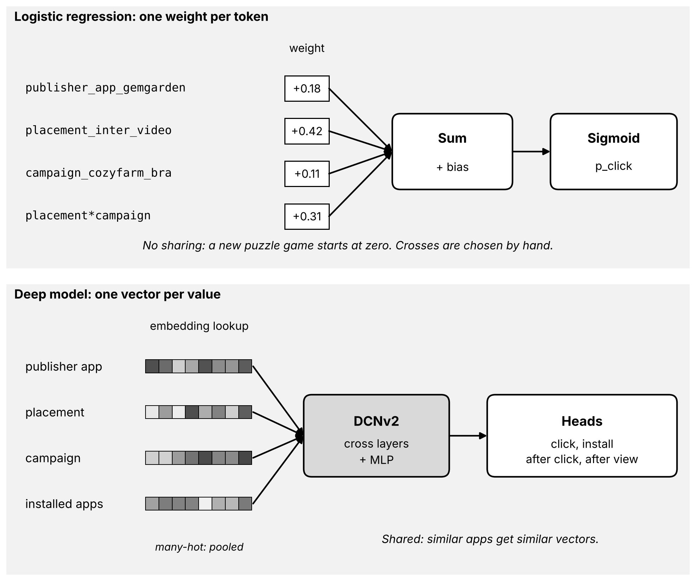
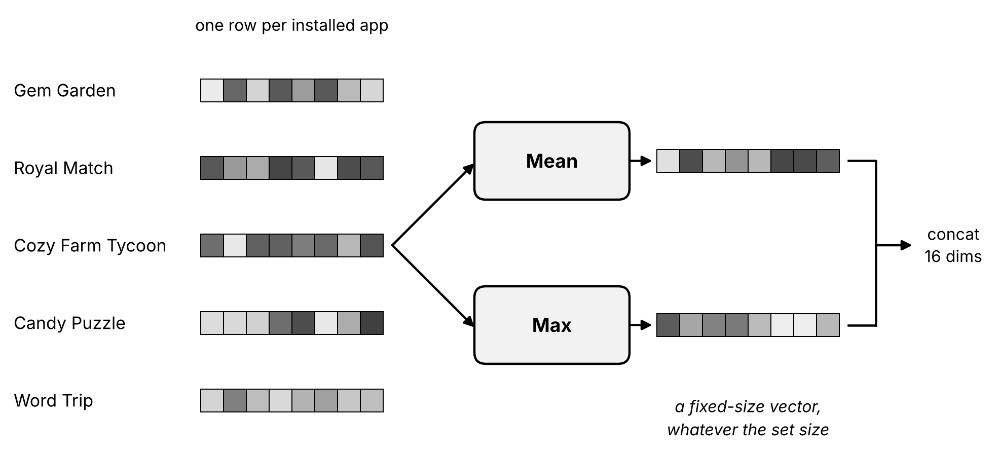
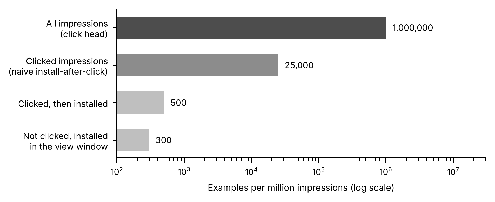
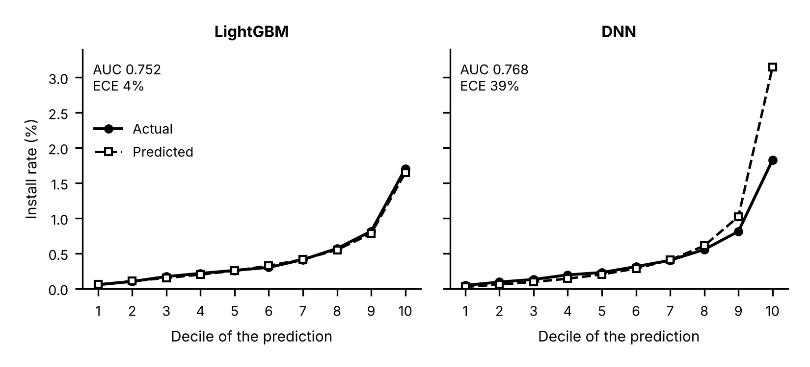

# Deep Models with Embeddings {#sec-deep-models-with-embeddings}

The first thing deep models add to a DSP is the embedding: a learned vector for each value of a categorical feature, such as each publisher app, device model, campaign, or creative. Where logistic regression had one weight per value and LightGBM could only group values together, an embedding places every value in a shared space, where values that behave alike end up close together. A new puzzle game that attracts the same players as Gem Garden can borrow what the model learned about Gem Garden, without a single hand-built feature saying they're related.

Embeddings are also where most of the practical problems with deep models in a DSP start. Vocabularies have to be built, versioned, and kept in sync between training and serving. Embedding rows that never see training data keep their random initial values. And deep models trained on sparse, downsampled conversion data are hard to calibrate.

In this chapter, we will build deep models with embeddings: embedding tables and the DeepFM and DCNv2 architectures, pooling for many-hot fields, vocabularies and out-of-vocab handling, and multi-task heads for clicks, installs, and purchases trained over every impression. We then cover the checks that catch bad embeddings, how to calibrate deep models, and content embeddings that give new apps and creatives a useful representation before they have any traffic.

## From One Weight to One Vector

The click model in @sec-a-click-model learned one weight per token. It's worth being precise about what that can't do, because each limitation is something an embedding fixes.[^c26-transformers]

- **No sharing between related values.** The weight for Gem Garden says nothing about another puzzle game. Every publisher, campaign, and cross learns from its own data, so new and small values are poorly estimated.
- **Crosses are built by hand.** People decide which pairs matter, the number of pairs grows quickly as fields are added, and interactions no one thought of are never learned.
- **No memory of the device,** beyond a few counters computed in the bidder.

Factorization machines were the first step past these limits. They give each value a small vector and model the interaction between two values as the dot product of their vectors, so every pair has an interaction term without being built by hand, and related values share information through their vectors. Learning a vector for each value is the idea that the rest of this chapter builds on. @fig-c26-onehot shows the difference.

{#fig-c26-onehot width="100%" fig-alt="Two panels. Logistic regression sums one weight per token, such as the publisher app or placement, then applies a sigmoid, with no sharing between values. A deep model looks up an embedding vector for each value, pools installed apps, and passes them through DCNv2 to click and install heads."}

In my own experiments on a public click dataset, a small neural network with embedding layers improved on a logistic regression model built from tokens and crosses, on log loss, ROC AUC, and especially precision-recall AUC, but its calibration was worse.[^c26-click] Both results recur throughout this chapter. Embeddings help most when there are many high-cardinality fields, which is exactly the situation in a DSP, where publisher app, device model, campaign, and creative each have thousands to hundreds of thousands of values. And calibration needs its own treatment.

## Embeddings, DeepFM, and DCNv2

An **embedding table** for a categorical field is a matrix with one row per value in the field's vocabulary, typically with 16 to 64 columns. The model looks up the row for each value, and the rows are learned during training like any other weights. A field with 100,000 publisher apps and 32 dimensions has 3.2 million parameters, which is large, but far smaller than the crosses a linear model needs to capture the same relationships.

Embeddings alone don't model interactions. Most ad ranking networks combine them with an architecture that does:

- **Wide & Deep** combines a linear model on sparse features with an MLP on embeddings.
- **DeepFM** adds a factorization machine, which models every pairwise interaction between fields as the dot product of their embeddings, alongside an MLP. It's the natural successor to the hand-built crosses of @sec-a-click-model, learned rather than chosen.
- **DCN and DCNv2** (Deep & Cross Networks) add **cross layers**, which compute explicit feature interactions of increasing order, layer by layer, next to an MLP.[^c26-dcn]

A cross layer in DCNv2 computes $x_{l+1} = x_0 \odot (W_l x_l + b_l) + x_l$, where $x_0$ is the concatenated input embeddings and $\odot$ is element-wise multiplication. Two or three cross layers capture most of the useful interactions cheaply. In practice, DCNv2 is a strong default for conversion prediction in ad tech, and it's what the reference DSP uses.

A few choices come up for every field:

- **Embedding size.** Small fields, such as connection type, need only 4 to 8 dimensions. High-cardinality fields, such as publisher app and campaign, use 16 to 64. A common rule of thumb is a size proportional to the fourth root of the vocabulary size, rounded up to a multiple of 8, and the exact value matters less than keeping the total input width manageable.
- **Numeric fields.** Standardize them and pass them in directly, or bucket them and embed the buckets like a categorical. Embedding the buckets lets the model learn a nonlinear effect for each feature, such as the bid floor's effect on win rates, without any extra work.
- **Shared tables.** The same app appears in several fields: as the publisher app, as the advertised app, and in a device's installed apps. Using one embedding table for all of them puts the three roles in the same space, so the model can relate them directly. We rely on this in @sec-sequences-and-transformers.

Here's what the parameter budget looks like for a typical DSP model. With 200,000 apps at 32 dimensions in one shared table, 50,000 device models at 16, 5,000 campaigns at 32, and 30,000 creatives at 16, the embeddings hold about 7.8 million parameters. Two cross layers and a 512-256 MLP over a 400-wide input add about 0.7 million. Almost all of the model is in the embedding tables, which is why they need the most care: vocabularies, OOV handling, and checks for rows that never trained.

## Pooling Many-Hot Fields

Many of the best features are sets: the apps a device was seen in, the genres of its installed games, or the categories of a publisher app. Each member has an embedding, and the set has to become one fixed-size vector. That's **pooling**:

- **Mean pooling** averages the members' embeddings. It's stable for sets of different sizes, and it's the usual default.
- **Sum pooling** adds them, which preserves information about the size of the set, at the cost of scale differences between small and large sets.
- **Max pooling** takes the element-wise maximum, which highlights the strongest signal in the set.
- **Combined pooling** concatenates two or more of these, which is cheap and often helps.

Mean and max pooling together is a good default. Mean summarizes the overall profile, such as the average of a device's installed genres, and max keeps a single rare but informative value from being averaged away. @fig-c26-pooling shows the idea for a device's installed apps.

{#fig-c26-pooling width="100%" fig-alt="The embeddings of five installed apps are pooled with a mean and a max, and the two results are concatenated into one fixed-size 16-dimension vector, whatever the number of apps."}

Pooling treats a set as unordered, which is right for sets and wrong for sequences. When order and recency matter, as they do for device histories, the model needs attention, which we cover in @sec-sequences-and-transformers.

## Vocabularies, Out-of-Vocab Handling, and Versioning

Every embedding table needs a **vocabulary**: a mapping from each string value to a row. As we set up in @sec-logging-at-bid-time, the vocabulary belongs to the model, not to the log, and ships in the model's bundle.

- **Build vocabularies from training data,** keeping values seen at least a minimum number of times, such as 100. Rarer values share an **out-of-vocab (OOV)** row, which learns what a rare value looks like in general.
- **Reserve index 0 for padding,** with no meaning, so empty sets and lists can be padded without claiming a real value. The padding incident in @sec-logging-at-bid-time is why.
- **Hash very high-cardinality fields** instead of building a vocabulary, using several hash functions or buckets to reduce collisions.
- **Version vocabularies with the model.** A retrain that rebuilds the vocabulary assigns different rows to the same values, so a model can only be served with the vocabulary it was trained with.
- **Monitor OOV rates** by field in serving. A rising OOV rate means the world has moved past the model's vocabulary, such as a wave of new apps, and it's a reason to retrain.

## Multi-Task Heads

A DSP needs several predictions for every impression: a click, an install after a click, an install after a view, and, for value goals, purchases. In Part III, each was a separate LightGBM model. Deep models make it natural to predict them all from one shared base, with a separate **head** for each prediction. The shared base learns from every label, so a rare label, such as purchases, benefits from the representation learned from a common one, such as clicks. How the heads are trained is where most of the subtlety is.

Recall the install equation from @sec-from-clicks-to-installs-and-purchases:

$$P(\text{install}) = p_{\text{click}} \cdot p_{\text{install} \mid \text{click}} + (1 - p_{\text{click}}) \cdot p_{\text{install} \mid \text{view}}$$

The two paths behave differently. Click-through installs depend heavily on the creative and placement, and view-through installs depend more on the device's existing intent. View-through installs are also where impression spamming and attribution fraud show up. So it's worth keeping the three quantities separate, and calibrating and monitoring each path on its own, even when they share a model.

### Three Ways to Set Up the Training

@fig-c26-multitask shows three ways to train models for the three terms.

{#fig-c26-multitask width="100%" fig-alt="Three setups for click and install prediction: separate models trained on different slices of impressions; shared towers with heads for click, install after click, and install after view; and an entire-space model where every loss is computed over all impressions."}

**Separate models,** each trained on the impressions where its term applies, are where most teams start, because it's the obvious reading of the equation: train the click model on everything, and train the install-after-click model on just the clicked impressions, since that's what the term is conditioned on. The install-after-view model trains on the impressions without a click. Each model is simple, and each can be a LightGBM model like the ones in Part III.

This works, and it's a reasonable baseline, but it has two problems that get worse as models get larger.

The first is **data sparsity**. @fig-c26-subsets shows the training data per million impressions for a typical interstitial campaign. The click model gets a million examples. The install-after-click model gets 25,000, of which 500 are positives. A deep model with millions of embedding parameters can't learn much from 500 positives, and the embedding rows for most publishers and device models never see a clicked impression at all.

{#fig-c26-subsets width="100%" fig-alt="Horizontal bars on a log scale of training examples per million impressions: 1,000,000 for the click head, 25,000 clicked impressions, 500 clicks that installed, and 300 installs without a click."}

The second is **sample selection bias**. The install-after-click model is trained on clicked impressions, but at bid time it's applied to every candidate impression, most of which would never be clicked. Clicked impressions aren't a random sample. They're over-represented in placements with accidental clicks, in creatives with misleading hooks, and in devices that click a lot. A model trained only on them learns what installs look like among clickers, and its predictions for the typical impression, which is unlike anything it trained on, are extrapolations.

**Shared towers with conditional heads** fix the first problem, because the towers learn from every label and the install heads reuse a representation learned from all impressions. But each install head still computes its loss only on its slice, so the second problem remains.

The **entire space multi-task model** (ESMM) fixes both.[^c26-esmm] Every head still predicts its conditional probability, but every loss is defined over all impressions:

- The **click head** predicts $p_{\text{click}}$, with its loss on $p_{\text{click}}$ and the click as its label.
- The **install-after-click head** predicts $p_{\text{install} \mid \text{click}}$, with its loss applied to $p_{\text{click}} \times p_{\text{install} \mid \text{click}}$, and the label "clicked and then installed".
- The **install-after-view head** predicts $p_{\text{install} \mid \text{view}}$, with its loss applied to $(1 - p_{\text{click}}) \times p_{\text{install} \mid \text{view}}$, and the label "installed without clicking, inside the view window".

The install-after-click head now receives gradient from every impression, weighted by how likely the click head thinks a click is, and it never has to train on the biased set of clicked impressions alone. Because the products are the quantities that are observed for every impression, the model is trained on exactly the distribution it's applied to. And the conditional heads remain available for monitoring each path separately.

A purchase head is added the same way, multiplying through the funnel: its loss is applied to the predicted probability of an install from either path times $p_{\text{purchase} \mid \text{install}}$, over all impressions. Day-7 retention and predicted SKAN conversion value fit the same pattern.

### Practical Details

- **Loss weights.** Rare labels produce small gradients, so the model can end up learning only the click head. Weight the losses for rare labels up, and check each head's normalized entropy separately as the weights change.
- **Masked losses for immature labels.** An impression from yesterday may still install. Mask the install and purchase losses for impressions whose windows haven't closed, and keep the click loss, which matures in minutes.
- **Conflicting tasks.** When tasks pull the shared base in different directions, such as clicks and purchases, which reward different devices, a single shared bottom can hurt the weaker task. **Mixture-of-experts** designs such as MMoE give each task its own learned mix of several shared expert networks,[^c26-mmoe] and PLE adds experts that belong to a single task. Snap describes using both for predicting several conversion events jointly.[^c26-snap] Start with a shared bottom, and move to experts if one head gets worse when the others are added.
- **Downsampling.** Keep every positive and a fraction of negatives, and weight the negatives by one over the sampling rate in the loss, so the outputs stay on the original scale. With several heads, downsample on the rarest positive label you care about, so no head loses its positives.

### Jointly Trained Embedding Models

The same structure works for an embedding model trained jointly with a conversion model. One design trains a device embedding model, with transformer and DCNv2 layers, together with a multi-task conversion model, as one composite network, and then exports the two separately. The embedding model is scored in batch, and the conversion model serves online on the precomputed embedding, so each can retrain on its own cadence.[^c26-pyspark] We use that split in @sec-serving-deep-models.

## Training a Deep Conversion Model

A few details decide whether a deep conversion model trains well on DSP data:

- **Optimizers.** Use Adam for the dense layers, and a sparse optimizer, such as sparse Adam or Adagrad, for the embedding tables, so each step only updates the rows present in the batch. With millions of rows, a dense update of every row on every step is both slow and wrong, since rows that weren't in the batch get pulled by momentum alone.
- **Large batches and a warmup.** Batches of 4,096 to 16,384 examples keep the GPU busy and give stable gradients for rare labels. Warm up the learning rate over the first few thousand steps, then decay it.
- **One or two epochs.** Ad data is huge and nonstationary. A model trained for many epochs on the same days memorizes them, and it gets more overconfident, which shows up as worse calibration. Most production models pass over each example once or twice.
- **Out-of-time validation and early stopping.** Train on earlier days, validate on a later day, and stop when the validation log loss stops improving, as in @sec-offline-evaluation-and-model-iteration.
- **Exploration in the training data.** Attributed impressions only cover auctions the current model chose to win. Keep the randomized bids and selections from earlier parts in the training data, so the data doesn't narrow around the model's own decisions.
- **Fixed seeds and comparisons across runs.** Deep models vary more between training runs than trees do. Train two seeds of every candidate before trusting a small offline gain, using the stability checks from @sec-offline-evaluation-and-model-iteration.

## Checks on Weights and Embeddings

Deep models fail in ways tree models don't. The most instructive example I know of is untrained embeddings. On a team I worked on, many deployed click and install models were poorly calibrated, and the miscalibration was worst on categorical features with sparse training data. The cause was embedding rows with no training examples: their weights never received an update, so they kept their random initial values, and live predictions for those values were essentially random. It happened because one vocabulary was shared across a click model and an install model, and the install model's smaller dataset didn't cover all of it.[^c26-incidents]

A few checks catch this and its relatives:

- **Compare weights before and after training.** Any embedding row whose weights didn't change got no gradient. Zero them, or map their values to OOV, before the model is published.
- **Don't reuse vocabularies across tasks** trained on different data. Build each model's vocabulary from its own training data.
- **Check embedding norms.** Rows with unusually large or small norms, compared with others of similar frequency, often point to rare values the model overfit or never learned.
- **Compare models across training runs.** The same tooling that compares weights within a run can compare runs, which helps explain models with similar offline metrics but different live behavior.

## Calibrating Deep Models

Deep models are often worse calibrated than trees, and this is the main reason they don't set bids directly in this book's designs. @fig-c26-calibration shows the typical pattern, on install prediction. The DNN ranks impressions better than LightGBM, with an AUC of 0.768 against 0.752, so on ranking metrics alone it looks like the better model. But its calibration plot fans out: it predicts too few installs in the low deciles and far too many in the top decile. Its expected calibration error is about ten times the LightGBM model's.

{#fig-c26-calibration width="100%" fig-alt="Two calibration plots of install rate by decile on the same impressions. LightGBM has AUC 0.752 and is well calibrated, with ECE of 4%. The DNN has a higher AUC of 0.768 but overpredicts sharply in the top decile, with ECE of 39%."}

Here, the **expected calibration error** (ECE) is the average absolute gap between the predicted and actual rates across the deciles, divided by the overall rate, so 4% means the model is off by 4% of the base rate in a typical decile. It's a rougher measure than log loss, but it answers the question that matters for bidding: by how much would bids be wrong?

The pattern in the figure is the worst kind for a DSP. The top decile is where the bidder bids highest and wins most often, so an overconfident model overpays on exactly the impressions it buys most. Bidding on the DNN's output would mean a campaign that looks great on AUC and misses its CPI target from the first day.

There are several reasons deep models end up like this:

- **Overconfidence.** Deep networks trained with log loss are often overconfident, especially large networks trained for many epochs.[^c26-guo]
- **Products of heads.** The install probability is a product of two or three heads, and small errors in each head compound.
- **Downsampling.** Negative downsampling and the weights that correct for it are easy to get slightly wrong, and a small error shifts every prediction.
- **Rare embedding rows.** Rows for rare values fit noise, which pushes their predictions toward the extremes.
- **Up-weighted losses.** Losses for rare labels that are weighted up shift those heads' outputs upward.

The standard fixes still apply. Correct for downsampling first. Then fit a calibration step on held-out data that the model didn't train on:

- **Temperature scaling** divides the logits by a single learned constant. It fixes the fan shape in @fig-c26-calibration, overconfidence across the whole range, with one parameter, and it doesn't change the ranking.
- **Platt scaling** fits a logistic regression on the logit, which adds a shift to the temperature.
- **Isotonic regression** fits a monotone step function, which can fix any shape, and needs more data.

Fit these per segment where the model is consistently off, such as by exchange, placement type, and platform, and check the calibration of each head and of the products, not only of the final install probability.

For a DSP, the most robust fix is to not let the deep model set the price at all. In Design A, its outputs are features for LightGBM, which makes the calibrated prediction. In Design B, a LightGBM layer calibrates the deep model's scores before they're used. Either way, a calibrated tree model sits between the deep model and the bid, and it's retrained often enough to follow the market. We build both in @sec-sequences-and-transformers.

## Content Embeddings for Cold Start

An embedding learned from traffic only exists for values that have traffic. A new app, campaign, or creative starts with the OOV row. **Content embeddings** fix this, by computing a representation from what the item is, rather than from how it has performed:

- **Apps:** embed the app store description, screenshots, and metadata with a language model or vision-language model. I've used BERT embeddings of app store descriptions for advertiser and publisher apps, which gave every app a useful representation, including brand new apps with no history.
- **Creatives:** embed video frames, end cards, and text, as we'll do in @sec-personalized-creative-selection.
- **Co-occurrence embeddings:** embed apps by which apps are installed together, such as GloVe trained on device app lists, then cluster them with k-means and use the cluster IDs as categorical features in a classic model.

Content embeddings matter beyond cold start. Meta's LLaTTE work found that content embeddings were a prerequisite for the steeper scaling curves of its sequence models, which we look at in the next chapter.[^c26-llatte]

::: {.callout-tip title="Try it on the simulator"}
Train a multi-task DCNv2 model with click, install-after-click, and install-after-view heads on simulated impressions. Find the embedding rows that never changed during training, and compare the model's calibration with and without zeroing them. Then compare its calibration with the LightGBM models from Part III, against the true rates.

*Status: the simulator already produces the data for this exercise (adsim 0.3). The companion code and exact commands are in progress.*

:::

## Conclusion

In this chapter, we built deep models with embeddings. Embedding tables give every categorical value a learned vector, DeepFM and DCNv2 learn feature interactions on top of them, and pooling turns sets into fixed vectors. Vocabularies belong to models, with OOV and padding rows and monitored OOV rates. Multi-task heads share a base and, with ESMM, train over every impression, which avoids the sparsity and selection bias of training install models only on clicks. Checks on weights catch untrained embedding rows, calibration is handled by keeping a calibrated tree model between the deep model and the bid, and content embeddings give new items a representation before they have traffic.

Pooling treats a device's history as a set. The next chapter models it as a sequence and pretrains on the much larger non-attributed data.

[^c26-dcn]: Ruoxi Wang, Bin Fu, Gang Fu, and Mingliang Wang, "Deep & Cross Network for Ad Click Predictions," AdKDD, 2017; and Ruoxi Wang et al., "DCN V2: Improved Deep & Cross Network and Practical Lessons for Web-scale Learning to Rank Systems," WWW, 2021.

[^c26-transformers]: Ben Weber, "Transformers for Mobile User Acquisition," *AI Advances*, November 2026, <https://medium.com/ai-advances/transformers-for-mobile-user-acquisition-f3816d8b0c41>

[^c26-pyspark]: Ben Weber, "Using DNN Embedding Models in PySpark at AdTech Scale," *Data Science Collective*, May 2026, <https://medium.com/data-science-collective/using-dnn-embedding-models-in-pyspark-at-adtech-scale-8f8fdd00fc17>

[^c26-incidents]: Ben Weber, "Machine Learning Incidents in AdTech," *Towards Data Science*, January 29, 2025, <https://medium.com/data-science/machine-learning-incidents-in-adtech-e3f48d858054>

[^c26-llatte]: Lee Xiong et al., "LLaTTE: Scaling Laws for Multi-Stage Sequence Modeling in Large-Scale Ads Recommendation," arXiv:2601.20083, January 2026, <https://arxiv.org/abs/2601.20083>

[^c26-esmm]: Xiao Ma et al., "Entire Space Multi-Task Model: An Effective Approach for Estimating Post-Click Conversion Rate," SIGIR, 2018, <https://arxiv.org/abs/1804.07931>

[^c26-mmoe]: Jiaqi Ma et al., "Modeling Task Relationships in Multi-task Learning with Multi-gate Mixture-of-Experts," KDD, 2018; and Hongyan Tang et al., "Progressive Layered Extraction (PLE): A Novel Multi-Task Learning Model for Personalized Recommendations," RecSys, 2020.

[^c26-snap]: Snap Engineering, "Machine Learning for Snapchat Ad Ranking," February 2022, <https://eng.snap.com/machine-learning-snap-ad-ranking>

[^c26-click]: Ben Weber, "Deep Learning for Click Prediction in Mobile AdTech," *Towards Data Science*, January 23, 2025, <https://medium.com/data-science/deep-learning-for-click-prediction-in-mobile-adtech-9739fe3f52de>

[^c26-guo]: Chuan Guo, Geoff Pleiss, Yu Sun, and Kilian Q. Weinberger, "On Calibration of Modern Neural Networks," ICML, 2017, <https://arxiv.org/abs/1706.04599>
