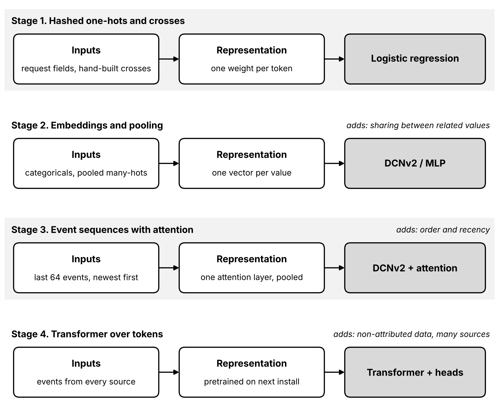
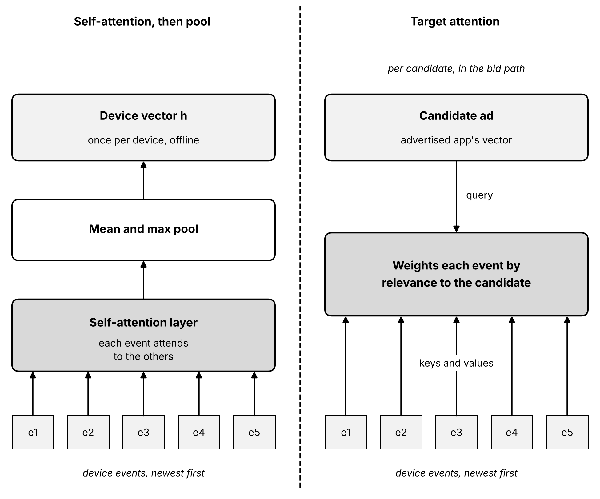
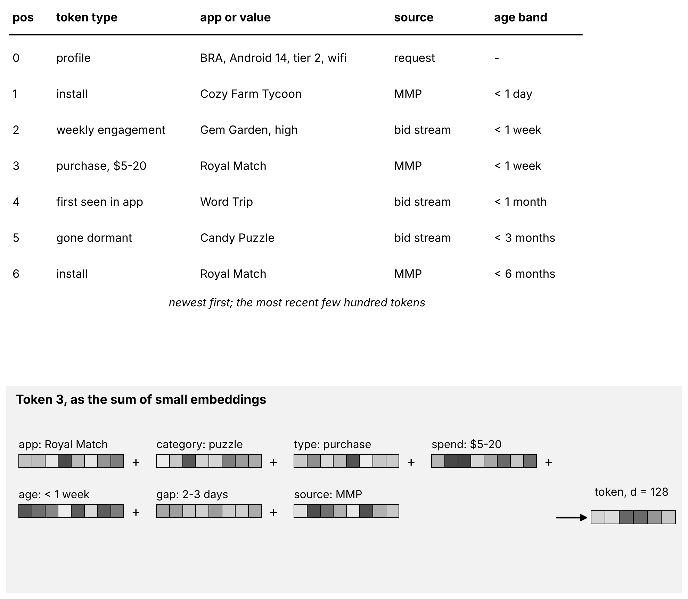
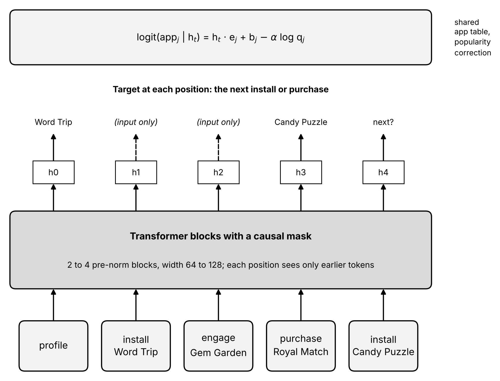
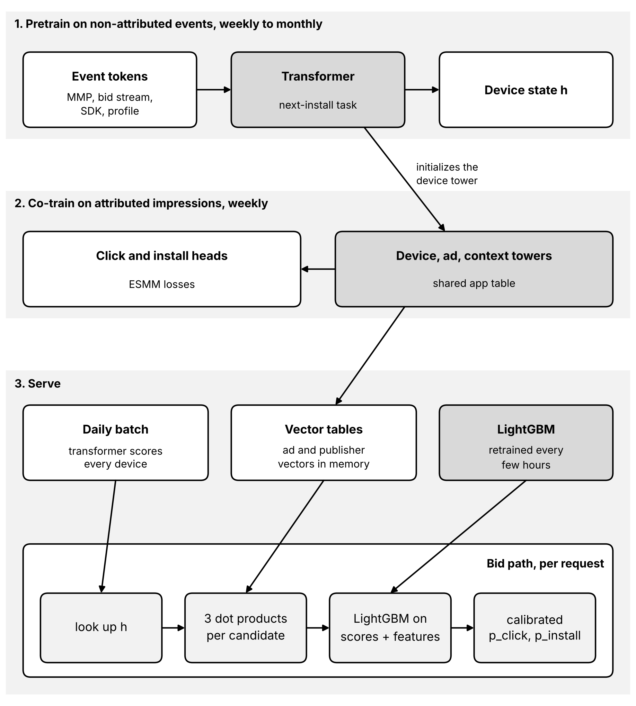

# Sequences and Transformers {#sec-sequences-and-transformers}

A device's history is the richest data a DSP has about it, and so far, every model has seen it through a keyhole. Logistic regression and LightGBM got hand-built counters, such as installs in the last 30 days in each genre. The deep models in the last chapter got pooled sets, which keep what a device did and lose when and in what order. But order and timing matter. A device that tried three strategy games in a week and then made a purchase is a different prospect from one that installed the same games over a year and never paid. In a related domain I've worked in, adding a single self-attention layer over a dated event history made the history the most important input to the model by a wide margin, ahead of every static feature.[^c27-transformers]

Sequence models read the history directly, and transformers make two more things natural: a token format that can represent events from several sources, and pretraining on data that needs no attribution. That second point is what changes the economics of a DSP's models. Attributed impressions are scarce, but advertisers' non-attributed installs and purchases, shared through their MMPs, are orders of magnitude larger, and full of intent.

In this chapter, we will trace four stages of how DSP models represent a device, move from pooled sets to event sequences, look at when a single attention layer is enough, give a short primer on transformers, compare self-attention with target attention, and tokenize events from MMPs, the bid stream, and SDKs. We pretrain a transformer on non-attributed data and co-train click and install heads on top of it. We pretrain on non-attributed data, cover two-tower models and the affinity signals they produce, and look at the large-upstream, small-online design, scaling laws, and foundation models distilled into production models. We then build both designs from @sec-where-trees-stop, deep signals into trees and an online ranker with a calibration layer, and close with leakage, versioning, and data rights.

## Four Stages of Representing a Device

It helps to see where this chapter fits in the progression of the book's models. Feature engineering for click and install prediction has moved through four stages, and each addresses a limit of the one before it, as @fig-c27-stages shows.[^c27-transformers]

{#fig-c27-stages width="100%" fig-alt="Four stages of representing a request, each adding to the last: hashed one-hots and crosses for logistic regression; embeddings and pooling for a DCNv2 or MLP; the last 64 events with attention; and a transformer pretrained on events from every source."}

1. **Hashed one-hots and crosses,** the crawl click model. The model learns from the bid request and a few counters, with interactions chosen by hand.
2. **Embeddings and pooling,** from the last chapter. Related values share what they learn, and the network learns interactions, but a device's history is a set, with no order or recency.
3. **Event sequences with attention.** The history becomes a sequence of dated events, read by an attention layer, so order and recency count. The encoder still learns only from attributed labels.
4. **A transformer over tokens, pretrained on non-attributed data.** Events from every source go into one timeline, and the model is trained on a task that needs no attribution, so it learns from what devices are doing across the whole market.

The four stages are less about architecture than about what the model can learn from. That's why the step from stage 3 to stage 4 usually matters more than the depth of the model.

## From Pooled Sets to Event Sequences

A pooled set of a device's apps answers "what does this device play?" A sequence answers "what has this device been doing, and what is it likely to do next?" For predicting the next install, the second question is the one that matters. Recency matters: a puzzle game installed yesterday says more than one installed a year ago. Order matters: trying several games in a genre and settling on one is a pattern, and so is a run of purchases that's growing. And gaps matter: a device that stopped paying six months ago is different from one that pays every week.

The input becomes each device's events in time order, such as installs, purchases with a spend band, uninstalls, and, from the DSP's own logs, impressions and clicks. Each event becomes a token, and each token is the sum of a few small embeddings:

- **App:** the app where the event happened, from the same embedding table as the ad side of the model, so a device's history and a candidate campaign's app are in the same space.
- **Category:** the app's category, which helps rare apps borrow from common ones.
- **Event type:** install, purchase, uninstall, and so on.
- **Spend band:** for purchases, an order-of-magnitude bucket for the amount, such as under \$1, \$1 to \$5, \$5 to \$20, and over \$20.
- **Age band:** how long before scoring time the event happened, bucketed into ranges such as less than a day, less than a week, and less than a month.

The age band carries time, so the model doesn't need a positional encoding to know which events are recent. The model keeps the most recent events, such as the last 64, sorted from newest to oldest. Summing rather than concatenating keeps every token the same small width, whatever the number of embeddings that go into it.

## When One Attention Layer Is Enough

A full transformer, pretrained on non-attributed data, is a large project: new data pipelines for the tokens, GPU training, a batch scoring job, and a new set of failure modes. Before committing to it, it's worth asking what a much smaller step gets you. That step is stage 3: a single self-attention layer over the event sequence, pooled with mean and max into one device vector, and trained end to end with the conversion heads on attributed impressions.

That small step is often most of the gain. As I mentioned at the start of this chapter, adding one self-attention layer over a dated event history made the history the most important input to a model I worked on, ahead of every static feature. Most of the signal is in the history, and even a lightweight encoder captures most of it.

A single attention layer is enough when:

- **Histories are short.** If most devices have a handful of events, for example on iOS or in markets where you receive few advertisers' MMP data, there isn't much order for a deep model to learn.
- **There's little non-attributed data.** Pretraining needs a large stream of installs and purchases from advertisers' shared data or the bid stream. Without it, a transformer has nothing more to learn from than the single layer does.
- **The team is new to deep models.** One attention layer trains on the same hardware as the DCNv2 model, serves the same way, and adds one new component to monitor.
- **You need a baseline.** Even if a transformer is the goal, the single layer tells you how much of the gain comes from having a sequence at all, and how much from depth and pretraining.

It has two limits, and they point to the same solution. First, the encoder is only as good as its labels. Trained on attributed impressions, it gets one weak label for each won impression, and most devices never have a won impression that converted. Second, pooling removes order. The age bands keep recency, but patterns that depend on the order of several events, such as trying three games in a genre before settling on one, are hard to represent after mean and max pooling. Both limits are addressed by training the sequence model on its own task, with data that needs no attribution. That's what the transformer in the rest of this chapter does.

## A Short Primer on Transformers

The rest of this chapter builds on the transformer, so it's worth a short look at how one works. A transformer reads a sequence of tokens. Each token starts as an embedding, here the sum of the app, category, event type, spend band, and age band embeddings, and the model refines those vectors through a stack of identical blocks.

The core of each block is **attention**. Each token is projected into three vectors: a query, which describes what it's looking for; a key, which describes what it offers; and a value, which is what it passes on. A token's new vector is a weighted average of every token's value, weighted by how well its query matches each key:

$$\text{Attention}(Q, K, V) = \text{softmax}\left(\frac{QK^\top}{\sqrt{d}}\right) V$$

Here, $Q$, $K$, and $V$ hold the queries, keys, and values for the whole sequence, and $d$ is their width. Dividing by $\sqrt{d}$ keeps the scores in a range where the softmax still has useful gradients. **Multi-head attention** runs several of these in parallel, each with its own projections, so one head can learn to follow recent purchases while another follows installs in the same genre.

A **transformer block** is attention followed by a small feed-forward network applied to each token on its own, with a residual connection and layer normalization around each, so blocks can be stacked without training becoming unstable. Attention on its own has no sense of order, so models add position information to the tokens. In this chapter, the age bands do that job.

Transformers come in two main shapes. An **encoder**, such as BERT, lets every token attend to every other token, and is used to represent a whole sequence. A **decoder**, such as GPT, uses a **causal mask**, so each token sees only the tokens before it, and is trained to predict what comes next. The pretraining task later in this chapter is the decoder's: predict the next install or purchase from everything before it. The cost of attention grows with the square of the sequence length, which is one reason device histories are cut to the most recent few hundred events.

The original architecture is in "Attention Is All You Need."[^c27-vaswani] For readers who want to go further, Chip Huyen's *AI Engineering* is a good reference.[^c27-aieng] It covers how transformers and the foundation models built on them work, how they're trained, evaluated, and adapted, and what it takes to build products on them. The models in this chapter are far smaller than a language model, but they use the same building blocks.

## Self-Attention vs. Target Attention

Attention is how a model reads a sequence. There are two common forms, and they have very different serving costs.

- **Self-attention** lets each event attend to the others in the history, so the model learns combinations, such as an install followed by a purchase in the same week. The outputs are pooled, or the last position is taken, into one vector for the device. Nothing depends on the ad being scored, so it can be computed once per device, offline.
- **Target attention** uses the candidate ad, such as the advertised app's embedding, as the query, and weights each past event by its relevance to that ad. This is the approach of the Deep Interest Network. It's often more accurate, but because it depends on the candidate, it has to run in the bid path for every candidate campaign.

@fig-c27-attention shows the difference in where each runs.

{#fig-c27-attention width="100%" fig-alt="Two panels. On the left, self-attention over a device's events is pooled into one device vector, computed once per device offline. On the right, target attention uses the candidate ad as a query to weight each event, so it must run per candidate in the bid path."}

For a DSP, self-attention is the practical default, because it moves the expensive part out of the auction. Target attention comes back in @sec-serving-deep-models, where we estimate what it would cost to run online.

## Tokenizing Events from MMPs, the Bid Stream, and SDKs

A transformer reads tokens, and the token format decides what it can learn. Once every event is a token, merging data sources means writing more tokens into the same timeline. Each token keeps the embeddings from the stage 3 sequence, the app, category, event type, spend band, and age band, and adds two more:

- **Source:** whether the event came from the MMP, the bid stream, or an SDK, so the model can learn how much to trust each source and how sources interact.
- **Gap:** a bucket for the time since the previous event, so the model sees cadence as well as recency.

@tbl-c27-tokens lists the token types I'd start with.

| Token | Source | Role | How many |
|---|---|---|---|
| Install | MMP data shared by advertisers | Input and next-event target | One per install |
| Purchase, with spend band | MMP revenue postbacks | Input and next-event target | One per purchase, or per app per day |
| First seen in app | Bid stream | Input only | One per app, the first time the bidder sees the device there |
| Weekly engagement, with volume band | Bid stream or SDK | Input only | One per app per week, for the latest few weeks |
| Gone dormant | Bid stream | Input only | One when a device stops appearing in an app for several weeks |
| Profile context | Bid request and device data | Input only | One, at position zero |

: Token types for a device's timeline. {#tbl-c27-tokens tbl-colwidths="[24,26,22,28]"}

The bid stream is the most interesting addition. If a device shows up in an app's bid requests, the app is installed and in use, so the first time the bidder sees the device in an app is an inferred install. That works for every app that sells ads, not only the apps of the DSP's own advertisers. When a device stops appearing in an app, that's an inferred churn. These tokens fill many of the gaps in MMP coverage, but they have to be aggregated. A device can generate thousands of bid requests a day, and without aggregation they'd push every install and purchase out of the context window.

The **profile context** token describes what the device is rather than what it did: country, OS, device model tier, and connection type, pooled like the many-hots in @sec-deep-models-with-embeddings. Placing it at position zero means attention can use it, and a device with no history still gets a valid state. That matters on mobile, where many devices, especially on iOS, have short histories. @fig-c27-tokens shows a short timeline and how one token is built.

{#fig-c27-tokens width="100%" fig-alt="Table of a device's timeline as tokens, newest first: a profile token, then installs, engagement, a purchase, first-seen and dormant events, each with its source and age band. Below, one token is shown as the sum of small embeddings for its app, category, type, spend, age, gap and source."}

Leave room in the format for creative events from the DSP's own impressions, such as video completions and end card clicks. We use them in @sec-personalized-creative-selection.

## Pretraining on Non-Attributed Data

A sequence model trained only on attributed impressions gets one weak label for each won impression, and most devices never have a won impression that converted. Pretraining fixes this, by training the sequence model on its own task, with data that needs no attribution.

**Next-event prediction** is the natural task. The transformer is trained with a causal mask, so each position sees only the events before it, to predict the next outcome event from all of the events before it, the same objective SASRec uses for next-item recommendation.[^c27-sasrec] At every position where the next token is an install, the model predicts which app was installed, with a softmax over the app vocabulary. The output layer reuses the input app embedding table, and a log-popularity correction is subtracted from the logits, so the model doesn't learn to predict the top-grossing apps for every device:

$$\text{logit}(\text{app}_j \mid h_t) = h_t \cdot e_j + b_j - \alpha \log q_j$$

Here, $h_t$ is the state at position $t$, $e_j$ is the app's embedding, $b_j$ is a learned bias, and $q_j$ is the app's share of installs. With tens of thousands of apps, a sampled softmax keeps training costs manageable. Every install in every history becomes a training label, so a model can learn from billions of events the DSP never paid for, and none of the labels depend on which network was credited. @fig-c27-pretraining shows the setup.

{#fig-c27-pretraining width="100%" fig-alt="Transformer with a causal mask over a device's event tokens. Each position's output state predicts the next install or purchase, using a softmax over apps with a popularity correction."}

Only outcome tokens are used as targets. If bid stream tokens were targets too, the model would spend its capacity learning to predict which apps a device opens next, which is an easier task and a less useful one. Bid stream and profile tokens are inputs, and installs and purchases are what the model learns to predict.

**Future-window objectives** predict what a device will do over a window, such as purchases and spend in the next 7 or 30 days, rather than only the next event. Pinterest's PinnerFormer found that a future-window objective made daily batch embeddings nearly as good as real-time ones, which suits a model refreshed offline, and it matches the horizon of D7 and D30 value labels.[^c27-intent]

### Details That Make It Work

- **Size.** Two to four pre-norm transformer blocks, a model width of 64 to 128, and a context of a few hundred tokens are enough. That's tiny next to a language model, because the task doesn't need a large model. The training data, on the other hand, can be enormous, since pretraining runs over every event in every history. That's where GPUs pay off.
- **Time.** Keep the age bands and add the gap bucket. A learned position embedding is cheap to add as well.
- **Warm start.** Initialize the app embeddings from co-install statistics, such as a PPMI matrix factored with SVD. Training converges faster, and rare apps start somewhere reasonable.
- **Observation gaps.** You only see MMP events for apps whose data you receive, and each advertiser's feed starts on a different date. Count an install as a target only if the app's feed was live at the time, and flag newly observed apps. Otherwise, the model learns when feeds started, not what devices want.
- **Time cutoffs.** Pretraining has to stop at each training window's cutoff. Events after the cutoff that leak into the device state make the downstream heads look better offline than they'll be in production.
- **Identity.** Sequences can only be joined across sources when the IDs match. The advertising ID works across apps on Android, and on iOS devices that have consented, but the IDFV doesn't. Expect much longer sequences on Android, and evaluate the platforms separately.
- **Data rights.** Every token comes from someone's data. MMP events fall under what advertisers agree to share and pool, and exchange terms often limit how bid request data can be used. Deciding which sources to combine is a policy decision as much as a modeling one.

The output of pretraining is a **device state**, $h$: the transformer's hidden vector at the last position, which summarizes everything the device did across every source available to the DSP, learned without a single attributed label. It's computed in batch for every device and stored in the device profile, ready for the models downstream.

## Co-Training Click and Install Heads

The pretrained transformer learns a lot about devices and nothing about ads. The second training stage connects it to impressions. This is a multi-task model trained on attributed impressions, with the transformer as the device tower and one head for each term in the install equation, as @fig-c27-towers shows.

{#fig-c27-towers width="100%" fig-alt="Three towers, for the device, the ad and the context, each output a 64-dimension vector from a shared app embedding table. A small MLP and pairwise dot products combine them into logits for click, install after click, and install after view."}

### Three Towers

Each tower outputs a 64-dimension vector:

- **Device tower, $h$:** the pretrained transformer, plus a few bid-time device fields, such as how many times the device has seen the campaign today.
- **Ad tower, $a$:** the campaign's app, from the same app table as the transformer, plus the creative, campaign, and ad format.
- **Context tower, $c$:** the publisher app, also from the shared app table, plus placement, OS version, country, connection type, and hour of day.

Sharing the app table across the three towers is a small detail with a large effect. The app a device installed last week, the app it's using now, and the app being advertised are all in the same space, so the model can relate them directly.

### Interactions Built for Serving

The heads use the three vectors in two ways. A small MLP reads the concatenated vectors and their element-wise products, so it can learn whatever interactions it needs. And each head has three explicit dot product terms, one for each pair of towers, the same idea as factorization machines, applied to towers:

$$\text{logit}_k = \text{MLP}_k([h, a, c, h \odot a, h \odot c]) + w_{k1}(h \cdot a) + w_{k2}(h \cdot c) + w_{k3}(a \cdot c)$$

The dot products are there for serving. Because they're part of every head's logit, training pushes the towers to put useful signal in them. In the bid path, a dot product of two 64-dimension vectors takes nanoseconds, while running the MLP for every candidate is far more expensive. The dot products are the bridge between this model and the one that serves, as we'll see in Design B below and in @sec-serving-deep-models.

The heads are trained with the ESMM losses from @sec-deep-models-with-embeddings, over every impression.

### Training Details

- **Start from the pretrained tower.** Freeze the transformer for the first epoch while the heads and the other towers converge, then unfreeze it with a learning rate about ten times lower. Keep the next-install loss running on a sample of non-attributed data as an auxiliary task, so fine-tuning on the much smaller attributed data doesn't erase what pretraining learned.
- **Downsample negatives,** keep every positive, and weight the negatives by one over the sampling rate.
- **Wait for labels to mature,** or use a delayed feedback model, as in @sec-retraining-and-real-time-learning.
- **Keep some exploration** in the training data, so it doesn't narrow around the model's own decisions.
- **Treat SKAN separately.** On iOS without consent, installs arrive as aggregated postbacks, not impression-level labels, and need their own models, as in @sec-ios-and-contextual-signals.

The same model can support more heads at low cost, because the heads share the towers: purchase after install, first-week spend, day-7 retention, and predicted SKAN conversion value all fit the same pattern, defined over every impression by multiplying through the funnel. Each new head adds supervision for the shared towers, which often helps the original heads too.

## Two-Tower Models: The Basics

A **two-tower model** learns a vector for each of two kinds of entity, such as devices and apps, so that the dot product of a device's vector and an app's vector scores how well they match.

- **The device tower** encodes a device from its history and context, such as the set or sequence of its installed apps, OS, device model, and country, as of a cutoff time.
- **The app tower** encodes an app from its ID and its metadata, such as category, genre, and store description embedding.

Training uses pairs of a device and an app it installed. The key technique is **in-batch negatives**: for each device in a batch, the other apps in the batch serve as negatives. One matrix multiplication scores every device against every app in the batch, so a batch of 8,192 pairs produces millions of negative comparisons almost for free, with no separate negative sampling step. That's what makes it possible to train on billions of install pairs with a few GPUs.

Two details matter a lot:

- **Popularity correction.** Install distributions are extremely skewed, and in-batch negatives are sampled by popularity, so without a correction, the model learns that everyone installs the top 20 apps. The **logQ correction** subtracts the log of each app's sampling probability from its score during training.[^c27-yi]
- **Dropping the ID for cold start.** If the app tower randomly drops the app ID during training, it learns to build an app's vector from metadata alone. A new app then gets a useful vector on day one, before it has a single install.

These basics are used here for affinity signals, and again in @sec-learned-campaign-selection for campaign retrieval.

## Two-Tower Affinity Signals and Device States

In Design A, the two-tower model's output isn't passed to the bidding models as an embedding. It's turned into a few scores, each answering a different question:

- **Long-term affinity:** the cosine similarity between the device's vector and the advertised app's vector.
- **Recent affinity:** the similarity between the advertised app and the device's last few installs, from app vectors alone.
- **Negative affinity:** the similarity to apps the device uninstalled quickly.
- **Placement affinity:** the similarity between the publisher placement and the advertised app, learned by adding placements as a third entity from the DSP's own bid logs. It works without a device ID.
- **Affinity percentile:** the long-term cosine, ranked within the advertised app's own distribution of cosines.

The percentile matters more than it looks. Raw cosines aren't comparable across apps: 0.4 might be the top 1% for one app and the median for another. A single model shared by thousands of campaigns needs a signal that means the same thing everywhere.

Scores, rather than raw embeddings, are a deliberate choice. Many classic models treat a 64-dimension embedding as 64 separate, weak columns, which can crowd out the request features that matter for bidding. A retrain of the two-tower model can rotate the embedding space, so dimension 17 means something different in each version, while a cosine between two vectors from the same version stays stable. And a few scores work with any model.

From the pretrained transformer, Design A takes **head outputs** in the same spirit: the probability of a purchase in any app within the window, spend bucket probabilities such as $P(\text{spend} \geq \$10)$, and an app-conditional purchase probability, computed by scoring the device state against the advertised app's embedding.

## A Large Upstream Model and a Small Online Ranker

The leading published design for sequence models in ad ranking separates a large model from a small one. A large transformer runs asynchronously, upstream of the auction, over long device histories, and caches a fixed-size device embedding. A small online model combines the cached embedding with request and campaign features at bid time.

Meta's LLaTTE work describes this design at scale. Its upstream model uses over 45 times the sequence compute of the online ranker, about half of the upstream model's gain transfers to the downstream ranker, the cached user embedding has 2,048 dimensions, and the design added no measurable change in p99 latency. Meta reported a 4.3% conversion uplift on Facebook Feed and Reels.[^c27-llatte] A companion post describes the same multi-stage architecture, with target-aware attention, and conversion gains of 6% on Instagram and 3% on Facebook.[^c27-meta-seq]

This is the architecture from my transformer post, with published numbers behind it: the expensive model runs where its cost doesn't affect the auction, and the auction only pays for a lookup and a small model.

## Scaling Laws: Where to Spend Compute

If a bigger upstream model is better, how should compute be spent: on longer histories, deeper models, or wider ones? LLaTTE reports that gains in normalized entropy grow log-linearly with compute, and that sequence length helps most, then depth, then width, with slopes of 0.265, 0.200, and 0.133. Width needs to reach about 256 before more depth helps.[^c27-llatte] Sequence diversity matters too: a mix of impressions, clicks, installs, and purchases beats a single event type.[^c27-meta-seq]

For a DSP team, the practical guidance is:

- **Extend history before adding depth.** Keeping more events per device is usually the cheapest gain, until the history runs out.
- **Add event types.** Purchases and the DSP's own impressions and clicks, next to installs, add diversity cheaply.
- **Get width to a reasonable size,** then add layers.
- **Measure on the price-performance curve.** Every increase in upstream compute costs only training and batch scoring, not serving, so the curve is about the training budget.

These numbers come from a platform far larger than any DSP, and they'll differ on DSP data. They're a guide to what to try first, not a forecast.

## One Foundation Model, Distilled into Production Models

A DSP that builds a two-tower model, a purchase transformer, a click model, an install model, and a win model ends up with many deep models, each trained separately. An alternative is to train one large pretrained device model, and transfer it to the click, install, purchase, and win models through distillation and shared representations. Meta's GEM trains one foundation model across surfaces and transfers it to hundreds of smaller vertical models, and reports 5% more conversions on Instagram and 3% on Facebook Feed.[^c27-gem]

For a DSP, one foundation model is a cleaner story than four separately trained deep models: one encoder, one shared app table, one version to keep in sync, and heads for install, purchase, and spend. The tradeoff is coupling. A change to the foundation model shifts every downstream model at once, as we'll see in @sec-operating-at-scale, and install and purchase data rights become tied together.

## Building Design A: Deep Signals into Trees

Design A, the default from @sec-where-trees-stop, passes the pretrained models' outputs as features to the LightGBM install and value models from Part III, which make the bid decision:

- **The install model** gets the affinity scores, next to its request, campaign, and serving features.
- **The value model** gets the transformer's head outputs.
- **The bid** is $P(\text{install}) \times E[\text{value} \mid \text{install}]$, with pricing as in @sec-pricing-for-goals.

We don't bid on the network's output directly, for the reasons in @sec-deep-models-with-embeddings: deep networks are often overconfident, products of heads compound errors, the pretrained models are refreshed slowly and lag the market, and downsampling corrections are easy to get slightly wrong. The trees handle all of this in one place. They retrain daily on recent attributed data, handle bid-time features such as floor and frequency well, and learn how much to trust the deep signals. For a new app with no attributed history, the ID features are empty while the affinity scores still carry signal, and the trees learn when to rely on them.

Design A rolls out in measured stages, each with its own A/B test: affinity scores into the install model first, then head outputs into the value model. At each stage, compare the trees with and without the new signals, offline on normalized entropy and AUC within campaigns, and online on CPI and D7 ROAS, with an incrementality holdout. The holdout shows whether the signals find devices your ads actually influence, rather than devices that would have installed anyway.

## Building Design B: An Online Ranker with a Calibration Layer

Design B moves more of the decision online. The pretrained device state is cached, as in Design A, and a small model runs at bid time for each candidate, combining the cached state with request and campaign features. Two forms work well:

- **Tower dot products.** A model co-trained with device, ad, and context towers, each producing a 64-dimension vector, with explicit dot products between each pair of towers in every head's logit. In the bid path, the ad and publisher vectors are in memory, and each candidate needs three dot products, which take nanoseconds.
- **A small DCN or MLP** on the cached embedding plus request features, which runs in about a millisecond for a batch of candidates.[^c27-pyspark]

Either way, a **LightGBM calibration layer** sits on top. It's trained on recent attributed impressions, with the ranker's scores, device scalars such as history length and a fallback flag, campaign levels such as a smoothed recent install rate, context, and bid-time features, and it outputs the probabilities the bidder uses. It retrains every few hours, so it corrects for the ranker's staleness and overconfidence, and it's easy to inspect when an account manager asks why bids changed.

@fig-c27-architecture puts the pieces together: pretraining on non-attributed data, co-training the towers and heads on attributed impressions, and serving with batch device states, in-memory vector tables, and a LightGBM model in the bid path.

{#fig-c27-architecture width="100%" fig-alt="Three-stage architecture. A transformer pretrained on non-attributed events initializes the device tower; device, ad and context towers are co-trained weekly on attributed impressions; and at serving time the bid path looks up the device state, computes dot products per candidate, and runs LightGBM to produce calibrated probabilities."}

The LightGBM model in Design B doesn't take the 64-dimension vectors as features. Trees split on one feature at a time, so 64 dense dimensions are many weak features that aren't meaningful on their own, and the dimensions change meaning every time the foundation model is retrained. A dot product is one stable number that already says how well two things match, and it stays meaningful across versions as long as both vectors come from the same run. The feature groups I'd use are:

- **Foundation model scores:** $h \cdot a$, $h \cdot c$, and $a \cdot c$, the learned affinity between device and ad, device and placement, and ad and placement.
- **Device scalars, stored with $h$:** the fallback flag, history length, days since the last install, and the model version, which let the trees trust the scores less when the history is thin.
- **Ad and campaign:** campaign, app category, creative format, smoothed recent install rate, and campaign age, the fast-moving levels that the foundation model lags behind.
- **Context:** placement, ad format, OS version, country, connection type, and hour of day.
- **Request:** the bid floor and how often this device has seen the campaign today, which only exist at bid time.

Train one LightGBM model for clicks and one for installs from either path, on the last few days of attributed impressions, with log loss, and correct for downsampling. Check calibration directly with plots like those in @sec-deep-models-with-embeddings, by publisher, country, OS, campaign age, and the fallback flag. If you need the click and view paths separately, for example to monitor view-through fraud, train a third model for view-through installs on impressions without a click, and combine them with the install equation.

Design B's extra lift comes at extra cost: a deep model in the bid path, more serving work per candidate, and a calibration layer that has to keep up. Use the price-performance view from @sec-where-trees-stop to decide whether it's worth it, by comparing both designs on the same traffic.

## Measuring What Each Stage Adds

It's easy to overstate the impact of a design like this, so the evaluation should separate what each stage contributes. The most useful experiment is a sequence of model variants, all trained on the same time windows and evaluated on the same holdout window, with LightGBM as the final layer in every case, so calibration is held constant. @tbl-c27-variants lists them.

| Variant | What it shows |
|---|---|
| 1. Plain features only | The baseline every DSP already has: LightGBM on bid request features, no device history |
| 2. Pooled device embeddings | What a static profile adds, with installed apps as a pooled many-hot |
| 3. One attention layer | What order and recency add, with the encoder trained on attributed labels only |
| 4. One attention layer plus next-install pretraining | What the training task adds, separate from depth |
| 5. Transformer with pretraining, MMP tokens only | What depth adds |
| 6. Transformer with all sources | What the bid stream and other sources add |

: Model variants for measuring what each stage adds. {#tbl-c27-variants tbl-colwidths="[38,62]"}

My expectation is that most of the improvement shows up between variants 3 and 4, from the pretraining task, and between variants 5 and 6, from the extra sources, with a smaller improvement from depth alone, between 4 and 5. Mobile histories are longer and change faster than the histories where I've seen this tested, so depth may matter more on DSP data. That's what the experiment is for.

A few rules make the comparison trustworthy:

- **Evaluate out of time.** Train on earlier windows, select on a later validation window, and report on a test window after that. Hold out a hash of devices from every training window, so test devices are never seen in pretraining.
- **Measure ranking and calibration.** Report log loss and AUC for clicks and installs, and calibration with expected calibration error and the ratio of predicted to actual conversions.
- **Break results out by segment:** by OS, by whether the device has a cross-app ID, by history length, by campaign age, and by app category. Averages hide where the gains are.
- **Check for leakage.** Assert that every token used for a training example comes before that example's cutoff, and be suspicious of any variant that improves much more than expected. In my experience, a gain that looks too good is usually a leak.

Offline gains don't always become cheaper installs, because the auction reacts to the new bids. Validate the final candidate with a budget-split A/B test from @sec-shadow-mode-canaries-and-ab-tests, on cost per install, installs per thousand impressions, win rate, and spend at a fixed budget, and monitor the daily ratio of predicted to actual installs. If that ratio drifts, the bids are wrong even if the ranking is right.

## Leakage, Versioning, and Data Rights

The design is simple to draw, but most of the work is in three areas where it can fail without obvious errors.

**Leakage.** The non-attributed feed contains the attributed events: a device the DSP acquired still has the app installed, and its purchases show up in the MMP's stream like any other. If those events train the pretrained model and then appear as labels for the trees, the signal encodes the label.

- **Cut off by time.** Device states used for a training row are built only from events before that row's impression, and the pretraining window ends before the label window starts.
- **Score history with the version that was live,** as in @sec-building-training-datasets. Backfilling with this week's embeddings leaks the future into the past.
- **Mask the target in the inputs.** When computing a device's affinity to the advertised app, remove that app from the device's own inputs.

**Versioning.** A dot product between vectors from two training runs is meaningless, and the trees learn what a cosine of 0.42 means for one version. Store a version ID with every device record and signal, and retrain or validate the trees whenever a pretrained model changes. @sec-serving-deep-models enforces this at bid time.

**Data rights.** Non-attributed installs and purchases are advertisers' first-party data. A pretrained model built from them is pooled, because it learns from every advertiser and serves every advertiser.

- **Make pooled use explicit in contracts.** "Helps the DSP perform" might be read as "helps my campaigns".
- **Handle opt-outs at the data layer.** An advertiser that doesn't allow pooling is removed from pretraining entirely, as labels and as features, controlled by a contract flag. Their app can still get an embedding from metadata, and their own data can still train models that serve only them.
- **Ask separately for purchase data.** Advertisers who are happy to pool installs may see their payer lists as their most valuable asset.
- **Follow platform and privacy rules,** including ATT consent on iOS, which we cover in @sec-ios-and-contextual-signals, and exclude sensitive app categories and anything directed at children.

## Pretraining on the Part IV Dataset

The companion code runs a small version of this design on the Part IV dataset from @sec-where-trees-stop. The transformer has two pre-norm blocks, a width of 32, and a context of the last 128 events, for 24,992 parameters. Its tokens are a device's appearances on the bid stream, its clicks, and its installs, credited to the DSP or shared by advertisers, each with a gap bucket and a position. It's pretrained on next-install prediction from every device's events before the validation days, with the output layer sharing the app table. The popularity of each install's period, its day in the run or its month before it, is added to the logits during training, so the dot product $h \cdot e_j$ learns only a device's lift for an app over what everyone was installing at the time. Reinstalls of an app a device already has are dropped, since the target is an app the device doesn't have yet. One model starts its app table from co-install vectors, the warm start, and one from random values, and each trains in about 15 seconds on a laptop's CPU.

Design A then computes a device state for every device on every day, from the events before that day, with the advertised app's events masked out, and adds the lift for the advertised app to the LightGBM install models as one feature. The leakage check found no state built from an event on or after its impression's day. @tbl-c27-results has the variants of @tbl-c27-variants that fit the dataset, with a pooled profile in place of variant 2: the mean co-install vector of the device's installs before the day, without the advertised app, and its cosine with the advertised app's vector. The error is the mean absolute error against the true rate, divided by the mean true rate.

| Variant | Install after view: AUC | Error | Install after click: error | Click: error |
|---|---|---|---|---|
| 1. Plain features, no device history | 0.783 | 0.891 | 0.564 | 0.534 |
| 2. The Part III device features | 0.796 | 0.874 | 0.514 | 0.546 |
| 3. Plus a pooled co-install profile | 0.806 | 0.814 | 0.462 | 0.497 |
| 4. Plus the pretrained transformer, random start | 0.796 | 0.857 | 0.506 | 0.551 |
| 5. Plus the pretrained transformer, warm start | 0.795 | 0.880 | 0.510 | 0.538 |

: Design A on the Part IV dataset's two test days: LightGBM install and click models with each signal added, against the simulator's true rates. {#tbl-c27-results tbl-colwidths="[40,15,15,15,15]"}

The pooled profile pays off. It cuts the install-after-view error by 7% and the click error by 9%, and most of all for devices the DSP never acquired: on impressions to devices with no credited installs, from 1.006 to 0.904, because the installs advertisers share fill in what the DSP's own logs can't see.

The transformer barely moves the trees, and its own numbers show why. Its pretraining loss is 2.82, against 2.87 for the popularity of each period alone. On next installs after the cutoff, it ranks the installed app in its top 5 of 35 apps 80% of the time, which looks strong next to 42% for overall popularity, and is no better than the 81% for popularity over the last 7 days. It learned which campaigns were running, not what each device wants. Within each advertised app, its affinity has a rank correlation of −0.04 with the true install rate, against +0.37 for the pooled profile, and only 30% of its app vectors' nearest neighbors share a genre, against 55% for the co-install vectors. Without the recent-popularity baseline and the check within each app, the transformer would have looked like a win.

The reason is the histories. The simulator gives each device about four installs before the cutoff. A pooled profile needs only counts, so a few installs are enough for it to locate a device's taste, but a sequence model needs long histories to learn anything from their order, and the payoff of pretraining isn't there until it has them. That's the comparison to run with more compute: lengthen the device histories, add devices, and find where the transformer passes the pooled profile.

::: {.callout-tip title="Try it on the simulator"}
Pretrain a small transformer on next-install prediction from the Part IV dataset's device histories, with the popularity of each install's period in the logits. Compute daily device states with the advertised app masked, add each device's lift for the advertised app to the LightGBM install models, and compare it against plain features and a pooled co-install profile, against the true install rates. Check for leakage, compare next-install prediction against recent popularity, and check each signal within each advertised app.

Scaling up is yours: longer device histories (the number of installs each device gets before the run starts is set in adsim's `history.py`), more devices, wider models and longer contexts on a GPU, the future-window objective, purchases as targets, and Design B. On the simulator's short histories, the pooled profile wins; find how long histories have to be before pretraining pays off.

*Status: runs with the companion code (adtrain 0.15, adsim 0.7), on the Part IV dataset: about three minutes on a laptop's CPU. Scaling up is yours. Commands are in `WALKTHROUGH.md`, under this chapter.*

:::

## Conclusion

In this chapter, we modeled device histories as sequences. Four stages of representation, from hashed one-hots to a pretrained transformer, each change what the model can learn from, and a single attention layer is often most of the gain before going further. Tokens built from app, category, event type, spend, age, gap, and source embeddings let a transformer read events from MMPs, the bid stream, and SDKs, and self-attention keeps the expensive part offline. Pretraining on non-attributed data, with next-event and future-window objectives, produces device states, and two-tower models with in-batch negatives, logQ correction, and ID dropout produce affinity signals. Published work on large upstream models with small online rankers, scaling laws, and foundation models shows where the field is going. Device, ad, and context towers that share one app table are co-trained on attributed impressions, with dot products built into every head for cheap serving. We built Design A, which passes a few stable scores to the trees, and Design B, which ranks online and calibrates with LightGBM, measured what each stage adds with a ladder of model variants, and covered the leakage, versioning, and data rights problems that both share.

Both designs depend on getting the expensive parts out of the bid path and the cheap parts into it, quickly and consistently. In the next chapter, we serve deep models within the bid path's budget, on CPU.

[^c27-transformers]: Ben Weber, "Transformers for Mobile User Acquisition," *AI Advances*, November 2026, <https://medium.com/ai-advances/transformers-for-mobile-user-acquisition-f3816d8b0c41>

[^c27-intent]: Ben Weber, "Pretrained Deep Learning Intent Signals for Mobile DSPs," *Medium*, October 3, 2026, <https://bgweber.medium.com/pretrained-deep-learning-intent-signals-for-mobile-dsps-2eb1834c62db>

[^c27-yi]: Xinyang Yi, Ji Yang, Lichan Hong, Derek Zhiyuan Cheng, Lukasz Heldt, Aditee Kumthekar, Zhe Zhao, Li Wei, and Ed Chi, "Sampling-Bias-Corrected Neural Modeling for Large Corpus Item Recommendations," RecSys, 2019.

[^c27-llatte]: Lee Xiong et al., "LLaTTE: Scaling Laws for Multi-Stage Sequence Modeling in Large-Scale Ads Recommendation," arXiv:2601.20083, January 2026, <https://arxiv.org/abs/2601.20083>

[^c27-meta-seq]: Steven De Gryze, Parshva Doshi, Sean O'Byrne, Arnold Overwijk, Dinesh Ramasamy, and Lee Xiong, "From User Sequences to Scaling Laws: A Multi-Stage Architecture for Meta's Ads Ranking," Engineering at Meta, August 5, 2026, <https://engineering.fb.com/2026/08/05/ml-applications/from-user-sequences-to-scaling-laws-a-multi-stage-architecture-for-metas-ads-ranking/>

[^c27-gem]: Huayu Li, Xiaoyi Liu, Jade Nie, et al., "Meta's Generative Ads Model (GEM): The Central Brain Accelerating Ads Recommendation AI Innovation," Engineering at Meta, November 10, 2025, <https://engineering.fb.com/2025/11/10/ml-applications/metas-generative-ads-model-gem-the-central-brain-accelerating-ads-recommendation-ai-innovation/>

[^c27-pyspark]: Ben Weber, "Using DNN Embedding Models in PySpark at AdTech Scale," *Data Science Collective*, May 2026, <https://medium.com/data-science-collective/using-dnn-embedding-models-in-pyspark-at-adtech-scale-8f8fdd00fc17>

[^c27-sasrec]: Wang-Cheng Kang and Julian McAuley, "Self-Attentive Sequential Recommendation," ICDM, 2018, <https://arxiv.org/abs/1808.09781>

[^c27-vaswani]: Ashish Vaswani, Noam Shazeer, Niki Parmar, Jakob Uszkoreit, Llion Jones, Aidan N. Gomez, Łukasz Kaiser, and Illia Polosukhin, "Attention Is All You Need," NeurIPS, 2017, <https://arxiv.org/abs/1706.03762>.

[^c27-aieng]: Chip Huyen, *AI Engineering: Building Applications with Foundation Models*, O'Reilly Media, 2025.

