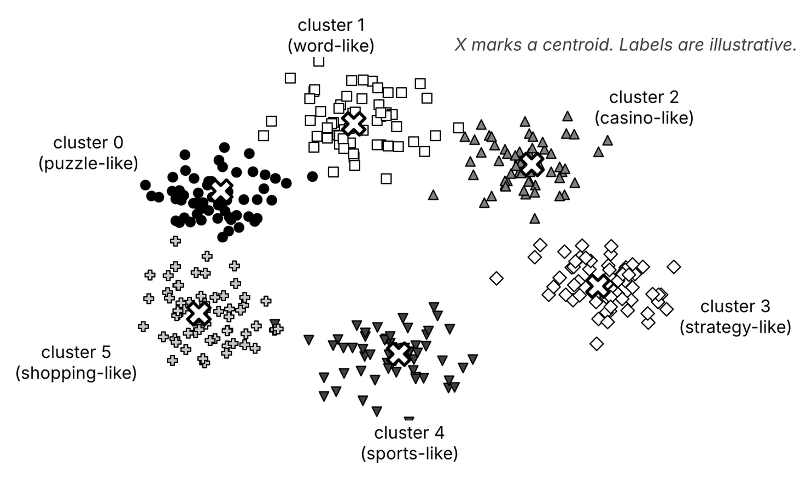
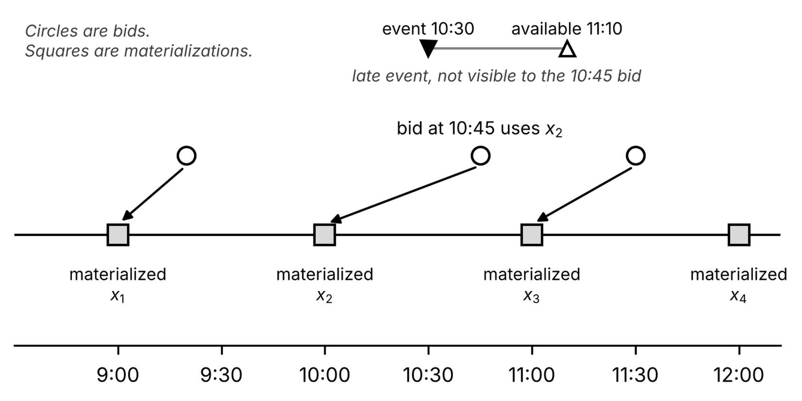

# Serving Deep Models {#sec-serving-deep-models}

The models in the last two chapters are expensive. A transformer over hundreds of events, a two-tower model with millions of apps, and a multi-task network with embedding tables don't fit in a bid path with a few milliseconds per request and dozens of candidates, on CPUs, at hundreds of thousands of requests per second. Yet both designs from @sec-where-trees-stop use their outputs on every bid.

The way through is to split the work. Everything that depends only on the device is computed offline, once per device, on GPUs if needed, and stored. Everything that depends on the candidate runs online, and is kept small enough for a CPU. The bid path does one key-value read, a few dot products, one small model, and the trees. Getting this right is mostly engineering: versions that match, parity between the training framework and the runtime, and tensors built the same way in Go as in Python.

In this chapter, we will design the bid path for CPU serving, split work between batch and the bid path, and distill models for serving. We then build tensors in Go with config-driven transforms, run ONNX Runtime with batched candidates, serve embedding lookups and dot products, and keep embeddings versioned with their downstream models. We cover exporting to ONNX with parity checks, benchmarking, CPU optimizations, when GPU serving makes sense, and when a feature store makes sense.

## Designed for CPU Serving

The models in this book are built so that the bid path runs on CPU: logistic regression, LightGBM, small online rankers over cached embeddings, and small heads. Heavy sequence compute runs offline or asynchronously on GPUs. Meta's LLaTTE design follows the same principle, keeping the online ranker light enough that p99 latency didn't change.[^c28-llatte]

The two designs differ in what they run at bid time:

| Step | Design A | Design B |
|------|----------|----------|
| Device lookup | One key-value read: device state and embedding | The same read |
| In memory | App and placement vectors, percentile tables | App, ad, and context vectors |
| Per candidate | A few dot products, a percentile lookup, one small ONNX head | Tower dot products, or a small DCN per candidate batch |
| Decision | Two LightGBM ensembles (install and value) | A LightGBM calibration layer |

: What each design runs at bid time. {#tbl-c28-designs tbl-colwidths="[22,39,39]"}

A production reference point for this kind of serving: Aarki has described exporting models trained in TensorFlow and PyTorch to ONNX and scoring them in-process, on CPUs, in a Rust bidder, across four data centers handling more than 5 million bid requests per second.[^c28-intent]

When a model doesn't fit the CPU budget, try these in order before adding GPUs to the bid path: precompute more of it offline, distill the online part into a smaller model, and batch candidates into one inference call.

<!-- RESULT: p99 latency and cost per million requests for Design A and Design B on the reference DSP. -->

## Splitting Work Between Batch and the Bid Path

The rule for splitting is to look at what each part of the model depends on. A transformer encoder over a device's history depends only on the device, so it runs offline, once per device, and its output, the device state, is stored in the profile. A head that combines the device state with the advertised app depends on the candidate, so it runs at bid time.[^c28-intent]

Splitting a model into an offline encoder and an online head creates a new way to fail: the two halves can disagree with the full model. Treat parity as a gate at both ends:

- **At export,** compare `head(encoder(x))` with the full model, on a sample of records, across a range of input lengths, both in the training framework and in ONNX Runtime. Refuse to register a version that fails.
- **In serving,** score a sample of requests both ways before anything switches over.
- **Register complete versions only.** A version is complete when both halves are exported and checked, and only complete versions can be promoted.

Batch scoring device states at DSP scale is a Spark job. One approach that works well is to export the encoder to ONNX, broadcast the model to the executors as bytes, and run it with `mapInPandas`, creating the ONNX Runtime session lazily on each executor, so a hundred million devices can be scored on a CPU cluster without a GPU.[^c28-pyspark]

## Distillation for Serving

When even the online part is too slow, **distillation** trains a small, fast student model to match the outputs of a large teacher. The student is trained on the teacher's predictions, often on far more data than has labels, so it learns the teacher's function rather than relearning from scarce labels. A student with a fraction of the teacher's layers can recover most of its gain. Distillation is also how one foundation model reaches many production models, as in @sec-sequences-and-transformers.

## Building Tensors in Go, and Config-Driven Transforms

Deep models take tensors, and the bidder has a FeatureVector. As we set up in @sec-logging-at-bid-time, the transforms between them belong to each model's bundle: vocabularies to map strings to IDs, padding and masks for lists, and fixed formulas such as `log1p` and standardization in the model graph. A shared Go preprocessing library reads the bundle's specification and builds the tensors, in the bidder and in the batch job that builds training data, so there's one implementation of each transform.

For transforms that change often, defining them in configuration rather than code keeps them in the bundle where they belong. CEL, the Common Expression Language, is one option for config-driven logic in a Go service: expressions are compiled once at load time and evaluated quickly per request.[^c28-cel] A feature specification can then say, for example, that a feature is the ratio of two counts with a default when the denominator is zero, and both Go and the training path evaluate the same expression.

## ONNX Runtime in Go, and Batching Candidates

The ONNX Runtime settings from @sec-serving-models-in-the-bid-path matter even more for deep models. Reduce the runtime's default thread parallelism, since concurrency comes from goroutines, and score all candidates for a request in one call. Limited CPU acceleration options are a real constraint for ONNX Runtime on CPU.

GoMLX is an alternative worth knowing about. It's a Go library with an XLA backend that accelerates inference on CPU, especially for small batch sizes, and it can load ONNX models. It can also fine-tune a loaded model online, on new examples such as win and loss feedback, which ONNX Runtime can't. Its ONNX support is less complete than Microsoft's runtime, so check that your models run before committing to it.[^c28-golang]

A practical note for on-prem fleets: recent ONNX Runtime bindings can require newer operating system versions than long-running servers have. Check the runtime's requirements against the bidder hosts before choosing a version.[^c28-onprem]

## Embedding Lookups and Dot Products at Bid Time

In both designs, most of the deep model's contribution reaches the bid through lookups and dot products:

- **Small tables in memory.** App, ad, and placement vectors, with thousands to tens of thousands of rows, fit in every bidder's memory, and are loaded with the model that needs them.
- **Device vectors in the profile store.** Device states and embeddings live in the NoSQL profile, keyed by advertising ID, and arrive with the one read the bidder already does.
- **Dot products are nearly free.** A dot product of two 64-dimension vectors takes nanoseconds, so three per candidate cost far less than any model call.

The lookup store's latency is the same constraint as in @sec-serving-models-in-the-bid-path: one read, a strict timeout, and a missing value when it times out. Missing is a value here too. Devices without an ID or a record get missing device signals, which the trees handle natively, and the placement affinity still provides a contextual signal.[^c28-intent]

## Embeddings as Versioned Artifacts, and Cluster IDs

Every signal derived from a deep model carries its version. Store a model version ID with each device record, and refuse to score when the device record, the in-memory app vectors, and the ONNX head come from different versions. Scores from mismatched versions look normal and are wrong, which is the worst kind of failure.[^c28-intent] Register embedding models and the online models that depend on them in the same registry, and promote them together when a new embedding version requires retrained downstream models.

Many useful features are lookups keyed by an entity: an app's category and release date, a publisher's historical click rate, or a pretrained embedding for the advertised app. Lookups are easy to get wrong, because the table behind them changes over time.

### Embeddings Are Versioned Artifacts

Consider GloVe embeddings for apps, trained on co-install data in February and retrained in March.[^c28-glove] The March vectors are not a refined copy of the February vectors. Each training run produces an arbitrary rotation of the space, so the coordinates mean different things. A model trained on February vectors that receives March vectors at serving time sees inputs that look like noise. The version is part of the feature's definition, and `app_glove@v2026-02` and `app_glove@v2026-03` are different features.

The pattern that keeps this consistent has four parts:

1. **Immutable artifacts.** Each embedding table is published once and never overwritten. The vocabulary, the rule for apps missing from it, and a checksum belong to the version.
2. **Model manifests.** Each model's bundle lists the exact versions it depends on, such as `app_glove@v2026-02` for one model and `app_glove@v2026-03` for another.
3. **Multi-version serving.** The bidder loads every version that any live model needs, keyed by feature name and version. A model whose dependencies are not loaded doesn't go live, and a version is unloaded once no model references it.
4. **Versions in the log.** The FeatureVector records the lookup key, such as the app bundle ID, and the version used, not the full vector. Because the artifact can't change, the input can be rebuilt exactly. Full vectors are logged only for a sample, for parity checks.

Small tables, such as app embeddings, can also be stored inside the model as a frozen embedding layer. One million apps with 64 dimensions in float32 take about 256 MB, which is often acceptable, and it makes version mismatches impossible. Large shared tables, such as precomputed device embeddings, belong in a versioned store, with at most two versions live at a time during a migration.

Two details are easy to miss. Each version has its own vocabulary, so a new app may be missing from February and present in March, and the OOV rule must match between training and serving. And embeddings trained on co-installs through March carry a little future information when used to train on January impressions. That's usually acceptable, but for strict comparisons, train embeddings only on data from before the model's training window, and record that window with the artifact.

[^c28-glove]: Jeffrey Pennington, Richard Socher, and Christopher D. Manning, "GloVe: Global Vectors for Word Representation," EMNLP, 2014.

### Cluster IDs from Embeddings

Embeddings work well in DNNs, but a 64-dimensional vector is awkward for tree models and hard for people to reason about. A useful compromise is to cluster the embeddings and use the cluster ID as a categorical feature. This is one of the most useful tricks I've used: on one DSP team, we trained GloVe embeddings on advertiser and publisher apps, grouped the apps with k-means at several values of k, and used the cluster IDs as categorical features in a logistic regression model. The embeddings were pretrained offline, and trivial to serve.[^c28-intent]

Running k-means on the app embeddings assigns each app to its nearest centroid:

$$c(a) = \arg\min_k \lVert e_a - \mu_k \rVert^2$$

where $e_a$ is the embedding for app $a$, and $\mu_k$ are the centroids. With a few hundred clusters, the cluster ID becomes a compact categorical feature that LightGBM can split on directly, that groups similar apps for cold start, and that gives analysts readable segments for reporting, as in @fig-c9b-clusters. Two levels, such as 20 coarse and 200 fine clusters, work well together, and the distance to the centroid is a useful numeric companion that says how typical an app is for its cluster.

{#fig-c9b-clusters width="90%"}

Cluster IDs are derived from an embedding version, so they are versioned with it, and the mapping from app to cluster is published as a lookup table alongside the embedding. Cluster numbers are arbitrary in each run, which means cluster 17 in February has nothing to do with cluster 17 in March. If continuity matters, for example for reporting, match new centroids to old ones with a minimum-cost assignment on centroid distances, and renumber the new clusters to follow the old ones.

## Exporting to ONNX and Verifying Parity

Every deep model reaches the bidder through an export to ONNX, and every export is checked before it's registered:

- **Outputs match.** Score a sample of real inputs in the training framework and in ONNX Runtime, and compare the outputs within a tolerance, such as a relative difference of $10^{-5}$.
- **Shapes and edge cases.** Include empty lists, maximum-length sequences, unseen IDs, and batches of different sizes in the sample.
- **Runtime versions align.** The ONNX opset the model was exported with must be supported by the ONNX Runtime version in the bidder.
- **Golden vectors.** As in @sec-shipping-the-first-model, the bundle ships golden FeatureVectors with the exact tensors and outputs, checked in Go before the model can load.

## Benchmarking Under Load

Deep models change the latency profile of the bid path, so benchmark them the way @sec-serving-models-in-the-bid-path benchmarked trees: Go benchmarks per stage, load tests with replayed requests at increasing rates, and p99 latency and cost per million requests for each model configuration. Benchmark with the real distribution of candidates per request, since a small DCN that's fast for one candidate can dominate the budget for fifty.

## CPU Optimizations for Deep Models

A few optimizations go beyond the tree-serving settings of @sec-serving-models-in-the-bid-path:

- **INT8 quantization** of the online model's weights can speed up CPU inference substantially, with parity checks to confirm the quantized model's outputs stay within tolerance and its calibration doesn't shift.
- **Memory for embedding tables.** Large tables loaded in every bidder add up. Store them in float16, or keep only the rows that serving needs, and account for two copies during a hot swap.
- **Per-candidate cost in Design B.** The online ranker runs for every candidate, so the candidate cap from @sec-serving-models-in-the-bid-path matters more, and the retrieval stage in @sec-learned-campaign-selection reduces it further.

## When GPU Serving Makes Sense

Training on GPU and serving on CPU is the dominant pattern for DSPs, and it's the pattern in this book. GPU serving makes sense only when an online model can't be made cheaper by precomputing, distilling, or batching, and the deciding number is FLOPs per request times requests per second.

As a rough estimate, online target attention over a 1,000-event history, with 256 dimensions and 50 candidates, takes about 25 million multiply-adds per request for the attention alone. At 1 million requests per second, that's tens of trillions of operations per second, which means hundreds of CPU cores per trading location, against a handful of GPUs. At ten times lower request rates, or with a shorter history, CPU wins.

<!-- TODO: replace the estimate with measured numbers from the reference DSP. -->

When it's needed, it's done with an inference server such as NVIDIA Triton running as a sidecar next to the bidder, called over gRPC, with dynamic batching that collects requests over a 1 to 2 ms window, TensorRT or ONNX engines in FP16, GPUs in every trading location, and a CPU fallback model when the GPU path times out. Triton is also the standard option for teams that want endpoint serving on-prem with both CPU and GPU execution providers.[^c28-outofcloud]

<!-- TODO: check NVIDIA Triton documentation on dynamic batching and recommender inference before citing specifics. -->

## When a Feature Store Makes Sense

A **feature store** provides one definition of each feature, computed by one pipeline and served to both training and serving. Most feature stores have four parts:

- **Registry:** feature definitions, owners, versions, and the entities they are keyed by.
- **Offline store:** historical feature values with timestamps, for building training data.
- **Online store:** current feature values with low-latency reads, for serving.
- **Materialization:** jobs that compute features and write them to both stores.

In a DSP, a feature store fits some features much better than others. Entity-level features, keyed by app, publisher, exchange, country, or campaign, are a natural fit. There are relatively few keys, the values change slowly, they are computed in batch or streaming jobs, and many models share them. Device-level features are a harder fit. There are billions of keys, they are written constantly, and they have to be read within a millisecond on the bid path. Most DSPs keep a custom device profile store, such as Bigtable, Aerospike, or Redis, for those, and log the values at bid time.

### Building One Without Leakage

The rule for a leakage-free feature store is that the offline store must return exactly what the online store would have returned at bid time, including its staleness. If the online store is refreshed every hour, a bid at 10:45 saw the value materialized at 10:00, and training must use that value, not one recomputed at 10:45:

$$x_{train}(t) = x(\tau^*), \qquad \tau^* = \max\{\,\tau_k : \tau_k \le t\,\}$$

where $\tau_k$ are the materialization times. This is called a point-in-time join, or an **as-of join**, and @fig-c9b-asof shows how it works.

{#fig-c9b-asof width="100%"}

A few design choices make this reliable:

- **Two timestamps on every value.** Store the event time the feature describes and the availability time it reached the online store, and join on availability time.
- **Append, never overwrite.** The offline store keeps every materialized value with its timestamp, so any past state can be reconstructed.
- **The same code writes both stores.** One materialization job writes the online and offline stores, so they can't drift.
- **Freshness monitoring.** Track the lag between event time and availability time per feature, because training should reflect the lag the bidder actually experienced.
- **Log what was served anyway.** Even with a feature store, have the bidder log the values it read and their timestamps. The log is the ground truth for parity checks against the offline store.

On Google Cloud, a simple version is an offline store in BigQuery with timestamped rows and an online store in Bigtable, written by the same Dataflow or batch job. Managed options include the Feature Store in Google's Gemini Enterprise Agent Platform, which replaced the Vertex AI brand in April 2026,[^c28-agent-platform] and open source options include Feast.[^c28-feast] Commercial platforms such as Tecton add streaming materialization and a registry.

[^c28-agent-platform]: "Google Announces New Gemini Enterprise Agent Platform," *THE Journal*, May 4, 2026. Most of the former Vertex AI services, including Feature Store, Pipelines, and Model Registry, continue under the Agent Platform name.
[^c28-feast]: Feast, an open source feature store, <https://feast.dev/>

### Choosing an Approach for Your Team

The best approach depends less on the technology than on who builds features and who owns the bidder.

**A small team that trains and serves.** When the same people train models and write the Go bidder, logging features at bid time is the simplest and safest choice. Adding a feature means adding it to the Go canonicalization layer, dark launching it, and backfilling from raw context with the same code. There is no extra infrastructure, skew is impossible by construction, and the team already understands the bid path. This is the setup this book uses for its reference DSP.

**A larger organization with more data scientists.** As the team grows, more people want to add features, and many of them work in SQL and Python rather than in the production Go codebase. Requiring a bidder change and a code review from the serving team for every feature becomes the bottleneck. This is when a feature store earns its cost. Data scientists define entity-level features declaratively, the platform materializes them to the online and offline stores, and the bidder reads them by name without code changes.

### An Extension Path

The two approaches don't have to compete. A DSP can keep logging at bid time and still let data scientists add features without touching Go, by giving the FeatureVector a section for registry-driven features:

1. Data scientists define a feature in the registry, with its entity key, its SQL or Python definition, and a refresh schedule.
2. The materialization job writes values to the online and offline stores.
3. The bidder reads the registry, fetches the listed features for each request by entity key, and places them in a generic section of the FeatureVector, keyed by feature name and version.
4. The bidder logs those values with the rest of the FeatureVector, so training still uses exactly what serving saw.

{#fig-c9b-team-path width="100%"}

This keeps the most important property of logging at bid time, that training data is exactly what the bidder used, while moving feature development to the people who build models. Device-level features that need bid-time aggregation stay in Go, owned by the serving team, and entity-level features move to the store. @fig-c9b-team-path and @tbl-c9b-teams summarize the progression.

| | Small full-stack team | Growing team with an extension path | Large organization |
|---|---|---|---|
| Who adds features | ML engineers, in Go | Data scientists for entity features; engineers for device features | Data scientists, through the platform |
| Source of training features | Logged FeatureVector | Logged FeatureVector, including registry features | Feature store as-of joins, checked against logs |
| New feature history | Dark launch and replay | Store backfill for entity features | Store backfill |
| Main risk | Bottleneck on the serving team | Registry and fetch latency on the bid path | Offline and online drift, staleness mismatches |

: How the approach changes as the team grows. {#tbl-c9b-teams}

One more lesson from the incidents: whichever structure you choose, have the people who train the models review changes to the code that computes features at bid time, and vice versa. When we started adding data scientists as reviewers on pull requests to the serving pipeline, parity issues started getting caught before they shipped instead of after.[^c28-incidents]

## First-Time Pitfalls

- **Embedding store outages and stale device states.** Missing-as-value only works if the model saw missing values in training. Train with realistic missingness, and alert on staleness of the stored states.
- **Catalog coverage.** A new campaign or app has no embedding in the current version. Each version records the entities it covers, and the bidder falls back gracefully for the rest.
- **A version rollover that mixes tables.** During a rollover, keep the previous version's in-memory tables loaded, and use the table that matches each device record's version.

[^c28-incidents]: Ben Weber, "Machine Learning Incidents in AdTech," *Towards Data Science*, January 29, 2025, <https://medium.com/data-science/machine-learning-incidents-in-adtech-e3f48d858054>

::: {.callout-tip title="Try it on the simulator"}
Serve Design B's online ranker on CPU, and profile the bid path under load with replayed traffic. Then publish a new device state version without the matching app vectors, and watch the bidder refuse to score mismatched versions and fall back.

<!-- TODO: add the exact commands once the simulator exists. -->
:::

## Conclusion

In this chapter, we served deep models within the bid path's budget, on CPU. Work that depends only on the device runs offline, with parity checked at both ends of the split, and the bid path does one read, a few dot products, a small ONNX model, and the trees. Distillation shrinks what has to run online, tensors are built by one config-driven Go library, ONNX Runtime is tuned for many small batched calls, and embeddings are versioned artifacts with every signal carrying its version. GPU serving is a last resort, sized by FLOPs per request, and a feature store is an extension for larger teams, built without leakage.

Serving deep models efficiently makes it possible to update them more often. In the next chapter, we look at retraining and real-time learning.

[^c28-llatte]: Lee Xiong et al., "LLaTTE: Scaling Laws for Multi-Stage Sequence Modeling in Large-Scale Ads Recommendation," arXiv:2601.20083, January 2026, <https://arxiv.org/abs/2601.20083>

[^c28-intent]: Ben Weber, "Pretrained Deep Learning Intent Signals for Mobile DSPs," *Medium*, October 3, 2026, <https://bgweber.medium.com/pretrained-deep-learning-intent-signals-for-mobile-dsps-2eb1834c62db>

[^c28-pyspark]: Ben Weber, "Using DNN Embedding Models in PySpark at AdTech Scale," *Data Science Collective*, May 2026, <https://medium.com/data-science-collective/using-dnn-embedding-models-in-pyspark-at-adtech-scale-8f8fdd00fc17>

[^c28-cel]: Ben Weber, "10 Technologies I Explored as an Applied Data Scientist in 2021," *Towards Data Science*, December 2021, <https://medium.com/data-science/10-technologies-i-explored-as-an-applied-data-scientist-in-2021-b0cd04fcfa9d>

[^c28-golang]: Ben Weber, "Options for ML Serving with Golang," *Medium*, May 7, 2026, <https://medium.com/@bgweber/options-for-ml-serving-with-golang-3b1afa3a6182>

[^c28-onprem]: Ben Weber, "OnPrem vs Public Cloud for AdTech ML," *Data Science Collective*, May 15, 2026, <https://medium.com/data-science-collective/on-prem-vs-public-cloud-for-ml-3fb4568bd589>

[^c28-outofcloud]: Ben Weber, "Out of the Cloud: Building On-Prem Machine Learning Pipelines," *Data Science Collective*, September 27, 2025, <https://medium.com/data-science-collective/out-of-the-cloud-building-on-prem-machine-learning-pipelines-597d5603502f>
