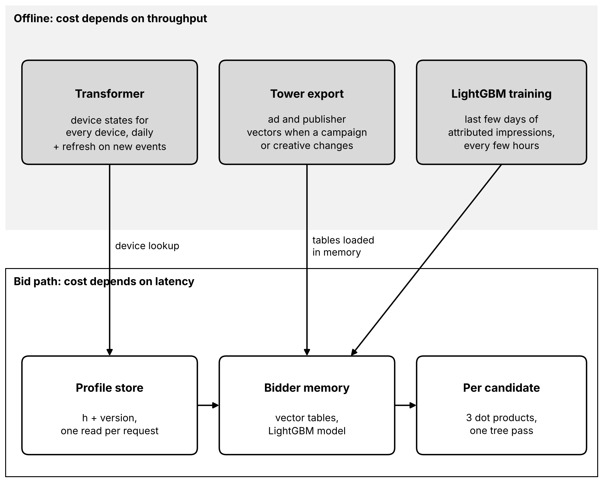
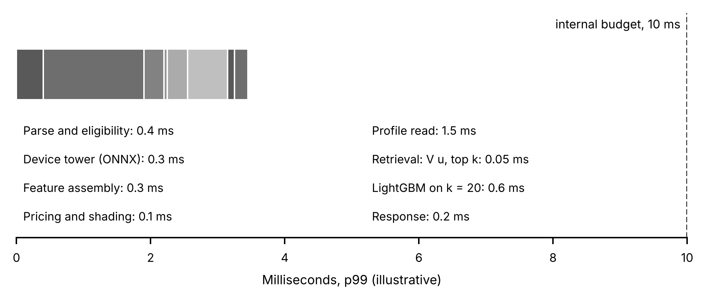
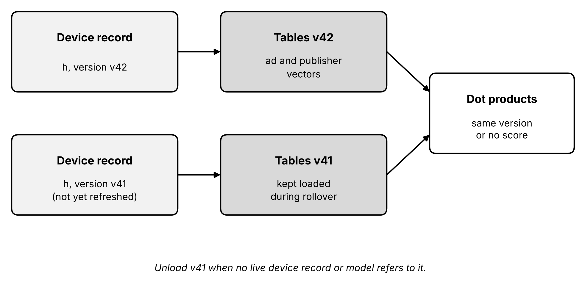
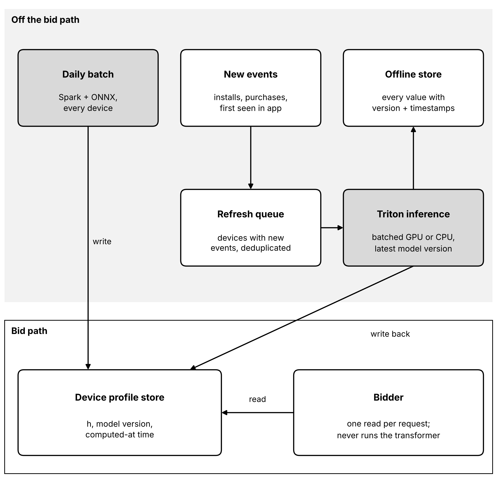

# Serving Deep Models {#sec-serving-deep-models}

The models in the last two chapters are expensive. A transformer over hundreds of events, a two-tower model with millions of apps, and a multi-task network with embedding tables don't fit in a bid path with a few milliseconds per request and dozens of candidates, on CPUs, at hundreds of thousands of requests per second. Yet both designs from @sec-where-trees-stop use their outputs on every bid.

The way through is to split the work. Everything that depends only on the device is computed offline, once per device, on GPUs if needed, and stored. Everything that depends on the candidate runs online, and is kept small enough for a CPU. The bid path does one key-value read, a few dot products, one small model, and the trees. Getting this right is mostly engineering: versions that match, parity between the training framework and the runtime, and tensors built the same way in Go as in Python.

In this chapter, we will design the bid path for CPU serving, split work between batch and the bid path, and distill models for serving. We then build tensors in Go with config-driven transforms, run ONNX Runtime with batched candidates, serve embedding lookups and dot products, and keep embeddings versioned with their downstream models. We cover exporting to ONNX with parity checks, benchmarking, CPU optimizations, when GPU serving makes sense, and when a feature store makes sense.

## Designed for CPU Serving

The models in this book are built so that the bid path runs on CPU: logistic regression, LightGBM, small online rankers over cached embeddings, and small heads. Heavy sequence compute runs offline or asynchronously on GPUs. Meta's LLaTTE design follows the same principle, keeping the online ranker light enough that p99 latency didn't change.[^c28-llatte]

The two designs differ in what they run at bid time:

| Step | Design A | Design B |
|------|----------|----------|
| Device lookup | One key-value read: device state and embedding | The same read |
| In memory | App and placement vectors, percentile tables | App, ad, and context vectors |
| Per candidate | A few dot products, a percentile lookup, one small ONNX head | Tower dot products, or a small DCN per candidate batch |
| Decision | Two LightGBM ensembles (install and value) | A LightGBM calibration layer |

: What each design runs at bid time. {#tbl-c28-designs tbl-colwidths="[22,39,39]"}

A production reference point for this kind of serving: Aarki has described exporting models trained in TensorFlow and PyTorch to ONNX and scoring them in-process, on CPUs, in a Rust bidder, across four data centers handling more than 5 million bid requests per second.[^c28-intent]

When a model doesn't fit the CPU budget, try these in order before adding GPUs to the bid path: precompute more of it offline, distill the online part into a smaller model, and batch candidates into one inference call.

<!-- RESULT: p99 latency and cost per million requests for Design A and Design B on the reference DSP. -->

## Splitting Work Between Batch and the Bid Path

The rule for splitting is to look at what each part of the model depends on. A transformer encoder over a device's history depends only on the device, so it runs offline, once per device, and its output, the device state, is stored in the profile. A head that combines the device state with the advertised app depends on the candidate, so it runs at bid time.

For the architecture in @sec-sequences-and-transformers, the split looks like this:

- **Device state $h$,** from the transformer, depends on the device's history. It's computed in an offline batch daily, plus a refresh for devices with new events, and stored in the profile store keyed by advertising ID, with a model version.
- **Ad vectors $a$** depend on the campaign, app, and creative. They're computed offline whenever a campaign or creative changes, and kept in bidder memory.
- **The publisher part of the context vector $c$** depends on the publisher app and placement. It's computed offline daily and kept in bidder memory.
- **The rest of the context,** OS version, country, connection, and hour, is read once per request as plain features.
- **Dot products** $h \cdot a$, $h \cdot c$, and $a \cdot c$ are computed per candidate in the bid path, from two stored vectors each.
- **Final probabilities** are computed per candidate by LightGBM, from the dot products and plain features.

The transformer runs as a batch job, once per device per day, on GPUs or a large CPU cluster, where cost depends on throughput rather than latency. The ad and publisher vectors are small tables, with thousands to tens of thousands of rows, that fit in the bidder's memory. In the bid path, each request needs one key-value read, which the bidder already does for frequency caps and other device features. For each candidate, the work is three dot products of 64 numbers and one pass through a tree model. None of it needs a neural network. @fig-c28-split shows the two halves, with only two arrows between them.

{#fig-c28-split width="100%" fig-alt="Offline jobs (transformer device states, tower export and LightGBM training) connect to the bid path only through a device lookup in the profile store and vector tables and models loaded in the bidder's memory; per candidate the bid path does three dot products and one tree pass."}

The main benefit of this design is that the large model and the bid path are decoupled. You can make the transformer deeper, extend its context, or add data sources, and the extra cost is paid in the batch job, not in the auction.

Splitting a model into an offline encoder and an online head creates a new way to fail: the two halves can disagree with the full model. Treat parity as a gate at both ends:

- **At export,** compare `head(encoder(x))` with the full model, on a sample of records, across a range of input lengths, both in the training framework and in ONNX Runtime. Refuse to register a version that fails.
- **In serving,** score a sample of requests both ways before anything switches over.
- **Register complete versions only.** A version is complete when both halves are exported and checked, and only complete versions can be promoted.

Batch scoring device states at DSP scale is a Spark job. One approach that works well is to export the encoder to ONNX, broadcast the model to the executors as bytes, and run it with `mapInPandas`, creating the ONNX Runtime session lazily on each executor, so a hundred million devices can be scored on a CPU cluster without a GPU.[^c28-pyspark]

## Distillation for Serving

When even the online part is too slow, **distillation** trains a small, fast student model to match the outputs of a large teacher. The student is trained on the teacher's predictions, often on far more data than has labels, so it learns the teacher's function rather than relearning from scarce labels. A student with a fraction of the teacher's layers can recover most of its gain. Distillation is also how one foundation model reaches many production models, as in @sec-sequences-and-transformers.

## Building Tensors in Go, and Config-Driven Transforms

Deep models take tensors, and the bidder has a FeatureVector. As we set up in @sec-logging-at-bid-time, the transforms between them belong to each model's bundle: vocabularies to map strings to IDs, padding and masks for lists, and fixed formulas such as `log1p` and standardization in the model graph. A shared Go preprocessing library reads the bundle's specification and builds the tensors, in the bidder and in the batch job that builds training data, so there's one implementation of each transform.

For transforms that change often, defining them in configuration rather than code keeps them in the bundle where they belong. CEL, the Common Expression Language, is one option for config-driven logic in a Go service: expressions are compiled once at load time and evaluated quickly per request.[^c28-cel] A feature specification can then say, for example, that a feature is the ratio of two counts with a default when the denominator is zero, and both Go and the training path evaluate the same expression.

## ONNX Runtime in Go, and Batching Candidates

The ONNX Runtime settings from @sec-serving-models-in-the-bid-path matter even more for deep models. Reduce the runtime's default thread parallelism, since concurrency comes from goroutines, and score all candidates for a request in one call. Limited CPU acceleration options are a real constraint for ONNX Runtime on CPU.

GoMLX is an alternative worth knowing about. It's a Go library with an XLA backend that accelerates inference on CPU, especially for small batch sizes, and it can load ONNX models. It can also fine-tune a loaded model online, on new examples such as win and loss feedback, which ONNX Runtime can't. Its ONNX support is less complete than Microsoft's runtime, so check that your models run before committing to it.[^c28-golang]

A practical note for on-prem fleets: recent ONNX Runtime bindings can require newer operating system versions than long-running servers have. Check the runtime's requirements against the bidder hosts before choosing a version.[^c28-onprem]

## Embedding Lookups and Dot Products at Bid Time

In both designs, most of the deep model's contribution reaches the bid through lookups and dot products:

- **Small tables in memory.** App, ad, and placement vectors, with thousands to tens of thousands of rows, fit in every bidder's memory, and are loaded with the model that needs them.
- **Device vectors in the profile store.** Device states and embeddings live in the NoSQL profile, keyed by advertising ID, and arrive with the one read the bidder already does.
- **Dot products are nearly free.** A dot product of two 64-dimension vectors takes nanoseconds, so three per candidate cost far less than any model call.

The lookup store's latency is the same constraint as in @sec-serving-models-in-the-bid-path: one read, a strict timeout, and a missing value when it times out. Missing is a value here too. Devices without an ID or a record get missing device signals, which the trees handle natively, and the placement affinity still provides a contextual signal.

## Per-Request and Per-Candidate Work

The single most useful rule for serving deep models in a bidder is to separate work that depends only on the request from work that depends on the candidate. A request has one device and one placement, and dozens to thousands of candidate campaigns and creatives. Anything computed per request is paid once. Anything computed per candidate is paid hundreds of times.

That makes it fine to run a light ONNX model once per bid request. A user or device tower that turns the cached device state and a few bid-time fields, such as the placement and how many ads the device has seen today, into a 64-dimension vector is a small MLP, and it runs in a fraction of a millisecond. What's not fine is running a network per candidate. The campaign and creative vectors depend only on the campaign and creative, so they're precomputed when a campaign or creative changes and held in memory, and scoring every candidate reduces to dot products between the per-request vector and the precomputed ones. @fig-c28-request shows the layout.

{#fig-c28-request width="100%" fig-alt="Once per request, the profile lookup feeds a device tower in ONNX that outputs a 64-dimension vector. Per candidate, a precomputed campaign matrix is multiplied by that vector, a partial sort keeps the top k, and only those go to the full models."}

### Computing Dot Products Efficiently

A dot product is cheap, but there are many of them, and the details decide whether scoring takes microseconds or milliseconds:

- **Store vectors as one contiguous matrix.** Keep all campaign vectors in a single row-major `[]float32` slice, with $N$ rows of 64, rather than a map of slices. Scoring every candidate is then one matrix-vector product over memory the CPU can stream, and eligibility is a list of row indices.
- **Let the compiler or a library vectorize.** A tight loop over `float32` slices, unrolled four or eight ways, lets the CPU use SIMD instructions. A BLAS routine, such as `Sgemv` through a Go or Rust binding, does the same with less effort. Both reach several billion multiply-adds per second per core.
- **Normalize once.** If the model scores with cosine similarity, normalize every vector when it's loaded, so scoring is a plain dot product.
- **Quantize if memory is tight.** Storing vectors as int8 with a scale per row cuts memory by four and speeds up scoring, with a small loss of precision. Check the effect on recall and calibration offline before using it.
- **Don't allocate per candidate.** Reuse a scores buffer per worker, and select the top $k$ with a partial sort or a small heap, which is linear in $N$, rather than sorting every score.
- **Batch across requests only if it's free.** Scoring several requests together turns the matrix-vector product into a matrix-matrix product, which is faster per request, but waiting for a batch adds latency. In a bidder, per-request scoring is usually fast enough.

The arithmetic is reassuring. With 2,000 eligible campaigns and 64 dimensions, scoring every campaign is 128,000 multiply-adds. At a few billion per second, that's tens of microseconds on one core, less than a single profile read. Even 50,000 creatives would take about a millisecond, which is when it's worth narrowing the candidates first, as in @sec-learned-campaign-selection.

### A Latency Budget

Every step in the bid path should have a budget, measured at p99 under load, as in @sec-serving-models-in-the-bid-path. @fig-c28-budget shows an illustrative budget for Design B with retrieval. The profile read and the trees dominate. The deep model's share, the device tower and the dot products, is under half a millisecond, because everything expensive happened offline.

{#fig-c28-budget width="100%" fig-alt="Horizontal bar of an illustrative p99 latency budget, totaling about 3.5 ms of a 10 ms budget. The largest pieces are the profile read at 1.5 ms and LightGBM on 20 candidates at 0.6 ms."}

## Embeddings as Versioned Artifacts, and Cluster IDs

Every signal derived from a deep model carries its version. Store a model version ID with each device record, and refuse to score when the device record, the in-memory app vectors, and the ONNX head come from different versions. Scores from mismatched versions look normal and are wrong, which is the worst kind of failure. During a rollover, keep the previous version's ad and publisher tables loaded, and use the tables that match each device record's version, as @fig-c28-rollover shows. Device records refresh over a day, so for a while both versions are live.

{#fig-c28-rollover width="100%" fig-alt="Two device records with different model versions, v42 and v41, each matched to the vector tables of the same version. The bidder keeps both versions loaded during the rollover and unloads v41 when nothing refers to it."}

Register embedding models and the online models that depend on them in the same registry, and promote them together when a new embedding version requires retrained downstream models.

Many useful features are lookups keyed by an entity: an app's category and release date, a publisher's historical click rate, or a pretrained embedding for the advertised app. Lookups are easy to get wrong, because the table behind them changes over time.

### Embeddings Are Versioned Artifacts

Consider GloVe embeddings for apps, trained on co-install data in February and retrained in March.[^c28-glove] The March vectors are not a refined copy of the February vectors. Each training run produces an arbitrary rotation of the space, so the coordinates mean different things. A model trained on February vectors that receives March vectors at serving time sees inputs that look like noise. The version is part of the feature's definition, and `app_glove@v2026-02` and `app_glove@v2026-03` are different features.

The pattern that keeps this consistent has four parts:

1. **Immutable artifacts.** Each embedding table is published once and never overwritten. The vocabulary, the rule for apps missing from it, and a checksum belong to the version.
2. **Model manifests.** Each model's bundle lists the exact versions it depends on, such as `app_glove@v2026-02` for one model and `app_glove@v2026-03` for another.
3. **Multi-version serving.** The bidder loads every version that any live model needs, keyed by feature name and version. A model whose dependencies are not loaded doesn't go live, and a version is unloaded once no model references it.
4. **Versions in the log.** The FeatureVector records the lookup key, such as the app bundle ID, and the version used, not the full vector. Because the artifact can't change, the input can be rebuilt exactly. Full vectors are logged only for a sample, for parity checks.

Small tables, such as app embeddings, can also be stored inside the model as a frozen embedding layer. One million apps with 64 dimensions in float32 take about 256 MB, which is often acceptable, and it makes version mismatches impossible. Large shared tables, such as precomputed device embeddings, belong in a versioned store, with at most two versions live at a time during a migration.

Two details are easy to miss. Each version has its own vocabulary, so a new app may be missing from February and present in March, and the OOV rule must match between training and serving. And embeddings trained on co-installs through March carry a little future information when used to train on January impressions. That's usually acceptable, but for strict comparisons, train embeddings only on data from before the model's training window, and record that window with the artifact.

[^c28-glove]: Jeffrey Pennington, Richard Socher, and Christopher D. Manning, "GloVe: Global Vectors for Word Representation," EMNLP, 2014.

### Cluster IDs from Embeddings

The GloVe clusters from @sec-gradient-boosted-conversion-models are the simplest case of an embedding-derived feature, and they follow the same rules. Cluster IDs are derived from an embedding version, so they're versioned with it, and the mapping from app to cluster is published as a lookup table alongside the embedding. The same holds for clusters of device states, creatives, or campaigns, which are useful for reporting as well as for trees.

Cluster numbers are arbitrary in each run, which means cluster 17 in February has nothing to do with cluster 17 in March. If continuity matters, for example for reporting or for analysts who've learned what cluster 17 means, match new centroids to old ones with a minimum-cost assignment on centroid distances, and renumber the new clusters to follow the old ones. Apps that change clusters between versions are worth a report of their own: a game that moves from "puzzle" to "casino" may have changed its audience, or its monetization.

## Exporting to ONNX and Verifying Parity

Every deep model reaches the bidder through an export to ONNX, and every export is checked before it's registered:

- **Outputs match.** Score a sample of real inputs in the training framework and in ONNX Runtime, and compare the outputs within a tolerance, such as a relative difference of $10^{-5}$.
- **Shapes and edge cases.** Include empty lists, maximum-length sequences, unseen IDs, and batches of different sizes in the sample.
- **Runtime versions align.** The ONNX opset the model was exported with must be supported by the ONNX Runtime version in the bidder.
- **Golden vectors.** As in @sec-shipping-the-first-model, the bundle ships golden FeatureVectors with the exact tensors and outputs, checked in Go before the model can load.

## Benchmarking Under Load

Deep models change the latency profile of the bid path, so benchmark them the way @sec-serving-models-in-the-bid-path benchmarked trees: Go benchmarks per stage, load tests with replayed requests at increasing rates, and p99 latency and cost per million requests for each model configuration. Benchmark with the real distribution of candidates per request, since a small DCN that's fast for one candidate can dominate the budget for fifty.

## CPU Optimizations for Deep Models

A few optimizations go beyond the tree-serving settings of @sec-serving-models-in-the-bid-path:

- **INT8 quantization** of the online model's weights can speed up CPU inference substantially, with parity checks to confirm the quantized model's outputs stay within tolerance and its calibration doesn't shift.
- **Memory for embedding tables.** Large tables loaded in every bidder add up. Store them in float16, or keep only the rows that serving needs, and account for two copies during a hot swap.
- **Per-candidate cost in Design B.** The online ranker runs for every candidate, so the candidate cap from @sec-serving-models-in-the-bid-path matters more, and the retrieval stage in @sec-learned-campaign-selection reduces it further.

## When GPU Serving Makes Sense

Training on GPU and serving on CPU is the dominant pattern for DSPs, and it's the pattern in this book. GPU serving makes sense only when an online model can't be made cheaper by precomputing, distilling, or batching, and the deciding number is FLOPs per request times requests per second.

As a rough estimate, online target attention over a 1,000-event history, with 256 dimensions and 50 candidates, takes about 25 million multiply-adds per request for the attention alone. At 1 million requests per second, that's tens of trillions of operations per second, which means hundreds of CPU cores per trading location, against a handful of GPUs. At ten times lower request rates, or with a shorter history, CPU wins.

<!-- TODO: replace the estimate with measured numbers from the reference DSP. -->

When it's needed, it's done with an inference server such as NVIDIA Triton running as a sidecar next to the bidder, called over gRPC, with dynamic batching that collects requests over a 1 to 2 ms window, TensorRT or ONNX engines in FP16, GPUs in every trading location, and a CPU fallback model when the GPU path times out. Triton is also the standard option for teams that want endpoint serving on-prem with both CPU and GPU execution providers.[^c28-outofcloud]

<!-- TODO: check NVIDIA Triton documentation on dynamic batching and recommender inference before citing specifics. -->

## When a Feature Store Makes Sense

A **feature store** provides one definition of each feature, computed by one pipeline and served to both training and serving. Most feature stores have four parts:

- **Registry:** feature definitions, owners, versions, and the entities they are keyed by.
- **Offline store:** historical feature values with timestamps, for building training data.
- **Online store:** current feature values with low-latency reads, for serving.
- **Materialization:** jobs that compute features and write them to both stores.

In a DSP, a feature store fits some features much better than others. Entity-level features, keyed by app, publisher, exchange, country, or campaign, are a natural fit. There are relatively few keys, the values change slowly, they are computed in batch or streaming jobs, and many models share them. Device-level features are a harder fit. There are billions of keys, they are written constantly, and they have to be read within a millisecond on the bid path. Most DSPs keep a custom device profile store, such as Bigtable, Aerospike, or Redis, for those, and log the values at bid time.

### Building One Without Leakage

The rule for a leakage-free feature store is that the offline store must return exactly what the online store would have returned at bid time, including its staleness. If the online store is refreshed every hour, a bid at 10:45 saw the value materialized at 10:00, and training must use that value, not one recomputed at 10:45:

$$x_{train}(t) = x(\tau^*), \qquad \tau^* = \max\{\,\tau_k : \tau_k \le t\,\}$$

where $\tau_k$ are the materialization times. This is called a point-in-time join, or an **as-of join**, and @fig-c9b-asof shows how it works.

{#fig-c9b-asof width="100%" fig-alt="Timeline from 9:00 to 12:00 with hourly feature materializations. Each bid uses the latest value materialized before it; an event at 10:30 that only becomes available at 11:10 is not visible to the 10:45 bid."}

A few design choices make this reliable:

- **Two timestamps on every value.** Store the event time the feature describes and the availability time it reached the online store, and join on availability time.
- **Append, never overwrite.** The offline store keeps every materialized value with its timestamp, so any past state can be reconstructed.
- **The same code writes both stores.** One materialization job writes the online and offline stores, so they can't drift.
- **Freshness monitoring.** Track the lag between event time and availability time per feature, because training should reflect the lag the bidder actually experienced.
- **Log what was served anyway.** Even with a feature store, have the bidder log the values it read and their timestamps. The log is the ground truth for parity checks against the offline store.

On Google Cloud, a simple version is an offline store in BigQuery with timestamped rows and an online store in Bigtable, written by the same Dataflow or batch job. Managed options include the Feature Store in Google's Gemini Enterprise Agent Platform, which replaced the Vertex AI brand in April 2026,[^c28-agent-platform] and open source options include Feast.[^c28-feast] Commercial platforms such as Tecton add streaming materialization and a registry.

[^c28-agent-platform]: "Google Announces New Gemini Enterprise Agent Platform," *THE Journal*, May 4, 2026. Most of the former Vertex AI services, including Feature Store, Pipelines, and Model Registry, continue under the Agent Platform name.
[^c28-feast]: Feast, an open source feature store, <https://feast.dev/>

### Choosing an Approach for Your Team

The best approach depends less on the technology than on who builds features and who owns the bidder.

**A small team that trains and serves.** When the same people train models and write the Go bidder, logging features at bid time is the simplest and safest choice. Adding a feature means adding it to the Go canonicalization layer, dark launching it, and backfilling from raw context with the same code. There is no extra infrastructure, skew is impossible by construction, and the team already understands the bid path. This is the setup this book uses for its reference DSP.

**A larger organization with more data scientists.** As the team grows, more people want to add features, and many of them work in SQL and Python rather than in the production Go codebase. Requiring a bidder change and a code review from the serving team for every feature becomes the bottleneck. This is when a feature store earns its cost. Data scientists define entity-level features declaratively, the platform materializes them to the online and offline stores, and the bidder reads them by name without code changes.

### An Extension Path

The two approaches don't have to compete. A DSP can keep logging at bid time and still let data scientists add features without touching Go, by giving the FeatureVector a section for registry-driven features:

1. Data scientists define a feature in the registry, with its entity key, its SQL or Python definition, and a refresh schedule.
2. The materialization job writes values to the online and offline stores.
3. The bidder reads the registry, fetches the listed features for each request by entity key, and places them in a generic section of the FeatureVector, keyed by feature name and version.
4. The bidder logs those values with the rest of the FeatureVector, so training still uses exactly what serving saw.

{#fig-c9b-team-path width="100%" fig-alt="Three stages, left to right, as more people build features outside the bidder code: a small team with features in Go and logged feature vectors; an extension path where a registry and store add features by name; and a large organization where the feature store is primary and logs check parity."}

This keeps the most important property of logging at bid time, that training data is exactly what the bidder used, while moving feature development to the people who build models. Device-level features that need bid-time aggregation stay in Go, owned by the serving team, and entity-level features move to the store. @fig-c9b-team-path and @tbl-c9b-teams summarize the progression.

| | Small full-stack team | Growing team with an extension path | Large organization |
|---|---|---|---|
| Who adds features | ML engineers, in Go | Data scientists for entity features; engineers for device features | Data scientists, through the platform |
| Source of training features | Logged FeatureVector | Logged FeatureVector, including registry features | Feature store as-of joins, checked against logs |
| New feature history | Dark launch and replay | Store backfill for entity features | Store backfill |
| Main risk | Bottleneck on the serving team | Registry and fetch latency on the bid path | Offline and online drift, staleness mismatches |

: How the approach changes as the team grows. {#tbl-c9b-teams}

One more lesson from the incidents: whichever structure you choose, have the people who train the models review changes to the code that computes features at bid time, and vice versa. When we started adding data scientists as reviewers on pull requests to the serving pipeline, parity issues started getting caught before they shipped instead of after.[^c28-incidents]

## Getting Embeddings into the Device Profile

Device embeddings and states are the hardest features to get right in a feature store. There are billions of keys, the values are large, a few hundred bytes each, and the bidder needs them in one read, within a millisecond. And unlike a publisher's click rate, a device's state changes every time it installs an app. There are three ways to get them into the device profile, and most DSPs end up using all three.

### Batch Scoring

The simplest approach is a daily batch job. Export the transformer to ONNX, score every device in Spark as in the batch scoring section above, and write the results to the profile store, keyed by advertising ID, with the model version and a computed-at timestamp. It's cheap per device, easy to reason about, and easy to backfill. Its weakness is freshness: a device that installed an app an hour ago isn't reflected in last night's state, and the hours just after an install are often when a device's intent is clearest.

### Calculating Embeddings on the Fly, Off the Bid Path

The alternative is to compute a device's state when its history changes, rather than once a day. Running the transformer for a single device is cheap, a few milliseconds on a CPU and much less in a batch on a GPU, but it's still far too slow and too variable to run inside the auction. The answer is to run it near real time, off the bid path, and write the result back to the profile:

1. **Trigger on new events.** When an install, a purchase postback, or a "first seen in app" event arrives for a device, publish the device ID to a refresh queue. Deduplicate within a short window, so a device with a burst of events is refreshed once.
2. **Score with an inference service.** A pool of workers reads device IDs from the queue, loads each device's recent tokens, and sends them in batches to an inference server. NVIDIA's Triton Inference Server is a good fit: it serves ONNX and TensorRT models from a versioned model repository, batches requests dynamically to keep the GPU busy, and runs on GPUs or CPUs. It's the endpoint style of serving from my post on serving deep learning in ad tech, used where its network hop doesn't matter.[^c28-serving]
3. **Write back to the profile.** Write the new state with its model version and computed-at time, using a conditional write so a slow worker can't overwrite a newer state with an older one.
4. **Log to the offline store.** Append the same value, with both timestamps, to the offline store, so training can reconstruct exactly what the bidder would have read at any moment, using the as-of join from earlier in this chapter.

@fig-c28-refresh shows how the pieces fit. The bidder never calls Triton. It reads the profile, as it always did, and finds a state that's minutes old instead of a day old.

{#fig-c28-refresh width="100%" fig-alt="Off the bid path, a daily batch job and a refresh queue for devices with new events run Triton inference and write device states to the profile store, with every value also kept offline. In the bid path, the bidder reads the profile once per request and never runs the transformer."}

The refresh path is sized by the rate of new events, not by bid requests. A DSP that sees a hundred million devices might receive tens of millions of install and purchase events a day, which is a few hundred refreshes a second, far less than the bid rate, and a few GPUs or a modest CPU pool can handle it. Pinterest's TransAct takes a related approach, combining a precomputed user embedding with a small real-time transformer over recent actions.[^c28-transact]

### Fallback States

Some requests have no record: a new device, a device without a usable ID, or an IDFV-only iOS request. Precompute a **fallback state** for each profile segment, such as country by OS by device tier, by running the transformer on the profile token alone, and store them in bidder memory. Flag fallback states in the features, so the trees can treat them differently, and report performance for these requests separately, so gains on devices with long histories don't hide the gap.

### Which to Use

Start with the daily batch, because it's the simplest and it gets most of the value. Add the refresh path when you can measure the gain from freshness. A simple test is to compare the model's offline metrics on impressions within a day of a device's last install, using the state from before and after that install. If the gap is large, freshness matters, and the refresh path is worth its cost. Keep the batch job either way, as the backfill and the safety net for any device the refresh path misses.

The one option to avoid is running the transformer in the bid path itself, synchronously, when a request arrives. It adds tens of milliseconds at p99, couples the bidder to the inference service's availability, and pays the full cost on every request, for a state that changes only when the device's history does.

## First-Time Pitfalls

- **Embedding store outages and stale device states.** Missing-as-value only works if the model saw missing values in training. Train with realistic missingness, and alert on staleness of the stored states.
- **Catalog coverage.** A new campaign or app has no embedding in the current version. Each version records the entities it covers, and the bidder falls back gracefully for the rest.
- **A version rollover that mixes tables.** During a rollover, keep the previous version's in-memory tables loaded, and use the table that matches each device record's version.

[^c28-incidents]: Ben Weber, "Machine Learning Incidents in AdTech," *Towards Data Science*, January 29, 2025, <https://medium.com/data-science/machine-learning-incidents-in-adtech-e3f48d858054>

::: {.callout-tip title="Try it on the simulator"}
Serve Design B's online ranker on CPU, and profile the bid path under load with replayed traffic. Then publish a new device state version without the matching app vectors, and watch the bidder refuse to score mismatched versions and fall back.

*Status: planned. This exercise needs the companion Go bidder with the ONNX device tower, which isn't built yet.*

:::

## Conclusion

In this chapter, we served deep models within the bid path's budget, on CPU. Work that depends only on the device runs offline, with parity checked at both ends of the split, and the bid path does one read, a few dot products, a small ONNX model, and the trees. Work that depends only on the request, such as a device tower, runs once per request, and campaign and creative vectors are precomputed, so scoring every candidate is one matrix-vector product. Distillation shrinks what has to run online, tensors are built by one config-driven Go library, ONNX Runtime is tuned for many small batched calls, and embeddings are versioned artifacts with every signal carrying its version. GPU serving is a last resort, sized by FLOPs per request, and a feature store is an extension for larger teams, built without leakage. Device states reach the profile through a daily batch job and a refresh path that recomputes them with Triton, off the bid path, and writes them back.

Serving deep models efficiently makes it possible to update them more often. That is where retraining and real-time learning come in.

[^c28-llatte]: Lee Xiong et al., "LLaTTE: Scaling Laws for Multi-Stage Sequence Modeling in Large-Scale Ads Recommendation," arXiv:2601.20083, January 2026, <https://arxiv.org/abs/2601.20083>

[^c28-intent]: Ben Weber, "Pretrained Deep Learning Intent Signals for Mobile DSPs," *Medium*, October 3, 2026, <https://bgweber.medium.com/pretrained-deep-learning-intent-signals-for-mobile-dsps-2eb1834c62db>

[^c28-pyspark]: Ben Weber, "Using DNN Embedding Models in PySpark at AdTech Scale," *Data Science Collective*, May 2026, <https://medium.com/data-science-collective/using-dnn-embedding-models-in-pyspark-at-adtech-scale-8f8fdd00fc17>

[^c28-cel]: Ben Weber, "10 Technologies I Explored as an Applied Data Scientist in 2021," *Towards Data Science*, December 2021, <https://medium.com/data-science/10-technologies-i-explored-as-an-applied-data-scientist-in-2021-b0cd04fcfa9d>

[^c28-golang]: Ben Weber, "Options for ML Serving with Golang," *Medium*, May 7, 2026, <https://medium.com/@bgweber/options-for-ml-serving-with-golang-3b1afa3a6182>

[^c28-onprem]: Ben Weber, "OnPrem vs Public Cloud for AdTech ML," *Data Science Collective*, May 15, 2026, <https://medium.com/data-science-collective/on-prem-vs-public-cloud-for-ml-3fb4568bd589>

[^c28-outofcloud]: Ben Weber, "Out of the Cloud: Building On-Prem Machine Learning Pipelines," *Data Science Collective*, September 27, 2025, <https://medium.com/data-science-collective/out-of-the-cloud-building-on-prem-machine-learning-pipelines-597d5603502f>

[^c28-serving]: Ben Weber, "Serving Deep Learning in AdTech," *Data Science Collective*, May 18, 2025, <https://medium.com/data-science-collective/serving-deep-learning-in-adtech-0ff9467ed946>

[^c28-transact]: Xue Xia et al., "TransAct: Transformer-based Realtime User Action Model for Recommendation at Pinterest," KDD, 2023, <https://arxiv.org/abs/2306.00248>
