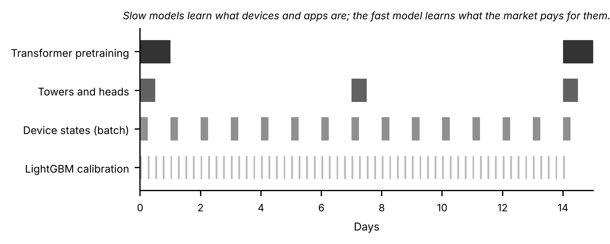

# Retraining and Real-Time Learning {#sec-retraining-and-real-time-learning}

Markets move faster than models retrain. A new game launches and takes over a genre's audience, an exchange changes its auction, a holiday weekend changes who's playing, or a competitor changes how it bids. A model retrained once a day is always a little behind, and a model retrained once a week can be badly behind by the end of the week. Every DSP has to decide how fresh its models need to be, and what it's willing to pay, in compute and in risk, to keep them that fresh.

"Real-time learning" is the phrase vendors use for the answer, and it means very different things depending on who's using it. Some mean retraining every few hours. Some mean features that update within seconds. Some mean models that update themselves continuously. Some mean a business that gets better with more data. This chapter separates them, because they have very different costs and risks.

In this chapter, we will look at frequent retraining and real-time features, separate the five things real-time learning can mean, and cover the risks of learning fast, with guards against them. We then handle delayed feedback when models retrain every few hours, and build shared state for real-time features on the counter store from Part II.

## Frequent Retraining and Real-Time Features

The retraining thread has run through the book: daily in crawl, a few times a day in walk, and near-continuous in run. The leading platforms describe the far end of it. Moloco describes deploying models as often as every two hours, with real-time features that update the next prediction as soon as a user sees an ad or a competitor changes a bid.[^c29-moloco] Liftoff describes training hundreds of models a day on over a petabyte of new data.[^c29-liftoff] Meta describes its GEM foundation model as training continuously.[^c29-gem]

A DSP with the architecture from @sec-sequences-and-transformers doesn't retrain everything at the same pace. It has three cadences, as @fig-c29-cadences shows:

- **Transformer pretraining** trains on non-attributed events from every source, and is retrained weekly to monthly. Its device states are recomputed daily in batch, and refreshed for devices with new events, as in @sec-serving-deep-models.
- **The co-trained towers and heads** train on attributed impressions and are retrained weekly. They produce the ad and publisher vectors and the dot products.
- **LightGBM** trains on the last few days of attributed impressions and is retrained every few hours. It produces the click and install probabilities the bidder uses.

{#fig-c29-cadences width="100%" fig-alt="Timeline over 14 days of four training cadences: transformer pretraining about every two weeks, towers and heads weekly, device states in a daily batch, and LightGBM calibration every few hours."}

The slow models learn what devices and apps are, and the fast model learns what the current market pays for them. That split is what makes frequent retraining affordable: only the small model retrains every few hours, and the expensive ones retrain when the world changes enough to matter. It also means "how often should we retrain?" has three answers, one per layer, each found the same way: train the layer at several cadences on the simulator or on replayed data, and see where the gain from fresher models stops paying for the compute. In my post on real-time ML systems, I describe the same trade-off from the serving side, as a range from features precomputed in batch and stored in a NoSQL store to features computed from the request in real time, each with its own cost and freshness.[^c29-realtime]

Retraining every few hours is possible only when everything around it keeps up. The pipelines from @sec-pipelines-validation-and-publishing need to run end to end within the interval, validation and canaries need to be automated, since nobody can review a model every two hours, and the labels a model trains on need to be as recent as the model. The last one is the hardest, as we'll see below.

## Real-Time Learning

It helps to separate the five things "real-time learning" can mean, because vendors use the phrase loosely:

1. **Frequent batch retraining,** from daily to every few hours. Moloco says it retrains as new signals arrive and deploys as often as every two hours, and Liftoff says it trains hundreds of models a day on over a petabyte of new data.[^c29-moloco][^c29-liftoff]
2. **Real-time features,** updated within seconds of an impression or a win. The model doesn't change, but its inputs do. Moloco describes features that update the next prediction as soon as a user sees an ad or a competitor changes a bid.[^c29-moloco]
3. **Fast-adapting layers on a slower model.** The calibration multiplier $\kappa$, per-campaign bias terms, the pacing multiplier $\gamma$, and creative bandits absorb drift between retrains. This is the practical sweet spot for a DSP, and most of it was built in Parts II and III.
4. **Online training of the model itself,** where the model's weights update with each new example. FTRL logistic regression from @sec-a-click-model is the classic example,[^c29-mcmahan] continuous training of large models such as GEM is the modern one,[^c29-gem] and libraries such as GoMLX can fine-tune a model in a Go service on win and loss feedback.[^c29-golang]
5. **Self-improving systems,** as described in earnings calls and product pages, where more advertisers and more data feed periodic model releases. AppLovin describes a cycle in which its team releases better models, advertisers see better returns and spend more, and more advertisers bring more data for a more sophisticated model, and Unity describes its Vector platform as self-learning and adaptive.[^c29-applovin][^c29-unity] These are claims about results, not methods, and should be read that way.

For most DSPs, the order to invest in is the order above, starting from the third: fast-adapting layers first, then more frequent retraining, then real-time features, and online training of the model itself last.

**The risks of learning fast.** The faster a system learns, the faster bad data reaches it. In online learning, a burst of bad labels or a broken feature changes the model immediately, with no validation step in between. Unity has described rebuilding its earlier system after it ingested inaccurate customer data in 2022.[^c29-unity] In one incident I've written about, false-positive labels from a small experiment drove a clearing-price feature upward, which pushed bids up and fed back into the feature.[^c29-incidents] The guards are the same at every level of speed:

- **Filter outliers** before they reach the model, such as segments whose label rates jump far beyond their history.
- **Handle delayed labels,** so recent examples aren't treated as negatives.
- **Bound updates,** so no single interval can move the model or a multiplier more than a set amount.
- **Roll back fast** to the last scheduled model, with the automated rollback from @sec-shadow-mode-canaries-and-ab-tests.

## Delayed Feedback with Frequent Retraining

In walk, we waited for each label's window to close before training on it. @fig-c29-delays shows why that's expensive: click-through installs arrive within an hour or so, but view-through installs take most of a day, and first purchases within a D7 window keep arriving all week.

{#fig-c29-delays width="100%" fig-alt="Line chart of the share of eventual conversions reported over time since the impression. Click-path installs are mostly reported within an hour, view-path installs rise more slowly over a day, and first purchases in the D7 window arrive over several days."}

When models retrain every few hours, waiting a week for purchase labels throws away exactly the recent data that frequent retraining is for. But training on recent impressions without waiting means their installs and purchases haven't arrived yet, so they look like negatives, and the model underpredicts.

Three published approaches correct for this:

- **The delayed feedback model** models the conversion and the delay together, so an impression without a conversion yet is treated as "not converted so far" rather than "not converted".[^c29-chapelle]
- **Elapsed-time sampling (ES-DFM)** corrects the training distribution for how long each example has been waiting, using importance weights.[^c29-esdfm]
- **Real negatives (DEFER)** ingests examples first as unlabeled or fake negatives, and later ingests the real labels and real negatives, with a correction so the model stays unbiased.[^c29-defer]

The simulator makes the bias easy to see, because it knows the true conversion rate. Train a model every few hours on recent impressions with naive labels, and its predictions fall below the true rate. Apply one of the corrections, and the gap closes.

The next section measures both on the simulator: naive labels left a model retrained every 6 hours at about two-thirds of the true rate, and importance weights by elapsed time closed the gap.

## Shared State for Real-Time Features

Real-time features build on the fleet-wide counter store from @sec-operating-the-first-dsp, which already holds spend per campaign and impressions per device for budgets and frequency caps. In run, it also holds features that change within seconds: how many of our impressions a device has seen in the last minute, whether it clicked one in the last hour, how a publisher's win rate has moved in the last five minutes.

Streaming jobs update these counters from impression, win, click, and postback events as they arrive. The difficulty is keeping training and serving consistent when features change this fast. A feature computed at bid time from a counter that was a few seconds stale is the value the model saw, so it's the value that's logged in the FeatureVector, and the value training uses. Recomputing it later from the event log, even as of the bid time, would give a fresher value than the bidder had, which is the skew from @sec-logging-at-bid-time all over again.

## A Market Shift in the Reference DSP

The simulator's `new-game` scenario shifts the market mid-day: at 12:00 UTC, a new hypercasual hit that isn't one of the DSP's advertisers takes over the genre's audience, and from then on the genre's games get 40% of the installs they did before. Hypercasual games had most of the dataset's installs, so the shift hits where the money is. The Part IV shift dataset continues the Part IV market for four days with the scenario on, the shift at noon on the first, and records when each install's postback arrived.

`adtrain retrain` replays the shift with four ways of keeping a LightGBM install model current, each trained only on the installs whose postbacks had arrived by its training time:

- **Daily:** retrained at midnight on the last 7 days, on impressions whose install window had closed, as in walk.
- **Daily, with $\kappa$:** the daily model times a calibration multiplier per advertised app. Every hour, $\kappa$ compares the installs reported so far for the last day's impressions with what the model in use predicts for them, times the share of installs reported by then. Each update moves $\ln \kappa$ by at most 0.2, and $\kappa$ starts again at 1 when the model is retrained.
- **Every 6 hours, naive:** retrained every 6 hours on every impression, with installs not reported yet counted as no install.
- **Every 6 hours, delay-weighted:** the same rows, with each reported install counted as $1/F(e)$ installs, where $F(e)$ is the share of installs reported by the time its impression had waited $e$, from the impressions before the replay. These are importance weights by elapsed time, in the spirit of ES-DFM. With install rates of a few percent, weighting the positives alone is close to unbiased.

Installs are reported 1.4 hours after the impression at the median and 12.5 hours at the 90th percentile, and 79% are reported within 6 hours, so a model retrained every 6 hours is missing many of the installs from its most recent impressions. Calibration is measured against the truth: predicted installs over true installs times the share credited to the DSP, which the labels count, measured on the week before the replay. @tbl-c29-shift has the hypercasual campaigns.

| Phase | Daily | Daily, with $\kappa$ | Every 6 hours, naive | Every 6 hours, delay-weighted |
|---|---|---|---|---|
| The day before the shift | 0.97 | 0.93 | 0.64 | 1.02 |
| The first 6 hours | 2.70 | 2.59 | 2.06 | 3.08 |
| 6 to 24 hours | 2.62 | 1.91 | 0.74 | 1.14 |
| The second day | 1.84 | 1.08 | 0.73 | 0.98 |
| The third day | 1.05 | 0.96 | 0.73 | 1.07 |

: Calibration of the hypercasual install predictions through the shift, against the truth: 1.00 is right. {#tbl-c29-shift tbl-colwidths="[32,14,18,18,18]"}

Before the shift, the naive model sits at two-thirds of the truth, the bias of delayed labels, and the delay-weighted model is calibrated. In the first 6 hours, every model overpredicts by two to three times, because none has seen the shift yet. Then they separate. The delay-weighted model is within 14% of the truth from 6 hours after the shift, and calibrated on the second day. The daily model overpredicts by 2.6 times for the rest of the first day and 1.8 times on the second, which a DSP would pay for in overbids on every hypercasual impression, until its retrain on the third day. $\kappa$ fixes most of that a day sooner than the retrain, limited by its bounded steps and by the installs it has to wait for. The naive model looks closer than the daily one after the shift, at 0.74, but for the wrong reason: its bias toward too few installs happens to point the same way as the shift, and it stays at 0.73 once the market settles.

For the other genres, whose true rate didn't change, the naive model stayed below the others throughout. On the last two days, the daily, $\kappa$, and delay-weighted models all drifted to about three-quarters of the truth together, so that drift isn't about how often they retrain.

::: {.callout-tip title="Try it on the simulator"}
Shift the simulated market mid-day, with a new game that takes over a genre's audience, and replay the shift with a model retrained daily, the same model with an hourly $\kappa$ per advertised app, and models retrained every 6 hours with naive labels and with importance weights by elapsed time. Compare their calibration against the true rates, hour by hour, before and through the shift.

Scaling up is yours: an online-updated model, retraining every 2 hours, the delayed feedback model or DEFER in place of the weights, purchases with their week-long delays, and shifts of other kinds, such as an exchange that changes its auction.

*Status: runs with the companion code (adtrain 0.17, adsim 0.8), on the Part IV shift dataset: about two minutes on a laptop's CPU. Scaling up is yours. Commands are in `WALKTHROUGH.md`, under this chapter.*

:::

## Conclusion

In this chapter, we looked at keeping models current, with three cadences for the slow pretrained models, the co-trained towers, and the fast calibration layer. "Real-time learning" covers five different things: frequent retraining, real-time features, fast-adapting layers, online training, and claims about self-improving systems, and the fast-adapting layers built in Parts II and III are the practical place to start. Learning fast also spreads bad data fast, so outlier filters, delayed label handling, bounded updates, and fast rollback guard every level. When models retrain every few hours, delayed feedback corrections replace waiting for labels, and real-time features come from a shared counter store, logged as the bidder saw them.

Freshness matters most for predictions that move fastest, and the slowest labels belong to value. In the next chapter, we predict what an installed user will be worth.

[^c29-moloco]: Moloco, "Inside Moloco's CARA: the AI that compounds," Moloco blog, 2026, <https://www.moloco.com/blog/inside-molocos-cara-the-ai-that-compounds>

[^c29-liftoff]: "How Liftoff improved conversion performance and reduced infrastructure costs with Cortex using AWS Graviton," AWS for Industries blog, March 31, 2026, <https://aws.amazon.com/blogs/industries/liftoff-improved-conversion-performance-and-reduced-infrastructure-costs-with-cortex-using-aws-graviton>

[^c29-gem]: Huayu Li, Xiaoyi Liu, Jade Nie, et al., "Meta's Generative Ads Model (GEM): The Central Brain Accelerating Ads Recommendation AI Innovation," Engineering at Meta, November 10, 2025, <https://engineering.fb.com/2025/11/10/ml-applications/metas-generative-ads-model-gem-the-central-brain-accelerating-ads-recommendation-ai-innovation/>

[^c29-mcmahan]: H. Brendan McMahan et al., "Ad Click Prediction: a View from the Trenches," KDD, 2013, <https://research.google/pubs/ad-click-prediction-a-view-from-the-trenches/>

[^c29-golang]: Ben Weber, "Options for ML Serving with Golang," *Medium*, May 7, 2026, <https://medium.com/@bgweber/options-for-ml-serving-with-golang-3b1afa3a6182>

[^c29-applovin]: AppLovin, Q1 2026 earnings call transcript, May 6, 2026, via The Motley Fool, <https://www.fool.com/earnings/call-transcripts/2026/05/07/applovin-app-q1-2026-earnings-transcript>

[^c29-unity]: Allison Schiff, "Unity's AI Ad Platform Is Out Of Beta After A Complete Rebuild," *AdExchanger*, May 7, 2025, <https://adexchanger.com/gaming/unitys-ai-ad-platform-is-out-of-beta-after-a-complete-rebuild/>

[^c29-incidents]: Ben Weber, "Machine Learning Incidents in AdTech," *Towards Data Science*, January 29, 2025, <https://medium.com/data-science/machine-learning-incidents-in-adtech-e3f48d858054>

[^c29-chapelle]: Olivier Chapelle, "Modeling Delayed Feedback in Display Advertising," KDD, 2014.

[^c29-esdfm]: Jia-Qi Yang et al., "Capturing Delayed Feedback in Conversion Rate Prediction via Elapsed-Time Sampling," AAAI, 2021, <https://arxiv.org/abs/2012.03245>

[^c29-defer]: Siyu Gu et al., "Real Negatives Matter: Continuous Training with Real Negatives for Delayed Feedback Modeling," KDD, 2021, <https://arxiv.org/abs/2104.14121>

[^c29-realtime]: Ben Weber, "Approaches for Building Real-Time ML Systems," *Towards Data Science*, September 2021, <https://medium.com/data-science/approaches-for-building-real-time-ml-systems-79ea0e340269>
