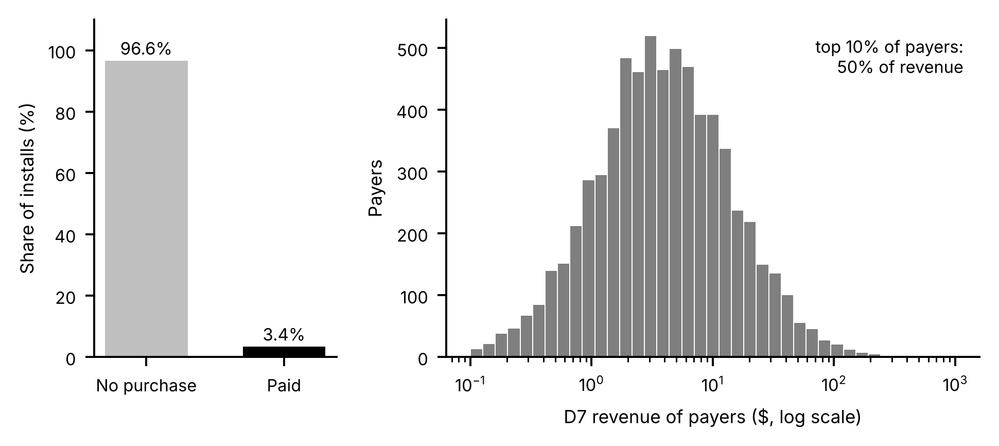
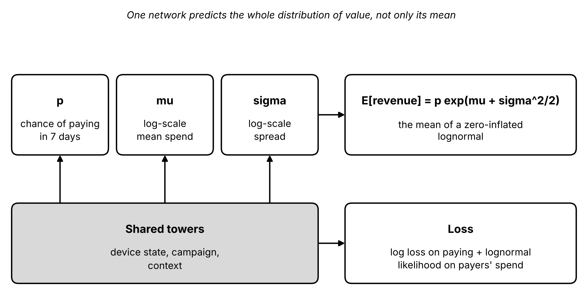
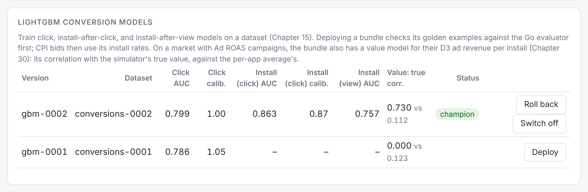
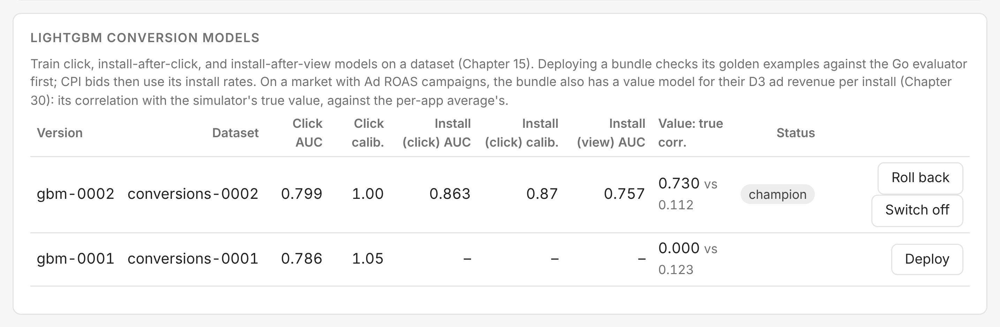

# Value Prediction {#sec-value-prediction}

For a ROAS campaign, an install isn't worth a fixed amount. One new player in Cozy Farm Tycoon never spends anything, another buys a starter pack in the first hour, and a third spends hundreds of dollars over the first week. The advertiser's goal is revenue per dollar spent, so the DSP has to predict which kind of player each impression is likely to bring, and bid accordingly. Walk added a first value model with LightGBM in @sec-gradient-boosted-conversion-models. Run makes value a first-class prediction, with deep models, better losses for heavy-tailed revenue, and models for the other value-based goals: retention and ad revenue.

As we said in @sec-introduction, long-term lifetime value modeling is usually the studio's job, not the DSP's. The studio has the full revenue history of its players and sets its D7 targets from its own long-term curves. The DSP's job is to predict the short-window value that its goals are measured on, as accurately as it can, from the moment of the impression.

In this chapter, we will define value labels, model sparse, long-tailed revenue, and build D1 retention models and ad revenue models for hypercasual games. We close with how to evaluate value models, where the usual classification metrics don't apply.

## LTV Labels

Value labels come from in-app event postbacks: purchase events with revenue, joined to attributed installs, as in @sec-building-training-datasets. The common labels are:

- **D7 revenue:** total purchase revenue in the first seven days after install. It's the most common ROAS goal window, because it balances signal against delay.
- **Longer windows,** such as D30 revenue, which are closer to long-term value but take a month to mature, so models trained on them are always more than a month behind.
- **Studio-provided multipliers.** Some studios share a multiplier between D7 and longer-term revenue, from their own cohort curves, so a campaign judged on D7 can be priced on expected long-term value. The multiplier is the studio's, and the DSP applies it to its D7 prediction rather than modeling D365 itself.

Revenue arrives in local currencies, sometimes net of app store fees and sometimes not, depending on how the advertiser configured its MMP. Normalize currency at ingest, and record per advertiser whether revenue is gross or net, because a model pooled across advertisers will otherwise learn that some games' players spend 30% less.

## Sparse, Long-Tailed Revenue

Most installers never pay, and of those who do, a few pay far more than the rest. @fig-c30-revenue shows a typical distribution for a mid-core game: about 97% of installs spend nothing in their first week, and among the payers, spend spans four orders of magnitude, with the top 10% of payers bringing in about half of the revenue.

{#fig-c30-revenue width="100%" fig-alt="Two charts. A bar chart shows that 96.6% of installs make no purchase and 3.4% pay. A histogram on a log scale shows payers' D7 revenue is roughly lognormal with a long tail, where the top 10% of payers bring half the revenue."}

This shape breaks most of the defaults from earlier chapters. A model trained with squared error on raw revenue is dominated by the largest payers, and one trained only on payers ignores the fact that most installs are worth nothing. Three approaches handle this well:

- **Two-part (hurdle) models:** a classifier for the probability of paying, and a regression for spend given payment, trained only on payers, often on log revenue. Expected value is the product. Each part is easy to evaluate on its own.
- **Tweedie and similar losses,** which model a point mass at zero and a continuous tail in one model, as with LightGBM in walk.
- **Zero-inflated lognormal (ZILN) loss** for deep models, which predicts the probability of paying and the parameters of a lognormal spend distribution in one network, and gives a full distribution of value rather than a point estimate.[^c30-ziln]

The ZILN head is worth seeing in detail, because it fits the shared-tower models of this part so naturally. @fig-c30-ziln shows it. Three outputs share the towers: $p$, the probability of paying within the window; $\mu$, the mean of log spend for a payer; and $\sigma$, its spread. The loss is the log loss on whether the device paid, plus, for payers only, the negative log likelihood of their spend under a lognormal with $\mu$ and $\sigma$. The expected revenue is the mean of the zero-inflated lognormal:

$$E[\text{revenue}] = p \cdot e^{\mu + \sigma^2/2}$$

The $\sigma^2/2$ term matters. The mean of a lognormal is above its median, by a lot when the spread is wide, so a model that predicted $e^\mu$ would systematically underprice devices whose spend is uncertain. And because the head predicts a distribution, it also gives quantities a point estimate can't, such as the probability of spending more than \$10, which some studios use as a goal, and the uncertainty of each prediction.

{#fig-c30-ziln width="100%" fig-alt="Shared towers output three values: the chance of paying within 7 days, and the log-scale mean and spread of spend. Together they give the expected revenue of a zero-inflated lognormal, trained with log loss on paying plus a lognormal likelihood on payers' spend."}

In run, value models are heads on the shared base from @sec-deep-models-with-embeddings, trained over every impression by multiplying through the funnel, or LightGBM models that use the transformer's purchase and spend head outputs as features, in Design A. Non-attributed purchase data is especially valuable here, because spending behavior carries across apps: a device that spends heavily in three strategy games is a much better prospect for a fourth than its install history alone would suggest.[^c30-intent]

Capping revenue labels, for example at a high percentile per app, reduces the influence of a few extreme payers on training. Cap for training, not for evaluation, and check that the cap doesn't bias predicted totals.

## Label Maturity and Early Signals

D7 revenue takes seven days to mature after the install, and the install can take a day after the impression, so the newest complete label is more than a week old. That's a long lag for a market that moves daily, and for a new campaign, it means a week of bidding before the first value label arrives. Three things shorten it:

- **Train on partial windows with a correction.** An install that's three days old has most of its D7 revenue already, for most games. Learn the share of D7 revenue that arrives by each day, per app, from older cohorts, and train on young installs with their partial revenue scaled up, or with the delayed feedback methods from @sec-retraining-and-real-time-learning.
- **Use early signals as features.** Revenue in the first day, a first purchase, the tutorial completion, and D1 retention all predict D7 revenue well. A model for "D7 revenue given what happened on day one" can score an install a day after it happens, which is enough to update the calibration multiplier for a campaign far faster than waiting a week.
- **Lean on non-attributed purchases.** The pretrained device model already knows how each device spends in other apps, so even a brand-new campaign gets value predictions that reflect its installers' spending history, before any of them has paid in its app.

These signals also connect to how studios judge DSPs. A studio that reports a boosted LTV, as in @sec-introduction, is usually building it from the same early signals, so a DSP whose value models predict them well is predicting what the studio will reward.

## Value Heads on the Transformer

The transformer from @sec-sequences-and-transformers was pretrained to predict the next install, and purchase tokens with spend bands are already in its input. That makes value heads cheap to add. A few that work well:

- **Purchase within the window, in any app,** predicted from the device state alone. It's a general propensity to spend, and it works for any campaign.
- **Spend band,** a softmax over the same bands as the purchase tokens, such as under \$1, \$1 to \$5, \$5 to \$20, and over \$20, which gives probabilities such as $P(\text{spend} \geq \$5)$ directly.
- **App-conditional purchase,** scored by combining the device state with the advertised app's embedding, as the next-install head does, which predicts purchase in this specific game.

In Design A, these head outputs are features for the LightGBM value model, and in Design B, a ZILN head on the co-trained towers predicts value per impression, multiplied through the funnel like the install heads. Either way, the tree layer sets the level, because value models are the hardest of all to calibrate.

## D1 Retention Models

Some advertisers, especially for games that monetize later or through ads, buy retention: installs from players who come back the next day. The label is whether the installed user opened the app on day one after install, which requires the advertiser to send a session or retention event through its MMP.

Retention is easier to model than revenue. It's binary, much more common than paying, and it matures in a day or two. A D1 retention head, or a LightGBM model on installs, is trained like the install models, and enters the advertiser value as $P(\text{install}) \times P(\text{D1} \mid \text{install})$. It's also a useful feature for value models, since players who come back are the ones who eventually pay.

## Ad Revenue ROAS for Hypercasual Games

Hypercasual games earn most of their revenue from ads shown to their players, not from purchases. Their advertisers judge campaigns on ad revenue ROAS: the ad revenue their new players generate, divided by what they cost.

Ad revenue labels come from impression-level ad revenue that the advertiser's mediation platform reports, shared with the DSP through the MMP where the advertiser chooses to. Ad revenue behaves differently from purchase revenue. Almost every retained player generates some, so it's much less sparse, and it depends mostly on how long and how often the player plays, and on the player's country, which sets the price of the ads they see. Models for it lean on retention and engagement signals, and on geo, and are usually regression models on log revenue rather than hurdle models. A player's ad revenue is also part of the same market the DSP buys in, so it moves with ad prices.

## Evaluating Value Models

Value models need different evaluation from classifiers:

- **Calibration of predicted revenue,** as the ratio of predicted to realized total revenue, by campaign, country, and decile of predicted value. The decile view matters most: a model can be calibrated overall and badly off at the top, where the money is. @fig-c30-calibration, after this list, shows the calibration plot for a value model, in the same form as the click and install plots earlier in the book, with revenue per install in place of a rate.
- **Ranking by value,** with a cumulative gain curve: sort installs by predicted value, and plot the share of total revenue captured by the top fraction. Normalized Gini summarizes the curve in one number. @fig-c30-gain compares a value model with ranking by install probability alone, which is what a CPI campaign effectively does.
- **The product with installs.** For bidding, what matters is the calibration of $P(\text{install}) \times E[\text{value} \mid \text{install}]$ by bid range, as in @sec-pricing-for-goals.
- **Enough days.** A few large payers can swing any revenue metric, so evaluate over enough days, and report confidence intervals from a bootstrap over users.

{#fig-c30-calibration width="100%" fig-alt="Calibration plot of mean predicted and actual D7 revenue per install by decile. The lines match closely from near zero to about $1.20, and the prediction is too high in the top decile."}

{#fig-c30-gain width="100%" fig-alt="Cumulative gain curves for D7 revenue. Ranking installs by the value model captures revenue fastest, with a Gini of 0.63, ahead of ranking by an install model alone at 0.40, and both are well above random."}

## Value Prediction in the Reference DSP

The reference DSP prices Ad ROAS campaigns for hypercasual apps with a value model, on the simulator's walk market with ad revenue turned on. Ad revenue labels are dense: in the simulator, as in real hypercasual games, every player earns something on the install day, and more on each day they keep playing, and hypercasual ads convert far better than most. The campaigns are judged on D3 ad revenue, so a label is final three and a half days after the install, not ten. The model is a LightGBM regression with a Tweedie loss, trained on every install of a hypercasual app, whichever campaign brought it, with the same inputs as the install models plus one: how many requests a day the DSP sees from the device, a proxy for how much its player plays. The bidder serves it natively, like the other trees, through an exp link.

The exercise runs on the simulator's smallest market, so that it takes minutes. After nine simulated days, the model was trained on 251 installs and evaluated on the 63 installs of the next two days with final labels. Its predictions correlated 0.73 with the simulator's true D3 value, against 0.11 for each app's average, the pricing from @sec-pricing-for-goals. The fifth of installs it ranked highest held 53% of the true value, against 39% for the per-app average. Overall, it predicted 0.77 times the true value, as in @fig-c30-bundles.

::: {.content-visible when-format="html"}
{#fig-c30-bundles width="100%" fig-alt="Screenshot of the LightGBM conversion models table with two bundles. Columns: click AUC and calibration, install AUCs and calibration, and Value: true corr. gbm-0002, the champion: click AUC 0.799, install (click) AUC 0.863, value 0.730 vs 0.112. gbm-0001: click AUC 0.786, no install models, value 0.000 vs 0.123."}
:::

::: {.content-visible unless-format="html"}
{#fig-c30-bundles width="100%" fig-alt="Screenshot of the LightGBM conversion models table with two bundles. Columns: click AUC and calibration, install AUCs and calibration, and Value: true corr. gbm-0002, the champion: click AUC 0.799, install (click) AUC 0.863, value 0.730 vs 0.112. gbm-0001: click AUC 0.786, no install models, value 0.000 vs 0.123."}
:::

Better predictions only matter if they buy more revenue, and a value A/B test checks that: it splits devices and each campaign's budget in half, and prices Ad ROAS bids with the value model in one arm and with each app's average in the other. On the small market, three days weren't enough to tell: about 270 installs per arm, and a treatment ROAS 0.95 times the control's measured from the postbacks (95% interval 0.66 to 1.41), 1.05 times from the simulator's true values (0.83 to 1.33). On a market ten times bigger, the simulator's laptop scale, the same test over three days found the value model's installs earned $270 of D3 ad revenue against $190 for the same spend: 1.42 times the ROAS measured (0.94 to 1.99), and 1.36 times from the true values (1.18 to 1.58). A value model can only show its worth where there's enough volume to measure it, which is one reason the DSPs that win on ROAS are the big ones.

::: {.callout-tip title="Try it on the simulator"}
Run the walk market with ad revenue for nine days, train a value model for the Ad ROAS campaigns' D3 ad revenue, and compare it with each app's average against the true expected revenue from the ground truth, by fifth of the prediction and by country, and against the least-squares model on log revenue in its report.

Scaling up is yours: run the value A/B test on the small market and see how wide its interval is, then on the laptop-scale market (`ADSIM_SCALE=laptop`, about ten times the traffic and the run time) for long enough to read it out. The deep funnel is yours too: purchase revenue for ROAS campaigns, with a two-part model and a Tweedie model on D7 purchase revenue, and a ZILN head once you have the deep models of Part IV. Purchases are sparse, so this needs many more simulated days than ad revenue.

*Status: runs with the companion code (dsp 0.15, adtrain 0.9, adsim 0.4), on the walk market with ad revenue (`ADSIM_SCENARIO=ad-roas`): nine simulated days, about five minutes. The Conversions tab shows each bundle's value model against the per-app average, and the Experiments tab runs and reads out value A/B tests. Scaling up and the purchase revenue models are yours. Commands and screenshots are in `WALKTHROUGH.md`, under this chapter.*
:::

## Conclusion

In this chapter, we predicted what installs are worth. D7 revenue labels, with studio-provided multipliers for longer horizons, come from purchase postbacks normalized for currency and fees. Two-part models, Tweedie losses, and ZILN handle sparse, heavy-tailed revenue, with non-attributed purchase signals from pretraining. D1 retention and ad revenue models cover the other value-based goals, and value models are evaluated on calibration by decile, ranking, and the product with install predictions.

With value predicted well, the next place to improve the bid is the auction itself. In the next chapter, we predict the whole win rate curve, explore it safely, and correct for the winner's curse.

[^c30-ziln]: Xiaojing Wang, Tianqi Liu, and Jingang Miao, "A Deep Probabilistic Model for Customer Lifetime Value Prediction," arXiv:1912.07753, 2019.

[^c30-intent]: Ben Weber, "Pretrained Deep Learning Intent Signals for Mobile DSPs," *Medium*, October 3, 2026, <https://bgweber.medium.com/pretrained-deep-learning-intent-signals-for-mobile-dsps-2eb1834c62db>
