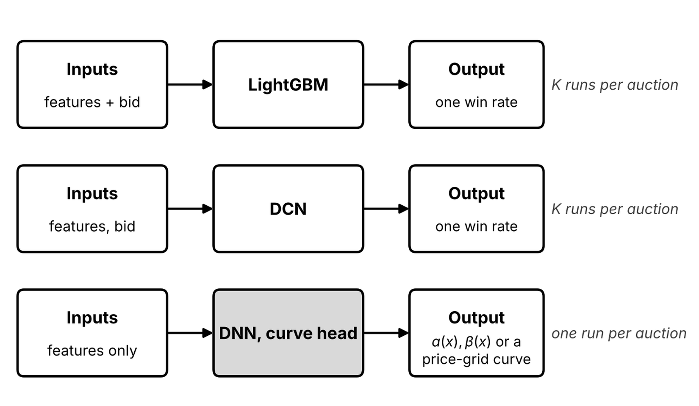

# Win Rate Curves and the Winner's Curse {#sec-win-rate-curves-and-the-winners-curse}

The LightGBM win model from @sec-win-rate-and-bid-shading took the bid as a feature, so it had to run once for every bid it considered. That's fine for shading one candidate at a time, but expensive when the bidder wants the whole curve: to shade every candidate in the internal auction, to forecast spend for pacing at many values of $\gamma$, or to explore the bid landscape. Deep models can predict the whole curve at once. And with better win models, a subtler problem becomes visible: the impressions a DSP wins are systematically the ones it overvalued, so even a calibrated DSP can lose money on what it buys.

In this chapter, we will move to DCN win models and models that predict the whole win rate curve in one pass, decide how much to trust the minimum bids exchanges report, and explore the bid landscape safely. We then spend the rest of the chapter on the winner's curse: why it applies to DSPs, how large it is, and how a DSP can address it.

## DCN Win Models

The win model is a function of both the request and the bid, and the bid varies for every candidate we consider. How the model treats the bid determines how many times it has to run per auction. @fig-c25-forms compares three options.

{#fig-c25-forms width="100%"}

A deep and cross network, which we cover in @sec-deep-models-with-embeddings, learns interactions between features explicitly, including interactions between the bid and the supply, device, and profile features.[^c31-dcn] This captures the fact that the curve's slope differs across segments, which trees approximate only with many splits. It still takes the bid as an input, so it shares the cost of running once per candidate bid.

[^c31-dcn]: Ruoxi Wang, Bin Fu, Gang Fu, and Mingliang Wang, "Deep & Cross Network for Ad Click Predictions," AdKDD, 2017; and Ruoxi Wang et al., "DCN V2: Improved Deep & Cross Network and Practical Lessons for Web-scale Learning to Rank Systems," WWW, 2021.

## Predicting the Whole Curve in One Pass

The most efficient form moves the bid out of the input and predicts the curve itself. The network reads only the request features and outputs a description of $W$ for every price. Two output heads work well.

A **parametric head** outputs $a(x)$ and $\beta(x)$ for the log-logistic curve, with $\beta$ kept positive through a softplus. Any bid's win rate is then one formula, and the best bid has a closed-form condition, shown in the next section.

A **price-grid head** outputs the win rate at a fixed set of prices $p_1 < p_2 < \dots < p_K$, kept monotone by building it from positive increments:

$$W(p_j \mid x) = \sum_{i \le j} \text{softmax}\big(z(x)\big)_i$$

where $z(x)$ is a vector of $K + 1$ outputs, with the last entry representing prices above $p_K$. Win rates between grid points are interpolated. This head can represent curves with unusual shapes, such as a jump at a common floor, which the parametric form can't. Predicting the full price distribution with a deep model is also an established line of research.[^c31-dlf]

Both heads train on the same likelihood as above. For a win or loss at bid $b$, the predicted $W(b)$ enters a binary cross-entropy loss, and for a reported minimum bid to win, the predicted density at that price adds the third term. Because the model runs once per auction, its cost doesn't depend on how many bids or campaigns are evaluated, which matters when the internal auction prices many campaigns per request.

[^c31-dlf]: Kan Ren, Jiarui Qin, Lei Zheng, Zhengyu Yang, Weinan Zhang, and Yong Yu, "Deep Landscape Forecasting for Real-time Bidding Advertising," KDD, 2019.

## How Much to Trust Reported Minimum Bids

Minimum-bid-to-win reports are valuable but uneven. Exchanges define them differently: some include fees or floors, some round them, many send them only on losses or only for some auctions, and an exchange has some incentive to report values on the high side. A practical approach has three parts:

1. **Check each exchange.** Compare the reported values against the win model's predicted median price for the same requests. Exchanges whose reports are consistently biased or noisy get a low weight $\lambda$, or none.
2. **Use them as lagged features.** Recent quantiles of reported values by segment are useful features, even when the individual values aren't trusted as labels.
3. **Watch for drift.** A sudden change in an exchange's reported values relative to predictions usually means a change in its floors or its reporting, which is worth knowing either way.

## Exploring the Bid Landscape Safely

A win model learns how the win rate changes with the bid only from variation in our own bids. If the DSP always bids close to its shaded value, the bid and the request features move together, and the model can't tell an impression that is cheap to win from one that we simply bid high on. The slope of the curve becomes unidentifiable exactly where it matters.

The fix is **bid exploration**. On a small share of requests, such as 5% to 10%, multiply the media value by a random factor before shading, drawn log-uniformly between about 0.6 and 1.5, and log the factor with the bid. This breaks the link between the bid and the features, so the model can learn the slope, as shown in @fig-c25-exploration.

{#fig-c25-exploration width="100%"}

Exploration has a cost, which is small and easy to measure. In the example above, exploring with multipliers between 0.6 and 1.5 lowers expected surplus on the explored requests by about 13%. With 5% of requests explored, that's well under 1% of total surplus. A few practices keep it safe:

- **Bound the multipliers**, so that explored bids stay between the floor and the campaign's maximum bid.
- **Reweight training data**, so that the over-represented usual bid levels don't dominate the fit.
- **Only optimize within the observed range.** Clamp shaded bids to the range of bids seen in training, since the model is extrapolating outside it.
- **Keep it running permanently.** Competition changes, and a model trained without fresh variation drifts.

Exploration has a second use. Because the multiplier changes the chance of winning for reasons unrelated to the user, it also measures the effect of winning an impression on conversions. @sec-measuring-incrementality uses it as an instrument for measuring uplift.

## The Winner's Curse

The **winner's curse** is the reason that a DSP with calibrated models can still lose money on the impressions it wins. The idea comes from engineers at Atlantic Richfield, who studied auctions for offshore oil leases in the Gulf of Mexico.[^c31-capen] Every company estimated the oil under the same tract, and the estimates were unbiased on average. But the company with the highest estimate won, and the highest of several unbiased estimates is biased upward. Winners kept finding less oil than they had paid for.

[^c31-capen]: E. C. Capen, R. V. Clapp, and W. M. Campbell, "Competitive Bidding in High-Risk Situations," *Journal of Petroleum Technology*, 1971.

### Why It Applies to DSPs

The value of a user to an advertiser has two parts. A common part is shared across bidders, such as whether this is a real, engaged user who installs and spends. A private part is specific to one advertiser, such as how well the user fits a particular game. Every DSP estimates the common part with some error, and a DSP wins when its estimate is high relative to everyone else's. Its wins therefore concentrate where its own error is positive. The auction keeps handing the DSP its own mistakes.

This is a form of selection bias. It's different from Simpson's paradox, which comes from combining groups with different mixes. The winner's curse comes from looking only at the cases selected by a noisy estimate, which is the same effect as regression to the mean.

The win model itself doesn't suffer from the curse, because it's trained on every bid, won or lost. The curse affects the conversion and value models, whose labels exist only for impressions the DSP won.

### How Large It Is

@tbl-c25-curse shows a simulation where every bidder is calibrated on average, competing DSPs have models with log-noise 0.3, and everyone shades to 80% of their estimate. The last column is $\kappa$, the calibration multiplier, measured on our wins: the realized value divided by the predicted value.

| Competing bidders | Our model's noise | Our win rate | $\kappa$ on wins |
|---|---|---|---|
| 1 | 0.3, as good as theirs | 50% | 0.86 |
| 1 | 0.6, worse | 42% | 0.67 |
| 3 | 0.3 | 25% | 0.75 |
| 3 | 0.6 | 27% | 0.56 |
| 10 | 0.3 | 9% | 0.64 |
| 10 | 0.6 | 17% | 0.48 |

: A simulation of the winner's curse. {#tbl-c25-curse}

Three patterns stand out. The curse grows with the number of bidders, because with more competitors, a DSP only wins when its error is extreme. A worse model can win more often, which is the familiar pattern of a new DSP that spends easily but misses its goals. And wins by a large margin are the worst, as shown in @fig-c25-curse.

{#fig-c25-curse width="100%"}

### How DSPs Can Address It

**Calibrate on wins, not on all requests.** The calibration multiplier $\kappa$ from @sec-pricing-for-goals is measured on won impressions, so it already corrects the average curse. A single $\kappa$ per segment isn't enough, though, because the curse depends on how far the bid was above the market.

**Calibrate by margin over the market price.** The win model predicts the market price for each request, the median of $H$. Measure $\kappa$ on wins in buckets of the ratio between our value and that predicted price, and apply the bucket's $\kappa$ in the pricing equation:

$$\kappa(x) = \kappa_{segment} \times \kappa_{margin}\left(\frac{v_m(x)}{\hat{h}_{50}(x)}\right)$$

where $\hat{h}_{50}(x)$ is the predicted median competing price. In the simulation with three competitors and a noisier model, this changes the outcome substantially, as shown in @tbl-c25-correction.

| Correction | Win rate | Surplus per 1,000 requests (simulation units) | $\kappa$ on wins |
|---|---|---|---|
| None | 27% | −188 | 0.56 |
| One $\kappa$ for all wins | 7% | −20 | 0.68 |
| $\kappa$ by margin over the market price | 6% | −2 | 0.78 |

: The effect of calibrating on wins. {#tbl-c25-correction}

The correction stops the losses, but it doesn't create an edge. A DSP whose information is worse than its competitors' can at best break even on contested supply, at much lower volume. That leads to the remaining strategies.

**Use the market price as evidence.** Feed the win model's predicted price, and lagged reported minimum bids to win, into the value models as features. A large gap between our value and the market price is a reason to doubt our value, and the value model can learn how much.

**Bid conservatively where uncertain.** Where the value model is uncertain, bid on a lower quantile of value instead of its mean. Keep optimistic bidding for exploration and new campaigns, where the cost is bounded and the goal is learning.

**Compete where you know more.** Map the information advantage by segment, comparing $\kappa$ on wins across exchanges, regions, verticals, and user types. A low $\kappa$ on wins means the DSP is losing the information battle there, and it should bid less or stop. Values close to 1 mean it knows as much as its competitors or more, and spend should concentrate there.

**Add information others don't have.** The curse acts on the common part of value. It weakens wherever the DSP knows something its competitors don't, such as first-party data in retargeting, context from its own supply, bid-stream sequence models (@sec-sequences-and-transformers), or verticals where competitors' models are weaker. The private part of value, how well a user fits our advertiser, isn't subject to the curse at all.

::: {.callout-tip title="Try it on the simulator"}
Train a win model with a parametric curve head on simulated bids and minimum bids to win, and compare it with the LightGBM win model from Part III. Then measure the winner's curse directly: compare the DSP's predicted value on won impressions with the true value from the ground truth, by margin. Apply the correction, and compare margins and spend before and after.

*Status: the simulator already produces the data for this exercise (adsim 0.1). The companion code and exact commands are in progress.*

<!-- Tracker: private/implementation-tracker.md -->
:::

## Conclusion

In this chapter, we modeled the auction more completely. DCN win models learn interactions between the bid and the request, and curve heads predict the whole win rate curve in one pass, so every candidate and every pacing multiplier can be priced from one model call. Reported minimum bids are useful and imperfect, and exploration with bounded random multipliers keeps the curve identifiable at a small, measurable cost. The winner's curse means the impressions a DSP wins are the ones it overvalued, and calibrating on wins, shading with uncertainty in mind, and adding information competitors don't have all reduce it.

The winner's curse is one way that predicted value can differ from what an impression is really worth. Another is that some attributed installs would have happened anyway. In the next chapter, we predict the lift an impression causes.
