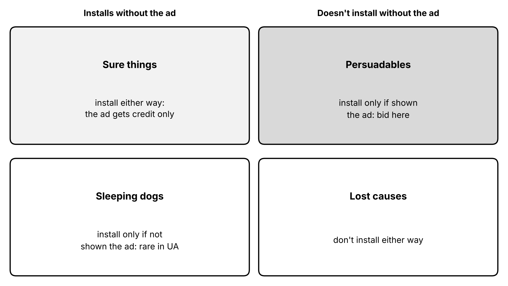
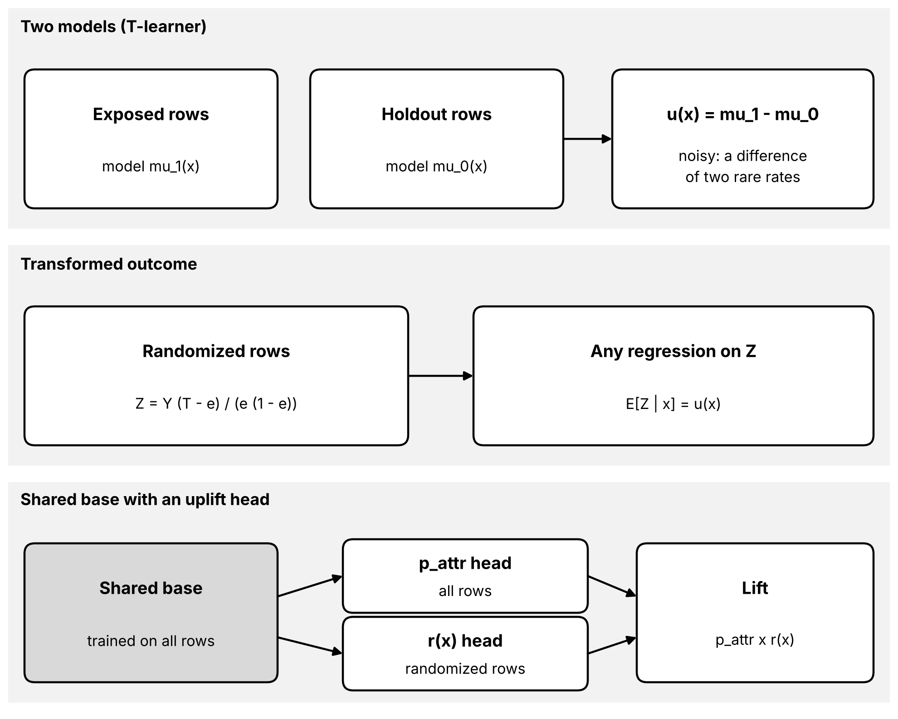

# Uplift Modeling {#sec-uplift-modeling}

In @sec-measuring-incrementality, we measured how many of the DSP's attributed installs it actually caused, with ghost bids on a device holdout, and estimated incrementality ratios by segment. A segment ratio says that, on average, a share $r$ of the attributed installs in a segment were caused by the ads. It doesn't say which impressions those were. Two devices in the same segment can differ completely: one was about to install the game from a friend's recommendation, and the ad only collected the credit, and the other would never have found the game without it.

**Uplift modeling** predicts the lift for each impression: the difference between the chance of an install with the ad and without it. It's the per-impression version of the incrementality ratio, and it lets the DSP bid on what an impression causes rather than on what it gets credit for. It's also one of the hardest models in the book, because the label it predicts is never observed for any single impression. We only see one of the two outcomes.

In this chapter, we will build uplift models, from two separate models to a shared base with an uplift head, evaluate them with Qini curves, look at the signals that predict lift, and price on incremental value.

## Uplift Models

It helps to think of devices in four groups, as in @fig-c32-quadrants. **Sure things** install whether or not they see the ad, so the DSP only collects credit. **Persuadables** install only if they see it, and they're where the DSP's money creates value. **Lost causes** don't install either way. **Sleeping dogs** are less likely to install if they see the ad, which is common in retention marketing and rare in user acquisition. An attributed conversion model ranks sure things and persuadables together, since both convert after an impression. An uplift model tries to separate them.

{#fig-c32-quadrants width="100%" fig-alt="Two-by-two grid of device groups by whether they install with and without the ad: sure things install either way, persuadables install only if shown the ad, sleeping dogs install only if not shown it, and lost causes never install."}

With enough randomized data, the ratio can be predicted per impression. There are three model forms, from simple to more capable, shown in @fig-c32-forms.

{#fig-c32-forms width="100%" fig-alt="Three uplift model forms: a T-learner that subtracts models fit on exposed and holdout rows; a transformed outcome that turns uplift into an ordinary regression target; and a shared base with an attributed-conversion head and a lift-ratio head."}

**Two models.** Fit one model on exposed users and one on unexposed users within the randomized data, and subtract:

$$\hat{u}(x) = \hat{\mu}_1(x) - \hat{\mu}_0(x)$$

This is easy to build, but noisy, because it subtracts two estimates of rare events.

**Transformed outcome.** With a known assignment probability $e$, define a new target whose expected value is the uplift, and fit any regression model to it:[^c32-athey]

$$Z = Y \times \frac{T - e}{e\,(1 - e)}, \qquad \mathbb{E}[Z \mid x] = u(x)$$

**Shared base with an uplift head.** A single network with two heads. The base head predicts $p_{attr}$ and trains on all data, as the conversion models already do. The ratio head predicts $r(x) \in [0, 1]$ and trains only on randomized rows, using a transformed outcome or instrumental variables loss. This is the same multi-task pattern as the conversion funnel in @sec-deep-models-with-embeddings, and it lets the uplift head borrow everything the base model has learned about users.

The randomized data comes from two sources the DSP has been logging since Part II: the device holdout with ghost bids, where the assignment probability is the holdout share, and the exploration multipliers on bids, which randomly change whether an impression is won. Both are small, which is the main constraint on uplift models. The shared-base design matters because it uses all the data for the hard part, learning who devices are, and the small randomized sample only for the easier part, learning how the ad changes their behavior.

Uplift models are also easy to fool yourself with. Three checks help:

- **Hold out randomized data for evaluation** that the model never sees in training, split by device, not by impression.
- **Compare with the segment table.** A model that disagrees sharply with the segment incrementality ratios from @sec-measuring-incrementality, on segments with plenty of holdout data, is more likely wrong than insightful.
- **Retrain several times.** Uplift estimates are noisy, so a ranking that changes a lot between seeds isn't one to bid on.

[^c32-athey]: Susan Athey and Guido Imbens, "Recursive Partitioning for Heterogeneous Causal Effects," *Proceedings of the National Academy of Sciences*, 2016.

## Evaluating Uplift Models

Uplift can't be observed for a single user, so the usual metrics don't apply. The standard tool is the **Qini curve**.[^c32-qini] Rank randomized users by predicted uplift, and for the top fraction $\phi$, compute the incremental outcomes:

$$Q(\phi) = Y_T(\phi) - Y_C(\phi) \times \frac{N_T(\phi)}{N_C(\phi)}$$

where $Y$ counts outcomes and $N$ counts users in each group within the top fraction. A good uplift model rises steeply and stays above the line for random targeting. A model that ranks by attributed conversion probability often does worse than an uplift model on this curve, because it ranks users who would convert anyway near the top, as shown in @fig-c24b-qini.

{#fig-c24b-qini width="90%" fig-alt="Qini curves of the share of incremental installs captured against the share of users targeted. Ranking by predicted uplift captures 61% at the top third, close to a perfect ranking, while ranking by attributed conversion captures 32%, about the same as random targeting."}

Also check calibration at the segment level. The average predicted $r$ in each segment should match the lift measured in that segment's holdout.

[^c32-qini]: Nicholas J. Radcliffe, "Using Control Groups to Target on Predicted Lift: Building and Assessing Uplift Models," *Direct Marketing Analytics Journal*, 2007.

## Signals That Predict Lift

The signals that predict incrementality are not the same as those that predict conversion. Several strong conversion signals predict low incrementality, as shown in @tbl-c24b-signals.

| Signal | Direction | Why |
|---|---|---|
| Frequency, the number of prior exposures to this advertiser | Lower lift as it rises | Each additional impression adds less. Usually the strongest single uplift feature |
| Recently lapsed users of the advertiser's app | Lower | Likely to return on their own after an update or a push notification |
| App momentum: launch week, featuring, rising chart rank, TV campaigns | Lower | A high organic baseline right now; needs a time-varying app-level baseline |
| Heavy players of very similar games, seen often in gaming supply | Lower | High intent, and heavily targeted by every other network |
| Supply where the largest networks bid most | Lower | Displacement from the same networks reaching the same users |
| Very short time from impression to install, view-through only | Lower | Often an install that was already happening, or attribution gaming |
| First few exposures to this advertiser | Higher | The ad is new information |
| Users new to the genre but engaged with apps | Higher | Interested, but unlikely to find the app on their own |
| Non-gaming supply, smaller exchanges, thinly covered regions | Higher | Fewer competing exposures |
| Rising intent in recent bid-stream activity | Higher | Reaching users before other channels flag them; see @sec-sequences-and-transformers |
| Playable and rewarded formats | Higher | More likely to change behavior rather than collect credit |

: Signals that predict lift. {#tbl-c24b-signals}

The inputs come from the DSP's own bid stream (which apps and exchanges a device appears in, which also proxies exposure from other networks), the exposure log (frequency, recency, creative, format), the advertiser's data (lapsed status, the organic install curve), and app-level time series (chart rank, featuring, seasonality).

## Pricing on Incremental Value

The incrementality ratio enters the pricing equation from @sec-pricing-for-goals as one more term in the advertiser value, before shading. There are two ways to use it, and the advertiser should choose, because they're billed on attributed outcomes:

$$\text{tilt:} \quad A = 1000\,\kappa\,p_{attr}\,V \times \big(1 - \alpha + \alpha\,r(x)\big)$$

$$\text{incremental goal:} \quad A = 1000\,\kappa\,p_{attr}\,r(x) \times T_{iCPI}$$

Here, $A$ is the advertiser value per thousand impressions, $\kappa$ is the calibration multiplier, and $V$ is the value of an install under the campaign's goal, such as its target CPI. With the **tilt**, the campaign keeps its attributed goal, and $\alpha \in [0, 1]$ sets how strongly low-lift segments are discounted. Attributed CPI rises slightly, and incremental installs per dollar rise. With an **incremental goal**, the advertiser sets a target cost per incremental install, $T_{iCPI}$, and bids are priced on uplift directly. This mode suits advertisers who run their own lift tests and trust them over last-touch numbers.

The pacing system in @sec-basic-pacing works the same way with either form, because it only sees the value. Two notes are worth keeping in mind. The calibration multiplier $\kappa$ corrects bias in attributed predictions and doesn't measure incrementality, so the two terms are separate. And with an incremental goal, the goal controller measures surplus on incremental outcomes, which arrive only through holdouts and exploration, so its slow loop runs on test readouts rather than daily cohorts. @tbl-c24b-pricing lists the new pricing inputs.

| Input | Symbol | Source | Default to start |
|---|---|---|---|
| Incrementality ratio | $r(x)$ | Segment table or uplift model | 1 |
| Tilt strength | $\alpha$ | Campaign, advertiser opt-in | 0 |
| Incremental CPI target | $T_{iCPI}$ | Campaign, advertiser opt-in | Not set |

: Pricing inputs for incrementality. {#tbl-c24b-pricing}

::: {.callout-tip title="Try it on the simulator"}
Train a T-learner and a shared-base uplift head on simulated impressions, using the randomness from the holdout and from bid exploration. Evaluate both with Qini curves on held-out randomized data, and against the true lift from the ground truth, which the simulator knows for every impression. Then price one campaign on incremental value, and compare its incremental CPI with attributed pricing.

*Status: the simulator already produces the data for this exercise (adsim 0.1). The companion code and exact commands are in progress.*

<!-- Tracker: private/implementation-tracker.md -->
:::

## Conclusion

In this chapter, we predicted the lift each impression causes. T-learners, transformed outcomes, and uplift heads on a shared base estimate it from the DSP's sources of randomness, and Qini curves evaluate them on randomized data, since lift is never observed for a single impression. Signals such as reach, recency of intent, and frequency predict where ads make a difference, and the incrementality ratio enters the advertiser value either as a tilt on attributed pricing or as an incremental goal the advertiser chooses.

The incrementality tilt is one more term in a pricing equation that has grown term by term. It's time to bring every term into one equation.
