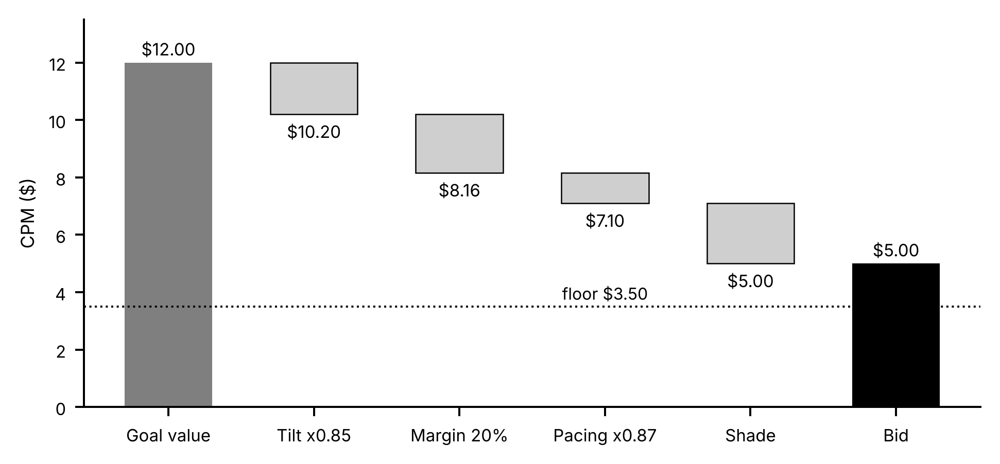

# The Unified Pricing Equation {#sec-the-unified-pricing-equation}

The walk DSP's pricing grew one term at a time. Each goal type got its own formula for the advertiser value, the calibration multiplier came in as a correction, the pacing multiplier came in with the controller, margins depended on the billing model, and the incrementality tilt from @sec-uplift-modeling is one more term on top. Each piece makes sense on its own. Together, they're hard to reason about, hard to explain to an advertiser, and hard to implement consistently, because nothing says in one place how they fit together. And each campaign can still only have one goal.

This chapter brings every pricing term into one equation, written so that an engineer, or an agent, could implement it from the specification alone, and so that every bid can be explained term by term from the bid ledger.

In this chapter, we will look at why campaigns have more than one goal, combine goals with weights in one equation, and see where pacing sits inside the equation and why. We then choose between target priority and budget priority, and walk one bid through every term. We then put the margin in the loop, add the incrementality tilt, check that a campaign's goals and budget can be met before launch, lay out the levers advertisers and account managers can use, and define the bid ledger that records every term.

<!-- NOTE: Ben's pricing and pacing drafts (patches 0001 to 0003) aren't in the repo. This chapter is drafted from the TOC and the earlier chapters; reconcile with the patches when they're available. -->

## Why Campaigns Have More Than One Goal

Advertisers rarely care about one number. A studio launching Cozy Farm Tycoon in a new market might want installs at a target CPI of \$3.00, but only if those installs reach a D7 ROAS of at least 20%, because cheap installs that never pay are worthless to it. Another might want D7 ROAS, with a floor on D1 retention, to avoid buying players who churn immediately.

With one goal per campaign, the advertiser has two bad options. They can pick one goal and watch the other by hand, adjusting targets when the second goal slips, which reintroduces the manual levers we worked to remove. Or they can run duplicate campaigns for the same app with different goals, which then compete with each other in the DSP's internal auction and split the data the models learn from.

## Weighted Goals in One Equation

The unified equation starts from a value for each goal $k$, computed exactly as in @sec-pricing-for-goals and calibrated with that goal's own multiplier, and combines them with weights:

$$V = \sum_k w_k \, \kappa_k \, A_k$$

Each $A_k$ is the advertiser value per thousand impressions under goal $k$, in dollars, so the values are in the same units and can be added. The weights $w_k$ express how the advertiser trades the goals off. A campaign that values installs and D7 revenue equally, at its targets, sets both weights to 0.5. A campaign with a single goal has one weight of 1, and the equation reduces to walk pricing.

The full media value then applies the remaining terms, in the order from @sec-pricing-for-goals:

$$v_m = V \times \rho(x) \times \gamma \times (1 - m) - f$$

where $\rho(x) = 1 - \alpha + \alpha\, r(x)$ is the incrementality tilt from @sec-uplift-modeling, $\gamma$ is the pacing multiplier, $m$ is the margin, and $f$ is fees. Shading, floors, and caps follow as before.

@fig-c33-pipeline shows the whole path from predictions to a bid, with the three controllers that adjust it.

{#fig-c33-pipeline width="100%"}

Weights work well for goals that trade off smoothly. For goals that are really constraints, such as a ROAS floor below which the advertiser doesn't want installs at any price, constraints work better, and the pacing system enforces them, as in the next section.

## Pacing Inside the Equation

So far, the pacing multiplier $\gamma$ has been a control knob: the PI controller from @sec-basic-pacing turns it down when the campaign spends ahead of plan, and up when it falls behind. It's worth seeing why a multiplier on the value is the right knob, and why it sits where it does in the equation, because the answer explains how pacing and pricing should work together.

### Where the Multiplier Comes From

Consider one campaign over one day. It sees impressions $i = 1, \dots, n$, each with a value $v_i$ to the advertiser and a cost $c_i$ if won, and it has a budget $B$. The best it can do is win the set of impressions with the most total value, subject to spending at most $B$:

$$\max_{x_i \in \{0, 1\}} \sum_i x_i v_i \quad \text{subject to} \quad \sum_i x_i c_i \le B$$

The standard way to handle the constraint is to price it. Introduce a multiplier $\lambda \ge 0$, the **shadow price** of the budget, which says how much value one more dollar of budget would buy. With $\lambda$ fixed, the problem separates into one decision per impression: win impression $i$ if $v_i - (1 + \lambda) c_i > 0$, that is, if its value is more than $1 + \lambda$ times its cost. In a first-price auction, that's the same as bidding as if the value were

$$\tilde v_i = \frac{v_i}{1 + \lambda} = \gamma \, v_i, \qquad \gamma = \frac{1}{1 + \lambda}$$

and then shading as usual. This is the standard result for budget-constrained bidding: the optimal bid is the value scaled by one multiplier for the whole day,[^c33-zhang] and it's where $\gamma$ comes from. When the budget is plentiful, $\lambda = 0$, $\gamma = 1$, and the campaign bids its full value. When the budget is tight, $\lambda$ rises, every bid is scaled down by the same factor, and the campaign gives up its least valuable impressions first, which is why bid modification beat throttling in @sec-basic-pacing.

Three consequences follow for the unified equation:

- **One multiplier for the whole value.** The budget constraint applies to everything the campaign buys, so $\gamma$ scales $V$ as a whole, after the goals are combined. It doesn't change the weights between goals, and it shouldn't be applied to one goal's value and not another's.
- **Before shading, not after.** $\gamma$ scales the value, and the win model then shades the scaled value, choosing the bid that maximizes $W(b)(\gamma v - b)$. Applying the multiplier to the shaded bid instead would double-count: the shading step already gives up some win rate for surplus, and the controller would push in the same direction again.
- **The controller is estimating $\lambda$.** The right $\lambda$ depends on the whole day's traffic, which isn't known in advance. The PI controller estimates it from the spend error as the day goes on, and the feedforward forecast from @sec-basic-pacing gives it a starting value. Everything in @sec-pacing-with-reinforcement-learning is a better way to estimate it.

Goal constraints work the same way. A CPI target or a ROAS floor is one more constraint, with its own multiplier, and the optimal bid scales the value by a factor that depends on all the multipliers together.[^c33-balseiro] Taking the minimum of a budget multiplier and a goal multiplier, as in the next section, is what the walk DSP already does, and it's better than an approximation. Balseiro and colleagues compare it with a fully coupled algorithm that optimizes both constraints jointly, and show that this min-pacing approach attains similar guarantees, while running the two controllers in sequence, with one lowering the other's bid, can badly violate the constraints.

### Controllers on Separate Time Scales

The unified equation has several controllers: one for the budget, one per goal constraint, and one for the margin. If they all react at the same speed to the same signal, they fight. A spend dip lowers the CPI, the goal controller raises bids, the budget controller raises them too, and the campaign overshoots. The fix is to give each one a different time scale, from fast to slow:

1. **Budget, every few minutes.** Spend responds within minutes, so the budget controller acts fastest.
2. **Goals, every hour or so.** CPI and ROAS are measured on installs and purchases that arrive hours later, so the goal controllers act on a smoothed signal over a longer window.
3. **Margin, daily.** The margin controller adjusts within its bounds based on how the campaign did over the last day or days.
4. **Calibration, continuously but slowly.** $\kappa$ corrects predictions toward realized outcomes over several days of data.

Each controller then sees the others as roughly fixed while it acts, which is what keeps the system stable. The bid ledger records which controller set each term, so when a campaign's bids move, it's clear which loop moved them.

### Budgets That Span Days

Many campaigns have weekly or monthly budgets, or a daily budget that the advertiser expects to average out over a week. The same reasoning applies with a longer horizon: one $\lambda$ for the whole period, estimated from the spend so far and the forecast of the rest. A campaign that underspends on a slow Tuesday can spend more on Saturday, when its traffic is better, if the plan allows it. This is where the planning ability of learned pacing policies pays off most, as we'll see in the next chapter.

## Target Priority vs. Budget Priority

In @sec-basic-pacing, two controllers set $\gamma$: a budget controller that keeps spend on plan, and a slower goal controller that holds bids back when the campaign misses its target. With several goals, there's one goal controller per constraint, and the campaign has to say which matters more when they conflict:

$$\text{target priority:} \quad \gamma = \min(\gamma_{\text{goal},1}, \dots, \gamma_{\text{goal},K}, \gamma_{\text{budget}})$$

$$\text{budget priority:} \quad \gamma = \gamma_{\text{budget}}$$

With **target priority**, every constraint can hold the campaign back, and it underspends rather than miss a target. With **budget priority**, the campaign spends its budget, and the goals are reported but not enforced. Most performance advertisers want target priority. Budget priority suits launches and brand pushes, where reach matters more than efficiency for a while. It's a campaign setting, chosen explicitly, rather than something an account manager achieves with an overbid.

## One Bid, Term by Term

Here's one bid for Cozy Farm Tycoon in Brazil, through every term, as @fig-c33-waterfall shows. The campaign has two goals, weighted equally: a CPI target of \$3.00, and a D7 ROAS target of 20%.

- **Predictions.** The install model predicts $P(\text{install}) = 0.4\%$, and the value model predicts \$0.60 of D7 revenue per install.
- **Goal values.** Under the CPI goal, $A_{\text{CPI}} = \$3.00 \times 0.004 \times 1000 = \$12.00$ CPM. Under the ROAS goal, an install worth \$0.60 at a 20% target is worth \$3.00 to the advertiser, so $A_{\text{ROAS}} = \$12.00$ CPM too.
- **Calibration and weights.** The install model has been running slightly high for this campaign, so $\kappa_{\text{CPI}} = 0.95$, and the value model slightly low, so $\kappa_{\text{ROAS}} = 1.05$. With weights of 0.5, $V = 0.5 \times 11.40 + 0.5 \times 12.60 = \$12.00$.
- **Tilt.** The campaign opted into an incrementality tilt with $\alpha = 0.3$, and the predicted incrementality ratio for this device is 0.5, so $\rho = 1 - 0.3 + 0.3 \times 0.5 = 0.85$, and the value becomes \$10.20.
- **Margin.** A 20% margin leaves \$8.16.
- **Pacing.** The campaign is spending a little ahead of plan, so the budget controller has $\lambda = 0.15$, and $\gamma = 1/1.15 \approx 0.87$, leaving \$7.10.
- **Shading.** The win model's curve for this request puts the best bid at \$5.00, which maximizes $W(b)(\$7.10 - b)$.
- **Floor and cap.** The floor is \$3.50 and the campaign's cap is \$15.00, so the bid of \$5.00 goes out.

{#fig-c33-waterfall width="100%"}

Every number in that list is a column in the bid ledger. If the account manager asks why the campaign bid \$5.00, the answer is this list. If the campaign's bids fall tomorrow, the ledger shows whether it was the models, the calibration, the tilt, the controller, or the auction that moved.

## Margin in the Loop

The margin $m$ has been fixed per campaign so far. In run, it flexes between a floor and a target, as one more control the DSP can use:

- **When a campaign is constrained by its goal,** lowering the margin toward its floor raises the media value without changing the advertiser's cost per outcome, so the campaign wins more of the impressions it was narrowly losing.
- **When a campaign is comfortably within its goal and on budget,** the margin stays at its target.
- **Across impressions,** the margin can vary with the surplus available, as long as the campaign's average margin meets its target, as in the dynamic margin from @sec-pricing-for-goals.

A margin controller runs on the slow loop, alongside the goal controllers, and its bounds are set by the business, not by the controller. The bid ledger records the margin on every bid, so the DSP can always report what it kept.

## The Incrementality Tilt

The tilt $\rho(x) = 1 - \alpha + \alpha\, r(x)$ multiplies the value by a factor that depends on the predicted incrementality ratio $r(x)$, from a segment table or an uplift model. With $\alpha = 0$, pricing is purely attributed. With $\alpha = 1$, the value is scaled fully by the ratio, which prices installs the DSP is likely to cause above installs it would only get credit for.

The tilt sits with the other multipliers, before the margin and shading, and it's separate from the calibration multiplier: $\kappa$ corrects predicted attributed outcomes toward realized attributed outcomes, and says nothing about incrementality. A campaign with an incremental goal, such as a target incremental CPI, uses that goal as one of its $A_k$ instead of a tilt, as in @sec-uplift-modeling. Because advertisers are usually billed and judged on attributed results, the tilt is an advertiser opt-in, with $\alpha$ set by the campaign.

## Consistency Check Before Launch

Some combinations of goals and budgets can't all be met. A campaign that wants \$50,000 a day at a \$1.50 CPI in a market where the DSP can only buy 10,000 installs a day at that price will underspend every day under target priority, and the advertiser will be surprised by it.

Before a campaign launches, and whenever its settings change, the DSP runs a **consistency check**: replay recent eligible traffic through the pricing path, as in the feedforward forecast from @sec-basic-pacing, and estimate the spend and outcomes at each value of $\gamma$. If no $\gamma$ within bounds spends the budget while meeting every constraint, the check says so, with the frontier between spend and performance: how much the campaign could spend at its target, and what CPI it would need to spend its full budget. The advertiser can then change the budget, the target, or the priority before launch, rather than after a week of underdelivery.

## Advertiser Levers and Overrides

Advertisers and account managers need ways to steer campaigns. The unified equation gives them a ladder of levers, each acting on a specific term, from the most to the least preferred:

1. **Goals and targets:** change what the campaign is trying to achieve, which changes $A_k$.
2. **Weights and priority:** change how goals trade off, through $w_k$ and target or budget priority.
3. **Budgets and schedules:** change how much and when, through the pacing plan.
4. **Targeting:** change which requests are eligible.
5. **Bounded overrides:** a temporary multiplier on $\gamma$'s bounds, with an expiry date and a cap, for cases such as a launch week.

Each lever is recorded in the campaign configuration and in the bid ledger, so its effect is visible, and the consistency check shows where it moves the campaign on the frontier between spend and performance. What's missing from the ladder is a raw multiplier on the bid that bypasses pricing, which is what overbids were. Every override goes through a term of the equation.

## The Bid Ledger

The bid ledger from @sec-logging-at-bid-time records every term of the unified equation for every bid:

- **Predictions:** each model's output and version, including the click, install, value, retention, and uplift predictions.
- **Goal values:** each $A_k$, its calibration multiplier $\kappa_k$, and its weight $w_k$.
- **Multipliers:** the tilt $\rho$ and its inputs, $\gamma$ with the controller's estimate of $\lambda$ and which controller set it, and any bounded override.
- **Margin and fees:** $m$, its bounds, and $f$.
- **Shading:** the media value $v_m$, the win model's version and predicted curve parameters, the shaded bid, any exploration multiplier, and the floor and cap checks.
- **The internal auction:** each candidate's score and the winner.

With the ledger, any bid can be explained term by term, any change in a campaign's bids can be traced to the term that moved, and any proposed change to the equation can be replayed on logged traffic before it ships.

::: {.callout-tip title="Try it on the simulator"}
Trace one bid through every term of the unified equation, for a campaign with a CPI target and a D7 ROAS floor. Then set up a campaign whose budget and targets can't both be met, run the consistency check, and compare its forecast frontier with what the campaign actually does over a simulated week.

*Status: the simulator already produces the data for this exercise (adsim 0.1). The companion code and exact commands are in progress.*

<!-- Tracker: private/implementation-tracker.md -->
:::

## Conclusion

In this chapter, we brought every pricing term into one equation. Campaigns can have several goals, combined with weights in one value, or enforced as constraints by goal controllers with target or budget priority. The pacing multiplier is the shadow price of the budget in disguise, which is why it scales the whole value before shading, and the controllers work on separate time scales so they don't fight. The margin flexes within bounds as one more control, the incrementality tilt sits with the other multipliers, and a consistency check before launch shows whether goals and budgets can both be met. Advertiser levers form a ladder of terms in the equation, and the bid ledger records every term of every bid.

The pacing controllers in this equation are still the PI controllers from Part III. In the next chapter, we learn pacing policies with reinforcement learning, and measure them against the PI baseline.

[^c33-zhang]: Di Wu et al., "Budget Constrained Bidding by Model-free Reinforcement Learning in Display Advertising," CIKM, 2018, <https://arxiv.org/abs/1802.08365>. The paper shows that the optimal bid under a budget constraint is linear in the impression's value, scaled by one multiplier, which it then learns with RL.

[^c33-balseiro]: Santiago R. Balseiro, Kshipra Bhawalkar, Zhe Feng, Haihao Lu, Vahab Mirrokni, Balasubramanian Sivan, and Di Wang, "A Field Guide for Pacing Budget and ROS Constraints," ICML, 2024, <https://arxiv.org/abs/2302.08530>
