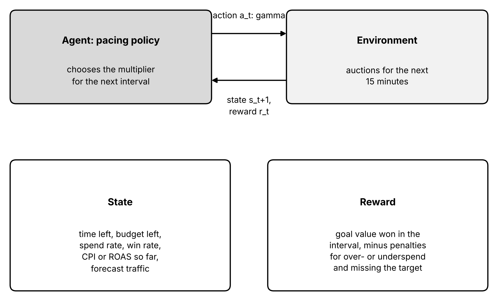
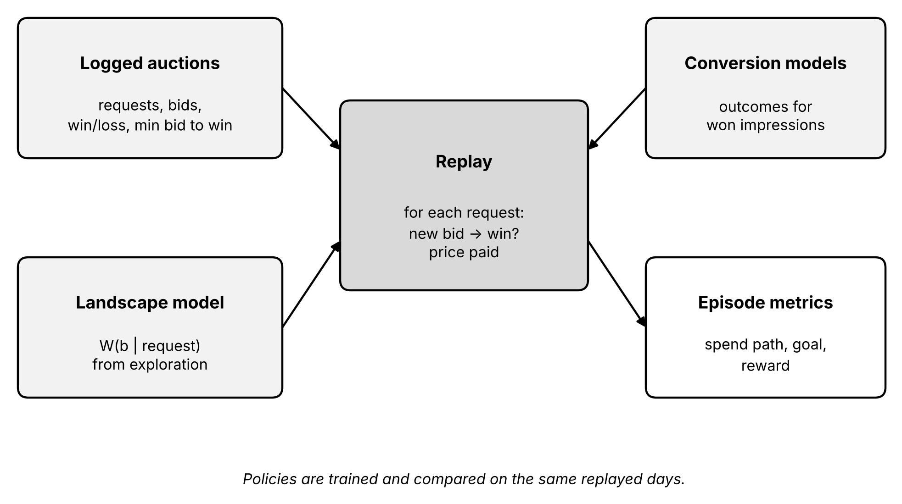
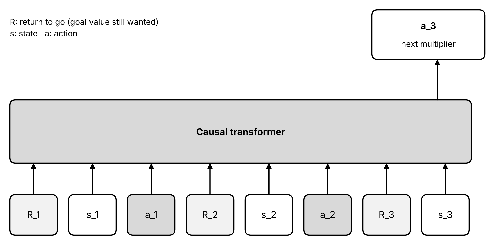

# Pacing with Reinforcement Learning {#sec-pacing-with-reinforcement-learning}

The PI controller from @sec-basic-pacing works well. It's simple, stable when its gain is set from the win model's spend elasticity, and easy to reason about. But it's reactive and myopic. It corrects errors after they happen, it doesn't know that the traffic at 8 p.m. in the campaign's main geo is worth more than the traffic at 3 a.m., and with several goal constraints, it handles each one separately. In the language of @sec-the-unified-pricing-equation, the controller is estimating the shadow price of the budget, $\lambda$, one spend error at a time. A pacing policy that planned the whole day, knowing how traffic and competition change hour by hour, could spend the same budget on better impressions.

Reinforcement learning (RL) is the natural framework for that kind of planning, and auto-bidding is an active research area, with benchmarks and competitions of its own. It's also a place where a DSP can spend a lot of effort for little gain, because a well-tuned PI controller is a strong baseline, and learning a policy safely from logged data is hard.

In this chapter, we will introduce RL briefly, frame budget-constrained bidding as a decision process, and look at where a PI controller leaves value on the table. We then build simulators from logged auctions to train in, compare the main families of methods, from model predictive control to offline RL, and cover the safety constraints a pacing policy needs. We look at generative auto-bidding at the research frontier, and close with how to evaluate a learned policy against the PI baseline, and when it's worth the complexity.

## Reinforcement Learning in Brief

In RL, an **agent** observes a **state**, takes an **action**, receives a **reward**, and moves to a new state. A **policy** maps states to actions, and the goal is a policy that maximizes the total reward over time, not just the next reward. That's what distinguishes RL from the prediction problems in the rest of the book: the action changes what happens next. @fig-c34-loop shows the loop for pacing.

{#fig-c34-loop width="100%"}

Bidding over a day is a sequential decision in exactly this sense. Spending more in the morning leaves less budget for the evening, so the value of a bid now depends on what the campaign will be able to do later.

A few terms recur in the rest of the chapter:

- The **return** is the sum of rewards from now to the end of the episode, here the end of the day.
- The **value function** $V(s)$ is the expected return from state $s$ under a policy, and the **action-value function** $Q(s, a)$ is the expected return after taking action $a$ in state $s$. Most RL methods learn one of these, a policy, or both.
- **Exploration** means trying actions whose outcomes are uncertain, so the policy can learn about them. In pacing, exploring means spending real money on multipliers that might be wrong.

RL comes in two broad forms. **Online RL** learns by acting: the agent tries actions in the environment and learns from the results. **Offline RL** learns from a fixed dataset of past states, actions, and rewards, collected by some other policy, without acting during training. For a DSP, online RL on live traffic means experimenting with real budgets, so most practical work is offline, or online in a simulator. Offline RL has its own catch: a policy can only learn about actions the logging policy actually took, so if the logged policy explored little, the learned policy may prefer actions whose outcomes it's only guessing at.

## Budget-Constrained Bidding as a Decision Process

For pacing, the decision process for one campaign over one day looks like this:

- **Episode:** one day for a daily budget, or one week for a weekly one.
- **Time steps:** intervals of the day, such as every 15 minutes, which gives 96 decisions per day.
- **State:** the time of day, budget remaining as a share of the budget, spend and outcomes so far against plan and target, recent win rates and clearing prices, and the forecast of remaining eligible traffic and its value. For campaigns with goal constraints, the realized CPI or ROAS so far, and the share of labels that have matured.
- **Action:** the pacing multiplier $\gamma$ for the next interval, or, more stably, a change to its logarithm, $\Delta \log \gamma$, within bounds.
- **Reward:** the goal value won in the interval, such as predicted installs at the campaign's target CPI or predicted D7 revenue, with penalties for spending ahead of plan, for budget left at the end of the day, and for missing goal constraints.

A concrete reward for a CPI campaign might be:

$$r_t = \sum_{i \in \text{won}_t} \hat p_i \cdot \text{CPI}_{\text{target}} - \beta_1 \max(0, s_t - \bar s_t)\,B - \beta_2 \,\mathbb{1}[t = T]\,(B - S_T)$$

where $\hat p_i$ is the predicted install probability of each won impression, $s_t$ and $\bar s_t$ are the actual and planned share of budget spent by step $t$, $S_T$ is the total spent by the end of the day, and $\beta_1$ and $\beta_2$ set how much overspending and underspending cost. Using predicted rather than realized installs as the reward keeps it available immediately, since installs arrive hours later, and it's the same choice the PI controller's goal loop makes.

The action is $\gamma$, not individual bids, which keeps the problem small and the policy compatible with everything else in the pricing equation: the policy decides how aggressive the campaign should be, and the models and shading still decide each bid. That's also what @sec-the-unified-pricing-equation says the optimal policy looks like: one multiplier on the value, changing over the day as the estimate of $\lambda$ improves. Wu and colleagues use exactly this framing, learning how to adjust the multiplier with deep Q-learning rather than learning bids directly.[^c34-wu]

## Where a PI Controller Leaves Value

It helps to be specific about what a learned policy can do that a PI controller can't. @fig-c34-trajectory shows a simulated day for one campaign, with an unexpected surge in traffic from 1 p.m. to 4 p.m., such as a large publisher running a promotion.

{#fig-c34-trajectory width="100%"}

Three things go wrong for the PI controller, and each is something a policy with a model of the day could avoid:

- **It reacts late.** The controller only sees a spend error after the extra spend has happened, so it overspends during the first part of the surge.
- **It overcorrects for too long.** After the surge, the integral term remembers the overspend, and keeps $\gamma$ low into the evening, when the campaign's traffic is most valuable. The campaign ends the day slightly under budget, having bought cheaper afternoon traffic and skipped better evening traffic.
- **It doesn't know the value of time.** The controller follows the plan, and the plan follows traffic volume, not traffic value. If evening installs are worth more, because they come from devices that play longer sessions, the controller has no way to save budget for them.

A policy that observes the remaining budget, the time of day, and the forecast can re-plan every interval: what multiplier would spend the remaining budget on the best of the remaining traffic? That's the policy shown as the solid line. It's not magic. It's using information the PI controller doesn't have, a forecast of the rest of the day, and a state that includes how much budget is left rather than only how far off plan the campaign is.

That also suggests a strong intermediate step before RL, which we come back to below: re-solve for the multiplier every interval using the forecast, with no learning at all.

## Simulators Built from Logged Auctions

Training a pacing policy needs an environment that responds to its actions. A DSP can build one from its own logs, as @fig-c34-replay shows. Replay a day of logged requests for a campaign, and for each request, use the win model to decide whether a bid at the policy's $\gamma$ would have won and at what price, and the conversion models to estimate the value won. The win model's curve is what makes this possible: it answers, for every request, what would have happened at a bid the DSP didn't actually place.

{#fig-c34-replay width="100%"}

Building one takes a few steps:

1. **Collect the requests.** For each campaign and day, keep every request the campaign was eligible for, not only the ones it bid on, with the features the models need. The bid log from Part II already has them.
2. **Model the landscape.** Use the win model from @sec-win-rate-curves-and-the-winners-curse, trained with the exploration multipliers, to give the probability of winning each request at any bid, and the expected price paid. Where exchanges report the minimum bid to win, use it to check the model.
3. **Sample outcomes.** For each request the policy wins, sample a click, an install, and a purchase from the calibrated conversion models, so the simulator produces the same reward signal the live system would.
4. **Replay.** Step through the day in intervals. At each step, the policy sets $\gamma$, the bids for the interval's requests follow from the pricing equation, and the simulator returns spend, wins, and value.

A logged-auction simulator is only as good as its win model, and it inherits the win model's blind spots. Requests where the DSP never bid in the range the policy explores are the ones where the simulator is least reliable. Three checks keep it honest:

- **Replay the logging policy.** Run the PI controller that actually ran on the logged days through the simulator, and compare simulated spend, win rate, and installs with what really happened. If they don't match, the simulator isn't ready.
- **Restrict the action range.** Only allow multipliers in the range the exploration traffic covered, so the policy can't exploit the simulator where it's guessing.
- **Randomize the environment.** Vary competition, traffic volume, and conversion rates around their logged values, such as by 20% in either direction, and add shocks like the surge above, so the policy learns to handle days that don't look like the training days.

The book's companion simulator has the advantage of knowing the true auction, so a policy trained on a logged-auction simulator built from its logs can be tested against the real one. That's the best way to learn how much to trust a simulator before using one on production data.

Public benchmarks help as well. AuctionNet, from the NeurIPS 2024 auto-bidding competition, provides a large simulated advertising environment for comparing bidding methods.[^c34-auctionnet]

## Methods, from Planning to Learning

There's a range of methods between the PI controller and a fully learned policy. It's worth climbing it one step at a time.

**Model predictive control (MPC).** Every interval, use the forecast of the rest of the day and the win model to solve for the single multiplier that would spend the remaining budget, the same calculation as the feedforward forecast from @sec-basic-pacing, repeated every 15 minutes with the latest spend. Apply it for one interval, then solve again. There's no learning, and it's easy to explain, but it already fixes the PI controller's lag and overcorrection, because it re-plans from the remaining budget rather than accumulating errors. For many DSPs, MPC captures most of the gain available from better pacing.

**Value-based RL.** Learn $Q(s, a)$ for a discrete set of multiplier adjustments, such as $\Delta \log \gamma \in \{-0.2, -0.1, 0, 0.1, 0.2\}$, with deep Q-learning in the simulator. This is the approach of Wu and colleagues, and it can learn patterns MPC can't, such as saving budget for times of day when traffic converts better than the forecast of volume suggests.[^c34-wu]

**Policy gradient methods,** such as PPO, learn the policy directly, with a continuous action. They're more stable to train than Q-learning in many settings, need more simulator time, and are the usual choice for multi-campaign or multi-constraint problems.

**Offline RL** learns from logged days without a simulator, or alongside one. Its methods are designed to stay close to the actions in the data, as we'll see in the next section.

Whatever the method, the policy's inputs should be features the bidder already computes, its output should be a multiplier within the PI controller's bounds, and the policy should be small, an MLP or a tree model, so it's cheap to run every interval for every campaign. It runs in the pacing service, not in the bid path.

## Offline RL and Safety Constraints

A learned pacing policy controls real money, so it needs the same guardrails as the PI controller, and a few more, as @fig-c34-safety shows.

{#fig-c34-safety width="100%"}

- **Bounded actions:** $\gamma$ within the same bounds as the PI controller, with a limit on how much it can change per step.
- **Constrained learning:** offline methods such as conservative Q-learning penalize actions the logged data rarely took, so the learned policy stays close to the logged one where data is thin and doesn't exploit errors in the simulator.
- **Exploration in the logs:** offline RL can only learn about multipliers that were tried. Keep a small, logged perturbation on the PI controller's output, such as a random 5% up or down for a share of intervals, so the logs cover the actions a policy might take.
- **A fallback to PI:** if the policy's state goes outside what it was trained on, such as a budget edit mid-day, a new campaign, or a traffic drop, the PI controller takes over. Log every fallback, and treat a rising fallback rate as a model monitoring alert.
- **Shadow first:** run the policy in shadow, logging the $\gamma$ it would have chosen next to the PI controller's, before it controls any campaign. Large disagreements in shadow are worth reading one by one.

## Generative Auto-Bidding

A recent line of research treats a campaign's bidding over a day as a sequence to generate, conditioned on the campaign's budget and goal, rather than as a policy learned step by step. The simplest version is a **decision transformer**: a causal transformer that reads the sequence of past states and actions, each preceded by a **return to go**, the goal value the campaign still wants to win, and predicts the next action, as @fig-c34-dt shows. At serving time, the campaign's remaining goal is fed in as the return to go, and the model generates the multiplier that a good trajectory in the training data would have taken next.

{#fig-c34-dt width="100%"}

It's the same idea as the next-install transformer in @sec-sequences-and-transformers, applied to the campaign's day rather than a device's history, and it learns from logged trajectories without a reward model or a simulator. AIGB generates bidding trajectories with a conditional diffusion model,[^c34-aigb] and GAS combines a generative model with search after training to refine its decisions.[^c34-gas] These methods were built for advertising platforms that run their own auctions, and they're evaluated on benchmarks such as AuctionNet.

<!-- TODO: R11 to R13 were located but not read in full; check each paper's method and results before describing them in more detail. -->

They're the current research frontier, not the state of practice for a DSP. Adapting them to a DSP means accounting for first-price auctions on outside exchanges, competition the DSP can't observe, and delayed outcomes. They're worth watching, and worth trying on the simulator, before anyone puts one in charge of a budget.

## Comparing Against the PI Baseline

Every learned pacing policy is judged against the PI controller, on the same campaigns and traffic, first in the simulator and then in a budget-split A/B test from @sec-shadow-mode-canaries-and-ab-tests. In a budget-split test, each campaign's budget is divided between the arms, so each arm paces its own share, and the two can't take each other's traffic.

| Metric | What it shows |
|---|---|
| Goal value won per dollar | Whether the policy buys better impressions for the same spend |
| Delivery: share of budget spent | Whether it underspends, which advertisers notice first |
| Spend tracking error against plan | How smooth delivery is through the day |
| Goal attainment: CPI or ROAS against target | Whether it meets constraints as well as PI does |
| Fallback rate | How often it hands control back to PI, and why |
| Multiplier volatility | Whether it changes bids more than advertisers will tolerate |

: Metrics for comparing a learned pacing policy with the PI baseline. {#tbl-c34-metrics tbl-colwidths="[40,60]"}

Report each metric by campaign, not only in total. A policy that wins on large campaigns and loses on small ones can look good overall and still be wrong for most advertisers.

RL is worth its complexity when there's structure the PI controller can't use: strong and predictable daily patterns in the value of traffic, several interacting constraints, frequent shocks, or budgets that span days. It isn't worth it when the controller already keeps spend on plan and the remaining gains are small, which for many DSPs is most campaigns. A sensible path is to keep PI as the default, add MPC with the forecast as the first upgrade, and use learned policies for the campaigns where the simulator and the test show a clear gain beyond MPC.

::: {.callout-tip title="Try it on the simulator"}
Build a logged-auction simulator from a simulated week of one campaign's bid logs and its win model, and check it by replaying the PI controller that ran. Add a traffic surge to one day, then compare the PI controller, MPC with the forecast, and a policy trained with Q-learning in the simulator, on the companion simulator. Compare value won per dollar, spend against plan, and the multiplier over the day.

*Status: planned. This exercise needs traffic surge scenarios, which adsim 0.1 doesn't support yet.*

<!-- Tracker: private/implementation-tracker.md -->
:::

## Conclusion

In this chapter, we learned pacing policies. Budget-constrained bidding is a sequential decision process, with the pacing multiplier as the action and the shadow price of the budget as the quantity being estimated. A PI controller reacts late and overcorrects, and a policy that re-plans from the remaining budget and a forecast can do better. Simulators built from logged auctions and the win model let policies train and be compared safely, if they're checked against the days they replay. The methods range from model predictive control, which needs no learning, through Q-learning and policy gradients, to offline RL, and every learned policy needs bounded actions, constrained learning, a fallback to the PI controller, and a shadow period. Generative auto-bidding is the research frontier, and every policy is measured against the PI baseline, which is often hard to beat.

Pacing decides how much each campaign bids. Next, we learn which campaigns get scored at all, and personalize that choice for each device.

[^c34-auctionnet]: "AuctionNet: A Novel Benchmark for Decision-Making in Large-Scale Games," NeurIPS 2024 Datasets and Benchmarks, arXiv:2412.10798, <https://arxiv.org/abs/2412.10798>

[^c34-aigb]: Jiayan Guo et al., "AIGB: Generative Auto-bidding via Conditional Diffusion Modeling," KDD, 2024, arXiv:2405.16141, <https://arxiv.org/abs/2405.16141>

[^c34-gas]: "GAS: Generative Auto-bidding with Post-training Search," WWW, 2025, arXiv:2412.17018, <https://arxiv.org/abs/2412.17018>
[^c34-wu]: Di Wu et al., "Budget Constrained Bidding by Model-free Reinforcement Learning in Display Advertising," CIKM, 2018, <https://arxiv.org/abs/1802.08365>
