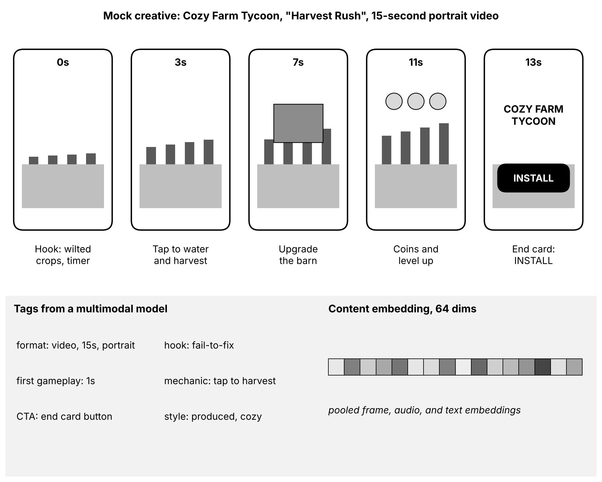
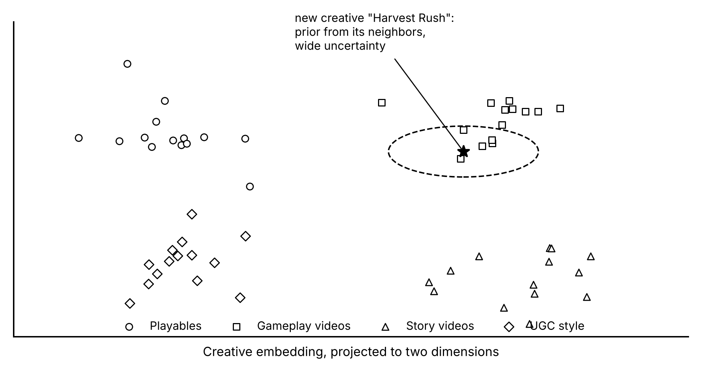

# Personalized Creative Selection {#sec-personalized-creative-selection}

The creative is what the player actually sees: a 15-second video of a farm growing, a playable demo of a match-3 level, an end card with a big install button. It changes click rates and install rates as much as almost anything else in the bid, and studios produce new creatives constantly, because creatives wear out. Yet in most DSPs, creative selection is the least sophisticated decision in the bid. The walk DSP chose creatives with Thompson sampling per campaign, which finds the creative that works best on average, and treats every new creative as unrelated to the ones before it.

In this chapter, we will look at what breaks with per-campaign creative testing, and lay out the steps from context-free bandits to deep contextual models. We'll follow one mock creative through the whole chapter: how it's tagged and embedded from its content, how a creative tower turns it into a vector, and how that vector is scored against a device with a few dot products per request. We then model a device's history with creatives, measure fatigue per device and per creative, score campaigns and creatives jointly within the latency budget, explore in embedding space with Thompson sampling, measure creative impact with incrementality in mind, and report creative insights back to advertisers.

## What Breaks with Per-Campaign Creative Testing

Thompson sampling per campaign, from @sec-pricing-for-goals, answers one question: which of this campaign's creatives has the highest install rate across all the devices it's shown to? Three things are missing:

- **Personalization.** The best creative on average isn't the best creative for every device. A player who finishes puzzle-style videos and skips narrative ones should see the puzzle-style creative, even if the narrative one wins on average.
- **Sharing across creatives.** A new creative starts from a prior based on the campaign's other creatives, but nothing about what it contains. A new creative that's nearly identical to the current winner is treated like any other unknown.
- **Sharing across campaigns.** What the DSP learns about which kinds of creatives work, such as short playables for puzzle games, stays inside each campaign.

## From Context-Free Bandits to Embeddings

Creative selection at most DSPs follows a progression, and each step keeps the explore-and-exploit loop that makes sure new creatives get impressions, while changing what the loop can condition on.

1. **Context-free bandits with offline weights.** Each creative in a campaign is an arm. A batch job computes each creative's posterior from its recent impressions and installs, and the bidder samples from the posteriors, as in @sec-pricing-for-goals. It's simple to serve, new creatives get a fair chance because their posteriors are wide, and the weights are easy to inspect. But the weights are the same for every impression, and every new creative starts from the same uninformed prior.
2. **Linear contextual bandits.** The expected reward of each creative becomes a linear function of features of the request and the creative, such as the placement type, OS, and device model, the creative's format, length, and orientation, and crosses between them. LinUCB is the classic version, with a confidence bound that drives exploration,[^c36-linucb] and Thompson sampling versions sample from a posterior over the linear weights. A creative can now win in one context and lose in another, and exploration concentrates where the model is uncertain. Libraries such as Vowpal Wabbit make it practical to prototype this step.
3. **Deep contextual bandits with embeddings.** Hand-built features are replaced with learned representations: an embedding for the device, an embedding for the creative, and an embedding for the placement, with the reward coming from how well they match. Exploration is kept with a linear bandit on top of the learned representation, or with uncertainty estimates in the deep model itself. Twitter, for example, estimated uncertainty in a deep click model with bootstrapping and dropout, so new ads were explored where the model was least certain.[^c36-twitter]
4. **Content priors for new creatives.** The hardest case is a creative with no impressions. Giving each creative a prior based on its content means the bandit starts from an informed estimate. Alibaba, for example, ranks new creatives with a visual model trained on past creative performance, and a bandit refines the scores as clicks arrive.[^c36-alibaba]

Netflix's artwork personalization is a good public example of the whole loop, choosing one image per title for each member with a contextual bandit, with controlled randomization that's logged so new policies can be evaluated offline by replay.[^c36-netflix] The rest of this chapter builds steps 3 and 4 for a DSP.

## Creative Engagement Data

The signals for creative models come from the DSP's own impressions: impressions, video starts and quartiles, playable interactions, end card views and clicks, clicks, and the installs and post-install events attributed to each creative.

One constraint is worth stating plainly: creative engagement exists only on the DSP's own impressions. MMPs report which channel won an install, not which creatives a device saw elsewhere. So a device's history with creatives is much sparser than the install and purchase histories used for pretraining in @sec-sequences-and-transformers, and many devices have none at all. Models have to work well without it, and use it when it's there.

Rewards are also sparse and delayed. An install happens for a small fraction of a percent of impressions, and value events arrive days later. Many systems therefore learn from faster engagement signals, such as completions and end card clicks, alongside installs, and confirm on installs and D7 value. That speeds up learning, at the risk of favoring creatives that attract clicks but not payers, which is why the heads below include installs, and why creative results are checked against incrementality later in the chapter.

## A Mock Creative

To make the rest of the chapter concrete, consider a new creative for Cozy Farm Tycoon, "Harvest Rush", shown in @fig-c36-mock. It's a 15-second portrait video. It opens on wilted crops and a timer, cuts to a player tapping to water and harvest, upgrades the barn, shows coins and a level-up, and ends on an end card with an install button.

{#fig-c36-mock width="100%" fig-alt="Five frames from a mock 15-second portrait video ad for Cozy Farm Tycoon called Harvest Rush, from a hook with wilted crops to an install end card. Below are tags a multimodal model would assign, such as format, hook and mechanic, and a 64-dimension content embedding."}

Before it has a single impression, the DSP can describe it in two ways:

- **Tags,** produced by a multimodal model that watches the creative and returns structured attributes: the format and length, the hook type (here, fail-to-fix, where the player sees something go wrong and fixes it), the time to first gameplay, the mechanic shown, the call to action, and the production style. Tags are readable by advertisers' creative teams, and they give a consistent vocabulary for reporting.
- **A content embedding,** computed from the creative's frames, audio, and text, which captures what the tags miss, such as visual style, pacing, and color palette.

A practical setup uses both: the embedding feeds the model, and the tags explain it. Both need to be versioned like any other model, since a new tagging prompt or embedding model changes every downstream feature, and tags should be spot-checked against human labels, especially subjective ones like the hook type.

## Content Embeddings for Creatives

@fig-c36-embedding shows how the content embedding is built, extending the content embeddings from @sec-deep-models-with-embeddings to creatives.

{#fig-c36-embedding width="100%" fig-alt="A creative's frames, gameplay clip, audio and text each pass through a frozen encoder, and its tags, format and length through small embeddings. These are concatenated and pooled, together with a creative ID that is dropped 30% of the time in training, into a creative tower that outputs a 64-dimension vector."}

- **Frames and end cards,** sampled at a couple of frames per second and embedded with an image-text model such as CLIP or SigLIP, which places frames and on-screen text in a shared space, then mean- and max-pooled across the frames.[^c36-clip]
- **Gameplay motion,** with a self-supervised video model such as V-JEPA, which learns representations of motion and scene content without labels.[^c36-vjepa] For gameplay footage, what happens over time often matters more than any single frame.
- **Voice-over, music, and sound effects,** with an audio encoder. Audio matters a lot for mobile game ads.
- **Text,** such as the call to action and captions, with a text encoder.
- **Tags and structured attributes,** such as format, length, orientation, and hook type, as small learned embeddings.

The encoders are pretrained and frozen. They run once per creative, offline, when the creative is uploaded, so their cost doesn't matter for serving. Their outputs, a few thousand numbers in total, are concatenated and passed to the **creative tower**, a small MLP that's trained with the rest of the model and outputs the creative's 64-dimension vector, $c$.

Content embeddings give every new creative a position in a shared space, near creatives that look and sound like it, so it can borrow what the DSP has learned about them. Baidu, for example, reported gains on new ads by encoding ad images into embeddings that depend only on the image, so they exist for ads with no history.[^c36-baidu]

## Creative Embeddings Learned from Engagement

Content says what a creative is, and engagement says how players respond to it. The creative tower also takes the creative's ID, with its own learned embedding, so creatives that the same players respond to end up close together, even when they look different.

The two work together through ID dropout. During training, the creative ID is randomly dropped, for example 30% of the time, so the tower learns to build a good vector from content alone. A new creative, whose ID has never been seen, starts at the position predicted from its content, and moves toward its engagement-based position as data arrives and the model is retrained. This is the same technique as for new apps in @sec-sequences-and-transformers and new campaigns in @sec-learned-campaign-selection.

## A Device's Creative History

For devices that have seen the DSP's ads before, their history with creatives is a strong signal. Creative events become tokens in a short device sequence, in the same format as @sec-sequences-and-transformers: the creative's content embedding, plus the event type (impression, completion, end card click, install), plus an age band. A device that finished two fail-to-fix videos for farming games this week and skipped three story videos is telling the model something specific about which creative to show it next.

There are two ways to read this history, with very different costs:

- **Self-attention, pooled into the device vector.** The history is read once per request, and its summary is part of the device tower's output. It costs one small model call per request, no matter how many creatives are scored.
- **Target attention between the candidate creative and the history.** The candidate creative is the query, so the model can learn exactly which past creatives are relevant to this one. It's more accurate, but it runs once per candidate creative.

Start with self-attention, which fits the serving rule below. If target attention is worth adding, keep it cheap: a short history of the device's last few dozen creative events, small embeddings, and only the top few creatives per campaign.

## A Tower Model for Creatives

@fig-c36-towers puts the pieces into one model. It has the same shape as the co-trained model in @sec-sequences-and-transformers, with creatives in place of campaigns:

- **The device tower** reads the device state $h$ and the device's creative history, and outputs $d$.
- **The creative tower** reads the creative's content embedding, its ID, its campaign, and fatigue counts, and outputs $c$.
- **The context tower** reads the publisher app, placement, OS, and hour, and outputs $x$.
- **The heads** predict video completion, an end card or CTA click, and an install, each from a small MLP plus explicit dot products $d \cdot c$, $d \cdot x$, and $c \cdot x$, trained over every impression with the ESMM losses from @sec-deep-models-with-embeddings.

{#fig-c36-towers width="100%" fig-alt="Three towers for creative selection: a device tower with attention over the device's creative history, a precomputed creative tower, and a context tower per request. Dot products and a small MLP feed heads for video completion, click and install."}

The completion and click heads learn fast, from plentiful labels, and they shape the towers early in a creative's life. The install head is what the bid uses, and it's calibrated with a tree layer as in Design B, using the dot products as features.

## Serving Creative Scores Efficiently

Creative scoring follows the same rule as campaign retrieval in @sec-learned-campaign-selection: separate what depends only on the request from what depends on the candidate.

- **Once per request, a light ONNX model.** The device tower, including its self-attention over the creative history, and the context tower run once per bid request. Together, they're a small model over a few dozen tokens, a fraction of a millisecond on a CPU. It's fine to run a model like this once per request.
- **Precomputed creative vectors.** The creative tower's outputs depend only on the creative, its campaign, and slow-moving counts, so they're computed when a creative is uploaded, when the towers are retrained, and when fatigue counts are refreshed, and held in bidder memory as one matrix.
- **Dot products per candidate.** For each retrieved campaign, score its creatives with $d \cdot c$, $d \cdot x$, and $c \cdot x$, plus a bias. The $c \cdot x$ term depends only on the creative and the placement, so it can be cached per placement type.

The arithmetic is small. With 20 retrieved campaigns and 6 creatives each, the bidder computes 120 creative scores of a few dot products each, a few thousand multiply-adds, which takes microseconds. The contiguous matrix, vectorized loops, and no-allocation rules from @sec-serving-deep-models apply as they did for campaigns. The cost that matters isn't the dot products, it's the profile read and the tree layer, which runs only on the top creatives.

The mistake to avoid is running the creative tower, or the full network, per candidate at bid time. The tower's inputs are a few thousand numbers per creative and its outputs never change between requests, so computing it per request would spend most of the bid's budget recomputing the same 64 numbers.

## Fatigue per Device and per Creative

Creatives wear out at two levels.

**Per device:** a player who has seen the same creative five times is less likely to respond to it a sixth time, and the same is true, more weakly, for creatives close to it in embedding space. Features for fatigue count how many times this device has seen this creative, and how many times it has seen creatives within a distance of it, with decay over time. The near-duplicate count matters more as generated variants multiply, since ten variants of "Harvest Rush" will wear out together.

**Per creative:** across the population, a creative's performance declines as more of its audience has seen it. Track each creative's install rate by age and by how many unique devices have seen it, and retire creatives whose performance has fallen below the campaign's other options, with a report to the advertiser so the creative team knows to replace it. Bandits need to discount old data or model the decay explicitly, or they'll keep serving a creative after it has worn out.

## Joint Campaign and Creative Scoring

The creative changes click and install rates, so the internal auction should score campaign and creative pairs, not pick a campaign first and attach a creative afterward. A campaign whose best creative for this device is excellent can beat one with a higher average install rate.

Scoring every pair is expensive, so keep it affordable: retrieve campaigns first, as in @sec-learned-campaign-selection, then score a few creatives per retrieved campaign with the dot products above, and send the best one or two per campaign to the heavy models. Research on ranking ads and creatives together, rather than one after the other, points the same way.[^c36-parallel]

## Exploring in Embedding Space

Thompson sampling per creative explores each creative from scratch. **Contextual bandits** over creative embeddings explore more efficiently, because what they learn about one creative applies to its neighbors. The most practical version for a DSP is a **neural-linear** bandit: the deep model learns the representation, and a linear Thompson sampling model on top of it handles exploration.

Let $\phi(d, c)$ be a feature vector for a device and creative pair, such as the element-wise product $d \odot c$ from the towers. The bandit models the reward, here an install, as linear in those features, $r \approx \phi(d, c)^\top \theta$, with a Gaussian posterior over the weights, $\theta \sim \mathcal{N}(\mu, \Sigma)$, updated from matured outcomes. For each request, it draws one sample $\tilde \theta$ from the posterior and scores every candidate creative with it:

$$\tilde \theta \sim \mathcal{N}(\mu, \Sigma), \qquad c^* = \arg\max_c \; \phi(d, c)^\top \tilde \theta$$

A creative whose features point in directions the posterior is unsure about gets scores that vary a lot from sample to sample, so it wins some draws and gets impressions. As outcomes arrive, $\Sigma$ shrinks in those directions, and the scores settle. With a 64-dimension $\phi$, the posterior is a 64 by 64 matrix, and drawing a sample per request is cheap.

@fig-c36-space shows why this beats per-creative sampling. "Harvest Rush" lands in embedding space near the campaign's other gameplay videos, so the bandit starts with a prior that's informed by them, and a wide uncertainty that shrinks as it's shown. Showing it to farming players teaches the model about every gameplay video for farming players, not only about this one creative.

{#fig-c36-space width="100%" fig-alt="Scatter plot of creative embeddings in two dimensions, grouped into playables, gameplay videos, story videos and user-generated style. A new creative sits among gameplay videos, with a dashed ellipse showing a prior from its neighbors and wide uncertainty."}

The practical issues are the same as before. Rewards are delayed, so the bandit updates on matured labels in batches, such as hourly. Exploration has a cost to the advertiser, which should be budgeted and measured, and better content priors are the most direct way to reduce it. And the selection probabilities must be logged, so new policies can be evaluated offline with the methods from @sec-offline-evaluation-and-model-iteration.

## Measuring Creative Impact

Creative policies are tested like any other change, with A/B tests from @sec-shadow-mode-canaries-and-ab-tests. One trap is specific to creatives: some creatives win attribution without causing installs. A creative that gets accidental clicks, or that's shown mostly to players who were going to install anyway, can have an excellent attributed install rate and little lift. Check creative-level results against the incrementality measurements from @sec-measuring-incrementality, at least for the creatives that a new policy favors most.

## Creative Insights for Advertisers

The models that choose creatives also learn which creative attributes and embedding clusters drive installs and value, for which audiences. That's valuable to advertisers' creative teams. Report it as feedback, in the vocabulary of the tags: which attributes, such as length, hook type, or the time to first gameplay, are associated with higher installs and higher value, which clusters of creatives are wearing out, and which kinds of devices respond to which styles. A report that says fail-to-fix hooks with gameplay in the first second outperform story openings for farming players in Brazil is something a creative team can act on.

Studios are protective of creative performance data, so a creative model trained on results from many studios and used for all of them needs explicit terms for pooled use, as with the data rights for device histories in @sec-sequences-and-transformers.

Generated creatives change the picture. Studios can now produce many variants of a creative quickly with generative tools, which is good for testing, and creates a cold-start problem at a new scale: hundreds of new creatives a week, each with no history. Content embeddings and exploration in embedding space are what make that volume usable.

::: {.callout-tip title="Try it on the simulator"}
Simulate creative engagement histories for devices with hidden creative preferences. Compare personalized creative selection, with content embeddings, a device's creative history, and neural-linear Thompson sampling, with per-campaign Thompson sampling, on installs, on true lift, and on how many impressions a new creative needs before it's served at its true rate.

*Status: planned. This exercise needs creative content features and device state that persists across days, which adsim 0.3 doesn't support yet.*

:::

## Conclusion

In this chapter, we chose creatives per device. Per-campaign testing finds the best creative on average and learns nothing across creatives, so we followed the progression to contextual bandits with embeddings. A mock creative showed how tags and content embeddings describe a creative before its first impression, and how a creative tower turns them into a vector, with ID dropout to handle new creatives. A tower model scores devices and creatives with a few dot products, the device side runs once per request in ONNX, and creative vectors are precomputed, so scoring a hundred creatives takes microseconds. Fatigue is measured per device and per creative, campaigns and creatives are scored jointly, neural-linear Thompson sampling explores in embedding space, creative results are checked against incrementality, and what the models learn goes back to advertisers' creative teams.

Those are all the models of the state-of-the-art DSP. Running them is its own problem: many model families, at scale, with automation and a learning loop from incidents.

[^c36-parallel]: "Parallel Ranking of Ads and Creatives in Real-Time Advertising Systems," AAAI, 2024, arXiv:2312.12750, <https://arxiv.org/abs/2312.12750>

[^c36-linucb]: Lihong Li, Wei Chu, John Langford, and Robert E. Schapire, "A Contextual-Bandit Approach to Personalized News Article Recommendation," WWW, 2010, <https://arxiv.org/abs/1003.0146>

[^c36-twitter]: Dalin Guo et al., "Deep Bayesian Bandits: Exploring in Online Personalized Recommendations," RecSys, 2020, <https://arxiv.org/abs/2008.00727>

[^c36-alibaba]: Shiyao Wang et al., "A Hybrid Bandit Model with Visual Priors for Creative Ranking in Display Advertising," WWW, 2021, <https://arxiv.org/abs/2102.04033>

[^c36-netflix]: Ashok Chandrashekar, Fernando Amat, Justin Basilico, and Tony Jebara, "Artwork Personalization at Netflix," Netflix Technology Blog, December 7, 2017, <https://netflixtechblog.com/artwork-personalization-c589f074ad76>

[^c36-clip]: Alec Radford et al., "Learning Transferable Visual Models From Natural Language Supervision," ICML, 2021; and Xiaohua Zhai et al., "Sigmoid Loss for Language Image Pre-Training," ICCV, 2023.

[^c36-vjepa]: Adrien Bardes et al., "Revisiting Feature Prediction for Learning Visual Representations from Video," 2024, <https://arxiv.org/abs/2404.08471>

[^c36-baidu]: Tan Yu et al., "Boost CTR Prediction for New Advertisements via Modeling Visual Content," 2022, <https://arxiv.org/abs/2209.11727>
