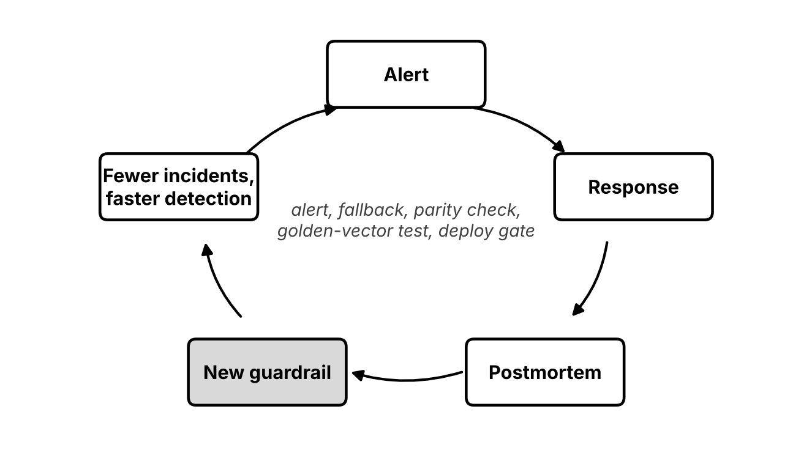

# Operating at Scale {#sec-operating-at-scale}

The state-of-the-art DSP runs many models at once: a pretrained device model and a two-tower model upstream, click, install, value, retention, and uplift models in the decision layer, a curve-head win model, retrieval and creative models, a calibration layer, pacing controllers and learned policies, and fallbacks for each. They depend on each other, they retrain on different schedules, and they're changed by different people, often in the same week. Operating them is a different problem from operating the competitive DSP's handful of LightGBM models. It needs more automation, an inventory of what's running and what depends on what, and a loop that turns every incident into a guardrail.

In this chapter, we will cover drift in data, features, and concepts, monitoring many model families and their dependencies, and experimentation at scale. We then automate rollback, watch for calibration drift and feedback loops, and close the loop with postmortems and guardrails, illustrated by incident case studies. We finish with tooling at scale, the feature lifecycle, tracking training and serving cost per model, and quarantine tooling that traces bad data through every downstream model.

## Drift in Data, Features, and Concepts

Drift comes in three forms, and each calls for a different response, as shown in @tbl-c19-drift.

| Kind | What changes | How it shows up | First response |
|---|---|---|---|
| Data drift | The distribution of inputs | PSI on features rises; prediction distribution shifts | Check upstream sources; retrain if the shift is real |
| Concept drift | The relationship between inputs and outcomes | Calibration drifts while input distributions are stable | Retrain on recent data; check for market or attribution changes |
| Supply mix shift | Which exchanges, publishers, and placements send traffic | Segment shares change; overall prediction mean moves while each segment is stable | Usually no model action; confirm segment-level stability |

: Three kinds of drift. {#tbl-c19-drift}

The third row matters because it looks like model drift in aggregate charts, and it isn't. If a new exchange starts sending a large share of low-value traffic, the overall mean prediction falls, even though the model scores each segment exactly as before. This is the same mix effect as Simpson's paradox, and the remedy is to check the segment-level views before concluding that the model changed.

There's a fourth, nastier pattern that doesn't fit neatly in the table: a feedback loop, where the model's own decisions change its inputs. In one incident, we had a feature called `clearing_price` that recorded how much we had been willing to bid for a device the last time we served it. An experiment on a small cohort of traffic introduced false positive labels into training data, the models bid higher on those devices, and the feature's average value climbed steadily as the models fed on their own bids. It was very hard to find, because the cohort was small enough that no operational metric moved. What eventually surfaced it was looking at feature drift for the affected devices. We rolled back to the last good model, cleaned the labels, and removed the feature entirely, replacing it with features based on the minimum bid to win that exchanges report. The lesson for monitoring is to watch the drift of features that the bidder itself influences, such as past bid prices and frequency, more closely than features that come from outside.

## Monitoring Many Model Families

At scale, the first question in any investigation is what's running. The model registry from @sec-pipelines-validation-and-publishing becomes the inventory: for each model family, which champion is serving, in which trading locations, what it depends on, such as embedding versions, vocabularies, and upstream models, and when each changed.

Dependencies change how monitoring works. When a shared foundation model changes, every downstream model shifts at once: the install model's affinity scores move, the value model's head outputs move, and calibration moves everywhere. Monitored separately, that looks like a dozen unrelated alerts. Monitored with the dependency graph, it's one change with many effects. Version and monitor the upstream embedding as its own model, with its own prediction distributions and parity checks, and group alerts by the upstream change they follow.

## Experimentation at Scale

With many teams changing many models, the few layers from @sec-shadow-mode-canaries-and-ab-tests aren't enough. Moloco describes running over 100 concurrent live experiments,[^c37-moloco] which is only possible with the layered design from Google's overlapping experiment infrastructure:[^c37-google] each part of the system in its own layer, each layer with its own salt, and an experiment registry that records which layer each experiment is in, which traffic it uses, and when it runs.

Keeping readouts trustworthy at that volume takes discipline: automated sample ratio mismatch checks on every experiment, a standard set of primary and guardrail metrics computed the same way for every readout, corrections for the number of comparisons when many segments are examined, and a holdout of devices that receives no experiments at all, against which the combined effect of everything shipped can be measured.

## Automated Rollback

In walk, canaries rolled back automatically when a guardrail failed. At scale, automated rollback covers every kind of change: models, embeddings, vocabularies, configuration, and pacing policies. Each change type has its guardrails, each has a known previous version, and the deploy system can revert it without a person. People decide whether to try again, and what to change first.

The dependency graph matters here too. Rolling back an embedding version means rolling back, or revalidating, every model that was promoted with it, so rollback acts on the set of versions that were promoted together, not on one model at a time.

## Calibration Drift and Feedback Loops

A DSP's models change the data they're trained on. The win model decides which impressions the DSP wins, the conversion models are trained only on those, and the pacing system shifts which segments each campaign buys. Over time, models can drift toward a narrower and narrower slice of traffic, and their calibration on everything else gets worse without anyone noticing, because the DSP no longer buys it.

The defenses are the ones built up through the book: exploration, with randomized bids and selection, which keeps the training data from narrowing around the model's own decisions; calibration multipliers by segment, which catch drift where the DSP still buys; monitoring of segments the DSP has stopped buying, through the holdout and the exploration share; and features that come from outside the DSP's own decisions, such as exchange-reported minimum bids to win, instead of the DSP's own past bids.

## Postmortems and the Guardrail Loop

Every tier 1 incident, and any tier 2 incident with real impact, gets a **blameless postmortem**. It records the timeline, the impact, how the problem was detected, how the team responded, the root cause and contributing factors, and follow-up actions. Blameless means that the focus is on the system that allowed the failure, not on the person who made the last change. Google's SRE book has the classic description of this philosophy, and it's worth reading in full.[^c37-sre]

I like a simple structure for postmortems. On one team I worked on, we used the "five W's": what went wrong, when and where it happened, who was involved, and why it happened, followed by how to keep it from happening again. For ML incidents specifically, I've used four questions, which you've seen throughout these chapters: What was the issue? How was it found? How was it fixed? What did we learn?[^c37-incidents]

Impact should be measured in money and delivery where possible. For an overspend incident, the excess spend over the incident window $I$ compares actual spend with the forecast that the pacing system would have made:

$$\text{excess spend} = \sum_{t \in I} \left(S_t - \hat{S}_t\right)$$

and the same comparison applies to installs or revenue for incidents that hurt delivery or performance. Track three times for every incident (time to detect, time to mitigate, and time to recover), and watch how they change across incidents.

The most important output of a postmortem is a new guardrail. Each incident should add at least one of the following: a new alert, a new fallback, a new parity check, a new test with golden vectors, or a new deploy gate. Over time, the same class of incident should become impossible or caught automatically, as shown in @fig-c20-loop. This is what happened with the incidents in my post: the untrained model led to validation thresholds and automated rollback, the warmup file mismatch led to a staging environment, and the parity issues led to cross-team code reviews. Each fix made the system a little more robust than before.

{#fig-c20-loop width="80%" fig-alt="A cycle: alert, response, postmortem, new guardrail, and fewer incidents with faster detection, leading back to alerts. Examples of guardrails in the middle include an alert, a fallback, a parity check, a golden-vector test and a deploy gate."}

[^c37-sre]: Betsy Beyer, Chris Jones, Jennifer Petoff, and Niall Richard Murphy, eds., *Site Reliability Engineering: How Google Runs Production Systems*, O'Reilly, 2016, Chapter 15, "Postmortem Culture: Learning from Failure," <https://sre.google/sre-book/postmortem-culture/>

## Incident Case Studies

The cases below follow the same four questions. They are composites of common patterns rather than accounts of specific incidents, except where noted.

**An embedding version fails to load on part of the fleet.**

- *What was the issue?* After a deploy, a third of the bidder hosts failed to load the new app embedding version, and their models fell back to OOV handling.
- *How was it found?* Predictions dropped on those hosts, and the lookup miss alert paged the on-call engineer.
- *How was it fixed?* The on-call engineer rolled back the deploy.
- *What did we learn?* The postmortem added a deploy gate that blocks promotion when lookup coverage is below a threshold on any host.

**An upstream change empties a feature.**

- *What was the issue?* An SDK update stopped sending a session count on iOS.
- *How was it found?* The missing feature alert fired within the hour.
- *How was it fixed?* The playbook switched the affected models to their fallback while the upstream team fixed the field.
- *What did we learn?* The postmortem added a canary on missing rates for new SDK releases.

**A new model shifts click predictions everywhere.**

- *What was the issue?* A retrained click model raised predictions by about 10% across all exchanges.
- *How was it found?* The canary check caught the shift at the 1% stage and rolled back automatically, so the impact was small.
- *How was it fixed?* The investigation, done during working hours, found a change in negative downsampling that the calibration step didn't account for.
- *What did we learn?* The postmortem added a validation check comparing mean predictions with the previous model on a fixed sample, which is the same check that came out of the untrained model incident.

**Runaway bidding on one exchange.**

- *What was the issue?* A currency conversion error on a new exchange made floors and bids appear much lower than they were, and spend climbed far above forecast.
- *How was it found?* The spend-rate circuit breaker paused bidding on the exchange within minutes.
- *How was it fixed?* The incident commander kept the exchange disabled while the integration was fixed.
- *What did we learn?* The postmortem added a currency sanity check to exchange onboarding, the process we described in @sec-the-auction-lifecycle.

## Tooling Stacks at Scale

The monitoring stacks from @sec-operating-a-competitive-dsp, open source on-prem or managed on Google Cloud, still apply. What changes at scale is what's on top of them: the registry as the model inventory, an experiment registry, a dependency graph between models and data, automated rollback, and the cost tracking below. Most teams build these as thin layers over the registry and the warehouse, rather than buying a platform, because they depend so much on the DSP's own model structure.

## The Feature Lifecycle

Features accumulate. Each one was added for a reason, and few are ever removed, so a mature DSP logs, stores, and computes hundreds of features, some of which no model uses anymore, and some of which nobody can explain.

Treat features like code, with a lifecycle:

- **Ownership:** every feature has an owner and an entry in a catalog that says what it means, where it comes from, and which models use it.
- **Cost:** what the feature costs to compute in the bid path, to log, and to store.
- **Value:** how much each model loses without it, measured by an ablation retrain or by importance on held-out data.
- **Retirement:** features that don't earn their cost are removed in steps. First, stop using them in new model versions, then stop computing them once no live model needs them, then stop logging them, keeping their field numbers reserved, as in @sec-building-training-datasets.

The same lifecycle applies to models and embedding versions that nothing serves anymore: retire them, and clean up their artifacts, keeping enough to reproduce old results.

## Tracking Training and Serving Cost

The price-performance curve from @sec-where-trees-stop needs real numbers for every model in production:

- **Training cost** per run, and GPU utilization, since an underused GPU is money spent waiting.
- **Storage** for logs, datasets, embeddings, and artifacts.
- **Serving cost** per model, as CPU time per million requests, measured from per-stage profiling in the bidder.

With those, each model's cost can be compared with what it earns, from its A/B tests and its share of the bid. A model whose gain no longer covers its cost, often because a newer model captures the same signal, is a candidate for retirement.[^c37-moloco]

## Quarantine and Rebuild Tooling at Scale

In @sec-operating-a-competitive-dsp, quarantining bad data meant marking partitions, rebuilding datasets, and retraining. At scale, the hard part is knowing what to rebuild. A bad day of postbacks reaches the pretraining data of the device model, the device states scored from it, the embedding version built on it, every downstream model trained with those states, and the calibration tables computed from their predictions.

Tooling that records lineage, which datasets, embedding versions, and models were built from each partition, turns that into a query. Given a quarantined partition, it lists every artifact downstream of it, so one bad day can be traced and rebuilt everywhere, in dependency order.

## First-Time Pitfalls

- **A change to a shared upstream model shifts every downstream model at once.** Promote upstream changes with downstream checks, and alert on simultaneous shifts as one incident, not many.
- **Archived pipelines that look supported.** Keep old pipelines runnable, so experiments can be reproduced, but mark them clearly as unmaintained, with a record of what replaced them.
- **Experiments that outlive their owners.** An experiment registry with end dates, and alerts for experiments past them, keeps traffic from being split indefinitely by tests nobody is reading.

[^c37-incidents]: Ben Weber, "Machine Learning Incidents in AdTech," *Towards Data Science*, January 29, 2025, <https://medium.com/data-science/machine-learning-incidents-in-adtech-e3f48d858054>

## Conclusion

In this chapter, we operated the state-of-the-art DSP. Drift comes in several kinds, including feedback loops through the DSP's own decisions, and the registry becomes the inventory of model families and their dependencies, so a change upstream is one incident rather than many. Layered experiments run at scale with automated checks, rollback acts on sets of versions, and exploration and outside signals keep feedback loops in check. Postmortems turn every incident into a guardrail, features and models have lifecycles, every model's training and serving cost is tracked against what it earns, and lineage traces bad data through every downstream artifact.

With that, the state-of-the-art DSP is built. Part V goes beyond the bidder, starting with what changes when device IDs aren't available.

[^c37-moloco]: Moloco, "Inside Moloco's CARA: the AI that compounds," Moloco blog, 2026, <https://www.moloco.com/blog/inside-molocos-cara-the-ai-that-compounds>

[^c37-google]: Diane Tang, Ashish Agarwal, Deirdre O'Brien, and Mike Meyer, "Overlapping Experiment Infrastructure: More, Better, Faster Experimentation," KDD, 2010, <https://research.google/pubs/pub36500/>
