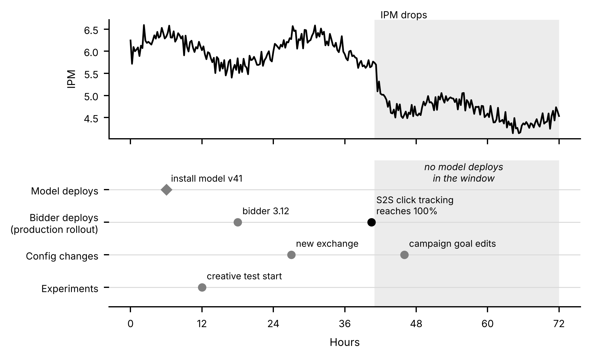
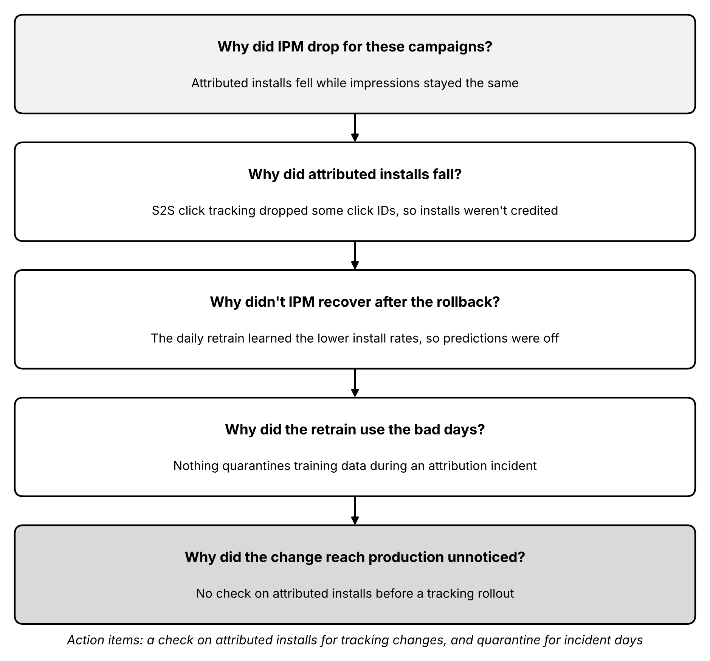

# Building a Healthy ML Culture {#sec-building-a-healthy-ml-culture}

Most of this book is about systems: bidders, models, pipelines, and the guardrails around them. This chapter is about the people who build and run those systems, and the culture they work in. It's the most personal chapter in the book. I've led or worked on ML teams at several DSPs, and the hardest problems I faced were rarely about model architecture. They were about alignment, trust, and what happens to a team when something breaks and everyone looks at ML.

The patterns here showed up in more than one place, and I suspect many readers will recognize them. In this chapter, we will look at why shipping and monitoring are team sports at a DSP, where full-stack ML engineers help and where they stop, and how tooling shapes culture. We then cover what to do when every problem gets blamed on ML, how blameless postmortems break that pattern, what counts as delivered for an ML team, and why small wins compound. I close with burnout: how to recognize it, and how to look after yourself and your team when the culture around you is stressful, or even toxic.

## Shipping Is a Team Sport

A high-functioning ML team delivers on two levels. Tactically, it ships steady improvements: a new feature, a retrained model, a better calibration step. Strategically, it moves the DSP toward larger goals, such as new campaign types, deep models in the bid path, or real-time learning. Both kinds of work should map to a well-defined ML roadmap, and that roadmap should map to the goals of the product and engineering teams.

At a DSP, the coupling between ML and the rest of the system is tight. Almost nothing the ML team builds reaches production without engineering work. For example, say the ML team plans to add precomputed device embeddings to the install model next quarter, as in @sec-serving-deep-models. The model work is only part of the project. Someone needs to build the pipeline that produces the embeddings, the store that serves them, the lookup in the bid path, and the monitoring that catches when they go stale. If engineering hasn't set aside time for that work, the model sits finished and unused.

When that happens repeatedly, a familiar perception sets in: the ML team isn't delivering anything. From a pragmatic point of view, that's true. Models that don't reach production don't move revenue. But the team is often blocked by process and planning, not by a lack of effort. A team that works hard for a quarter and has nothing to show for it gets demoralized, and a team that's seen as not delivering loses the trust it needs to get engineering time for the next project. Left alone, this cycle erodes the culture.

The fix I've come to believe in is a **shared roadmap**. Engineering, product, and ML should agree on a single high-level plan, because large ML projects are really cross-team projects. If the embeddings project is on the shared roadmap, the pipeline and serving work is planned alongside the model work, and everyone agrees on what "shipped" means before the quarter starts.

How hard this is depends on the size of the company. At a small DSP, the ML leader and the engineering leader may be the same person, and there may be no product lead at all. In that setup, the roadmap is aligned by default: one person decides what gets built, so the pipeline and serving work for an ML project gets scheduled alongside the model. As the company grows and adds separate engineering, product, and ML leads, that alignment stops happening on its own. Each lead has their own priorities and their own planning cycle, and ML projects that span all three teams are the first to fall through the gaps. At that stage, a shared roadmap takes deliberate effort, and it's worth being diligent about it.

## Full-Stack MLEs, and Where They Stop

One way I've tried to reduce this dependency is by hiring and coaching ML engineers to work on both the training and serving sides, rather than splitting the work into siloed teams, as we discussed with pods and silos in @sec-building-the-ml-team. An MLE who can build the training pipeline, export the model, and wire up inference in the bidder doesn't have to wait on another team for every change.

This works well up to a point, and then it breaks down. Building a new training pipeline to explore a model is much easier than refactoring the DSP to handle something new in the bid path. The bidder is shared, latency-critical code that many teams depend on. Changes to request parsing, profile lookups, or the response path need careful review from the people who own that code, and they should. Full-stack MLEs shorten the path to production for model changes, but they don't remove the need for engineering alignment on changes to the system itself.

## Tooling Shapes Culture

A lot of what looks like a culture problem is a tooling problem in disguise. Good tooling makes the ML team's work visible, auditable, and easier to reason about, and that changes how people talk about it.

One example is **lineage**. An MLE should be able to trace a model artifact back to the features it was trained on, and each feature back to how it was computed, as in @sec-pipelines-validation-and-publishing. This sounds basic, but it's often missing. A common gap is the device profile. The bidder reads a full profile from a NoSQL store at bid time, but the ML team only sees the subset that gets logged on impressions. If it's unclear how profiles are built, stored, and updated, the team ends up with a large knowledge gap. Features get computed slightly differently in training and serving, investigations take longer, and the team looks less efficient than it is.

The bigger example is deployment visibility, which I'll come back to later in the chapter. In both cases, the investment in tooling pays off twice: once in faster, safer work, and again in how the rest of the company perceives the team.

## When Everything Is ML's Fault

One of the hardest challenges in building a good ML culture at a DSP is a culture where every problem gets blamed on ML. I've seen this in more than one place, and it's rough.

The pattern goes like this. Someone in product, engineering, or operations changes the system in a way that breaks something. The bidder keeps buying inventory, because that's what bidders do, and the installs per thousand impressions (IPM) drop for some campaigns. Or the predicted IPM goes up while the observed IPM stays flat. Either way, the models become worse calibrated, performance drops, and advertisers notice. In the worst case, advertisers churn or cut their budgets, and budgets are the lifeblood of a DSP. Everyone is under pressure, and the visible symptom is a model that's making bad predictions.

In a narrow sense, the blame is accurate: the models did get worse, and it shows in calibration. But the cause is often somewhere else. Here are a few versions I've seen:

- **An engineering change to attribution.** For example, the team enables server-to-server click tracking for some campaigns, and attributed installs drop compared with the baseline. The immediate fix is to revert the deployment, but that isn't the end of it. If the models retrain the next day on data with lossy attribution, they learn the wrong install rates, and the problem comes back in a new form. Reverting the models helps once the engineering change is rolled back, but the bad data also needs to be found and cleaned up before the models return to a stable state, using the quarantine tooling from @sec-operating-at-scale.
- **A product change to clicks.** New functionality, such as click shaping, can be terrible for model training. If synthetic clicks end up in the training data alongside real ones, the click model starts learning from events that users never made, and things go off the rails quickly.
- **An operations change to campaign setup.** When campaigns are complex to configure, there's a lot that can go wrong, and it will. A misconfigured goal, a wrong event mapping, or a broken targeting rule shows up as a model that's suddenly performing badly on that campaign.
- **An ML change.** Sometimes the cause really is ML. A model ships miscalibrated, perhaps because its calibration was fit on a stale holdout, or a feature is computed differently in serving than in training. It overpredicts installs on part of the supply, the bidder overpays, and spend climbs while installs stay flat. In that case, the fix is to roll back to the champion, and the postmortem should say plainly that the ML team caused the incident.

Things can go wrong in many ways, and ML will often get blamed for them. Getting out of that pattern is daunting, because each incident reinforces the story.

To be clear, ML can break things too, and I'm not saying ML is blameless. I've shipped plenty of models that didn't improve performance. I've had launches go wrong because of feature parity issues between training and serving, and models that caused incidents because of latency spikes. The ML team owns those, and it should own them openly. The point is that a healthy culture finds the actual cause, and an unhealthy one stops at the most visible symptom.

## Monitoring Is a Team Sport

Shipping takes engineering, product, and ML working from the same roadmap. Monitoring works the same way. Each team watches the parts of the system it owns, and incidents tend to happen in the gaps between them. One of the larger incidents I was involved in started with a model I shipped, and it's a good example of a gap.

**What was the issue?** We added ONNX models for install prediction to compete with our existing LightGBM models. The ONNX models took about 5 ms per inference, roughly ten times slower than the LightGBM models, but that looked acceptable in testing. The problem appeared when the business shifted from retargeting campaigns to user acquisition. Retargeting filters out most campaigns for a given request, so the bidder priced only a few. User acquisition campaigns are eligible for most requests, so the bidder priced many campaigns on every request, and the cost of each call multiplied. CPU usage climbed until the bidder went down.

**How was it found?** By the outage itself. We monitored overall bidder latency, not model inference latency, so nothing pointed at the model until the bidder was already failing. The downtime also left gaps in the logged data, and performance suffered for a while after the bidder recovered.

**How was it fixed?** We reverted to the LightGBM models and worked on ONNX latency before trying again.

**What did we learn?** The root cause was visibility. A dashboard showing p50 inference latency by model key would have made the cause obvious within minutes, and most of the incident would have been avoided. A model's latency isn't a fixed number. It's the cost of each call multiplied by the number of campaigns priced per request, and that number changes with the campaign mix.

No single team had the full picture. Engineering watched the bidder's latency and CPU, ML watched model accuracy, and the shift in campaign mix was a business decision that neither team treated as a change to the system. A few practices close those gaps:

- **Put model metrics next to system metrics.** Inference latency, call counts, and error rates by model key belong in the same dashboards the engineering team watches, not in a separate ML tool that only the ML team opens.
- **Treat business changes as system changes.** A shift in campaign mix, a new exchange, or a new campaign type changes the load on every model. Announce them the way you would a deployment, and check model latency and CPU headroom when they happen.
- **Test under the workload you're heading toward.** Load tests should use the campaign mix you expect next quarter, not just today's traffic.
- **Give every model a latency budget.** Alert when a model exceeds its share of the request budget, and fall back or roll back automatically when it does, as in @sec-serving-deep-models.

There's a second reason monitoring matters for culture: who notices a problem first. If account managers, operations, or engineering are the ones pointing out that a model's performance has changed, the ML team looks detached, as if it doesn't know what its own systems are doing. That perception sticks even when the cause turns out to be elsewhere, and it makes every later conversation harder. The ML team should be the first to know when its models drift, and ideally, it should be the one telling everyone else.

In practice, that means a few things:

- **Watch calibration, not just accuracy.** Compare predicted and observed rates, such as predicted IPM against actual IPM, by campaign and by exchange, every day. Calibration drift is usually the first visible sign that something upstream has changed.
- **Alert on inputs as well as outputs.** Feature null rates, out-of-vocab rates, and shifts in feature distributions often move before the predictions do.
- **Hold a short model health review.** A weekly look at calibration, latency, and the champion and challenger readouts keeps the team close to how the models behave in production.
- **Tell people first.** When the team spots a problem, it should post a short note to the account and operations teams before they come asking: what changed, which campaigns are affected, and what's being done.
- **Track who detected each incident.** The "how was it found?" question in a postmortem, from @sec-operating-at-scale, is worth tracking over time. If other teams keep finding ML problems before the ML team does, that's a monitoring gap worth fixing.

## Change the Question with Tooling

The most effective way I've found to shift a blame culture is with tooling, not argument. If the team can view model latency in real time, a new model that spikes latency gets caught and reverted in minutes. If there's a dashboard that shows which models shipped and when, auditing an incident becomes much easier.

With the right tooling, the conversation changes. Instead of "what did the ML team do that caused the system to tank?", the question becomes "there were no ML deployments in this window, so what else shipped when performance dropped?" That shift takes the heat off the ML team, and more importantly, it gets the company to the real cause faster.

Ideally, the DSP has a single timeline that shows model deployments, code deployments, configuration changes, and experiment changes, in one place and in an auditable way, as @fig-c40-timeline shows. Even that isn't enough on its own if deployments are slow. Knowing when a change merged to main in the bidder codebase doesn't tell you when it reached production, if deployments take a long time to roll out. I've seen that process take up to 24 hours. The timeline needs actual production rollout times, not merge times, for it to settle an argument.

{#fig-c40-timeline width="100%" fig-alt="A chart of installs per mille over 72 hours, which drops sharply around hour 41, above a timeline of changes by type. No model shipped in the window, but server-to-server click tracking reached 100% of traffic right when the drop began."}

## Blameless Postmortems

@sec-operating-at-scale covers the mechanics of a postmortem: the five W's, measuring impact, and turning every incident into a new guardrail. This section is about why postmortems matter for culture. The postmortem is the place where a blame culture is either reinforced or broken. If the review finds that the model got worse and stops there, it confirms the story that ML caused the problem, and the next incident starts with the same assumption.

Blameless doesn't mean that no one is accountable. Teams still own their action items, and the ML team should own its mistakes openly. It means the question is why the system allowed the failure, not who triggered it. The "who" in the five W's is there so the timeline is complete and the right people are in the room, not to assign fault. John Allspaw, writing about Etsy's postmortems, made the case that engineers who expect to be punished stop sharing the details needed to understand what went wrong.[^c40-allspaw] Google's research on effective teams points the same way: psychological safety, whether people feel safe taking risks and admitting mistakes in front of each other, mattered more to a team's success than who was on it.[^c40-aristotle] A blame culture is the opposite of that, and it makes every incident take longer to diagnose.

When the answer to "why?" needs more depth, I like the **5 Whys** from Amazon's Correction of Error process, or COE.[^c40-coe] Ask why the failure happened, then ask why of that answer, and keep going until you reach something the team can fix. AWS is explicit that the COE isn't a process for finding someone to blame, and the rule I've found most useful is that "human error" is never the last answer. If someone made a mistake, the next question is why the system let them.

Applied to a DSP, "the model got worse" is the first why, not the root cause. @fig-c40-whys shows a chain for the attribution example from earlier in the chapter. It runs from a drop in IPM, to attributed installs lost by a server-to-server tracking change, to a retrain that learned the wrong install rates from the lossy days, to two missing guardrails: nothing quarantined the incident's data, and nothing checked attributed installs before the tracking change rolled out. The last answers point to missing guardrails, not people, and that's where the action items belong.

{#fig-c40-whys width="100%" fig-alt="Five stacked questions and answers. IPM dropped because attributed installs fell; they fell because server-to-server click tracking dropped click IDs; IPM didn't recover because the daily retrain learned the lower rates; the retrain used the bad days because nothing quarantines incident data; and the change reached production because nothing checked attributed installs before a tracking rollout."}

A few practices help postmortems build trust across teams. Invite engineering, product, and operations to ML postmortems, and ask to attend theirs. Share the write-ups widely, including the ones where ML caused the incident. And watch how leaders behave in the room. The first time a leader opens a review by asking whose fault it was, people learn to stay quiet, and the process stops working.

## What Counts as Delivered

There's another thing that makes delivery hard to see for ML teams. For example, say you explore a new feature, such as app affinity based on a Jaccard score between the advertiser app and the publisher app. Offline, it shows a clear improvement, using the evaluation from @sec-offline-evaluation-and-model-iteration. You ship a model with the feature and run an A/B test, as in @sec-shadow-mode-canaries-and-ab-tests, but online performance doesn't improve enough to promote it to champion. You've done the work and run the test, but you haven't delivered a new champion model. What looked promising offline didn't turn into business value.

That's a normal outcome in ML. Many experiments don't pan out, and a failed test still teaches you something. An interview study of ML engineers across companies describes the job as a continual loop of data collection, experimentation, evaluation, and monitoring for performance drops in production, and names experimentation velocity as one of the keys to success.[^c40-shankar] Running experiments that don't pan out is part of the job, not a sign that the team isn't delivering. But if the ML team owns its own model roadmap, separate from the engineering and product roadmaps, it can end up held to a different standard. An engineering project that ships a feature counts as delivered. An ML project that ships a well-run experiment with a negative result may not.

A better long-term approach is a unified product and ML roadmap. Product gives input on when to invest in feature engineering, and shares the call on when it's no longer worth investing in something like the affinity feature, and time to look elsewhere for gains. That makes experiments a shared bet rather than an ML team bet. It's harder when engineering, product, and ML leaders are in different time zones with little overlap. In that case, written plans and decision records, from @sec-building-the-ml-team, do a lot of the work that meetings would otherwise do.

## Small Wins Compound

One of the most reliable ways I've found to build a good culture is to start with small wins and build a record of improvements over time. It's often better to ship a 1% improvement once a month than a 5% improvement twice a year. The math is similar, and the monthly cadence is better in nearly every other way: it's less risky, it's easier to measure, and it builds a visible history of delivery that earns the team trust.

In practice, I like to split the ML team's work into two kinds:

- **Evergreen work** that the ML team can run on its own, such as new features, retraining improvements, and calibration fixes. This doesn't need strong alignment with product, and it keeps a steady stream of small wins flowing.
- **Longer-term projects,** such as new model architectures, new signals, or changes to the bid path. These need roadmap alignment with engineering and product. Without it, they're destined to stall, and a stalled big project does more damage to a team's reputation than a dozen small successes can repair.

Technical debt makes all of this harder, especially when team members with core institutional knowledge have left or been let go. Losing the people who understand why the system works the way it does is one of the most expensive things that can happen to a DSP. Written decision records, lineage, and runbooks are partly insurance against it.

## Burnout and How to Deal with It

ML work in mobile ad tech can be highly rewarding, and it can also be exhausting. The World Health Organization describes burnout as the result of chronic workplace stress that hasn't been successfully managed, marked by exhaustion, mental distance or cynicism about the job, and reduced effectiveness at work.[^c40-who] That definition matters, because it puts the cause in the workplace rather than in the person. The system is always live and always spending money. Incidents happen at any hour. When the culture around you defaults to blame, the stress compounds: every drop in performance feels like a verdict on you and your team, and every quarter without a shipped champion feels like a failure, even when you did good work.

Burnout doesn't usually arrive all at once. For me, and for people I've worked with, the early signs were things like dreading the on-call rotation, checking dashboards late at night without a reason, feeling cynical about experiments before they ran, and losing interest in the parts of the work that used to be fun. If you notice those signs in yourself or your team, take them seriously.

Here are the things that have helped me, and that I've tried to put in place for my teams:

- **Write things down.** Keep a simple log of what the ML team shipped, when, and what happened. When questions come after an incident, a clear record of model deployments and experiment results lets you answer with facts rather than defensiveness. On bad days, it's also a reminder of what the team has delivered.
- **Set boundaries around on-call.** Page people at night only for problems that need immediate action, and handle slower problems during working hours, as in @sec-operating-at-scale. Rotate on-call fairly, give people time to recover after a rough night, and don't let one expert become the person everyone calls.
- **Build allies across teams.** Regular time with the engineering, product, and operations people you depend on, before something goes wrong, turns "the ML team" into people they know and trust.
- **Protect your team if you lead one.** Absorb pressure from above rather than passing it down. Celebrate small wins publicly, and give credit for well-run experiments even when the result is negative.
- **Step away, and talk to someone.** Take real time off, away from Slack and dashboards, and treat a DSP that can't run for a week without you as a risk to raise. When stress follows you home every night, talking to a mentor, a peer, or a professional helps you see what's normal and what isn't.

Sometimes the culture doesn't change. If you've built the tooling, pushed for shared roadmaps and blameless reviews, and the organization still defaults to blaming ML for every problem, it's reasonable to decide that the environment isn't right for you. Leaving a toxic culture isn't a failure. Some of the best decisions I've made in my career were about where to work, not what to build.

## Conclusion

In this chapter, I shared what I've learned about building a healthy ML culture at a DSP. ML at a DSP is tightly coupled to engineering, product, and operations, so the team's success depends on shared roadmaps and a shared definition of what it means to ship. Good tooling, especially lineage, real-time model monitoring, and a single timeline of every change to the system, makes ML work visible and changes the conversation when things break. Blameless postmortems find the missing guardrail rather than the person, and a steady record of small wins builds trust faster than occasional big launches. And because this work can be stressful, it's worth setting boundaries, building allies, and paying attention to burnout in yourself and your team.

The systems in this book are only as good as the teams that build and operate them. A team that trusts each other, and is trusted by the rest of the company, will outperform a team with better models and a worse culture. In the final chapter, we look back at the path from a first bid to a state-of-the-art DSP, and at where the field is heading.

[^c40-aristotle]: Google re:Work, "Guide: Understand team effectiveness" (Project Aristotle), <https://rework.withgoogle.com/en/guides/understanding-team-effectiveness>

[^c40-allspaw]: John Allspaw, "Blameless PostMortems and a Just Culture," *Code as Craft* (Etsy), 2012, <https://www.etsy.com/codeascraft/blameless-postmortems>

[^c40-coe]: Luis Caro, Juan Ossa, and Johnny Hanley, "Why you should develop a correction of error (COE)," AWS Cloud Operations Blog, 2022, <https://aws.amazon.com/blogs/mt/why-you-should-develop-a-correction-of-error-coe>

[^c40-shankar]: Shreya Shankar, Rolando Garcia, Joseph M. Hellerstein, and Aditya G. Parameswaran, "Operationalizing Machine Learning: An Interview Study," 2022, <https://arxiv.org/abs/2209.09125>

[^c40-who]: World Health Organization, "Burn-out an 'occupational phenomenon': International Classification of Diseases," May 28, 2019, <https://www.who.int/news-room/detail/28-05-2019-burn-out-an-occupational-phenomenon-international-classification-of-diseases>
